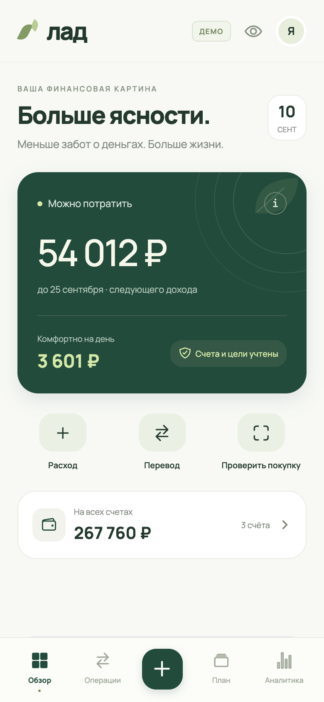

# Лад

Нативное приложение для личных финансов на **React Native / Expo** для **iOS и Android**. Русский интерфейс, расчёты в рублях, спокойный дизайн с оливковыми и лавандовыми акцентами. В комплекте — веб-предпросмотр того же React Native интерфейса.



## Запуск

Требуется Node.js 22.13 или новее. Проект использует Expo SDK 57, React Native 0.86 и TypeScript. Зависимости зафиксированы в `package-lock.json`.

В CI используется Node.js из `.nvmrc` (22.21.1). При установленном nvm ту же версию можно выбрать командой `nvm install && nvm use`.

```sh
npm ci
npm start
```

Откройте QR-код в совместимой с SDK 57 версии Expo Go на iOS или Android. Компьютер и телефон должны находиться в одной сети. Если ваша версия Expo Go не поддерживает SDK проекта, используйте сборку приложения.

Для проверки Face ID нужна собственная development/preview-сборка: Face ID недоступен в Expo Go. Локальные напоминания не требуют сервера push-уведомлений. После добавления нативных модулей пересоберите установленное приложение. [Ограничение Expo Go](https://docs.expo.dev/versions/v57.0.0/sdk/local-authentication/) и [локальные уведомления](https://docs.expo.dev/versions/v57.0.0/sdk/notifications/).

```sh
npm run ios       # установленный Xcode и iOS Simulator
npm run android   # настроенный Android SDK и эмулятор
npm run web       # предпросмотр в браузере
```

Для установки собственного APK или iOS-сборки подготовлены профили `eas.json`:

```sh
npx eas-cli build --platform android --profile preview
npx eas-cli build --platform ios --profile preview
```

EAS потребует ваш аккаунт Expo; для установки iOS-сборки на устройство нужны соответствующие Apple credentials и регистрация устройства. Идентификаторы `app.lad.finance` перед публикацией замените своими. Облачные сборки и публикация в магазины в рамках этой работы не выполнялись. [Документация Expo по созданию проекта](https://docs.expo.dev/get-started/create-a-project/) и [совместимости SDK](https://docs.expo.dev/versions/latest/).

## Возможности

- **Обзор:** доступные деньги до следующего дохода, сумма на день, счета, расходы по категориям, цели, последние операции.
- **Операции:** добавление, редактирование и удаление расходов, доходов и переводов; поиск и фильтры по месяцу, типу, счёту и категории.
- **Быстрый ввод:** «кофе 320», «продукты 1 450,50», «зарплата 120000». Сумма и категория предлагаются локальными правилами; сохранение остаётся за пользователем.
- **Прогноз на 30/60/90 дней:** ожидаемые доходы, счета, взносы на цели и повседневные расходы; график остатков, даты нехватки и календарь с объяснением каждого дня.
- **Симулятор покупки:** выбор суммы и даты, сравнение двух прогнозов, доступный остаток и новая сумма на день для покупки сегодня. Реальные деньги и операции не меняются.
- **Бюджеты:** редактируемые месячные лимиты по восьми категориям и индикация превышений.
- **Цели:** создание, изменение, пополнение переводом на накопительный счёт и оценка количества месяцев при выбранном взносе.
- **Платежи:** календарь, просрочки в доступном остатке, дата начала учёта, пропуск месяца, история изменения суммы и дня, отметка оплаты или привязка уже записанного расхода.
- **Напоминания:** локальные уведомления на iOS и Android, выбор времени и срока — в день платежа, за день или за три дня; отмена после оплаты. Суммы и названия не показываются в уведомлении.
- **Аналитика:** доходы и расходы, интерактивные столбики по дням, структура расходов и остаток дохода.
- **Данные:** локальное хранение, экспорт JSON и импорт с валидацией и подтверждением замены.
- **Банковский CSV:** сопоставление колонок, UTF-8 и Windows-1251, предпросмотр, выбор строк, проверка повторов и подтверждение переводов. Импорт дополняет историю.
- **Защита:** автоматическое шифрование нативного хранилища AES-256-GCM, ключ в Keychain/Keystore, включаемая блокировка системной биометрией или кодом устройства, защита содержимого в списке недавних приложений.

Первый запуск показывает **демоданные**, помеченные в шапке. Для собственного учёта откройте профиль → **«Начать свой учёт с нуля»**, затем «Мои счета», задайте текущие остатки и настройте дату дохода. День дохода не создаёт поступления автоматически.

## Анализ конкурентов

[Сравнение YNAB, Wallet, Дзен-мани и Copilot Money, источники и обоснование функций](docs/COMPETITORS.md).

Позиционирование: понятная сумма на день, объяснение каждого резерва и примерка покупки до расхода. Отдельные функции уже встречаются у конкурентов; преимущество их сочетания нужно проверять с пользователями.

## Как считаются деньги

Денежные значения хранятся в **целых копейках**. Календарные даты — локальные `YYYY-MM-DD`, разницы дней считаются без влияния переходов часовых поясов. Число 31 в коротком месяце переносится на последний день.

```text
Доступно = остатки повседневных счетов
         − неоплаченные платежи от сегодня до дня дохода (не включая его)
         − неотмеченные просроченные платежи
         − остаток взносов на цели в текущем календарном месяце
         − неприкосновенный остаток

На день = max(0, доступно) / количество дней до дохода
```

В день дохода горизонт переносится на следующий месяц. Поступление нужно записать отдельно. Доход в будущем не прибавляется заранее. Накопительные счета исключаются из доступной суммы. Категорийные бюджеты показываются отдельно и не вычитаются второй раз.

Пополнение цели — внутренний перевод, который не меняет сумму всех счетов и не попадает в расходы. Пока пополнение не превышает оставшийся месячный взнос, уменьшение свободного счёта компенсируется уменьшением резерва цели. Новая цель начинается с нулевых накоплений. Срок цели — ориентир по оставшейся сумме и регулярному взносу, без доходности и инфляции.

Отметка платежа создаёт расход с привязкой к месяцу обязательства. Можно связать существующий расход, например из выписки, без повторного списания. Один платёж нельзя отметить дважды в том же месяце, даже после изменения дня. Неоплаченные месяцы остаются в резерве до оплаты или пропуска. Изменение суммы и дня действует с текущего месяца, сохраняя условия прошлых месяцев. Выключение исключает обязательство из плана; повторное включение начинает учёт с сегодняшнего дня.

При обновлении старые записи без даты начала получают начало текущего месяца, и эта граница сохраняется. Более ранние долги автоматически не создаются. Для нового платежа можно явно указать дату начала.

Календарный прогноз находится в **План → Прогноз** и открывается с главной кнопкой **«Прогноз по дням»**. Добавьте планируемые доходы с суммами и датами, настройте повседневные расходы и день взносов на цели. Полученный доход можно записать либо связать с уже существующей операцией. [Правила прогноза и устройство общего слоя финансовых действий](docs/FORECAST.md).

## Импорт выписки и защита

Профиль → **«Импортировать банковский CSV»** → файл → кодировка и строка заголовков → сопоставление колонок → предпросмотр → подтверждение. Поддержаны разделители `;`, `,` и табуляция, сумма со знаком или отдельные приход/расход. [Описание формата и ограничений](docs/CSV_IMPORT.md), [пример выписки](docs/examples/statement.csv).

В профиле включаются напоминания и блокировка. На телефоне данные шифруются независимо от включения блокировки. Веб-предпросмотр использует незашифрованное локальное хранилище и явно сообщает об отсутствии нативной защиты.

[Устройство хранилища, перенос старых данных и ограничения защиты](docs/SECURITY.md).

## Ограничения

Это работающий MVP для ручного учёта и импорта выписок. Банковских подключений, реальных платежей, облачной синхронизации, семейных аккаунтов, мультивалютности, OCR и удалённых push-уведомлений нет. Все числа деморежима — примеры, включая цены подписок.

На iOS/Android AsyncStorage содержит шифротекст; ключ хранится отдельно в системном хранилище. Экспорт JSON не зашифрован. При удалении приложения или потере ключа нужна резервная копия. Восстановление JSON заменяет данные целиком после проверки и подтверждения; CSV только добавляет выбранные операции. Максимум — 5 МБ и 20 000 операций в резервной копии. При ошибке чтения существующее хранилище не перезаписывается; можно повторить загрузку или явно восстановить проверенную копию. Ошибка сохранения отображается с повторной попыткой.

Напоминания планируются на срок до 60 дней, максимум 60 одновременно, и обновляются при открытии приложения. Для просрочек планируется одно уведомление в день на ближайшую неделю. Если дата предварительного напоминания уже прошла, используется день платежа. Доставка зависит от разрешений, системного режима тишины и ограничений ОС; это не будильник с гарантированным временем. Долго не открывая приложение, вы не пополняете очередь напоминаний.

Нативный интерфейс использует Safe Area, системную клавиатуру, меню обмена файлами и тактильный отклик. Web используется для автоматизированной проверки общих пользовательских сценариев; это не заменяет проверку клавиатуры, файлового меню и поведения на настоящих телефонах.

## Проверки

[Результаты проверки: расчёты, импорт, хранилище, пользовательские сценарии и экспорт трёх платформ](docs/VERIFICATION.md).

```sh
npm run typecheck
npm test
npm run build              # экспорт JS и ресурсов для iOS, Android, Web
npx expo install --check
```

Тесты пользовательских сценариев используют Playwright:

```sh
npx playwright install chromium
npm run test:e2e
```

Если уже установлен Google Chrome: `PLAYWRIGHT_CHANNEL=chrome npm run test:e2e`. Playwright запускает локальный Expo на порту 8087. Снимки интерфейса: `PLAYWRIGHT_CHANNEL=chrome node scripts/capture.mjs` при запущенном сервере на этом порту.

## Автоматические проверки GitHub

[Workflow CI](https://github.com/Tiroras/lad-finance/actions/workflows/ci.yml) запускается при каждом push, при создании и обновлении pull request, а также вручную через **Actions → CI → Run workflow**.

1. **Types and unit tests** — TypeScript, модульные тесты и проверка зависимостей по локальной таблице Expo SDK.
2. **Export iOS, Android and Web** — экспорт JavaScript и ресурсов всех трёх платформ после успешного первого задания.
3. **Browser scenarios** — установка Chromium и запуск Playwright с собственным сервером Expo; выполняется параллельно с экспортом.

Задания используют Ubuntu 24.04, Node.js из `.nvmrc`, `npm ci` и кэш загрузок npm. Новый запуск отменяет предыдущий незавершённый запуск для той же ветки или PR. В CI запрещены случайно оставленные `test.only`.

В карточке запуска доступны артефакты на 7 дней: `expo-export-<commit>` с содержимым `dist/` и `playwright-report-<commit>` с HTML-отчётом, снимками и трассировками упавших тестов. Для просмотра скачанного отчёта: `npx playwright show-report <папка-отчёта>`.

Workflow экспортирует код и ресурсы; установочные APK/IPA и публикация требуют отдельной нативной сборки. Для этих проверок не нужны Expo-аккаунт, ключи подписи или секреты репозитория. Конфигурация: [`.github/workflows/ci.yml`](.github/workflows/ci.yml).

## Структура

```text
src/Application.tsx    загрузка шрифтов и сборка приложения
src/application/       провайдеры, оболочка, шапка, меню, окна и уведомления
src/navigation/        типы, вкладки и хук навигации; Android Back и переходы из напоминаний
src/screens/home/      обзор: доступная сумма, счета, расходы и ближайшие платежи
src/screens/transactions/ операции: фильтры, итоги и группы по датам
src/screens/plan/      бюджеты, цели, подписки и их карточки
src/screens/analytics/ аналитика: итоги месяца, графики и категории
src/screens/shared/   заголовки экранов, выбор месяца и строка операции
src/forms/             11 форм и 4 вспомогательных компонента
src/ui/                18 компонентов в отдельных файлах; тема и общие состояния
src/features/payments/ календарь и настройки напоминаний
src/features/import/   мастер CSV и проверка строк
src/features/forecast/ прогноз, календарь, планы доходов и примерка покупки
src/hooks/             финансовые действия для UI и обработка ошибок
src/security/          блокировка, восстановление и ядро шифрованного хранилища
src/services/          адаптеры iOS/Android и веб-предпросмотра
src/store.tsx           локальное сохранение и состояние
src/backup.ts           системный импорт и экспорт
src/domain/            финансовые расчёты, модели, валидация, примеры
src/domain/actions/    проверяемые изменения финансового состояния
tests/                 финансовые и пользовательские проверки
docs/COMPETITORS.md     исследование и продуктовые решения
docs/screenshots/      снимки работающего интерфейса
```
