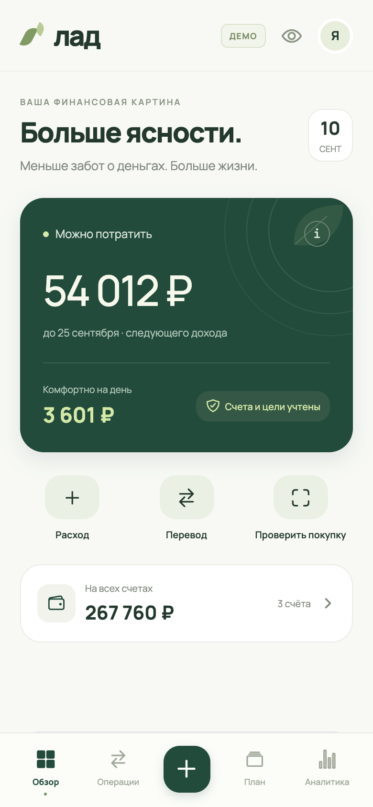
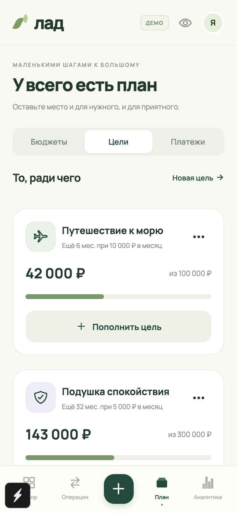
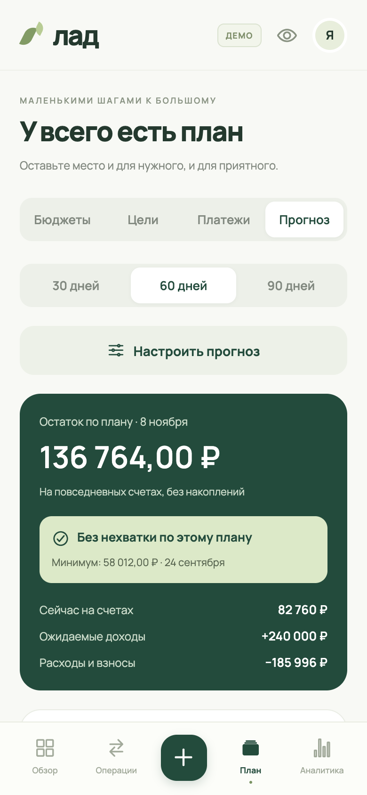
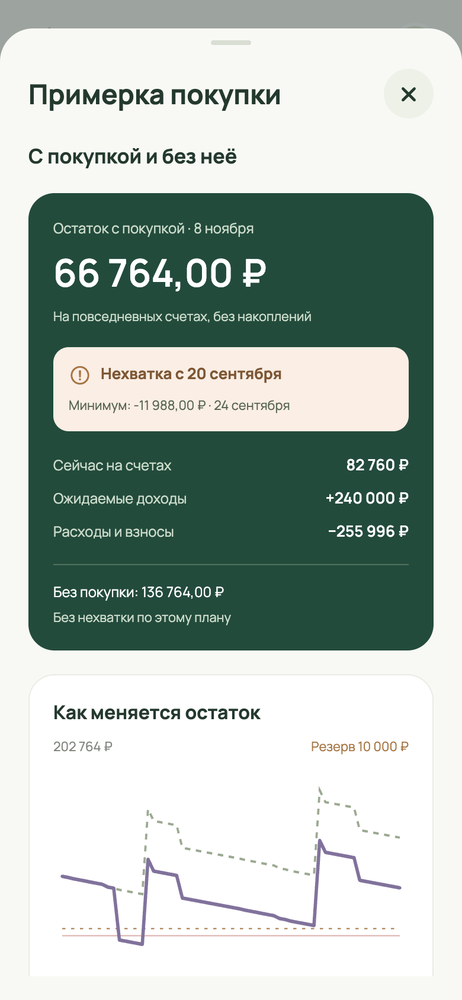
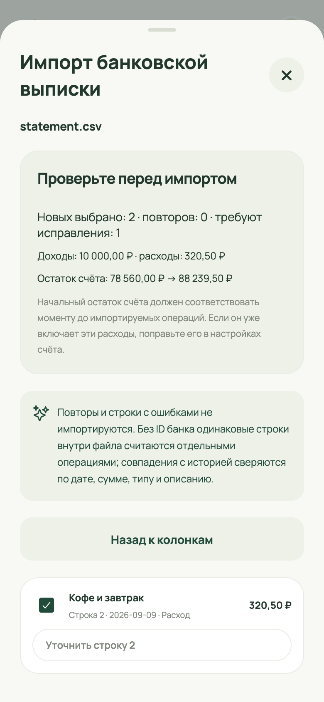
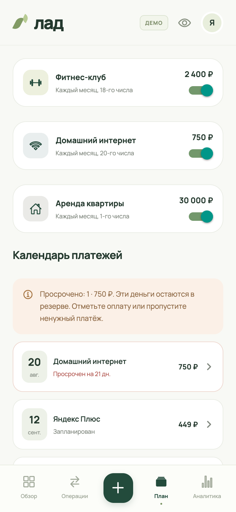

# 1 Требования к мобильному приложению для управления личными финансами «Лад»

## 1.1 Общее описание продукта

### 1.1.1 Назначение объекта автоматизации

Объектом автоматизации является процесс управления личными денежными средствами: регистрация доходов и расходов, контроль остатков, планирование обязательных платежей и накоплений, оценка последствий будущих покупок. Разрабатываемое мобильное приложение «Лад» предназначено для индивидуального использования на устройствах под управлением iOS и Android.

Потенциальный пользователь получает заработную плату или другие поступления, оплачивает повседневные покупки и регулярные обязательства, распределяет средства между текущими расходами и накоплениями. Деньги могут находиться на нескольких банковских счетах и в наличной форме. Для планирования недостаточно знать их общую сумму: часть остатка потребуется для аренды, подписок и других платежей, а часть предназначена для достижения финансовых целей.

В предметной области следует различать фактическую операцию и плановое событие. Операция подтверждает уже совершённое движение денег и изменяет учётный остаток. Плановое событие отражает намерение или ожидание и используется для расчёта будущего состояния. Перевод между собственными счетами меняет распределение средств, но не образует дохода или расхода пользователя. Взнос на накопительную цель уменьшает повседневную ликвидность, сохраняя общую сумму денег.

При разрозненном учёте пользователю необходимо вручную сопоставлять остатки, даты поступлений и обязательства. Возникают риски повторной регистрации одной операции, использования накоплений на повседневные покупки и завышения доступной суммы из-за неучтённых будущих платежей. Положительный остаток в конце месяца также не исключает нехватку денег до очередного поступления. Поэтому приложение должно показывать как текущую финансовую картину, так и изменение доступных средств по календарным датам.

Автоматизируемый процесс включает внесение исходных остатков, регистрацию или импорт операций, распределение расходов по категориям, настройку планов и анализ рассчитанных показателей. Пользователь остаётся источником подтверждения фактических событий. Приложение помогает вести учёт и сравнивать сценарии; оно не выполняет банковские переводы и не подтверждает наличие средств в банке.

Основная потребность целевой аудитории состоит в получении объяснимого ответа на три вопроса: сколько средств доступно для повседневных расходов, какие обязательства предстоят и как выбранная покупка повлияет на остаток до будущих поступлений. Результатом автоматизации должен стать единый локальный учёт с согласованными остатками, планами и аналитикой.

### 1.1.2 Аналитический обзор

Для анализа выбраны YNAB, Wallet by BudgetBakers, Дзен-мани и Copilot Money. Эти продукты решают задачи учёта и планирования личных финансов. Сравнение выполнено по официальным описаниям и справочным материалам, доступным на 21 сентября 2026 г. Рассматриваются способы ввода данных, планирование, ограничения платформ и условия использования. Оценки скорости, удобства и точности прогнозов по результатам собственного испытания аналогов не приводятся.

YNAB предлагает распределять имеющиеся деньги по назначениям, контролировать цели и учитывать операции. Сильная сторона решения — связь расходования средств с заранее выбранными приоритетами. Поддерживается совместное использование подписки. Ограничениями для рассматриваемой задачи являются платный доступ после пробного периода и региональная доступность прямого банковского импорта: в официальном описании перечислены отдельные банки США, Канады, Великобритании и Европейского союза. В одном финансовом плане используется одна валюта [1].

Wallet by BudgetBakers объединяет банковскую синхронизацию, ручной учёт, бюджеты, регулярные платежи и анализ денежных потоков [2]. Документация раскрывает способ оценки расходов бюджета: уже совершённые расходы дополняются плановыми платежами и оценкой прочих расходов на основе прошлых периодов. Это позволяет сопоставлять лимит с ожидаемым результатом. Ограничения связаны с различиями между платформами: бюджеты отсутствуют в веб-версии, а изменение начала бюджетного месяца недоступно в iOS. Разработчик также рекомендует исключать пересечение бюджетов, чтобы избежать неоднозначного представления статистики [3].

Дзен-мани ориентирован на сбор финансовых данных и анализ расходов. К сильным сторонам относятся русскоязычный интерфейс, банковские подключения, учёт регулярных платежей и прогноз расходов по категориям. На сайте заявлены расчёт свободных денег на месяц и прогнозирование на основе истории. Бесплатный тариф предусматривает ручное ведение бюджета; отчёты, расширенное планирование, банковские подключения и сканирование чеков относятся к платному тарифу. Следовательно, доступ к нужному набору возможностей зависит от выбранного тарифа [4].

Copilot Money предоставляет автоматическую категоризацию, бюджеты, контроль подписок, накопительные цели и визуализацию денежных потоков. Сильная сторона решения — объединение связанных финансовых показателей в одном интерфейсе. Для целевой аудитории «Лада» существенны ограничения: поддерживаются финансовые учреждения США, а среди платформ указаны iPhone, iPad, Mac и Web; Android в перечень не входит. Продукт распространяется по подписке [5]. Справка также указывает поддержку только доллара США, что ограничивает использование для рублёвого учёта [6].

В таблице 1.1 сопоставлены отдельные проверяемые характеристики аналогов и требования к разрабатываемому продукту. Наличие функции не означает одинаковый способ её реализации или доступность во всех тарифах.

Таблица 1.1 – Сопоставление возможностей приложений

| Характеристика         | YNAB | Wallet    | Дзен-мани | Copilot | Лад |
| ---------------------- | ---- | --------- | --------- | ------- | --- |
| Учёт операций          | Да   | Да        | Да        | Да      | Да  |
| Планирование бюджета   | Да   | Да        | Да        | Да      | Да  |
| Банковское подключение | Да   | Да        | Да        | Да      | Нет |
| Валютный режим         | Одна | Несколько | Не оценён | USD     | RUB |

Для YNAB указано ограничение одной валютой в пределах плана [1], для Wallet — заявленная мультивалютность [2]. Валютный режим Дзен-мани отдельно не оценивался. Для «Лада» отражены границы разрабатываемой версии. Банковские подключения конкурентов не означают поддержку любого банка или любой страны.

Косвенными альтернативами являются бумажный журнал, электронная таблица и история операций банковского приложения. Журнал не требует настройки программного обеспечения, но итоговые суммы и планы приходится рассчитывать вручную. Электронная таблица позволяет задавать произвольные формулы и структуру учёта, однако пользователь самостоятельно обеспечивает проверку данных, согласованность переводов и календарных событий. История одного банка удобна для проверки проведённых операций этого банка; при наличии наличных денег и других счетов необходим дополнительный способ объединения информации.

Из рассмотренных подходов для разработки применимы категоризация операций, распределение денег по назначениям и календарная модель денежных потоков. Категоризация позволяет агрегировать фактические расходы. Бюджет категории задаёт ограничение расходов за период. Календарная модель определяет будущий остаток с учётом дат ожидаемых поступлений и оттоков. В общем виде такая модель представляется формулой (1.1).

$$ B(d) = B(d−1) + I(d) − O(d) || (1.1) $$

где B(d) — остаток повседневных средств на конец дня d; B(d−1) — остаток перед событиями этого дня; I(d) — сумма ожидаемых поступлений; O(d) — сумма плановых оттоков, включая обязательные платежи, повседневные траты и переводимые в накопления средства. Для первого дня исходным значением служит текущий фактический остаток. Формула задаёт используемую в проекте модель; она не описывает внутреннее устройство всех рассмотренных аналогов.

Прогноз на основе усреднённых прошлых расходов уменьшает объём ручной настройки, но зависит от полноты истории. В «Ладе» предполагается использовать явно заданные доходы, обязательства и дневную сумму повседневных расходов. Такой подход позволяет воспроизвести расчёт по исходным данным. При изменении будущих обстоятельств пользователь должен скорректировать план; вероятностная оценка наступления событий не предусмотрена.

Для мобильной реализации возможны отдельные приложения под каждую операционную систему либо общая кодовая база. React Native позволяет создавать интерфейс iOS и Android с использованием компонентов React и нативных возможностей платформ [7]. Expo предоставляет средства доступа к системным функциям, включая работу с файлами, уведомлениями и защищённым хранилищем [8]. Для данного проекта общая кодовая база обоснована необходимостью одинаковых финансовых правил и согласованного интерфейса на двух платформах.

Анализ показывает, что готовые продукты покрывают базовый учёт и значительную часть планирования; отдельные функции прогноза и свободного остатка уже представлены на рынке. Основанием для собственной разработки является выбранное сочетание требований: локальная работа без регистрации, рублёвый учёт, явное разделение факта и плана, объяснение доступной суммы и сравнение покупки с исходным календарным прогнозом. Это сочетание определяет проектную специализацию «Лада», но не доказывает отсутствие подобных возможностей у всех конкурентов. Ограничениями разрабатываемой версии остаются ручное обновление данных, отсутствие банковских подключений, облачной синхронизации и совместного доступа.

### 1.1.3 Классы и характеристики пользователей

В системе предусматривается одна роль — владелец личного финансового учёта. Он имеет доступ ко всем собственным записям и настройкам. Серверный администратор, бухгалтер и участник семейной группы в состав ролей не включаются, поскольку многопользовательская работа не предусмотрена.

Внутри этой роли выделяются три группы потребностей. Начинающему пользователю необходимы быстрый ввод, понятные категории и объяснение итоговых сумм. Пользователю с регулярным доходом важны контроль обязательств до следующего поступления и накопительные цели. Пользователю с нерегулярными поступлениями нужен календарный план доходов и возможность проверить покупку на нескольких горизонтах. Такое разделение описывает предполагаемые сценарии использования, а не результаты проведённого опроса.

От пользователя требуется владение базовыми действиями на смартфоне, понимание собственных доходов и обязательств, а также готовность подтверждать операции. Специальные знания бухгалтерского учёта не требуются. Для корректного импорта выписки пользователь должен определить назначение её столбцов и проверить распознанные строки.

### 1.1.4 Ограничения дизайна и реализации

Разработка выполняется на React Native с Expo SDK 57 и TypeScript. Целевыми платформами являются iOS и Android. Минимальные версии, заявленные для выбранного SDK, — iOS 16.4 и Android 7; фактическая совместимость должна подтверждаться для выпускаемой сборки [8]. Веб-версия используется для предпросмотра интерфейса и браузерных проверок.

Данные размещаются локально на устройстве. Это обеспечивает работу основного учёта без сети и ограничивает зависимость от внешних сервисов. Одновременно пользователь самостоятельно отвечает за создание переносимой резервной копии. Регистрация, серверная база данных, синхронизация между устройствами и интеграция с банковскими программными интерфейсами в объём данной версии не входят.

Расчёты выполняются в российских рублях с точностью до копейки. Для исключения накопления ошибок округления денежные величины должны представляться целым числом копеек. Используются локальные календарные даты. Операция перевода отражает движение средств между учётными счетами и не инициирует реальное банковское действие. Мультивалютность, инвестиционный учёт и автоматическое распознавание чеков не предусматриваются.

## 1.2 Функциональные требования

Действующим лицом всех описанных прецедентов является владелец учёта. Высокий приоритет назначается функциям, необходимым для корректного учёта, сохранности данных и основных плановых расчётов. Средний приоритет назначается средствам ускорения ввода и дополнительного информирования. Приоритет отражает значимость требования, а не статус реализации. При отклонении некорректного действия сохранённые данные должны оставаться неизменными.

### 1.2.1 Настройка личного учёта

Система должна предоставлять возможность задать имя пользователя, день ожидаемого регулярного дохода и неприкосновенный остаток. Приоритет — высокий. Имя необязательно и содержит не более 40 символов; день задаётся целым числом от 1 до 31; резерв не может быть отрицательным. В коротком месяце выбранное число ограничивается последним днём месяца.

При первом запуске допускается демонстрационный набор данных с явной отметкой режима. Переход к личному учёту и повторное включение демонстрации должны требовать подтверждения замены текущих данных. Изменение дня дохода должно менять горизонт показателя «Можно потратить», но не создавать фактическое поступление. Для календарного прогноза доход задаётся отдельным планом с суммой и датой.

### 1.2.2 Ведение счетов

Система должна позволять создавать и редактировать повседневные и накопительные счета. Приоритет — высокий. Пользователь задаёт название, тип и текущий остаток; при создании остаток становится исходной величиной учёта. Для существующего счёта корректировка должна изменять исходную величину с учётом уже записанных операций, сохраняя историю. Тип существующего счёта не изменяется.

Название обязательно, его длина не превышает 120 символов. Вводимый текущий остаток неотрицателен. Допускается не более 30 счетов. Уменьшение накоплений ниже суммы, закреплённой за целями, должно отклоняться с объяснением причины. Итоговый остаток счёта рассчитывается по исходной величине и фактическим операциям.

### 1.2.3 Регистрация и исправление операций

Система должна обеспечивать добавление, редактирование и удаление доходов, расходов и переводов. Приоритет — высокий. Операция содержит вид, название, положительную сумму, фактическую дату и счёт. Для расхода выбирается категория, для перевода — другой собственный счёт. Примечание необязательно и ограничено 500 символами.

Дата не должна находиться в будущем. При недостатке доступных средств перевод отклоняется. Средства, зарезервированные на цели, нельзя расходовать через произвольный перевод; для расходования свободных накоплений сначала выполняется перевод на повседневный счёт. Перевод между одинаковыми счетами запрещён. Исправление или удаление связанной операции не должно нарушать обеспеченность целей и правила однократного учёта платежей и доходов.

После успешного действия система должна пересчитать остатки, доступную сумму и аналитику. Переводы исключаются из итогов доходов и расходов. Удаление операции выполняется с предусмотренным в интерфейсе подтверждением.

### 1.2.4 Быстрый ввод и поиск операций

Система должна предлагать заполнение полей операции по короткой текстовой записи, например «кофе 320». Приоритет — средний. Сумма и предполагаемая категория определяются локальными правилами. Пользователь проверяет результат и подтверждает сохранение; неоднозначный ввод не должен создавать операцию автоматически.

В журнале должны быть доступны поиск по тексту и фильтры по месяцу, счёту, категории и виду операции. Для каждого результата показываются дата, название, сумма и принадлежность к счёту. При отсутствии совпадений отображается пустое состояние. Поиск и изменение фильтров не должны менять финансовые данные.

### 1.2.5 Расчёт суммы, доступной для расходов

Система должна показывать сумму «Можно потратить», период расчёта и ориентир расходов на день. Приоритет — высокий. В расчёт включаются остатки повседневных счетов; накопительные счета исключаются. Доступная сумма определяется по формуле (1.2).

$$ A = max(0, L − P − G − R) || (1.2) $$

где A — доступная сумма; L — текущий остаток повседневных средств; P — неоплаченные обязательства до следующего настроенного дня дохода, не включая этот день, и непропущенные просрочки; G — оставшаяся часть запланированных взносов на цели за текущий месяц; R — неприкосновенный остаток. Будущий доход сам по себе к L не прибавляется. Лимиты категорий повторно не вычитаются.

Система должна раскрывать составляющие результата. Если выражение до ограничения нулём отрицательно, показывается нехватка средств. Дневной ориентир равен доступной сумме, разделённой на количество дней до выбранной даты, с округлением вниз до копейки. В день ожидаемого дохода следующий такой день определяется уже в следующем месяце, поэтому деление на ноль исключается.

### 1.2.6 Контроль бюджетов и аналитики

Система должна позволять задавать месячный лимит каждой категории расходов и показывать его использование. Приоритет — высокий. Лимит неотрицателен; нулевое значение означает отсутствие выделенной суммы по категории. Расходы агрегируются по фактическим датам операций выбранного месяца.

Аналитика должна содержать доходы, расходы, их разницу, распределение расходов по категориям и дневную динамику. Изменение месяца обновляет показатели по одному и тому же набору исходных правил. Превышение бюджета сопровождается числовым и текстовым обозначением. При отсутствии операций выводятся нулевые значения и пояснение, а процентные показатели не должны приводить к делению на ноль.

### 1.2.7 Управление накопительными целями

Система должна предоставлять создание, изменение, пополнение и удаление целей. Приоритет — высокий. Пользователь задаёт название, положительную целевую сумму и необязательный ежемесячный взнос. Допускается не более 100 целей. Уже накопленная сумма не должна превышать целевую.

Пополнение оформляется переводом с повседневного счёта на накопительный с привязкой к цели. Взнос ограничивается доступными средствами и оставшейся суммой цели. Общий объём денег при этом сохраняется. Выполненный взнос текущего месяца уменьшает оставшийся месячный план. Удаление цели освобождает привязанные средства и удаляет связь с целью, сохраняя счета и фактические переводы.

### 1.2.8 Учёт регулярных платежей

Система должна позволять вести обязательные платежи и подписки, задавая название, сумму, день месяца, дату начала, категорию и повседневный счёт. Приоритет — высокий. Допускается не более 200 планов платежей. Для каждого месяца формируется отдельное обязательство с учётом длины месяца.

Пользователь может отметить оплату, связать подходящий уже зарегистрированный расход, пропустить обязательство за конкретный месяц или выключить план. Отметка оплаты создаёт расход сегодняшней датой; привязка существующего расхода не изменяет баланс повторно. Повторная оплата одного обязательства через этот сценарий не допускается. Просроченное обязательство остаётся в расчёте до оплаты либо явного пропуска.

Изменение условий должно сохранять суммы и даты обязательств прошедших месяцев. Выключение подписки прекращает её планирование в приложении и должно сопровождаться пояснением, что реальная подписка у поставщика услуги не отменяется.

### 1.2.9 Планирование и подтверждение доходов

Система должна поддерживать разовые и ежемесячные планы доходов. Приоритет — высокий. Обязательны название, положительная сумма, дата и повседневный счёт поступления. Допускается не более 200 планов. Создание плана не должно менять фактический остаток.

При подтверждении поступления создаётся доход текущей датой либо выбирается существующая операция с совпадающими суммой и счётом. Повторное подтверждение одного разового события или одного месяца ежемесячного плана не должно повторно увеличивать баланс. Допускается связь с фактическим доходом, полученным раньше или позже плановой даты. Удаление плана сохраняет историю поступлений. Если ожидаемая дата прошла, неподтверждённый доход не переносится на сегодня автоматически.

### 1.2.10 Построение календарного прогноза

Система должна рассчитывать остатки повседневных средств на конец каждого дня горизонта 30, 60 или 90 дней, включая текущую дату. Приоритет — высокий. В расчёт включаются ожидаемые доходы, неоплаченные обязательства, плановые взносы на цели и заданные пользователем повседневные расходы.

Повседневные расходы начисляются начиная с завтрашнего дня; их значение по умолчанию равно нулю. Просроченные неоплаченные обязательства включаются один раз в текущий день с условиями соответствующего месяца. Фактические операции, уже вошедшие в начальный остаток, повторно не учитываются. Плановые взносы ограничиваются остатком до достижения цели; невнесённые суммы за месяцы до текущего автоматически не накапливаются.

Результат должен включать график, календарь событий, конечный и минимальный остатки, первую дату отрицательного остатка и первое снижение ниже резерва. Резерв служит порогом сравнения и повторно не списывается. Для выбранного дня показываются составляющие изменения. Расчёт не моделирует порядок событий внутри дня и доступность средств на каждом отдельном счёте; эти ограничения должны быть доступны пользователю.

### 1.2.11 Проверка сценария покупки

Система должна позволять задать положительную стоимость покупки, её дату и горизонт прогноза. Приоритет — высокий. Дата должна находиться в пределах выбранного горизонта. Пользователь получает исходный прогноз и вариант с дополнительным оттоком средств в день покупки, а также сравнение конечных остатков и дат нехватки.

До даты покупки оба варианта должны совпадать. Смена параметров и закрытие окна не должны создавать операции, менять счета, цели или планы. Для покупки сегодня дополнительно допускается оценка изменения дневного ориентира до настроенного дня дохода. Результат сценария должен обозначаться как расчёт по введённому плану, а не как подтверждение возможности оплаты банком.

### 1.2.12 Импорт банковской выписки

Система должна импортировать выбранные пользователем операции из CSV или TSV через предварительное сопоставление столбцов. Приоритет — средний. Поддерживаются UTF-8 и Windows-1251, разделители «;», «,» и табуляция, единая знаковая сумма либо отдельные столбцы поступления и списания. Даты должны быть распознаваемыми, не ранее 2000 г. и не позднее текущего дня; валюта — российский рубль.

Перед подтверждением пользователь выбирает счёт, проверяет изменение остатка, исключает строки и уточняет категории. Возможный перевод требует явного определения его назначения. Ошибочные и повторные строки не должны добавляться. Повторы сопоставляются по банковскому идентификатору, а при его отсутствии — по реквизитам операции; неоднозначность такого сравнения должна быть обозначена. Все выбранные строки сохраняются одним изменением после проверки всего пакета. Ошибка пакета не должна оставлять частичный импорт.

### 1.2.13 Резервное копирование и восстановление

Система должна экспортировать финансовые данные в файл JSON и восстанавливать их из совместимой копии. Приоритет — высокий. Восстановление включает проверку формата, версии, допустимых значений, уникальности записей и связей между ними. Замена текущего учёта выполняется после отдельного подтверждения пользователя.

Некорректная копия должна отклоняться без изменения данных. Ошибка чтения локального хранилища не должна автоматически создавать пустой учёт или демонстрационные записи. Пользователь должен получить возможность выбрать проверенную резервную копию для восстановления. Экспортируемый файл не зашифрован; это свойство сообщается перед передачей файла. Настройки системной блокировки и ключ шифрования в финансовую копию не включаются.

### 1.2.14 Настройка защиты доступа

Система должна позволять включить блокировку доступа средствами операционной системы. Приоритет — высокий. Для блокировки используется доступная системная биометрическая проверка с допустимым системным кодом устройства. При отмене проверки финансовый интерфейс остаётся закрытым. После ухода приложения в фон содержимое должно скрываться, а незавершённая форма — сохраняться до возвращения пользователя.

### 1.2.15 Настройка напоминаний о платежах

Система должна предоставлять локальные напоминания о платежах после получения системного разрешения. Приоритет — средний. Пользователь выбирает уведомление в день платежа, за один или за три дня и час от 0 до 23. Оплаченные, пропущенные и выключенные обязательства исключаются из расписания. Отказ в разрешении не должен препятствовать ведению учёта. Текст системного уведомления не должен раскрывать сумму и название личного обязательства.

## 1.3 Требования к данным

### 1.3.1 Словарь данных

Словарь определяет смысл и допустимые значения элементов предметной области. Наименования используются независимо от программных идентификаторов. Денежные значения вводятся и отображаются в рублях, а расчёты и обмен выполняются в целых копейках. Если для элемента явно не указана необязательность, он должен присутствовать в соответствующей записи.

Идентификатор записи — уникальная в пределах вида сущности непустая строка длиной до 100 символов. Предназначен для устойчивой ссылки на счёт, операцию, цель или план; пользователю не требуется вводить его вручную.

Наименование — текст от 1 до 120 символов после удаления пробелов по краям. Используется для названия счёта, операции, цели, платежа и планируемого дохода. Имя владельца — отдельный необязательный текст длиной до 40 символов для персонализации интерфейса.

Денежная сумма — целое число копеек от 1 до 100 000 000 000 включительно для операции, целевой суммы, платежа или ожидаемого дохода. Денежный лимит — целое число от 0 до того же предела для бюджета категории, резерва, месячного взноса и дневных расходов. Начальный остаток — знаковое целое число в пределах ±100 000 000 000 копеек; отрицательное значение допустимо как результат корректировки исходной величины при наличии истории.

Календарная дата — существующая локальная дата формата ГГГГ-ММ-ДД, 10 символов. Для фактической операции она не позднее текущего дня; для планов доходов и начала платежей используется диапазон 2000–2100 гг. Месяц обязательства — строка ГГГГ-ММ, 7 символов, которая идентифицирует период оплаты или пропуска. День месяца — целое число от 1 до 31; отсутствующее в месяце число заменяется последним днём этого месяца.

Тип счёта — одно из значений «повседневный» или «накопительный». Вид операции — «доход», «расход» или «перевод». Категория расхода — один из восьми элементов справочника: «Продукты», «Кафе и рестораны», «Транспорт», «Покупки», «Впечатления», «Здоровье», «Дом», «Другое». Для операций, не относящихся к расходам, категория не используется при расчёте расходной аналитики.

Примечание — необязательный текст до 500 символов. Ключ импорта — необязательная строка до 500 символов для выявления ранее импортированной операции; банковский идентификатор в исходной выписке ограничивается 120 символами. Эти значения не подтверждают факт выполнения операции банком.

Вид обязательства — «обязательный платёж» или «подписка». Признак активности — логическое значение, определяющее участие плана в будущих расчётах. Повторяемость дохода — «однократно» или «ежемесячно». Признак демонстрации — логическое значение, отделяющее пример учёта от личных данных.

Значок — элемент предопределённого набора пиктограмм категорий и финансовых объектов. Цвет — строка из символа «#» и шести шестнадцатеричных цифр. Это характеристики отображения; они не влияют на денежные расчёты.

Признак напоминаний — логическое значение включения уведомлений. Опережение напоминания — целое число из набора 0, 1, 3 суток. Час напоминания — целое число от 0 до 23 по местному времени. Горизонт прогноза — 30, 60 или 90 дней. Версия формата — целое число, определяющее правила чтения копии; для текущего формата используется значение 1.

Простые элементы объединяются в следующие составные объекты.

Счёт объединяет идентификатор, наименование, тип, начальный остаток, значок и цвет. Текущий остаток является вычисляемой величиной. В учёте должен сохраняться хотя бы один счёт.

Операция объединяет идентификатор, вид, наименование, сумму, дату, категорию и ссылку на счёт. Для перевода обязательна ссылка на отличный от исходного счёт назначения. Дополнительно могут присутствовать примечание, ключ импорта, ссылка на цель либо ссылка на план платежа или дохода с датой соответствующего события. Ссылки должны указывать на существующие объекты и соответствовать виду операции.

Бюджет категории объединяет категорию и денежный лимит. Расход за выбранный месяц и остаток лимита вычисляются по операциям. Цель объединяет идентификатор, название, целевую сумму, начальные накопления, месячный взнос, значок и цвет. Её накопленная сумма равна начальным накоплениям и связанным фактическим пополнениям; она должна быть обеспечена средствами накопительных счетов.

Регулярный платёж объединяет идентификатор, название, сумму, день месяца, вид обязательства, активность, категорию, счёт, значок и цвет. Необязательные составные элементы — дата начала, набор пропущенных месяцев и история условий. Историческое условие содержит месяц окончания действия, сумму и день платежа. Эти сведения позволяют сохранить смысл прошлых обязательств при редактировании плана.

План дохода объединяет идентификатор, название, сумму, дату, повторяемость и ссылку на повседневный счёт. Подтверждение получения задаётся связью фактической операции с плановым событием. Для разового плана такая связь уникальна, для ежемесячного — уникальна в пределах месяца события.

Настройки учёта включают имя владельца, день ожидаемого дохода, резерв, параметры напоминаний и прогноза. Параметры прогноза состоят из дневной суммы повседневных расходов и дня взноса на цели. Резервная копия объединяет версию, признак демонстрации, счета, операции, категории, цели, платежи, планы доходов и настройки. Отсутствующие в прежних совместимых копиях планы доходов трактуются как пустой набор, дневные расходы — как ноль.

Объём учёта ограничивается 30 счетами, 20 000 операциями, 100 целями, 200 регулярными платежами и 200 планами доходов. Идентификаторы не должны повторяться внутри одного вида объектов. Один расход нельзя использовать для повторного подтверждения одного и того же обязательства. Удаление плана или цели сохраняет фактические операции с корректным снятием соответствующей связи.

### 1.3.2 Отчётные представления

В составе продукта предусматриваются экранные отчётные представления. Отдельное формирование печатного отчёта или его экспорт в PDF не входит в требования. JSON-копия служит для переноса данных и не заменяет пользовательский аналитический отчёт.

Месячная сводка содержит выбранный период, итог доходов, итог расходов, их разницу, дневную динамику и распределение расходов по категориям. Источник — фактические операции. Дневные показатели располагаются по возрастанию даты; переводы между собственными счетами исключаются из доходов и расходов. Бюджетная сводка дополняет расходы категорий лимитами и остатками.

Календарный прогноз содержит период, начальную сумму, ожидаемые поступления и оттоки, остаток по каждому дню, минимум и даты пересечения порогов. Источники — фактические остатки, планы доходов, обязательства, цели и настройки. События группируются по календарной дате. Представление сценария покупки показывает эти показатели для исходного и изменённого вариантов при одинаковых остальных предпосылках.

## 1.4 Требования к внешним интерфейсам

### 1.4.1 Пользовательский интерфейс

Интерфейс должен быть русскоязычным, с едиными названиями действий и единым представлением рублей и дат. Основная навигация включает разделы «Обзор», «Операции», «План» и «Аналитика», а также доступное действие добавления операции. Внутри планирования выделяются бюджеты, цели, платежи и прогноз. Настройки учёта, защита и обмен файлами открываются из профиля.

Формы ввода должны содержать подписи полей, понятные ограничения и явную кнопку подтверждения. Неправильная сумма, отсутствующий счёт или некорректная дата сопровождаются объяснением способа исправления. Формы операций, счетов, целей и планов используют одинаковые элементы ввода и выбора. Клавиатура не должна перекрывать доступ к подтверждению и отмене.

Для приложения принимаются шрифт Manrope, светлый фон, тёмно-зелёные основные элементы и дополнительные цветовые акценты для планов и состояний. Активное состояние, предупреждения и ошибки должны сопровождаться текстом или значком. Макет должен сохранять доступ к действиям при ширине от 320 логических единиц, длинных названиях и вертикальной прокрутке. Кнопки и поля должны иметь подписи для системных средств доступности.

Для иллюстрации требований используются экранные формы прототипа с демонстрационными данными. Они показывают видимую часть прокручиваемого экрана. Главная форма выводит доступную сумму, дневной ориентир и быстрые действия; форма целей — прогресс накопления и переход к пополнению (рисунок 1.1).

Рисунок 1.1 – Экранные формы обзора и накопительных целей

Прогноз должен предоставлять выбор горизонта, итоговую оценку остатка и доступ к детализации по дням. В сценарии покупки исходный и изменённый результаты показываются совместно; нехватка обозначается текстом и датой, а не только цветом (рисунок 1.2).

Рисунок 1.2 – Прогноз и результат проверки покупки

Форма импорта должна последовательно вести пользователя от выбора файла к проверке строк. Форма платежей объединяет календарь и состояние обязательств. Пользователь должен различать предстоящий, оплаченный и просроченный платёж до выполнения действия (рисунок 1.3).

Рисунок 1.3 – Импорт выписки и календарь платежей

### 1.4.2 Интерфейсы программного обеспечения

Взаимодействие с файловой системой выполняется через системный выбор документа и меню передачи файла. На вход импорта поступает текст CSV или TSV; выполняются декодирование, выбор строки заголовков, сопоставление столбцов и перевод денежных значений в копейки. Ограничения загрузки — 2 МБ, 5000 строк данных и 50 столбцов. Сертифицированная поддержка форматов конкретных банков не заявляется.

Интерфейс резервного копирования принимает и выдаёт JSON с версией и финансовыми сущностями. Проверка входных данных предшествует замене состояния. Для текущего обработчика применяется ограничение длины текста 5 000 000 символов. Неизвестная версия и нарушенные связи должны приводить к отказу восстановления с понятным сообщением.

Локальные уведомления передаются службе операционной системы после выдачи разрешения; точный момент показа зависит от системных ограничений. Биометрическая проверка выполняется средствами платформы. Приложение получает результат проверки и не должно получать или хранить биометрические образцы. Ключ шифрования размещается отдельно от финансовых записей в защищённом хранилище платформы.

Самостоятельные интерфейсы с внешним оборудованием не требуются. Экран, сенсорный ввод и доступные средства аутентификации используются через операционную систему смартфона. В веб-предпросмотре нативная блокировка и напоминания недоступны, а браузерное хранилище не обладает свойствами зашифрованного хранилища мобильной версии.

## 1.5 Нефункциональные требования

### 1.5.1 Производительность

Для проверки принимается профиль устройства с не менее чем 4 ГБ оперативной памяти и поддерживаемой версией операционной системы. Контрольный набор включает 10 счетов, 5000 операций, 20 целей, 50 регулярных платежей и 20 планов доходов. Измерения должны выполняться в сборке без средств отладки после загрузки данных.

Целевое время построения 90-дневного прогноза и применения фильтра к журналу — не более 1 с, импорта 1000 проверенных строк — не более 5 с. Эти значения являются критериями приёмки, а не результатами выполненных измерений. Для каждого действия следует провести 20 повторений и проверить 95-й процентиль длительности, указав модель устройства и состав данных в протоколе. При длительной файловой операции интерфейс должен отображать состояние выполнения и предотвращать повторное подтверждение.

### 1.5.2 Надёжность и целостность данных

После перезапуска система должна восстанавливать сохранённый учёт. Ошибка действия не должна приводить к частичному изменению данных. При повреждении хранилища система должна сохранять исходные данные и предоставлять доступ к восстановлению.

При создании, изменении и удалении операций должны проверяться сохранение общей суммы переводов, однократный учёт событий и обеспеченность целей. Календарные проверки включают смену года, високосный февраль и планы на 29–31-е числа. Прежние совместимые копии должны читаться без добавления вымышленных доходов и обязательств.

### 1.5.3 Безопасность информации

На iOS и Android записи должны шифроваться алгоритмом AES-256-GCM с проверкой целостности и новым случайным вектором инициализации при каждом сохранении. Ключ размещается отдельно в системном защищённом хранилище. При миграции открытых данных исходная запись удаляется только после записи и проверки зашифрованной копии.

При включённой блокировке доступ к данным требует системного подтверждения. В фоне содержимое скрывается; отмена проверки не открывает приложение. Данные и ключи не должны попадать в журналы. Об открытом формате экспорта JSON пользователь уведомляется. Блокировка не защищает от компрометации операционной системы и доступа к памяти процесса.

### 1.5.4 Удобство использования

Повторяющиеся действия должны иметь одинаковые названия и расположение в сходных формах. Для ошибки обязательного поля должно быть указано, какое значение требуется исправить. Результат расчёта доступной суммы должен сопровождаться расшифровкой, а прогноз — обозначением горизонта и принятых предпосылок.

При контрольной ширине 320 и 390 логических единиц текст, поля и основные действия не должны обрезаться по горизонтали. Информация о превышении бюджета и нехватке средств должна оставаться понятной без различения цвета. Проверка предусматривает ручной просмотр форм, длинных названий, пустых состояний и поведения при открытой клавиатуре; соответствие не устанавливается только по наличию стилевых правил.

### 1.5.5 Автономность и совместимость

Ввод операций, расчёт остатков, бюджеты, цели и прогноз должны работать при отключённом сетевом соединении после установки приложения. Недоступность уведомлений или системной аутентификации должна приводить к объяснению ограничения соответствующей функции. Сохранение учёта не должно зависеть от ответа внешнего сервера.

Одинаковые исходные данные и дата должны давать одинаковые финансовые результаты на iOS и Android. Нативные файловые операции, защищённое хранилище, блокировка и уведомления должны проверяться на целевых устройствах. Браузерные проверки и экспорт программных ресурсов не заменяют такую проверку. Перенос данных на другое устройство выполняется через совместимую резервную копию.

### 1.5.6 Сопровождаемость и проверяемость

Финансовые правила должны быть отделены от экранов и платформенных средств хранения. Интерфейс разделяется на компоненты навигации, экранов, форм и общих элементов. Изменение представления не должно требовать дублирования расчёта в нескольких экранах.

Для денежных и календарных правил должны существовать воспроизводимые проверки с явно заданной датой. Изменение схемы данных должно сопровождаться правилами совместимого чтения или миграции. По каждому функциональному прецеденту должен быть определим наблюдаемый результат: созданная запись, изменённый расчёт, сохранённый файл либо отказ без изменения данных. Эти требования задают основу последующего проектирования и проверки мобильного приложения «Лад».

# Список использованных источников

1 YNAB. Pricing [Электронный ресурс]. — URL: https://www.ynab.com/pricing (дата обращения: 21.09.2026).

2 BudgetBakers. Personal Finance Management: Wallet [Электронный ресурс]. — URL: https://budgetbakers.com/en/solutions/personal/ (дата обращения: 21.09.2026).

3 BudgetBakers. Setup Budgets // Wallet Help Center [Электронный ресурс]. — URL: https://support.budgetbakers.com/hc/en-us/articles/7076953735314-Setup-Budgets (дата обращения: 21.09.2026).

4 Дзен-мани. Приложение для контроля расходов [Электронный ресурс]. — URL: https://zenmoney.ru/ (дата обращения: 21.09.2026).

5 Copilot Money. FAQs [Электронный ресурс]. — URL: https://www.copilot.money/faq (дата обращения: 21.09.2026).

6 Copilot Money. International Currency // Copilot Help Center [Электронный ресурс]. — URL: https://help.copilot.money/en/articles/10715424-international-currency (дата обращения: 21.09.2026).

7 React Native. Core Components and Native Components [Электронный ресурс]. — URL: https://reactnative.dev/docs/intro-react-native-components (дата обращения: 21.09.2026).

8 Expo. Expo SDK reference. SDK 57 [Электронный ресурс]. — URL: https://docs.expo.dev/versions/v57.0.0/ (дата обращения: 21.09.2026).
