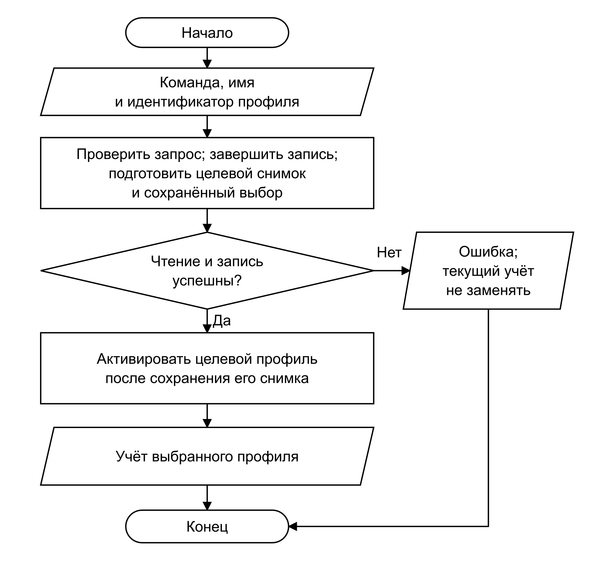
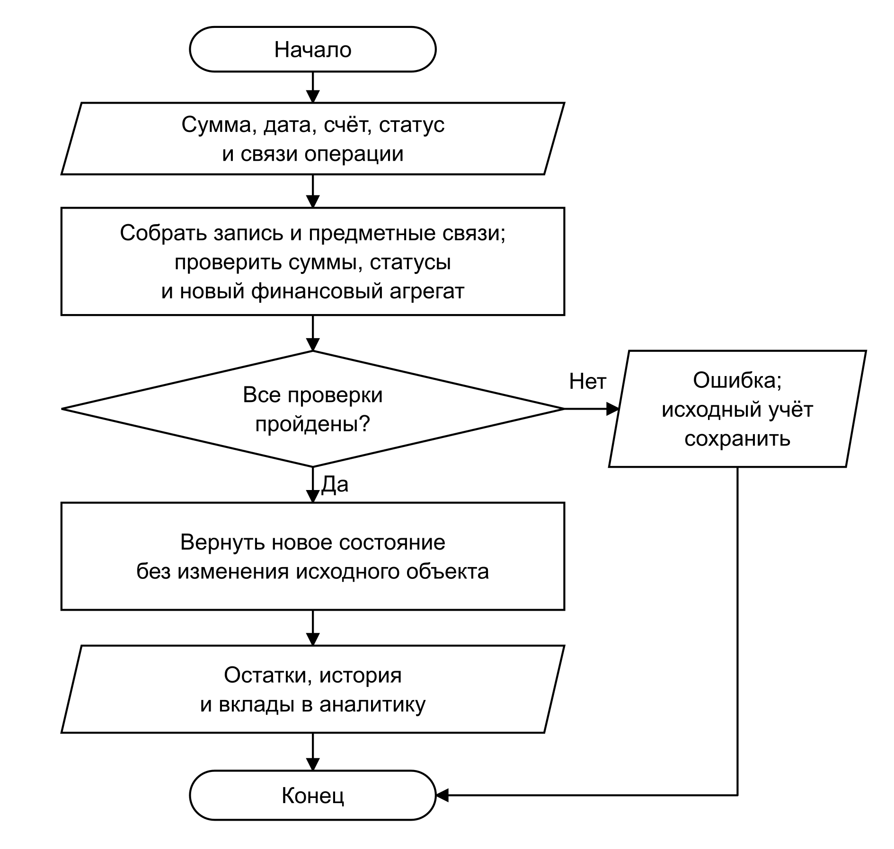
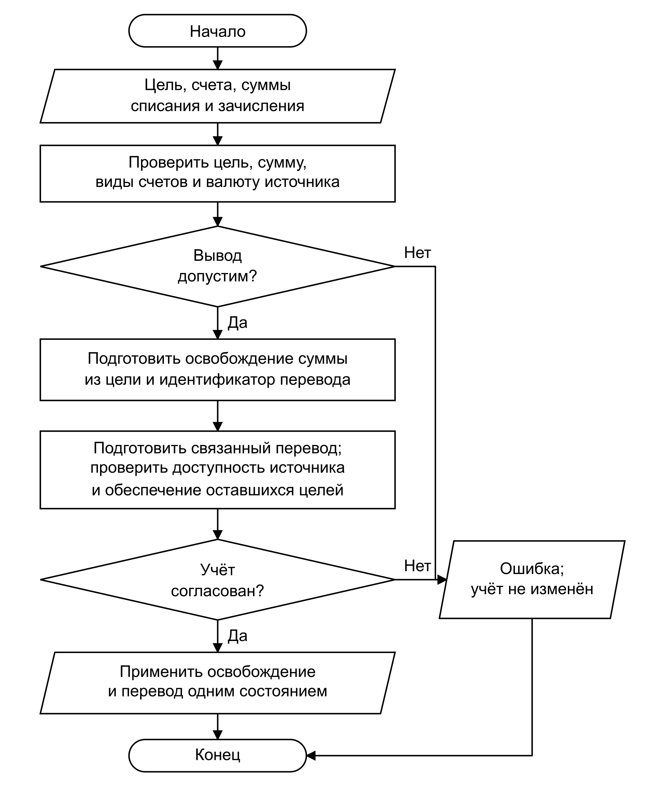
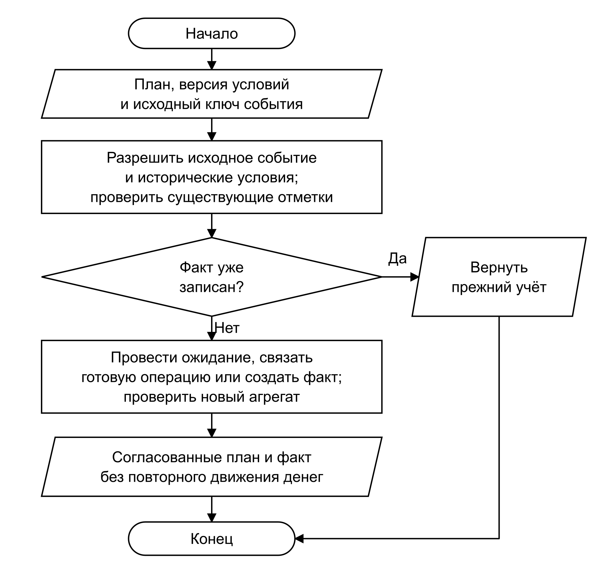
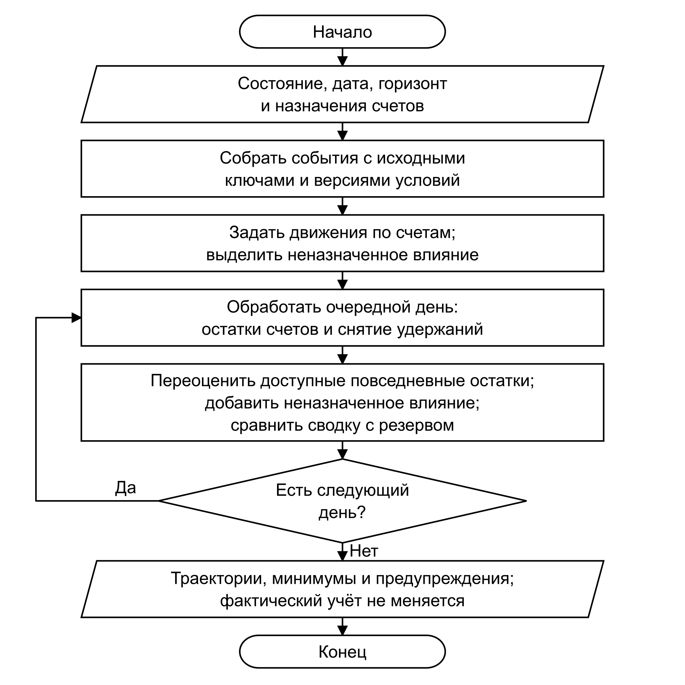
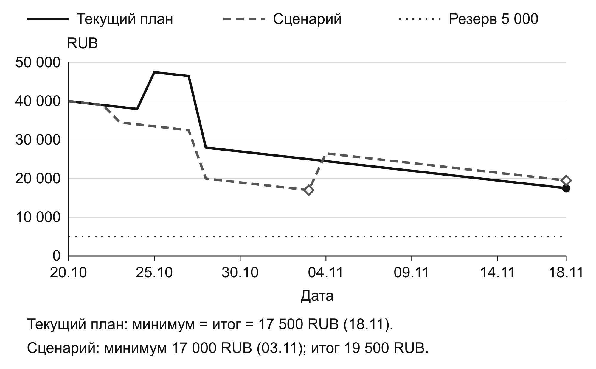
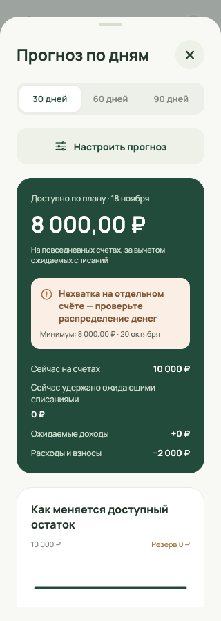
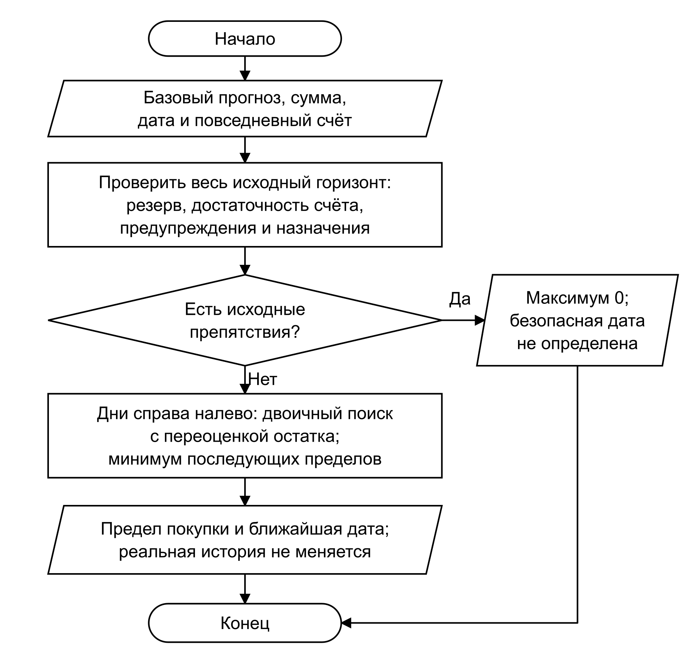
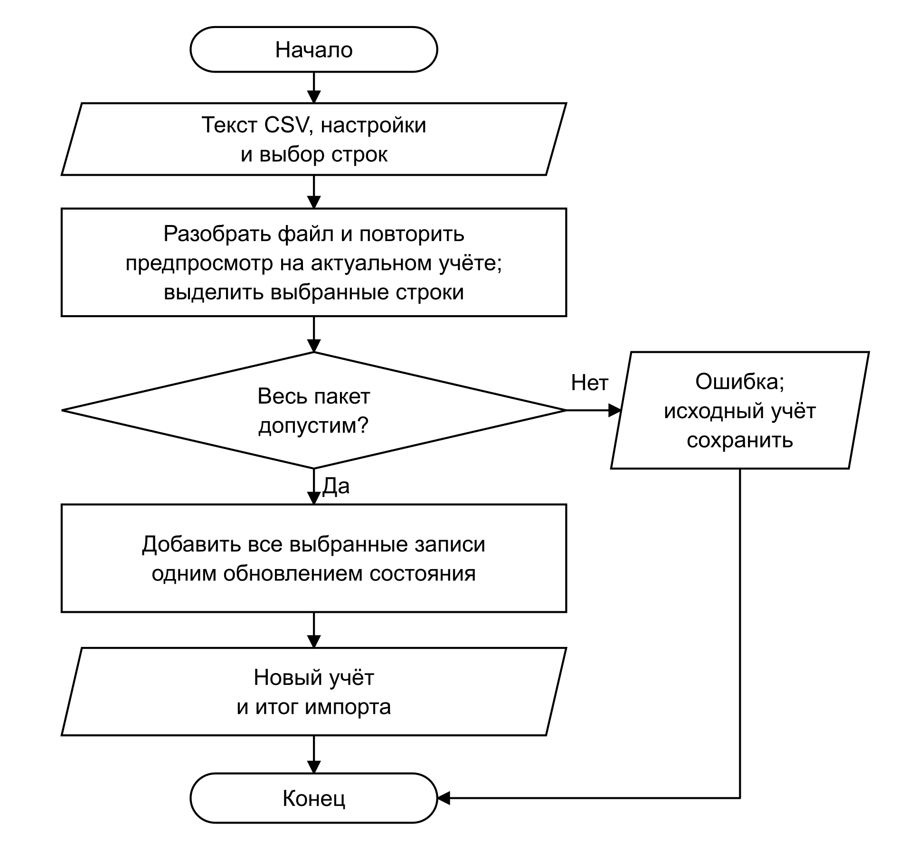
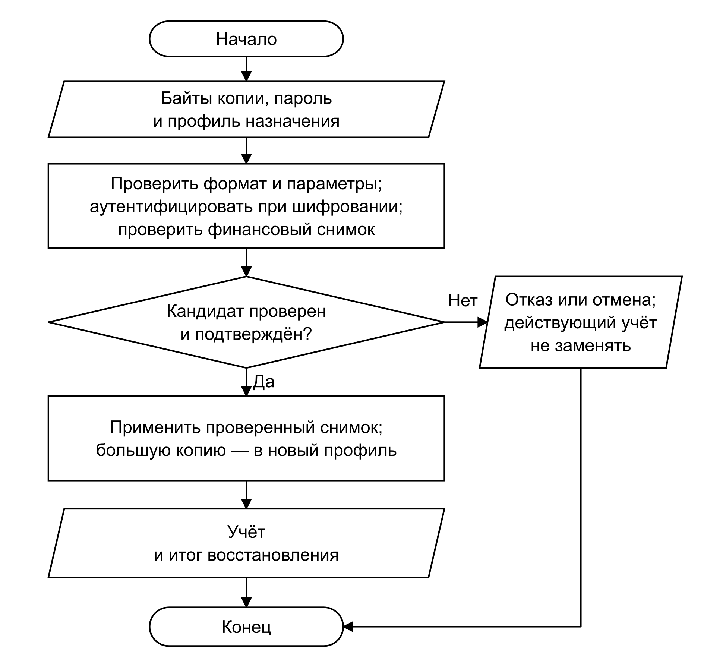

# 3 Реализация прецедентов приложения «Лад»

В третьей главе рассматривается реализация шестнадцати прецедентов, сформулированных в подразделе 1.2. Для каждого прецедента показаны преобразование входных данных, существенные проверки и используемые программные структуры. Числовые расчёты и примеры действий поясняют работу алгоритмов. Математическая постановка приводится там, где результат определяется финансовым расчётом. Для управления профилями и файлового обмена основное значение имеют последовательность действий и сохранение согласованного состояния.

Приложение реализовано функциональными компонентами React и модулями TypeScript. Поэтому описание реализации классов раскрывается через типы записей, их поля и функции, выполняющие соответствующие обязанности. Концептуальным сущностям главы 2 не приписываются отсутствующие конструкторы и методы экземпляров. Финансовый агрегат FinanceState передаётся в чистые функции предметной области, а интерфейс публикует результат через единое действие изменения состояния. Платформенные операции выполняются отдельными адаптерами.

Денежные значения хранятся в целых минимальных единицах валюты. В числовых иллюстрациях суммы приведены в рублях, если явно не указан иной код: 1 RUB соответствует 100 копейкам. Дата передаётся в расчёт явно; она обозначает местный календарный день. Для описания работы используются условные финансовые данные. Хранение, системная аутентификация и уведомления зависят от платформенных адаптеров и возможностей операционной системы.

## 3.1 Настроить локальный учёт и профили

### 3.1.1 Реализация алгоритма

Прецедент UC-01 создаёт отдельное пространство учёта и позволяет переключать его без смешивания финансовых записей. Имя профиля предназначено для отображения, а ключом хранения служит устойчивый идентификатор. Переименование поэтому не перемещает операции между хранилищами. Для имени проверяются длина от 1 до 40 символов, отсутствие управляющих знаков и регистронезависимая уникальность после удаления внешних пробелов и нормализации Unicode.

Перед созданием или переключением завершается очередь записи текущего профиля. Новый финансовый снимок сохраняется до публикации записи в реестре. При переключении целевой снимок сначала читается и проверяется; только затем изменяются активный профиль и отображаемый учёт. Отсутствие записи допускает начальное состояние, но ошибка разбора существующей записи открывает восстановление. Такая ошибка не должна запускать первоначальное обучение поверх повреждённых данных. Общий порядок показан на рисунке 19.

Удаление профиля является самостоятельным подтверждаемым действием. После ввода слова «УДАЛИТЬ» приложение завершает очереди, закрывает финансовые провайдеры и сохраняет журнал намерения. Затем удаляются ресурсы выбранного профиля, проверяется результат и обновляется реестр. Незавершённое подтверждённое удаление продолжается при следующем запуске. Удаление последнего пользовательского профиля возвращает приложение к приветствию; внешние экспортированные файлы этим действием не удаляются.

### 3.1.2 Структуры данных и программные модули

Запись LedgerProfile содержит поля id и name. Реестр кодируется функциями `encodeProfileRegistry` и `decodeProfileRegistry`; его версия 2 допускает пустой список после удаления последнего профиля. Функции `addProfile` и `renameProfile` возвращают новый массив, сохраняя исходный. Функция `profileStorageKey` строит ключ из идентификатора профиля и назначения записи.

FinanceProvider координирует создание, переключение и очередь сохранения, а ProfilesSettings отображает список и формы. Промежуточными данными являются проверенный снимок целевого профиля и признак незавершённого переключения. В хранилище остаются снимок, реестр и предпочтение активного профиля. Сообщение об ошибке чтения выдаётся отдельно от результата успешного переключения.

### 3.1.3 Создание и переименование профиля

Пусть исходный реестр содержит профиль «Личный». Пользователь вводит для нового профиля имя « Семейный » с внешними пробелами. Нормализация удаляет их, поэтому в реестре сохраняется имя «Семейный». Переименование в «Общие расходы» меняет только отображаемое имя; идентификатор профиля и ключи его финансовых записей остаются прежними. Попытка добавить другой профиль с именем « ОБЩИЕ РАСХОДЫ » отклоняется как повтор после нормализации.

Действие возвращает новый массив реестра, не изменяя исходный. Кодирование сохраняет идентификаторы и имена для последующего чтения. Личный и демонстрационный профили используют разные ключи хранения, поэтому восстановление демонстрационного профиля не заменяет личный финансовый снимок.

## 3.2 Вести счета и сверять остатки

### 3.2.1 Математическая постановка

Прецедент UC-02 сопоставляет расчётный остаток с известной пользователю суммой. Для счёта a на дату d остаток определяется выражением

$$ B_{a}(d) = B_{a}^{0} + Σ_{t∈T(d)} Δ_{a}(t) + Σ_{c∈C(a,d)} δ_{c} \tag{3.1} $$

где B обозначает остаток в минимальных единицах валюты счёта; B с индексом 0 — начальный остаток; T(d) — проведённые операции не позднее d; Δ — подписанное влияние операции на счёт; C(a,d) — его датированные корректировки; δ — сумма корректировки. Ожидающие и отменённые операции не включаются в фактический остаток. Для входящей стороны обмена используется сумма зачисления, а не сумма списания.

При сверке вычисляется разность

$$ δ = B_{набл} − B_{a}(d) \tag{3.2} $$

где B с индексом «набл» — введённый наблюдаемый остаток. Нулевая разность позволяет сохранить только подтверждение сверки. Ненулевая разность требует причины и согласия на отдельную корректировку; начальный остаток и история операций остаются прежними.

### 3.2.2 Реализация алгоритма

Форма передаёт счёт, дату, сумму, пояснение и подпись денежных записей, использованных при предпросмотре. Действие повторно проверяет эти данные на актуальном состоянии. Несовпадение подписи означает, что за время ввода изменился учёт; устаревшее подтверждение отклоняется.

После расчёта разности создаётся кандидат корректировки. Проверяются ограничения счёта и обеспеченность всех целей накопительными средствами соответствующей валюты. Только согласованный кандидат дополняется записью сверки и публикуется. Изменение денежных записей до даты сверки делает её неактуальной; простое переименование счёта не меняет финансовый результат. Этот порядок использует общую схему проверяемого изменения, показанную в подразделе 3.3.

### 3.2.3 Структуры данных и программные модули

Account хранит id, kind, currency и openingBalance; тип и валюта существующего счёта не меняются. BalanceAdjustment содержит accountId, date, amount и note. AccountReconciliation дополняет идентификаторы наблюдаемым balance и signature. Функции `accountBalance` и `accountBalances` вычисляют остатки, `reconcileAccount` создаёт результат сверки, `accountSignature` и `reconciliationCurrent` определяют её актуальность.

Вход формы преобразуется в команду, промежуточный результат представляет собой новый финансовый агрегат. Сохраняются корректировка и подтверждение; расчётная карта остатков заново выводится из фактов. Архивирование допускается только при нулевом остатке и отсутствии действующих зависимостей.

### 3.2.4 Расчёт датированной корректировки

На 10 сентября 2026 года начальный остаток равен 10 000,00 RUB, операций нет, наблюдаемая сумма — 9 876,55 RUB. Разность составляет 9 876,55 − 10 000,00 = −123,45 RUB. После согласия пользователя создаётся корректировка −12 345 копеек: на 9 сентября остаток равен 10 000,00 RUB, на 10 сентября — 9 876,55 RUB. Начальный остаток сохраняется, число операций, доход и расход месяца равны нулю.

Повторное подтверждение той же суммы создаёт ещё одну сверку без дополнительной корректировки, поскольку разность уже равна нулю. Если денежные записи после предпросмотра изменяются, прежняя подпись становится неактуальной и действие отклоняет устаревшее подтверждение.

## 3.3 Вести операции и ожидания

### 3.3.1 Математическая постановка

Прецедент UC-03 регистрирует денежные факты и отделяет их от ожиданий. Для покупки с n частями должно выполняться условие

$$ Σ_{i=1}^{n} s_{i} = A \tag{3.3} $$

где s — положительная сумма части, A — общая сумма покупки. Части распределяют один расход по категориям и не создают самостоятельных списаний. Историческая оценка в основной валюте распределяется пропорционально методом наибольших остатков, поэтому округление не меняет общий итог.

Ожидающее исходящее движение уменьшает доступность, сохраняя фактический баланс:

$$ V_{a} = B_{a} − H_{a} \tag{3.4} $$

где V — доступность счёта, B — фактический остаток, H — сумма удержаний. Ожидаемый доход не увеличивает ни B, ни V. При проведении ожидания его удержание снимается одновременно с записью факта.

### 3.3.2 Реализация алгоритма

Общая форма преобразует денежный ввод в целое число, проверяет дату и формирует TransactionInput. Внутри действия повторно проверяются счёт, допустимая категория, статус, сумма частей и предметные ссылки. Для нового ручного ввода выбирается активная категория; сохранённая архивная категория допускается в предусмотренных случаях редактирования, возврата и исполнения действующего плана. Для возврата дополнительно проверяются исходная покупка, её оставшаяся возвращаемая сумма и историческое распределение по категориям.

Алгоритм формирует новый массив операций и проверяет согласованность всего кандидата, включая обеспеченность целей и связи планов. Только после успеха единое состояние заменяется результатом. Ошибка не оставляет частично добавленную запись. Под атомарностью здесь понимается публикация финансового агрегата одним действием; это не утверждение о транзакции СУБД или поведении файловой системы. Схема приведена на рисунке 20.

При проведении ожидание временно исключается из кандидата, чтобы освободить собственное удержание. Затем проведённая запись с тем же идентификатором проходит общий путь проверки. Повторное проведение не создаёт вторую операцию. Отмена переводит ожидание в состояние cancelled и не изменяет фактические деньги.

### 3.3.3 Структуры данных и программные модули

Transaction содержит amount, date, accountId, status, expectedDate, splits и ссылки на связанные предметные записи. Поля baseAmount и valuation сохраняют историческую оценку и её основание. Изменение только заметки или названия не пересчитывает эту оценку по сегодняшнему курсу.

В модуле операций `saveTransaction` сохраняет ввод, а `appendTransaction` добавляет проверенную запись. Функции `postPendingTransaction` и `cancelPendingTransaction` проводят и отменяют ожидание. Общие проверки используются также импортом CSV. Функции `expenseContributions` и `transactionIncomeAmount` определяют финансовый смысл записи для аналитики. TransactionForm отвечает за ввод и обратную связь, а модель черновика сохраняет введённые поля при закрытии финансового интерфейса блокировкой.

### 3.3.4 Распределение покупки, возврат и ожидание

При исходном остатке 10 000 RUB покупка 3 600 RUB от 8 сентября с частями 2 500, 800 и 300 RUB уменьшает остаток до 6 400 RUB. Возврат половины покупки от 10 сентября увеличивает его до 8 200 RUB и формирует отрицательные расходы −1 250, −400 и −150 RUB. На 9 сентября остаток по-прежнему равен 6 400 RUB, поскольку дата возврата ещё не наступает. Обычный доход от возврата равен нулю. Несовпадение суммы частей с покупкой и превышение возвращаемой суммы препятствуют сохранению записи.

Ожидающий расход 2 000 RUB при остатке 10 000 RUB даёт доступность 8 000 RUB. После проведения фактический остаток равен 8 000 RUB, удержание — нулю, доступность остаётся прежней. Повторная команда возвращает то же состояние. Ожидание ограничивает расходы заранее, а проведение заменяет удержание фактическим списанием.

## 3.4 Записывать переводы и обмен

### 3.4.1 Математическая постановка

Прецедент UC-04 связывает две стороны движения между собственными счетами. Для источника и получателя используются отношения

$$ B_{1}' = B_{1} − A;   B_{2}' = B_{2} + C \tag{3.5} $$

где A — списание в валюте первого счёта, C — зачисление в валюте второго. Для одной валюты C равно A, поэтому сумма остатков сохраняется. При обмене складывать номиналы разных валют без пересчёта нельзя. Введённое фактическое зачисление не подменяется расчётом по текущему справочному курсу.

Комиссия является отдельным расходом. Сам перевод исключается из доходов и расходов; его влияние на накопления и обеспеченность целей проверяется независимо от этой классификации.

### 3.4.2 Реализация алгоритма

После выбора разных активных счетов проверяются сумма источника, точность валюты получателя, удержания и обеспеченность целей. Обычный перевод создаётся одной операцией с двумя ролевыми ссылками. Для нового проведённого обмена с комиссией формируется кандидат из двух записей: перевода и расхода комиссии.

Проверки второй записи выполняются до публикации всего кандидата по схеме рисунка 20. Ошибка категории или суммы комиссии отклоняет весь обмен. Идентификатор комиссии выводится из идентификатора команды, что позволяет распознать повторное применение. Это запись учётного факта; банковский перевод приложение не отправляет.

### 3.4.3 Структуры данных и программные модули

Поля accountId и toAccountId задают счета, amount и toAmount — суммы двух сторон. ExchangeWithFeeInput дополняет перевод суммой, счётом и категорией комиссии. Действие `exchangeWithFee` возвращает новый финансовый агрегат; функция `receivedAmount` выбирает сумму зачисления. Форматирование и преобразование денежных строк выполняют общие валютные функции, учитывающие JPY без дробной части и KWD с тремя знаками.

### 3.4.4 Обмен с комиссией

20 октября 2026 года исходные остатки равны 20 000 RUB и 0 USD. Пользователь указывает 9 000 RUB списания, 100 USD зачисления и 100 RUB комиссии с рублёвого счёта. Новый рублёвый остаток составляет 20 000 − 9 000 − 100 = 10 900 RUB, долларовый — 100 USD. Две записи отражают перевод и комиссию; обычный расход равен 100 RUB, доход — нулю. Действие возвращает новое состояние, сохраняя исходный объект. Некорректная комиссия или архивная категория отклоняют весь обмен до публикации обеих записей.

## 3.5 Управлять категориями и бюджетами

### 3.5.1 Математическая постановка

Прецедент UC-05 ограничивает расходы выбранным бюджетным периодом. Для периода k неограниченный остаток равен

$$ R_{k} = L_{k} + C_{k} − E_{k} \tag{3.6} $$

где L — базовый лимит; C — входящий перенос; E — расходы периода с учётом частей покупок и возвратов в исторической оценке. Положительный R переносится, если разрешён перенос остатка; отрицательный — если отдельно разрешён перенос перерасхода. В остальных случаях входящий перенос следующего периода равен нулю.

Отображаемый бюджет активной категории не меньше нуля, но отрицательный перенос в истории не исчезает. Подкатегории используют бюджет основной категории; повторное сложение родительского итога с дочерними расходами недопустимо. Период содержит начальную дату и не содержит дату следующей границы.

### 3.5.2 Реализация алгоритма

При создании категории проверяются родитель, глубина дерева и отсутствие циклов. Расчёт определяет границы периода по графику и исходной опорной дате, затем распределяет вклады операций по основным категориям. От якоря плана до выбранного периода последовательно рассчитываются остатки и переносы по условиям соответствующих периодов.

Смена графика начинается на ближайшей будущей границе старого периода. Предпросмотр показывает эту дату, действие повторно проверяет её и сохраняет новую версию. Перенос на границе определяется прежними правилами один раз. Закрытые периоды не пересчитываются по новым условиям. Схема показана на рисунке 21.

### 3.5.3 Структуры данных и программные модули

Category содержит parentId и archived. BudgetPlan, BudgetTerms и BudgetVersion задают период, якорь, лимит, два независимых правила переносов и исключения. Функции `budgetPeriod` и `categoryBudget` возвращают границы и суммы; `scheduleBudgetTransition` сохраняет смену условий после проверки предпросмотра. Промежуточные накопители расходов не сохраняются. Карточка бюджета и расшифровка получают одни и те же значения base, carried, budget и spent.

### 3.5.4 Перенос остатка и границы периода

При лимите сентября 100 RUB, расходах 70 RUB и включённом переносе остатка октябрьский бюджет равен 100 + (100 − 70) = 130 RUB. Расходы октября 150 RUB образуют перерасход 20 RUB. Если перенос перерасхода выключен, ноябрьский бюджет составляет 100 RUB. В другом варианте разрешённый перенос сентябрьского перерасхода 40 RUB уменьшает октябрьский бюджет до 100 − 40 = 60 RUB.

Для месячного графика с опорной датой 31 января 2024 года дата 28 февраля относится к периоду от 31 января до 29 февраля, а дата 1 марта — к следующему периоду от 29 февраля до 31 марта. Ограничение короткого месяца сохраняет исходный якорь 31, поэтому мартовская граница возвращается к этому числу.

## 3.6 Вести цели и годовые фонды

### 3.6.1 Математическая постановка

Прецедент UC-06 отделяет накопленные средства цели от доступных повседневных денег. Прогресс цели g на дату d определяется выражением

$$ G_{g}(d) = G_{g}^{0} + Σ_{i∈P(d)} p_{i} − Σ_{j∈W(d)} w_{j} \tag{3.7} $$

где G с индексом 0 — начальное накопление; P(d) — проведённые взносы именно цели g не позднее d; p — сумма зачисления взноса; W(d) — освобождения накоплений той же цели не позднее d; w — освобождённая сумма. Для обменного взноса используется сумма в валюте цели. Вывод не может превышать накопленное на выбранную дату, а совокупные цели каждой валюты должны оставаться обеспечены накопительными счетами этой валюты с учётом удержаний.

### 3.6.2 Реализация алгоритма

Взнос создаёт перевод с повседневного на накопительный счёт и проверяется общим механизмом операций. Самостоятельный вывод выполняет обратное движение: проверяет цель и счета, создаёт датированное освобождение и связанный фактический перевод. Затем проверяются оставшиеся цели. Только согласованный результат публикуется, а финансовый формат повышается до 9. Алгоритм вывода приведён на рисунке 22.

Вывод не удаляет историю взносов. Исправление и удаление связанного перевода согласованно изменяют освобождение; удаление обеспечивающего взноса может быть запрещено. Годовой фонд использует другой контекст: освобождение связано с циклом фонда и оплатой конкретного обязательства. Возврат накоплений, полный расход и завершение цикла согласуются одним действием. Самостоятельному выводу цикл фонда не требуется.

### 3.6.3 Структуры данных и программные модули

Goal хранит валюту, целевую сумму и условия накопления. GoalTermsVersion сохраняет изменения графика, GoalFundCycle — годовой цикл. GoalRelease содержит goalId, date, amount, transferId и необязательный cycleId. Функции `goalSaved` и `goalContributions` выводят накопленное из истории; `fundGoal` и `withdrawGoal` создают согласованные изменения. Для фонда используется `payFundedPayment`. Интерфейс разделён на GoalForm, FundGoalForm и WithdrawGoalForm; форму вывода показывает схема рисунка 10.

### 3.6.4 Вывод части накоплений

На 26 октября 2026 года повседневный и накопительный счета содержат по 1 000 RUB. Цель «Поездка» обеспечена на 600 RUB, вторая цель — на 400 RUB. Вывод 250 RUB оставляет первой цели 350 RUB, второй — 400 RUB, накопительному счёту — 750 RUB и повседневному — 1 250 RUB.

Действие создаёт один перевод и связанное освобождение, повышая прежний финансовый формат до 9. На 25 октября накопление первой цели сохраняет значение 600 RUB: вывод относится к следующему дню. Последующий вывод оставшихся 350 RUB обнуляет её прогресс, сохраняя 400 RUB для второй цели и историю взносов. Превышение накопленного, недоступный счёт и устаревший повтор команды вызывают отказ без частичного перевода.

## 3.7 Планировать и отмечать доходы

### 3.7.1 Постановка и идентичность события

Прецедент UC-07 хранит ожидание поступления отдельно от факта. Возникновение определяется сочетанием плана, версии условий и исходного ключа. Для прежнего ежемесячного плана ключом служит месяц, для разового — once, для интервального графика — полная исходная дата. Ожидаемая дата переноса хранится отдельно.

Новая версия условий начинается не раньше завтра; интервалы не пересекаются. Получение нового дохода увеличивает остаток один раз. Привязка уже записанного дохода изменяет только ссылки и даёт нулевое дополнительное движение денег. Пауза сохраняет возникшие обязательства, а возобновление не заполняет пропущенный промежуток.

### 3.7.2 Реализация алгоритма

После проверки суммы, счёта и графика действие сохраняет план или новую версию его условий. При получении разрешается точное исходное событие. Уже полученное событие не записывается повторно. Связанное ожидание проводится общим действием; подходящий существующий доход привязывается; иначе создаётся новый факт с фактической датой. Ветви показаны на рисунке 23.

Перенос и отмена создают изменение отдельного события, сохраняя его исходный ключ. Удаление плана очищает связи, но оставляет полученные доходы и их суммы. Общая схема применяется также к оплате регулярного платежа с иным знаком денежного движения.

### 3.7.3 Структуры данных и программные модули

PlannedIncome содержит сумму, счёт, дату или график. IncomeTermsVersion задаёт интервал условий; IncomeOccurrenceOverride хранит изменение конкретного возникновения. Функция `resolveIncomeOccurrence` восстанавливает событие, `receivePlannedIncome` отмечает получение, `moveIncomeOccurrence` переносит ожидаемую дату. Реестр всех будущих событий не сохраняется: он вычисляется по версиям и отметкам. UI-компоненты IncomePlanForm и IncomeReceipt отделяют редактирование ожиданий от подтверждения факта.

### 3.7.4 Досрочное получение и привязка дохода

При исходном остатке 10 000 RUB создание плана поступления 500 RUB на 15 сентября 2026 года сохраняет фактические деньги. Отметка получения 10 сентября увеличивает остаток до 10 500 RUB, сохраняя идентичность исходного события 15 сентября. Повторная отметка возвращает прежнее состояние. При удалении плана фактический доход остаётся в истории, а ссылка на план очищается.

Если доход 500 RUB уже записан, его привязка к разовому плану меняет только предметные ссылки. Число операций остаётся равным единице, повторного зачисления на счёт нет. Несоответствие суммы препятствует привязке.

## 3.8 Вести регулярные платежи и напоминания

### 3.8.1 Постановка и календарные правила

Прецедент UC-08 формирует обязательства по версиям условий и связывает их с оплатой. Уже возникшее неоплаченное событие сохраняет прежнюю цену при изменении будущего плана. Для дня 29–31 срок ограничивается последним днём короткого месяца; в следующем длинном месяце используется исходный день.

Фактическая оплата уменьшает деньги и одновременно закрывает конкретное обязательство. Поэтому повторное вычитание оплаченного события из прогноза недопустимо. Напоминание является отдельным системным действием: ни планирование, ни доставка уведомления не создают финансовой операции.

### 3.8.2 Реализация алгоритма

План сохраняет сумму, категорию, счёт и график. Календарь раскрывает ещё не оплаченные и не пропущенные события с исходными ключами и версиями. При оплате действует схема рисунка 23: распознаётся уже выполненное событие, проводится ожидание, привязывается подходящий расход либо создаётся один новый расход.

План напоминаний рассчитывает будущие местные даты и часы. Если предварительное время уже прошло, но время в день срока ещё впереди, используется последняя возможность напомнить. Синхронизатор сравнивает желаемую очередь с фактически прочитанными триггерами через платформенные порты. Отсутствие разрешения или ошибка очереди отражается в интерфейсе, сохраняя финансовый учёт. Подтверждение постановки в очередь не означает подтверждения доставки операционной системой.

### 3.8.3 Структуры данных и программные модули

Recurring и PaymentTermsVersion содержат график, сумму, категорию, счёт и интервалы действия. Новая форма использует единый регулярный платёж; прежнее поле kind читается для совместимости. Функции `upcoming` и `overduePayments` формируют календарные результаты, `payRecurring` сохраняет факт.

PlannedReminder задаёт исходное событие и время триггера. Функция `reminderPlan` ограничивает очередь 60 элементами и окном 60 дней. Системный доступ изолирован в нативном адаптере уведомлений; синхронизатор работает через переданные операции чтения, отмены и планирования. ReminderQueueStatus показывает результат сверки очереди отдельно от финансовых показателей.

### 3.8.4 Оплата обязательства и календарь напоминаний

На 10 сентября 2026 года исходный счёт содержит 10 000 RUB, ежемесячный платёж 750 RUB действует с августа и назначен на 5-е число. Два неоплаченных события дают обязательства 1 500 RUB и доступную сумму 8 500 RUB. После оплаты августа остаток равен 9 250 RUB, остаётся одно обязательство 750 RUB. Доступная сумма составляет прежние 9 250 − 750 = 8 500 RUB: оплата уменьшает одновременно деньги и обязательства.

Для дня 31 и напоминания за сутки в 09:00 февральское событие 2026 года приходится на 28 февраля, а триггер — на 27 февраля в 09:00 местного времени. Отметка пропуска исключает событие из плана напоминаний. Расчёт задаёт время триггера; доставка зависит от разрешений и работы операционной системы.

## 3.9 Учитывать долги и кредитные карты

### 3.9.1 Математическая постановка

Прецедент UC-09 разделяет денежное движение и экономический смысл основной суммы долга. Непогашенный остаток на дату d равен

$$ D(d) = D_{0} + Σ I(d) − Σ P(d) \tag{3.8} $$

где D с индексом 0 — исходный остаток долга; I — последующие выдачи; P — погашения не позднее d. До даты начала долг равен нулю. Направление определяет знак влияния на деньги: полученный заём увеличивает их при выдаче, выданный другому человеку — уменьшает. Основная сумма связанного долга исключается из обычных доходов и расходов.

Для кредитной карты долг равен модулю отрицательного остатка, если остаток отрицателен. Лимит карты не увеличивает собственные деньги. Оставшийся платёж по выписке уменьшается последующими входящими переводами, но не ниже нуля и не выше текущей задолженности. Уже учтённые в выписке переводы повторно его не уменьшают.

### 3.9.2 Реализация алгоритма

Создание долга проверяет направление, сумму, валюту, счёт и даты. Прежний остаток сохраняется без новой выдачи; текущая выдача создаёт связанную операцию. Погашение ограничивается непогашенной суммой и проверяет достаточность исходящего счёта. Исправление раннего движения повторно проверяет хронологию последующих погашений.

Погашение карты является переводом с повседневного счёта. Оно уменьшает долг и оставшийся платёж по фактическому зачислению, не создавая второй расход исходной покупки. Обязательства со сроком поступают в прогноз; выданный долг не создаёт обещание надёжного будущего дохода. Проценты, доходность и льготный период модель не рассчитывает.

### 3.9.3 Структуры данных и программные модули

Debt хранит direction, currency, accountId, openingAmount, startsOn и dueDate. Операции связаны с ним полями debtId и debtAction. Действия `saveDebt` и `repayDebt` изменяют факты; `debtBalance` вычисляет остаток. Кредитные поля Account включают лимит, дату и оставшуюся сумму платежа, а также набор уже учтённых переводов. Функции `creditPaymentRemaining` и `debtObligations` формируют остаток платежа и прогнозные обязательства.

### 3.9.4 Движение займа и погашение карты

При исходном остатке счёта 1 000 RUB получение займа 500 RUB увеличивает деньги до 1 500 RUB и создаёт долг 500 RUB. Погашение 200 RUB оставляет деньги 1 300 RUB и обязательство 300 RUB. Обычный доход от выдачи и обычный расход от погашения равны нулю, поскольку обе записи относятся к основной сумме долга.

Пусть кредитная карта имеет долг 200 RUB и оставшийся платёж 100 RUB. Покупка 50 RUB увеличивает долг до 250 RUB. Перевод 60 RUB с повседневного счёта с остатком 1 000 RUB оставляет на нём 940 RUB, уменьшает долг карты до 190 RUB, а платёж — до 40 RUB. Покупка входит в расходы один раз; погашение отражается переводом между счетами.

## 3.10 Оценивать доступные деньги

### 3.10.1 Математическая постановка

Прецедент UC-10 даёт сводный ориентир до ближайшего неполученного дохода. Первичный предел определяется выражением

$$ C = L − H − P − D − G − R \tag{3.9} $$

где L — фактические повседневные остатки в основной валюте; H — удержания; P — не покрытые фондами платежи до выбранного дохода вместе с просрочкой; D — долговые обязательства до той же границы; G — оставшиеся резервируемые взносы текущего месяца; R — резерв. Накопительные и кредитные счета не входят в L. Будущий доход не прибавляется к фактическим деньгам, а бюджеты категорий не вычитаются как дополнительные движения.

Если подходящий доход найден в пределах 90 дней, выполняется защитный прогноз последующего периода:

$$ Q = min { A^{*}(d) − R : d ∈ D^{*} } \tag{3.10} $$

где A со звёздочкой — доступный остаток специального прогноза; D со звёздочкой — его календарные даты. Повседневные расходы этого прогноза начинаются с выбранной даты дохода, а при доходе сегодня — с завтрашнего дня. Это исключает двойное резервирование ежедневного ориентира до дохода. Горизонт защиты равен 30, 60 или 90 дням в зависимости от расстояния до поступления.

Доступная и дневная суммы рассчитываются как

$$ S = max(0, min(C, Q));   s = ⌊S / n⌋ \tag{3.11} $$

где n — число дней до выбранной даты, но не меньше единицы. При предупреждении защитного прогноза верхняя граница дополнительно ограничивается нулём. Если подходящего дохода нет, Q не ограничивает результат и используется объяснённый запасной день профиля. Отрицательный исходный результат сохраняется для расшифровки недостатка, хотя отображаемая доступная сумма равна нулю.

### 3.10.2 Реализация алгоритма и структур

Функция `spendable` принимает FinanceState и текущую дату. Она выбирает неполученное возникновение дохода, рассчитывает фактические остатки, удержания и обязательства, затем сравнивает первичный предел с результатом `spendableProtection`. Обязательства из защитного прогноза не вычитаются из C повторно.

Результат содержит liquid, held, payments, debts, goals, buffer, beforeProtection, raw, available, daily и параметры protection. Он не сохраняется в учёт. SpendableCard выводит сумму, FormulaContent раскрывает составляющие. Этот показатель является сводным ориентиром; проверка достаточности конкретного счёта выполняется прецедентом покупки.

### 3.10.3 Исходные данные для расчётов прогнозирования

Для UC-10–UC-13 используется один набор, приведённый в таблице 7. Фактические операции, удержания, цели и долги в нём отсутствуют. Все события назначены счёту A, если не указано иное.

Таблица 7 – Исходные данные примеров прогнозирования

| Параметр             | Значение                                            |
| -------------------- | --------------------------------------------------- |
| Дата и горизонт      | 20.10.2026; 30 дней, до 18.11 включительно          |
| Повседневные счета   | A — 30 000 RUB; B — 10 000 RUB                      |
| Накопительный счёт   | S — 50 000 RUB                                      |
| Неполученный доход   | 10 000 RUB на 25.10, разово, счёт A                 |
| Регулярный платёж    | 18 000 RUB на 28-е число, действует с 20.10, счёт A |
| Повседневные расходы | 500 RUB в день, счёт A                              |
| Резерв и формат      | 5 000 RUB; финансовый формат 9                      |

### 3.10.4 Расчёт доступной и дневной суммы

До 25 октября платежей нет: первичный предел равен 40 000 − 5 000 = 35 000 RUB. Но платёж 28 октября должен ограничивать решение уже сейчас. Защитный прогноз учитывает 25 ежедневных расходов с 25 октября до 18 ноября и получает минимум 40 000 + 10 000 − 18 000 − 25 × 500 = 19 500 RUB. После сравнения с резервом предел Q равен 14 500 RUB.

Доступная сумма равна min(35 000, 14 500) = 14 500 RUB, а дневной ориентир на пять дней — 14 500 / 5 = 2 900 RUB. Накопительные 50 000 RUB не входят в доступную сумму, доход учитывается как событие будущего прогноза. Крупный платёж после ближайшего поступления ограничивает текущие траты, поэтому расчёт использует и последующие даты.

## 3.11 Строить прогноз по счетам

### 3.11.1 Математическая постановка

Прецедент UC-11 рассчитывает остатки на конец каждого дня горизонта, включающего сегодня. Для счёта i движение определяется выражением

$$ b_{i}(d) = b_{i}(d − 1) + Σ_{e∈E(d)} δ_{ie} \tag{3.12} $$

где b — остаток в валюте счёта; E(d) — события дня; δ — подписанное собственновалютное движение события. Для первой точки b с аргументом d − 1 обозначает входной остаток на дату расчёта, уже включающий проведённые операции сегодняшнего дня; это не остаток вчерашнего дня. Далее используется предшествующая прогнозная точка. Ожидание при исполнении освобождает своё удержание; доступный остаток равен

$$ a_{i}(d) = b_{i}(d) − h_{i}(d) \tag{3.13} $$

где h — оставшиеся удержания. При финансовом формате 8 и выше сводная доступная сумма вычисляется как

$$ A(d) = Σ_{i∈W} V_{i}(a_{i}(d)) + U(d) \tag{3.14} $$

где W — повседневные счета; V — пересчёт остатка в основную валюту с текущим курсом и целочисленным округлением; U — накопленное подписанное влияние неназначенных событий. Накопительные и кредитные счета исключены из этой сводки. Резерв является порогом сравнения и не вычитается из каждой точки.

Сумма переоценённых остатков может отличаться от начальной оценки с отдельно округлёнными движениями; разница отражается явно. Расчёт моделирует конец дня, а не порядок платежей внутри суток. Повседневные расходы начинаются с завтрашнего дня.

### 3.11.2 Реализация алгоритма

Из условий планов формируются ещё не выполненные события доходов, платежей и взносов. Оплаченные, пропущенные и замещённые ожиданиями события исключаются. Затем добавляются ожидания, долговые обязательства, повседневные расходы, явные плановые переводы и сценарные события.

Каждому назначенному событию соответствуют движения в валютах счетов. Отсутствующее назначение сохраняется явно, без автоматического выбора источника. События группируются по датам; последовательный проход строит остатки и удержания. Проверяются достаточность источников плановых переводов и обеспеченность целей по валютам. Для каждого дня рассчитываются сводка, минимумы и признаки риска. Общий алгоритм показан на рисунке 24.

Плановый перевод после фактического выполнения не удаляется автоматически: пользователь должен убрать соответствующее предположение. Иначе оно продолжит влиять на прогноз. Неизвестный курс вызывает ошибку, просроченный плановый перевод — предупреждение, а валютный обмен требует двух явных сумм.

### 3.11.3 Структуры данных и программные модули

Функция `forecast` собирает события и сводку, `forecastAccounts` строит собственновалютные траектории, `validateAccountForecast` проверяет назначения. ForecastEvent содержит тип, имя, исходную идентичность, сумму в основной валюте, необязательные legs и признак unallocated. ForecastLeg хранит accountId и amount в валюте соответствующего счёта.

ForecastResult объединяет массив дней, траектории счетов, минимумы, даты нехватки, предупреждения и неназначенные события. Временные карты группировки и результаты не сохраняются как фактические операции. Сохраняются только параметры прогноза и явно введённые плановые переводы.

### 3.11.4 Траектория остатков и нехватка на отдельном счёте

По данным таблицы 7 прогноз содержит 30 точек от 20 октября до 18 ноября и 29 ежедневных расходов. Конечная сводка равна 40 000 + 10 000 − 18 000 − 29 × 500 = 17 500 RUB. Остатки составляют: A — 7 500 RUB, B — 10 000 RUB, S — 50 000 RUB. Минимум сводки 17 500 RUB приходится на 18 ноября. Предупреждения и неназначенные события отсутствуют; расчёт сохраняет исходный финансовый объект.

На рисунке 25 показаны базовая траектория и альтернативный сценарий, разобранный в подразделе 3.13. Каждая точка соответствует расчётному остатку на конец дня. Линия резерва позволяет сопоставить итоговую сумму с ограничениями на промежуточных датах.

Нехватка отдельного счёта возможна и при положительной сводке. Пусть на 20 октября 2026 года «Карта покупок» содержит 1 000 RUB, «Основная карта» — 9 000 RUB, резерв и ежедневные расходы равны нулю. На первую карту назначен платёж 2 000 RUB на текущий день. Её прогнозный остаток составляет −1 000 RUB, а общая сводка — 8 000 RUB. Интерфейс показывает предупреждение о нехватке источника платежа рядом с положительным общим значением. На рисунке 26 представлено отображение этой ситуации в Web-версии.

## 3.12 Проверять покупку

### 3.12.1 Математическая постановка

Прецедент UC-12 проверяет заданные сумму, дату и счёт покупки. Для каждой даты d от покупки до конца горизонта должны выполняться условия

$$ a_{k}(d) − q ≥ 0 \tag{3.15} $$

где k — выбранный повседневный счёт, a — его доступный остаток, q — стоимость в минимальных единицах его валюты, и

$$ A(d) − [V_{k}(a_{k}(d)) − V_{k}(a_{k}(d) − q)] ≥ R \tag{3.16} $$

где A — базовая сводка, V — пересчёт остатка выбранного счёта в основную валюту, R — общий резерв. Разность двух переоценённых остатков нельзя заменять отдельной конвертацией q: округление может дать различие в одну минимальную единицу.

Для каждого дня находится наибольшая допустимая целая стоимость q. Максимум на дату покупки равен минимуму таких дневных пределов на всём оставшемся горизонте. Исходный прогноз также должен сохранять резерв на всём горизонте, включая даты до покупки. Нехватка выбранного счёта, неназначенные события и предупреждения исключают положительный вывод.

### 3.12.2 Реализация алгоритма и структур

Функция `planPurchase` получает исходный ForecastResult, дату, стоимость и счёт. Сначала проверяются входные параметры и исходные препятствия. Затем проход справа налево определяет дневные пределы: двоичный поиск по целой сумме проверяет собственновалютный остаток и переоценку сводки. Накопленный минимум даёт допустимую стоимость каждой даты. Алгоритм показан на рисунке 27.

Результат содержит maximum, earliest, limitingDay, сведения об исходной нехватке и предупреждения. Временный массив пределов не сохраняется. Для графического сравнения Simulator строит второй прогноз с PurchaseScenario; реальная операция не создаётся. Ближайшая дата — первая допустимая дата внутри выбранного горизонта, а не обещание достаточности за его пределами.

### 3.12.3 Предельная сумма покупки

По таблице 7 разность общего минимума и резерва составляет 12 500 RUB. Однако минимум счёта A равен только 7 500 RUB. Максимум покупки с A на 20 октября — 7 500 RUB; ближайшая дата для этой суммы — тот же день. В прогнозе с такой покупкой конечный остаток A равен нулю, сводка — 10 000 RUB.

При увеличении стоимости до 7 500,01 RUB на 18 ноября возникает нехватка A в размере 0,01 RUB; допустимой даты внутри горизонта нет. Если удалить назначение счёта ежедневных расходов, неопределённость источника исключает положительный максимум. Такое же ограничение возникает при отдельном увеличении резерва до 20 000 RUB, поскольку базовая сводка опускается ниже этого порога. В обоих случаях maximum равен нулю. Изменение параметров симуляции сохраняет исходный учёт.

## 3.13 Сравнивать сохранённые сценарии

### 3.13.1 Математическая постановка

Прецедент UC-13 сравнивает два прогноза от одного актуального состояния и одной даты. Базовый вариант использует текущие планы, альтернативный — отдельные предположения. Разница конечных остатков определяется выражением

$$ Δ = A_{1}(d_{кон}) − A_{0}(d_{кон}) \tag{3.17} $$

где A с индексами 0 и 1 — базовая и альтернативная траектории; d с индексом «кон» — последняя календарная дата горизонта: сегодня плюс N − 1 день, где N — число дней. Положительная разница не гарантирует лучшую обеспеченность на каждой промежуточной дате. Поэтому вместе с конечными значениями сопоставляются минимумы, сроки риска и траектории счетов.

### 3.13.2 Реализация алгоритма

Черновик сценария проходит проверку названия, горизонта, сумм, дат и валют источников. Включённые изменения сопоставляются с существующими планами; удалённый источник не восстанавливается. Затем дважды выполняется алгоритм рисунка 24 с одинаковым фактическим состоянием. Выключенные строки не участвуют; события за пределами горизонта поясняются предупреждениями.

Сдвиг дохода меняет ожидаемую дату, сохраняя исходную идентичность. Новая сумма платежа применяется к будущим событиям, не переписывая просрочку. Сохранение обновляет массив сценариев и при необходимости повышает версию формата, не меняя реальные планы и операции. Копирование создаёт новые идентификаторы сценария и разовых событий, оставляя ссылки на реальные источники. Уже достигнутый финансовый формат 9 не понижается.

### 3.13.3 Структуры данных и программные модули

SavedScenario содержит название, горизонт, изменения планов и разовые события. ScenarioChange хранит тип и идентификатор источника, сумму, delayDays и необязательный enabled. ScenarioEvent содержит дату, доход или расход в основной валюте, необязательный счёт и признак участия. Отсутствие enabled в старой записи означает включённую строку.

Функции `saveScenario`, `copyScenario` и `deleteScenario` изменяют условия варианта. ScenarioComparison вызывает прогноз для двух наборов предположений и показывает результат. Рассчитанные траектории не сохраняются: при следующем открытии они обновляются от текущего учёта.

### 3.13.4 Сопоставление итогового и промежуточного остатка

Для данных таблицы 7 сценарий сдвигает доход с 25 октября на 4 ноября, уменьшает платёж с 18 000 до 12 000 RUB и добавляет расход 4 000 RUB со счёта A на 23 октября. Дополнительный расход 9 000 RUB выключен и в расчёте не участвует. Конечный остаток равен 19 500 RUB, на 2 000 RUB больше базового.

Минимум альтернативной сводки составляет 17 000 RUB на 3 ноября. Он на 500 RUB ниже базового минимума, что видно на рисунке 25: задержка дохода временно ухудшает положение при улучшении итоговой суммы. Перенесённый доход сохраняет исходную дату события 25 октября. Сохранение и последующее копирование создают два разных сценария. Финансовый формат остаётся 9, реальные счета, операции и планы сохраняются.

## 3.14 Анализировать историю

### 3.14.1 Математическая постановка

Прецедент UC-14 вычисляет показатели по проведённым операциям выбранного периода. Доход суммируется через общий расчёт доходной части, расход — через подписанные вклады в категории. Переводы и основная сумма долга не становятся обычными доходами или расходами. Возврат уменьшает расходы на дату зачисления, поэтому итог отдельного месяца может быть отрицательным.

Для распределения исторической оценки покупки V по весам её частей сначала вычисляется

$$ q_{i} = ⌊V × s_{i} / Σ_{j=1}^{n} s_{j}⌋ \tag{3.18} $$

где q — целая доля оценки, s — суммы частей. Оставшиеся минимальные единицы распределяются по убыванию остатков деления; при равенстве сохраняется порядок частей. Сумма полученных значений точно равна V. Для последовательных возвратов используются оставшиеся исторические доли.

### 3.14.2 Реализация алгоритма и структур

Расчёт ограничивает период сегодняшней датой и формирует сопоставимые границы текущего и предыдущего месяцев. Для каждой подкатегории определяется основной родитель. После фильтрации статусов операция преобразуется в положительные или отрицательные ExpenseContribution; её части, попавшие к одному родителю, объединяются до добавления объясняющей записи.

Функции `periodTotals`, `spendingComparison` и `monthlyOverview` используют единые правила `expenseContributions` и `transactionIncomeAmount`. SpendingChange хранит суммы двух периодов, разницу и списки исходных операций. AnalyticsScreen и CategoryBreakdown показывают агрегаты и открывают составляющие записи. Неполная и отсутствующая история отмечаются явно и не выдаются за доказанные нулевые расходы. Исходное финансовое состояние не изменяется.

### 3.14.3 Распределение возврата по категориям

Августовская покупка 100 RUB содержит три части: 60 RUB относятся к продуктам, 20 RUB — к их подкатегории, ещё 20 RUB — к другой категории. Возврат 40 RUB в сентябре формирует сентябрьский расход −40 RUB и обычный доход 0 RUB. Продукты с подкатегорией получают вклад −40 × (60 + 20) / 100 = −32 RUB, другая категория — −8 RUB.

При группировке основной категории продукты учитываются один раз вместе с подкатегорией. Отбор только по техническому типу income ошибочно относит возврат к обычным доходам. Общая функция финансового вклада учитывает его связь с первоначальной покупкой и уменьшает расходы соответствующих категорий на дату зачисления.

## 3.15 Импортировать и экспортировать операции CSV

### 3.15.1 Реализация алгоритма

Прецедент UC-15 преобразует табличный файл в выбранный пакет операций. Предварительный просмотр отделяет некорректные строки, повторы и строки, исключённые пользователем. Наличие плохой строки не требует отвергать все подходящие записи файла. При применении весь выбранный пакет заново проверяется относительно актуального учёта и публикуется одним изменением. Этапы показаны на рисунке 28.

Даты, валюты и суммы преобразуются по тем же правилам, что ручной ввод. Повторы определяются с учётом идентификаторов импорта; новые категории автоматически выбираются только из активных. Общая проверка пакета учитывает лимиты записей и финансовые инварианты. Если она не проходит, исходное состояние сохраняется целиком.

Экспорт формирует UTF-8 с BOM, заголовками, запятой и разделителями строк CRLF. Крупный результат разделяется на части; связанные строки составной покупки и возврата не разрываются между файлами. Экспорт операций не заменяет полную резервную копию профиля.

### 3.15.2 Структуры данных и программные модули

Входом служат текст файла, сопоставление колонок и настройки назначения счетов и категорий. Промежуточная модель содержит разобранные строки, ошибки, признаки повторов и выбор пользователя. Функция `applyCsvImportWithSummary` повторно проверяет эти решения, а `appendTransactions` применяет согласованный пакет.

Результат включает sourceRows, added, invalid, duplicate и excluded, позволяя объяснить судьбу каждой логической строки. Функция `exportTransactionsCsvParts` возвращает подготовленные части и статистику экспорта. Записи операций и идентификаторы импорта сохраняются; таблица предпросмотра и промежуточные массивы разбора не становятся самостоятельными финансовыми фактами.

### 3.15.3 Разбор и применение файла операций

На 15 октября 2026 года начальный остаток карты составляет 1 000 RUB; ранее импортированный расход 10 RUB уменьшает его до 990 RUB. Новый файл содержит пять строк: повтор прежнего расхода; доход с недопустимой будущей датой 16 октября; доход 100 RUB, исключённый пользователем; новый расход 20 RUB; новый доход 50 RUB.

Предварительный просмотр выделяет две операции для добавления, одну ошибку, один повтор и одну исключённую строку. После применения остаток равен 990 − 20 + 50 = 1 020 RUB; в истории находятся три операции. Экспорт формирует одну часть с тремя строками операций и BOM. Повторный импорт сохраняет историю, распознавая уже добавленные записи.

Ограничение общего объёма действует на пакет целиком. Если в учёте уже 19 999 операций, добавление ещё двух превышает предел 20 000. Действие отклоняет весь пакет и сохраняет прежние данные. Этот предел ограничивает допустимое состояние учёта и не задаёт скорость работы приложения.

## 3.16 Сохранять, восстанавливать и защищать учёт

### 3.16.1 Реализация сохранения и защиты

Прецедент UC-16 включает локальное сохранение, переносимую копию, восстановление и блокировку интерфейса. На нативных платформах снимок шифруется AES-GCM, а отдельный ключ профиля хранится в SecureStore. В Web финансовый JSON в браузерном хранилище открыт. Обычный экспорт JSON также не зашифрован. Эти механизмы нельзя объединять в утверждение о шифровании всех данных на всех платформах.

Переносимая парольная копия использует независимый ключ: PBKDF2-SHA256 получает пароль, случайную соль 16 байт, 600 000 итераций и требуемую длину 32 байта. Затем AES-256-GCM использует новый nonce 12 байт и аутентифицируемые параметры конверта. Ключ устройства и пароль в копию не записываются. Рабочие массивы ключа и открытых байтов очищаются после завершения операции. Описанный алгоритм является использованием криптографических примитивов, а не самостоятельным доказательством их стойкости.

Блокировка закрывает финансовый интерфейс при уходе приложения в фон. Результат системной проверки не принимается, если во время неё приложение ушло в фон. Компоненты открытой формы сохраняются смонтированными под защитной оболочкой, позволяя удержать черновик. Черновики не являются частью финансовой резервной копии.

### 3.16.2 Алгоритм копирования и восстановления

Перед экспортом выбирается подтверждённый источник снимка и проверяются финансовая схема, ссылки и размер. Для обычной копии действует предел 5 000 000 байт. Подготовленные байты получают имя, размер и SHA-256; передача в системное меню не объявляется доказательством сохранения внешнего файла.

Восстановление сначала распознаёт содержимое, проверяет поддерживаемые параметры конверта, выполняет аутентифицированное расшифрование и проверяет финансовый снимок. До успешной проверки и предусмотренного подтверждения действующий учёт не заменяется. Неверный пароль допускает повторную попытку. Восстановление показано на рисунке 29.

Финансовые форматы 1–4 читаются с прежней нормализацией в 4; чтение 5–8 само по себе не добавляет семантику 9. Версия финансового JSON независима от версии шифрованного конверта. Большой спасательный архив использует отдельный проверяемый допуск и восстанавливается в новый профиль; он не подменяет обычную копию произвольного размера.

### 3.16.3 Структуры данных и программные модули

PasswordEnvelope хранит формат, версию, алгоритмы, число итераций, соль и sealed. BackupCrypto предоставляет операции random, derive, seal и open через платформенные реализации. Функции `encryptBackup` и `decryptBackup` создают и читают парольную копию. `prepareRestoreCandidate` возвращает проверенный кандидат, а `restoreFinanceWithSummary` применяет допустимое восстановление.

PreparedBackup описывает точные передаваемые части, имя и отпечаток. BackupReceipt различает подготовку, подтверждённое сохранение и повторное чтение именно тех байтов, которые были экспортированы. Совпадение только имени файла недостаточно: проверяются размер и SHA-256. SecurityProvider отдельно управляет enabled, locked, busy и error, не изменяя финансовые суммы при блокировке.

### 3.16.4 Перенос финансового снимка в парольной копии

Для состояния из подраздела 3.15 с остатком 1 020 RUB парольная копия сохраняет все операции и параметры учёта. Такой снимок без новых полей имеет финансовую версию 4; обычный шифрованный конверт имеет версию 1. Расшифрование правильным паролем и последующее восстановление возвращают тот же финансовый снимок, включая его версию. Версия конверта описывает способ упаковки и не меняет смысл финансовых записей.

Неверный пароль вызывает отказ аутентификации до изменения действующего учёта. Подмена шифротекста, тега или соли также препятствует расшифрованию, а неизвестные параметры вывода ключа отклоняются до обработки содержимого. Данные профиля находятся в зашифрованной части; пароль в конверт не включается. Файловые диалоги и защищённое хранилище устройства обслуживаются платформенными адаптерами отдельно от преобразования снимка.

Реализация рассмотренных прецедентов связывает фактический учёт, условия планов и прогноз через общие проверки состояния. Целочисленные суммы, календарные правила и согласованное обновление записей задают единый порядок обработки финансовых данных. Прогноз зависит от полноты исходных сведений и не гарантирует будущих доходов. Сохранение файлов и доставка напоминаний дополнительно зависят от возможностей операционной системы, доступных разрешений и действий пользователя.
