# 1 Требования к мобильному приложению «Лад»

## 1.1 Общее описание продукта

### 1.1.1 Назначение объекта автоматизации

Объект автоматизации — управление личными финансами: учёт поступлений и расходов, анализ истории, распределение средств, контроль обязательств и накоплений, планирование и оценка решений. Личный финансовый план связывает цели человека с его доходами, расходами и сроками, учитывая текущее положение и предстоящие изменения [1]. Разрабатываемое мобильное приложение «Лад» объединяет эти процессы на устройстве пользователя.

Потенциальный пользователь имеет регулярный или нерегулярный доход, несколько счетов, обязательные платежи, цели, иногда разные валюты и долги. Общего остатка недостаточно для решения о покупке: часть средств закреплена за накоплениями, часть потребуется для обязательств; нужной суммы может не оказаться на выбранном счёте. Пропущенные операции и ошибочный учёт переводов искажают картину, а месячный итог скрывает нехватку денег между поступлениями. Это требует согласования фактов, ожиданий и будущих остатков.

«Лад» объединяет журнал операций, бюджеты, цели, планы доходов и платежей, долги, прогноз и сценарии. Расчёт объясняет доступную сумму и последствия гипотетической покупки, но зависит от полноты введённых сведений и не гарантирует будущих поступлений. Основные платформы — iOS и Android; Web служит предпросмотром и средой браузерных проверок. Банковские подключения, серверная авторизация, облачная синхронизация и исполнение платежей отсутствуют. Локальные профили разделяют данные на устройстве, не создавая многопользовательскую систему.

### 1.1.2 Аналитический обзор

Приложения для личных финансов решают три связанные задачи: фиксируют движение денег, распределяют доступные средства и помогают оценивать будущие решения. Эти задачи требуют разных средств. Журнал операций объясняет фактический остаток, бюджет задаёт ограничения расходов, а календарный прогноз показывает, в какой момент может возникнуть нехватка денег. Поэтому сравнение только по наличию категорий и диаграмм недостаточно: необходимо учитывать способ получения операций, работу с планами, валютами и накоплениями, а также объект прогнозирования.

Косвенной альтернативой специализированному приложению является электронная таблица. Microsoft предлагает сопоставлять ожидаемые и фактические доходы и расходы в месячном бюджете [2]. Пользователь может дополнить такую таблицу своими формулами и сценариями, однако корректность переводов, валютных оценок и связей между записями будет зависеть от устройства файла. Бумажный журнал позволяет вести историю, но требует ручного пересчёта итогов. Эти способы подходят для простого учёта и не рассматриваются как готовые программные реализации всех перечисленных функций.

Для подробного сопоставления выбраны четыре приложения. Дзен-мани ориентируется на сбор операций из разных источников, анализ расходов и планирование бюджета. В описании продукта выделены регулярные платежи, свободные деньги на месяц и прогноз расходов по категориям на основе истории [3]. CoinKeeper сочетает учёт счетов, категорий и лимитов с накопительными целями, повторяющимися операциями и семейным доступом. Производитель также описывает прогноз роста капитала и даты достижения цели [4]. Оба продукта сокращают объём ручного ввода, однако фактическая доступность банковского подключения зависит от банка, платформы и условий сервиса.

YNAB строится вокруг распределения уже имеющихся денег по назначениям и подготовки к будущим, в том числе нерегулярным, расходам [5]. Приложение поддерживает цели, отчёты и синхронизацию устройств, включая работу без сети [6]. Для одного плана выбирается одна валюта; прямой банковский импорт доступен для поддерживаемых банков определённых регионов [7]. Наличие плановых операций позволяет в Web-интерфейсе просматривать будущий остаток счёта с помощью Running Balance [8]. Таким образом, распределение средств в YNAB дополняется оценкой будущего остатка счёта.

Actual Budget использует конвертное бюджетирование: деньги распределяются по категориям, а расходы уменьшают доступные суммы. Его существенное свойство — локальная работа с возможностью синхронизации через собственный сервер; предусмотрены файловый импорт, связанные переводы и настраиваемые отчёты [9]. Встроенная мультивалютность отсутствует, при этом документация описывает экспериментальный обходной способ через правила [10]. Другой экспериментальный инструмент, Balance Forecast, рассчитывает будущие остатки из истории и расписаний, позволяет выбирать счета и дневной либо месячный шаг [11]. Экспериментальный статус важен для сопоставления: опубликованная возможность ещё может измениться или быть исключена из продукта.

В таблице 1 приложения сопоставлены с «Ладом» по четырнадцати критериям. Сведения об аналогах отражают их официальные описания на 29 октября 2026 года; это не результаты испытаний приложений. Набор возможностей может зависеть от тарифа и платформы. Для «Лада» рассматривается реализованное поведение. Обозначение «Не уточнено» означает, что отобранные источники не дают достаточного основания для конкретного вывода, и не доказывает отсутствия возможности. В строке проверки покупки сравнивается именно оценка выбранного счёта и сохранения резерва на всём горизонте, а не любая рекомендация о расходах.

Таблица 1 – Сопоставление возможностей приложений для личных финансов

| Критерий                 | Дзен-мани                          | CoinKeeper             | YNAB                       | Actual Budget            | «Лад»                         |
| ------------------------ | ---------------------------------- | ---------------------- | -------------------------- | ------------------------ | ----------------------------- |
| Основной подход          | Учёт и план расходов               | Учёт, лимиты, цели     | Назначение имеющихся денег | Конвертный бюджет        | Учёт, планы и прогноз         |
| Ручной ввод              | Есть                               | Есть                   | Есть                       | Есть                     | Есть; шаблоны и правила       |
| Банковский ввод          | Подключения к банкам               | Банки и SMS            | Банки выбранных регионов   | Внешние провайдеры       | Нет; импорт CSV               |
| Бюджеты                  | Категории, план на месяц           | Лимиты категорий       | Суммы по категориям        | Категории-конверты       | Периоды, версии, переносы     |
| Регулярные платежи       | План и напоминания                 | Повторы и напоминания  | Плановые операции          | Расписания операций      | Версии условий, отметки факта |
| Накопления               | Отдельная модель целей не уточнена | Цели и прогноз срока   | Цели категорий             | Накопления в конвертах   | Цели, фонды, взнос и вывод    |
| Несколько валют          | Детали модели не уточнены          | Валютные счета         | Одна валюта в плане        | Нет встроенной поддержки | Валютные счета и обмен        |
| Контроль трат            | Свободная сумма на месяц           | Темп расходов и лимиты | Остаток по назначениям     | Остаток в конвертах      | Сумма до дохода с резервом    |
| Объект прогноза          | Расходы категорий                  | Капитал и срок цели    | Остаток по расписанию      | Остатки по расписанию¹   | Остатки счетов и сводка       |
| Будущие остатки счетов   | Не уточнено                        | Не уточнено            | Running Balance в Web      | Фильтр счетов, дни¹      | По дням, в валюте счёта       |
| Покупка с резервом       | Не уточнено                        | Не уточнено            | Аналог не установлен       | Аналог не установлен     | Сумма, дата, счёт; сценарии   |
| Аналитика                | Категории и тренды                 | Категории и капитал    | Расходы и капитал          | Поток денег и отчёты     | Месяцы, категории, возвраты   |
| Работа без сети          | Не уточнено                        | Основные функции       | Есть                       | Локальный учёт           | Локальный учёт                |
| Обмен между устройствами | В описании не уточнён              | Через облако           | Через сервис               | Через свой сервер        | Отсутствует                   |

¹ Для Actual Budget указан экспериментальный Balance Forecast в режиме расчёта по расписаниям. Режим Tracking Budget строит общий месячный прогноз и не использует фильтр отдельных счетов. Экспериментальная схема мультивалютности не равнозначна встроенной поддержке валют. Основания сравнения: описание Дзен-мани [3], CoinKeeper [4], метод и возможности YNAB [5], [6], [7], [8], описание и документация Actual Budget [9], [10], [11].

Сопоставление показывает, что история операций, категории, бюджеты и накопления уже относятся к распространённым возможностям. У рассмотренных продуктов имеются и прогнозные средства, однако они решают разные вопросы: предполагаемые расходы категории, срок достижения цели, изменение капитала или будущий остаток счёта. Сравнивать их одной отметкой «есть прогноз» некорректно. Для личного планирования существенна последовательность поступлений и списаний: положительный итог месяца ещё не исключает нехватки денег внутри него, что отражено и в методике календарного бюджета CFPB [12].

Позиционирование «Лада» определяется сочетанием нескольких правил. Фактические деньги отделены от ожидаемых поступлений; прогноз ведётся по каждому повседневному счёту в его валюте; гипотетическая покупка проверяется относительно выбранного счёта и общего резерва на всём горизонте. Сохранённый сценарий изменяет предположения и пересчитывается от актуального учёта, сохраняя реальные планы и историю. Эти свойства позволяют объяснять причину ограничений, а не только показывать итоговый баланс. Расчёт детерминирован введёнными данными и не является статистическим предсказанием будущего дохода.

При этом локальная архитектура имеет ограничения. У «Лада» нет банковского подключения, облачной синхронизации и совместного семейного доступа; пользователю необходимо самостоятельно вносить или импортировать операции и создавать копии. CoinKeeper и YNAB предлагают совместное использование, а Actual Budget допускает синхронизацию через собственный сервер [4], [7], [9]. «Лад» также не рассчитывает доходность капитала и инфляцию целей. Поэтому разработка направлена на поддержку управления личными финансами средствами согласованного локального учёта, планирования и анализа. Такое назначение не предполагает превосходства над всеми аналогами.

### 1.1.3 Классы и характеристики пользователей

Основной актор — владелец локального учёта. Начинающему нужны простой ввод, обучение и объяснение показателей. При регулярном доходе важны повторяющиеся платежи и бюджетные периоды, при нерегулярном — перенос поступлений и осторожная оценка доступности. Несколько счетов и валют повышают требования к переводам и сверке; цели и долги требуют разделять собственные деньги, обязательства и закреплённые накопления. Эти характеристики сочетаются у одного человека и не образуют роли доступа: администратор сервера, банковский оператор и совместный семейный учёт отсутствуют.

### 1.1.4 Ограничения дизайна и реализации

Исходные границы продукта — личное использование, русский интерфейс, локальный учёт и отсутствие исполнения платежей. Работа с сохранёнными данными должна оставаться доступной без сети; обновление курсов требует внешнего источника. Автоматическая облачная копия отсутствует, поэтому перенос и восстановление являются самостоятельными сценариями.

React Native, Expo, TypeScript, функциональные компоненты и единое состояние — проектные решения разработчика. Они поддерживают общую логику iOS и Android и независимую проверку финансовых правил. Платформенные адаптеры изолируют различия защиты и файлового обмена. Экран и клавиатура требуют прокрутки, безопасных областей, переноса подписей и сохранения ошибочного ввода. Ограничения объёма данных не следует считать доказанной производительностью на максимальном наборе.

## 1.2 Функциональные требования

Шестнадцать прецедентов UC-01–UC-16 объединяют близкие команды вокруг пользовательских целей. Высокий приоритет связан с корректным учётом и сохранностью, средний — с анализом и удобством. Приоритеты подлежат согласованию. Идентификаторы связывают требования с моделями главы 2; проверяемость и прослеживаемость соответствуют принципам инженерии требований [13].

### 1.2.1 Настроить локальный учёт и профили

UC-01. Цель — начать учёт или выбрать другой набор данных. Приоритет высокий. Предусловие: приложение установлено, хранилище доступно; существующий профиль читается без ошибки.

Основной ход: пользователь проходит настройку, задаёт валюту и параметры планирования, открывает обзор. Позднее доступны отдельные профили, ручные курсы и сетевое обновление; смена основной валюты согласованно пересчитывает зависимые значения. Обучение проходит по реальным экранам, Demo предоставляет отдельный пример.

Удаление профиля требует предупреждения и ввода слова «УДАЛИТЬ». Очищаются его учёт, черновики и напоминания; остальные профили и общая блокировка приложения сохраняются. После удаления последнего пользовательского профиля открывается приветствие. Обучение начинается только по явному выбору пользователя.

Альтернативы: обучение можно пропустить; ошибка чтения открывает восстановление без подмены данных пустым учётом. Результат — выбранный профиль. Критерий: переключение не смешивает его счета и операции с другими, обычный перезапуск сохраняет набор. Модель: профиль и финансовое состояние.

### 1.2.2 Вести счета и сверять остатки

UC-02. Цель — представить счета и согласовать учёт с известным остатком. Приоритет высокий. Предусловие: открыт профиль, валюта поддерживается.

Основной ход: пользователь создаёт повседневный, накопительный или кредитный счёт, проверяет вычисляемый баланс, вводит дату и сумму сверки, при необходимости подтверждает корректировку с пояснением. Переименование и архив сохраняют историю.

Альтернативы и ошибки: тип и валюта созданного счёта неизменны; архивирование требует нулевого остатка и отсутствия действующих зависимостей. Корректировка не может нарушать обеспеченность целей. Результат — объяснимый остаток. Критерий: корректировка не становится доходом/расходом; денежное изменение делает затронутую сверку неактуальной, сохраняя запись. Модель: счёт, корректировка, сверка.

### 1.2.3 Вести операции и ожидания

UC-03. Цель — регистрировать поступления и покупки. Приоритет высокий. Предусловие: имеются подходящие активный счёт и категория.

Основной ход: пользователь вводит тип, сумму, дату и счёт, при необходимости части покупки и заметку, сохраняет запись. Доступны исправление, удаление, связанные возвраты, шаблоны и повтор ввода. Ожидающая операция проводится отдельно.

Альтернативы и ошибки: отмена ожидания освобождает удержание без движения денег; неверные суммы, даты, ссылки или части блокируют сохранение. Результат — согласованная история. Критерий: ожидание не меняет фактический баланс, проведение учитывается единожды, возврат уменьшает расходы на дату зачисления, части дают исходную сумму. Модель: операция, категория, части и возврат.

### 1.2.4 Записывать переводы и обмен

UC-04. Цель — отразить движение между своими счетами. Приоритет высокий. Предусловие: выбраны разные допустимые счета, источник обеспечивает списание.

Основной ход: пользователь задаёт источник, получателя, сумму и дату; при обмене — фактическое зачисление. Для нового проведённого обмена можно добавить комиссию отдельным расходом тем же действием.

Альтернативы и ошибки: неверные суммы или нарушение обеспечения целей отклоняют действие; ошибка комиссии не оставляет частичного пакета. Результат — согласованное изменение остатков. Критерий: одновалютный перевод сохраняет общую сумму, обмен использует обе суммы, перевод не включается в обычные доходы/расходы. Модель: операция и две ролевые связи со счетами.

### 1.2.5 Управлять категориями и бюджетами

UC-05. Цель — ограничивать расходы по назначению и периоду. Приоритет высокий. Предусловие: определена основная валюта профиля.

Основной ход: пользователь создаёт категории и подкатегории, задаёт лимит, период и переносы, просматривает расходы и остаток. Будущий график назначается после предпросмотра с ближайшей границы прежнего периода.

Альтернативы и ошибки: архив сохраняет историю; циклы и недопустимые связи отклоняются. Подкатегория использует лимит родителя. Результат — бюджет с историей условий. Критерий: расход учитывается единожды, будущие условия не переписывают закрытые периоды, положительный и отрицательный переносы независимы. Модель: категория, бюджетный план и версии.

### 1.2.6 Вести цели и годовые фонды

UC-06. Цель — накопить сумму или подготовить годовой расход. Приоритет высокий. Предусловие: задана валюта цели; для взноса доступны повседневный и накопительный счета.

Основной ход: пользователь задаёт цель, график и необязательный срок, проверяет прогресс, записывает выполненный взнос. Годовой фонд связывается с обязательством; его оплата освобождает накопления, оформляет возврат на повседневный счёт и полный расход.

Пользователь может частично или полностью вывести накопленное на повседневный счёт. Одно действие сохраняет датированное освобождение распределённых средств и фактический перевод с активного накопительного счёта в валюте цели. При другой валюте получателя вводятся обе фактические суммы. Вывод сохраняет историю взносов и не является доходом или расходом.

Альтернативы и ошибки: взнос ограничен остатком цели, вывод — накопленной суммой и доступностью выбранного счёта. Накопления должны обеспечивать распределённые суммы своей валюты, включая остальные цели. Результат — согласованные цель и факты. Критерий: прогресс увеличивается по зачислению, план не создаёт перевод, фонд не удваивает расход; исправление и удаление самостоятельного вывода согласованно изменяют перевод и освобождение. Выполненные взносы сохраняют отметки выполнения. Модель: цель, цикл, освобождение и операции.

### 1.2.7 Планировать и отмечать доходы

UC-07. Цель — согласовать ожидаемые поступления с фактом. Приоритет высокий. Предусловие: имеется активный повседневный счёт подходящей валюты.

Основной ход: пользователь создаёт разовый или повторяющийся план, выбирает счёт, затем подтверждает получение новой операцией либо связывает существующую. Будущие условия сохраняются версией не раньше завтра.

Альтернативы и ошибки: поступление можно перенести или отменить, сохранив исходный ключ. Граница условий, затрагивающая отмеченные будущие события, отклоняется. Пауза с завтра сохраняет возникшие события; возобновление с сегодня не заполняет промежуток. Результат — согласованные план и факт. Критерий: ожидание не увеличивает текущие деньги, привязка не зачисляет повторно, удаление плана сохраняет факты. Модель: план, версия, событие и операция.

### 1.2.8 Вести регулярные платежи и напоминания

UC-08. Цель — контролировать обязательства и напоминания. Приоритет высокий. Предусловие: доступен повседневный счёт; системные уведомления требуют разрешения ОС.

Основной ход: пользователь задаёт платёж, категорию или подкатегорию, график и счёт, открывает событие, записывает оплату или связывает расход. Подписка учитывается как регулярный платёж; отдельный выбор типа не требуется. Общая сводка показывает предстоящие неоплаченные и непропущенные события за 30 и 365 дней. Будущие условия изменяются версиями; остановка и возобновление сохраняют правила паузы UC-07. Пользователь включает напоминания и проверяет очередь.

Альтернативы и ошибки: событие можно пропустить, ранняя оплата сохраняет его ключ; отказ ОС не блокирует учёт. Результат — календарь обязательств. Критерий: факт не вычитается повторно, просрочка сохраняет историческую цену, отмеченные будущие события защищены от смены условий; очередь не доказывает доставку. Модель: план, версия, событие и операция.

### 1.2.9 Учитывать долги и кредитные карты

UC-09. Цель — отделить обязательства от обычного оборота. Приоритет высокий. Предусловие: выбран подходящий счёт, определены направление и сумма долга.

Основной ход: пользователь записывает долг и погашения; для карты — лимит и оставшийся платёж по выписке. Приложение показывает задолженность и учитывает обязательства со сроком в прогнозе.

Альтернативы и ошибки: ввод прежнего остатка не повторяет выдачу; исправление движения проверяет последующие погашения; неактуальные условия требуют уточнения. Результат — объяснимый долг. Критерий: основная сумма исключена из обычных доходов/расходов, перевод погашения уменьшает платёж карты, выданный долг не обещает надёжного дохода. Модель: долг, счёт и операция.

### 1.2.10 Оценивать доступные деньги

UC-10. Цель — получить ориентир текущих трат. Приоритет высокий. Предусловие: известны повседневные остатки, резерв и план дохода либо запасной день профиля.

Основной ход: пользователь открывает «Можно потратить», дневную сумму и объяснение. Расчёт учитывает фактические средства, удержания, обязательства, оставшиеся взносы и дальнейший прогноз при известном доходе.

Альтернативы и ошибки: отсутствие подходящего дохода объясняется запасной датой; предупреждения и дефицит ограничивают результат. Критерий: накопления и кредитный лимит исключены, ожидаемый доход не прибавлен к текущим деньгам, бюджеты и резерв не вычтены повторно. Результат и модель — вычисляемая оценка состояния.

### 1.2.11 Строить прогноз по счетам

UC-11. Цель — выявить будущую нехватку денег. Приоритет высокий. Предусловие: доступны остатки, планы и необходимые курсы.

Основной ход: пользователь выбирает 30/60/90 дней, назначает счета событий, задаёт плановые переводы и получает собственновалютные траектории, сводку и предупреждения.

Альтернативы и ошибки: отсутствующие курсы или назначения отражаются явно, обмен не предполагается автоматически. Результат — остатки и даты риска. Критерий: сегодня входит в горизонт, повседневные расходы начинаются завтра, выполненные события не повторяются. Плановый перевод не создаёт факта и после исполнения удаляется пользователем, иначе продолжает влиять на прогноз. Модель: назначения, перевод и расчётный день.

### 1.2.12 Проверять покупку

UC-12. Цель — оценить сумму и дату покупки. Приоритет средний. Предусловие: выбран повседневный счёт и горизонт.

Основной ход: пользователь вводит стоимость и дату, сопоставляет траектории и проверяет достаточность счёта и общего резерва. Приложение определяет максимальную сумму и ближайшую допустимую дату внутри горизонта.

Альтернативы и ошибки: неназначенные события, предупреждения и исходный дефицит исключают положительное обещание. Результат — обоснование в рамках внесённого плана. Критерий: учитываются все последующие обязательства горизонта; изменение параметров не создаёт расхода. Модель: параметры симулятора и прогноз.

### 1.2.13 Сравнивать сохранённые сценарии

UC-13. Цель — проверить альтернативы без изменения реального плана. Приоритет средний. Предусловие: открыт финансовый профиль.

Основной ход: пользователь создаёт сценарий, меняет суммы, сдвиги доходов и разовые события, сравнивает результат с планом или другим сценарием, сохраняет либо копирует вариант.

Альтернативы и ошибки: выключенная строка сохраняется без влияния; удалённый источник вызывает пояснение, недопустимый параметр — отказ сохранения. Результат — сравнение от актуальных остатков. Критерий: реальные счета и история неизменны, новая цена не переписывает просрочку, назначенный счёт события участвует в проверке ликвидности. Модель: сценарий, строки и ссылки на планы.

### 1.2.14 Анализировать историю

UC-14. Цель — понимать структуру фактических доходов и расходов. Приоритет средний. Предусловие: открыт профиль, в том числе с пустой историей.

Основной ход: пользователь выбирает период, изучает категории и динамику, фильтрует и открывает составляющие операции. Итоги выражаются в основной валюте по историческим оценкам.

Альтернативы и ошибки: неполнота истории и неизвестное основание оценки обозначаются явно. Результат — проверяемая экранная аналитика. Критерий: переводы и основной долг исключены, возвраты уменьшают расходы, части суммируются точно, переименование не переоценивает историю. Модель: операции и аналитические представления.

### 1.2.15 Импортировать и экспортировать операции

UC-15. Цель — перенести историю через файл. Приоритет высокий. Предусловие: доступен CSV либо операции для выгрузки.

Основной ход: пользователь сопоставляет колонки и значения, проверяет ошибки и повторы, подтверждает выбранные строки. Для экспорта выбираются период, счёт и формат; результат — UTF-8 с BOM, запятая и CRLF, большие наборы автоматически делятся на части.

Альтернативы и ошибки: ошибка пакета исключает частичный импорт; происхождение записей помогает обнаружить дубли. Результат — добавленная история либо выгрузка. Критерий: действуют общие финансовые проверки, повтор открытия результата не повторяет импорт, CSV не заменяет полную копию. Модель: операция, сопоставление и результат переноса.

### 1.2.16 Сохранять, восстанавливать и защищать учёт

UC-16. Цель — сохранить копию и ограничить доступ. Приоритет высокий. Предусловие: доступен читаемый снимок; системная блокировка поддерживается устройством.

Основной ход: изменения сохраняются локально; пользователь создаёт JSON или парольную .ladbackup, затем проверяет файл и подтверждает восстановление. Нативная блокировка закрывает интерфейс при уходе в фон.

Полный сброс отличается от удаления одного профиля: он очищает все локальные профили, настройки защиты и прогресс обучения. Пользователь читает предупреждение, вводит «УДАЛИТЬ» и подтверждает действие. Файлы, ранее экспортированные за пределы приложения, сохраняются. После завершения открывается приветствие.

Альтернативы и ошибки: неверный пароль или повреждение не заменяют данные; запись можно повторить; большой спасательный архив восстанавливается в новый профиль. Результат — понятный статус сохранности. Критерий: секреты не экспортируются, JSON/Web не объявляются зашифрованными, передача файла не заменяет чтение точных байтов. Модель: состояние, профиль, конверт и адаптеры.

## 1.3 Требования к данным

### 1.3.1 Словарь данных

Данные профиля образуют согласованный набор с устойчивыми идентификаторами. Название не заменяет ключ связи. Таблицы 2–4 определяют общие значения, фактический учёт и планирование.

Таблица 2 – Общие элементы финансовых данных

| Элемент            | Тип и обязательность                                         | Значение и ограничение                                                                                                                 |
| ------------------ | ------------------------------------------------------------ | -------------------------------------------------------------------------------------------------------------------------------------- |
| Идентификатор      | Непустая строка; обязателен для самостоятельной записи       | Уникален в коллекции; обязательные финансовые ссылки проверяются                                                                       |
| Денежная сумма     | Целое число; обязательна для денежной записи                 | Минимальные единицы валюты; положительная для операции, знаковая для корректировки; максимум отдельной записи — 100 000 000 000 единиц |
| Валюта             | Код из закрытого перечня                                     | RUB, USD, EUR, GBP, CNY, JPY, CHF, TRY, KZT, AED, BYN, GEL, KWD; у прежней записи отсутствие означает RUB                              |
| Календарная дата   | Строка YYYY-MM-DD                                            | Действительная локальная дата; без смещения UTC; обязательность зависит от события                                                     |
| Название и заметка | Строки; заметка необязательна                                | У операции название до 120, заметка до 500 символов                                                                                    |
| Курс и основание   | Положительное число в фиксированном масштабе, дата, источник | Курс хранится как рубли за единицу валюты с масштабом 10⁸; ручное значение имеет приоритет                                             |

Для JPY используются целые иены, для KWD — три дробных знака, для остальных валют — два. Ввод и конвертация сохраняют целые минимальные единицы. Отсутствующий курс вызывает ошибку. Валюты созданных счетов, целей и планов неизменяемы; другой счёт плана допустим только в той же валюте. Смена основной валюты согласованно пересчитывает бюджеты, исторические оценки и сценарии.

Таблица 3 – Составные элементы фактического учёта

| Элемент                | Обязательное содержание                                         | Условное содержание и правило                                                                                      |
| ---------------------- | --------------------------------------------------------------- | ------------------------------------------------------------------------------------------------------------------ |
| Счёт                   | Идентификатор, название, вид, начальный остаток                 | Вид: повседневный, накопительный, кредитный; признак архива; кредитные условия только у карты                      |
| Операция               | Идентификатор, тип, название, сумма, дата, счёт, категория      | Тип: расход, доход, перевод; статус: проведена, ожидается, отменена; старое отсутствие статуса означает проведение |
| Перевод                | Данные операции и счёт-получатель                               | Счета различны; для обмена используется сумма зачисления в валюте получателя                                       |
| Часть покупки          | Категория и сумма                                               | Вложена в расход; сумма частей точно равна покупке                                                                 |
| Возврат                | Поступление и ссылка на расход                                  | Уменьшает расходы на дату зачисления; ограничен возвращаемой частью покупки                                        |
| Корректировка и сверка | Счёт, дата; для корректировки — сумма и пояснение               | Сверка хранит проверенный баланс и отпечаток денежных записей; не создаёт дохода                                   |
| Долг                   | Идентификатор, направление, валюта, счёт, исходная сумма и дата | Направление: выдан или получен; срок необязателен; движения связаны с операциями                                   |

Текущий остаток вычисляется по начальной сумме, проведённым операциям и корректировкам. Исходящие ожидания удерживают доступность до проведения. Обычный расход повседневного счёта может оставить отрицательный остаток; переводы, накопления и кредит имеют специальные ограничения. Историческая оценка используется в аналитике, текущий курс — в сводках остатков. Неизвестное основание прежней оценки не дополняется вымышленной датой.

Таблица 4 – Составные элементы планирования

| Элемент                 | Обязательное содержание                                             | Существенное ограничение                                                                      |
| ----------------------- | ------------------------------------------------------------------- | --------------------------------------------------------------------------------------------- |
| Категория и бюджет      | Категория, лимит; у плана — период и правила переноса               | Один уровень подкатегорий; бюджет общий у родителя; один план на основную категорию           |
| Цель                    | Идентификатор, название, целевая сумма, исходное распределение      | Валюта неизменна; график и срок задают условия; обеспеченность проверяется по валюте          |
| План дохода или платежа | Идентификатор, сумма, счёт, дата либо график, связанные условия     | План не является фактом; версии действуют в непересекающихся интервалах                       |
| График                  | Единица, интервал, опорная дата                                     | День, неделя, месяц или год; интервал 1–365; короткий месяц ограничивает число последним днём |
| Цикл годового фонда     | Цель, дата события, состояние                                       | Активен, оплачен либо отменён; не более одного активного цикла цели                           |
| Освобождение накоплений | Идентификатор, цель, дата, сумма в валюте цели, фактический перевод | Ссылка на цикл нужна для оплаты фонда; самостоятельный вывод формата 9 не имеет цикла         |
| Плановый перевод        | Дата, источник, получатель, списание                                | Сумма зачисления учитывается при обмене; автоматической связи с фактом нет                    |
| Сценарий                | Название, горизонт, изменения и разовые события                     | Горизонт 30, 60 или 90 дней; выключенная строка не влияет на результат                        |

Идентичность события объединяет план, версию и исходный ключ: месяц прежнего месячного плана, единственное разовое поступление либо полную дату интервального графика. Перенос меняет ожидание, не идентичность. Ссылка сценария на удалённый источник допускается с предупреждением и не влияет на расчёт; это исключение из строгой ссылочной целостности фактов.

Финансовый формат 9 добавляет самостоятельное освобождение накоплений цели без цикла годового фонда, связанное с фактическим переводом. Формат 8 хранит назначения и переводы прогноза, основания оценок и активность строк сценария. Версии 1–4 нормализуются до 4; чтение корректных копий 5–8 сохраняет прежние правила без добавления новой семантики. Формат повышается действием, использующим новые возможности; последующие действия, включая сохранение и копирование сценария, его не понижают. Версии финансового JSON и шифрованного конверта независимы; реестр профилей, ключи и черновики хранятся отдельно.

Прежнее поле вида регулярного платежа читается как необязательная метаинформация для совместимости. Новые планы используют единую модель; назначение расхода определяется категорией.

### 1.3.2 Отчёты

Экранная аналитика показывает доходы, расходы, категории, динамику и сравнение периодов по проведённым операциям, включая части и возвраты. Переходы к составляющим позволяют проверить итог. Регламентированного печатного бухгалтерского отчёта нет.

CSV переносит выбранную историю, но не все планы, настройки и связи. JSON и .ladbackup восстанавливают профиль и не являются аналитическими отчётами. Аналогичное различие отражено в экспорте YNAB, не включающем все элементы состояния [14]. При выборе формата важен состав данных, а не только читаемость файла.

## 1.4 Требования к внешним интерфейсам

### 1.4.1 Пользовательский интерфейс

Навигация включает «Обзор», «Операции», «План» и «Аналитику». Обзор показывает доступность и счета, история поддерживает поиск и фильтры, план объединяет бюджеты, цели, платежи и прогноз. Настройки и профили открываются из шапки. Формы используют общую систему окон с возвратом к прежнему контексту.

Рисунки 1–10 показывают основные экраны, разделы «Плана» и ключевые окна.

Экран «Обзор» объединяет доступную сумму, счета и ближайшие события. Экран «Операции» предназначен для поиска, фильтрации и просмотра истории по датам. На рисунке 1 показаны их основные области и общая нижняя навигация.

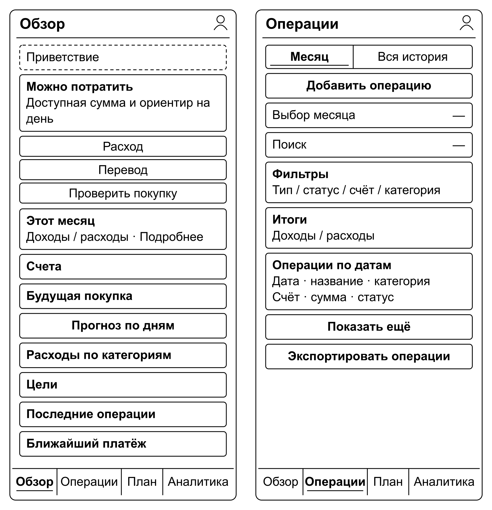

В разделе «Бюджеты» пользователь сопоставляет расходы категорий с лимитами. Раздел «Цели» показывает накопления и позволяет перейти к пополнению или выводу средств. Схемы на рисунке 2 сохраняют общий переключатель разделов планирования.

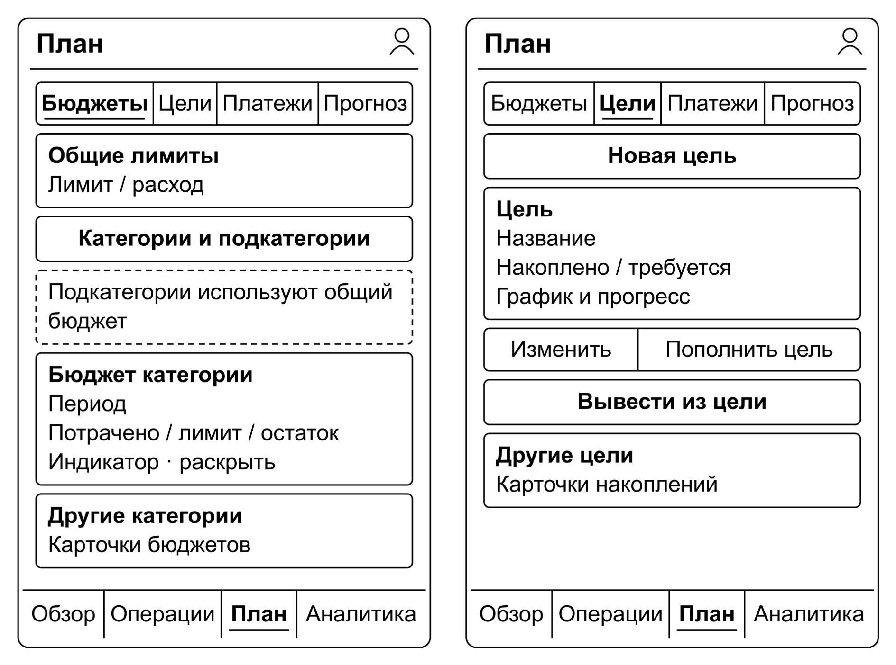

Раздел «Платежи» объединяет календарь обязательств, единый список регулярных платежей и общую сводку на 30 и 365 дней. «Прогноз» показывает ожидаемые остатки, счета и события выбранного горизонта. Их схемы представлены на рисунке 3; плановые показатели визуально отделены от подтверждения фактической операции.

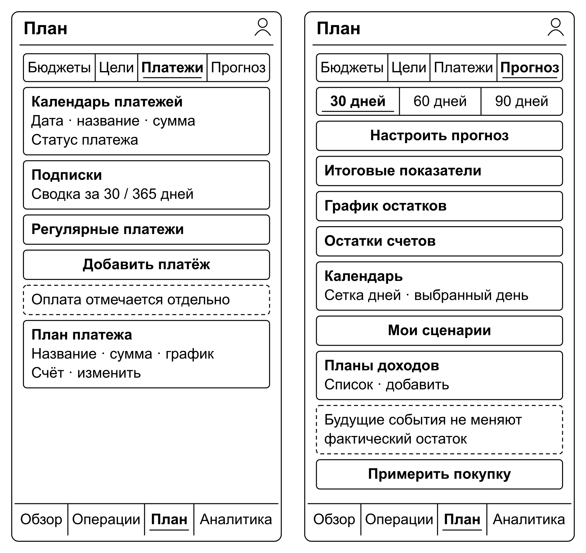

«Аналитика» раскрывает результаты выбранного месяца, динамику и структуру расходов. Меню профиля объединяет финансовые параметры, управление приложением и перенос данных. Рисунок 4 показывает самостоятельный экран аналитики и открываемое из шапки окно настроек.

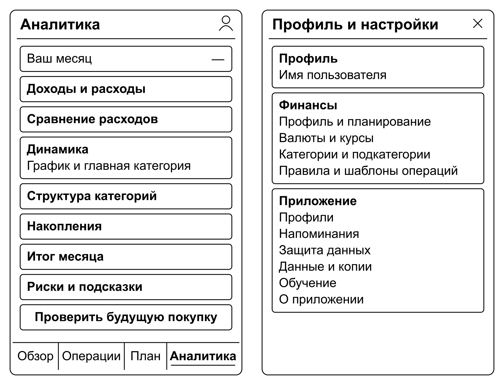

Финансовые настройки задают имя, опорный доход и резерв. Управление профилями позволяет выбрать отдельный набор учёта, создать, переименовать или удалить его. На рисунке 5 показаны эти окна; удаление требует отдельного подтверждения.

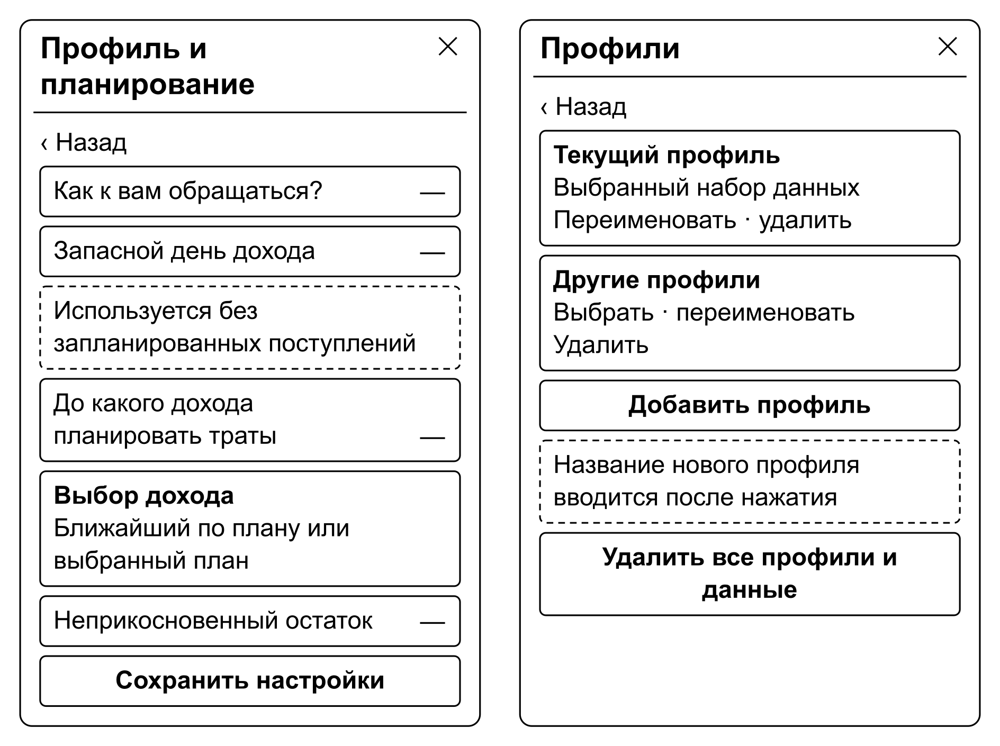

Окно данных разделяет перенос истории, резервную копию и очистку. Форма операции содержит статус, вид движения, сумму, категорию, счёт и дату. На рисунке 6 показаны доступные действия и вариант ввода проведённого расхода.

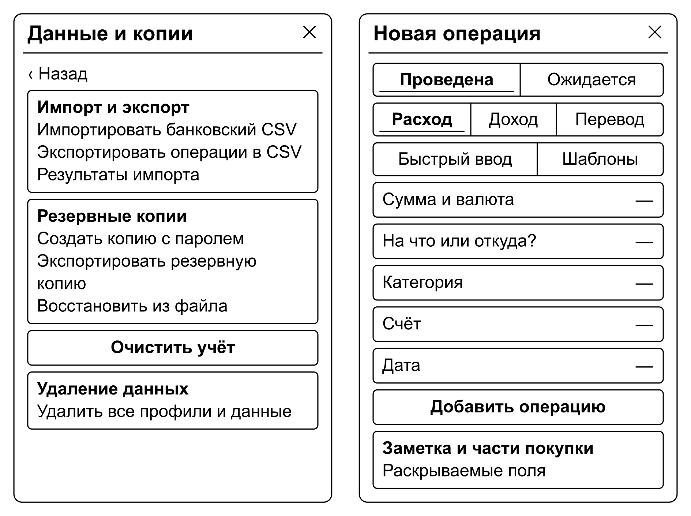

Создание счёта определяет его тип, валюту и начальное денежное положение. Создание цели задаёт требуемую сумму и условия накопления. Рисунок 7 показывает общие поля; кредитные параметры и индивидуальный график раскрываются только при соответствующем выборе.

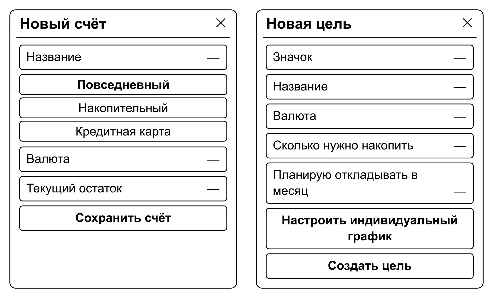

План дохода задаёт ожидаемое поступление, а план платежа — обязательство. В обоих окнах пользователь выбирает сумму, график и счёт. Рисунок 8 показывает формы создания планов; сохранение условий само по себе не меняет фактический остаток.

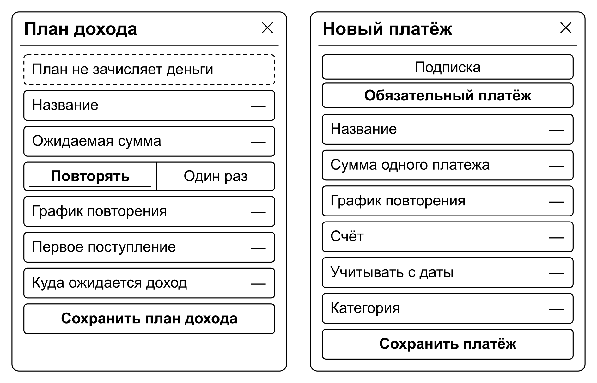

Проверка покупки связывает стоимость и дату с выбранным счётом и горизонтом. Сценарий объединяет несколько изменений для сравнения с базовым планом. Схемы на рисунке 9 отражают расчётный характер этих действий: изменение параметров не создаёт денежных операций.

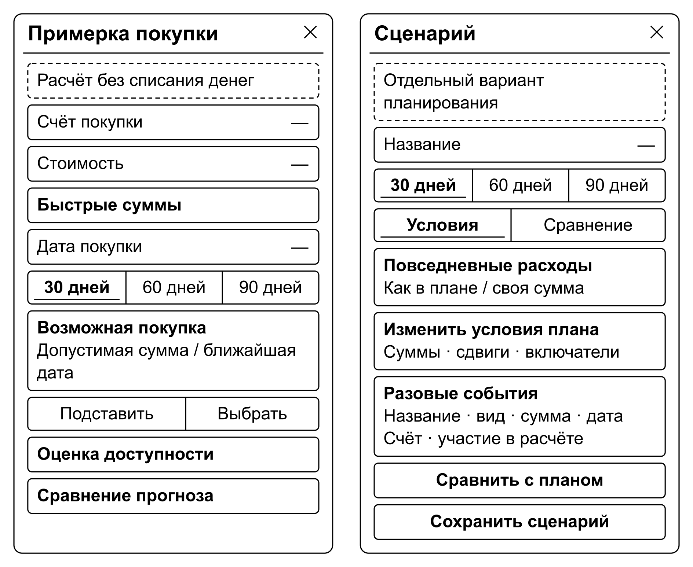

Обзорные блоки показывают первые пять записей. При большем количестве кнопка с общим числом открывает полный список с порциями по 50 записей и действием «Показать ещё». Ограничение показа не сокращает данные финансовых итогов. Вложенная форма возвращает пользователя к списку, а аналитика сохраняет выбранный месяц. Форма вывода из цели показывает доступные накопления, счета списания и зачисления и сумму; запись выполняется текущей датой. Обмен раскрывает сумму в валюте получателя. Оба состояния представлены на рисунке 10.

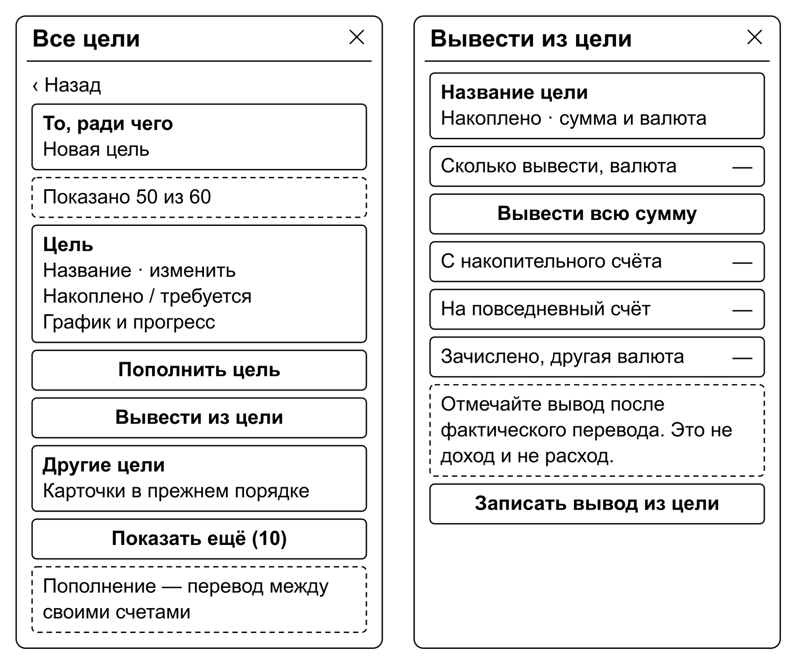

Поля явно разделяют тип, сумму, счёт, категорию и дату; обмен требует двух сумм и валют. Ошибка объясняет исправление, сохраняя ввод. Даты имеют локальный формат, суммы — валюту, доступность — пояснение. Неназначенное событие и неподтверждённая запись получают явный статус. Восстановление и сброс требуют отдельного подтверждения.

Общие компоненты, цвета и Manrope обеспечивают единообразие. Действия имеют доступные подписи и роли; цвет не служит единственным сигналом ошибки. Формы учитывают прокрутку, безопасные области и клавиатуру. Браузерные ориентиры 320, 390 и 1440 пикселей проверяют адаптацию, но не заменяют мобильную проверку доступности и системных окон.

Закрытие изменённой формы, возврат, свайп и переход к списку проходят общую проверку несохранённых изменений. Отмена отказа от черновика сохраняет ввод; подтверждение последовательно очищает затронутые черновики, включая редактирование шаблона и правила категории.

### 1.4.2 Интерфейсы ПО

Платформенные обращения отделены от финансовых расчётов. Таблица 5 показывает обмен через адаптеры и модули Expo SDK 58 [15].

Таблица 5 – Программные интерфейсы приложения

| Компонент                | Назначение и данные                                             | Ограничение                                                      |
| ------------------------ | --------------------------------------------------------------- | ---------------------------------------------------------------- |
| Локальное хранилище      | Снимок финансового состояния, реестр профилей, служебные записи | Native и Web имеют разные способы защиты                         |
| Файловые средства ОС     | Выбор CSV, JSON, .ladbackup; сохранение и передача файла        | Передача не подтверждает исправность копии без чтения            |
| SecureStore              | Отдельное хранение ключа профиля                                | Системные Keychain/Keystore; ключ не включается в экспорт [16]   |
| Системная аутентификация | Биометрия либо разрешённый код устройства                       | Только поддерживаемое нативное окружение                         |
| Локальные уведомления    | Разрешение, очередь событий, переход к плану                    | Web не предоставляет равнозначную очередь; доставки сервером нет |
| Frankfurter              | HTTPS-запрос кодов валют; JSON с курсом и датой                 | Финансовые записи не отправляются; ответ проверяется             |

Импорт CSV поддерживает UTF-8/Windows-1251, точку с запятой, запятую и табуляцию, настройку заголовка и колонок, разбор и предпросмотр. Полный перенос выполняется отдельной копией. При сетевой ошибке сохраняются прежние курсы и ручной ввод; обновление не отменяет ручной приоритет.

Напоминания ограничены 60 местными календарными днями, включая сегодня, и 60 записями. Очередь обновляется при открытии, возвращении и изменении планов; без запуска приложения она не пополняется. Аппаратных протоколов нет; биометрия доступна через ОС без получения и хранения биометрических образцов.

## 1.5 Нефункциональные требования

### 1.5.1 Целостность финансовых данных

NFR-01. Изменение сохраняет ссылки, целочисленные суммы и согласованность сущностей. Критерий: недопустимое действие не меняет исходное состояние; перевод обновляет обе стороны, импорт — весь проверенный пакет. Проверяются возвраты, обеспечение целей по валютам, границы сумм и календаря.

NFR-02. Остатки и отчётность воспроизводятся на указанную дату. Критерий: корректировка не становится доходом, план не создаёт факт, переименование не меняет оценку. Одинаковые исходные данные и дата дают одинаковые суммы и состав денежных событий.

### 1.5.2 Надёжность и восстановление

NFR-03. Ошибка чтения не подменяет данные пустым учётом или Demo; ошибка записи видима и допускает повтор. Критерий: различимы состояние в памяти, читаемый снимок и неподтверждённая запись; повтор не дублирует денежную операцию или импорт.

NFR-04. Формат, ссылки и пароль проверяются до подтверждённой замены. Неудача сохраняет исходные данные в предусмотренном маршруте. Новое поколение нативного файла и обратная проверка уменьшают риск перезаписи; физическая сохранность при любом отказе не гарантируется.

Подтверждённое удаление профиля или полный сброс фиксируется служебным журналом. После прерывания незавершённая очистка возобновляется до открытия учёта; при ошибке финансовый интерфейс остаётся закрытым до повторной попытки. Удаление одного профиля не затрагивает учёт остальных.

### 1.5.3 Безопасность информации

NFR-05. Нативный снимок шифруется AES-256-GCM, ключ хранится отдельно в SecureStore. Парольная копия использует отдельный ключ с фиксированными проверяемыми параметрами PBKDF2-SHA256. Критерий: повреждение и неверный пароль обнаруживаются до применения, секреты не входят в журналы и экспорт. Независимый аудит этим не утверждается.

NFR-06. Включённая блокировка закрывает интерфейс при уходе в фон, сохраняя черновик. Проверяются возвращение, отмена аутентификации и список приложений. Web, JSON/CSV и служебные названия профилей открыты. Защита интерфейса не противодействует скомпрометированной ОС или чтению памяти процесса.

### 1.5.4 Совместимость и переносимость

NFR-07. Старые копии сохраняют финансовый смысл: отсутствующая валюта означает RUB, неизвестное основание остаётся неизвестным, строка сценария без признака участия включена. Критерий: чтение корректной старой копии не повышает её автоматически до формата 9; версии 1–4 сохраняют нормализацию до 4. Освобождение без цикла допустимо начиная с формата 9; сохранение сценария после вывода сохраняет версию и финансовые связи.

NFR-08. Общие действия дают одинаковые финансовые результаты на всех UI-платформах; системное поведение проверяется отдельно. Экспорт JavaScript и ресурсов iOS/Android/Web не равнозначен APK/IPA или испытанию физического устройства.

### 1.5.5 Производительность и объём данных

NFR-09. Превышение допустимого объёма объясняется и отклоняется до изменения учёта. Обычная копия ограничена 5 МБ UTF-8, CSV — 2 000 000 байт, 5000 строк и 50 колонок. Предупреждения при 80% пределов учёта не являются нагрузочными результатами. Спасательный архив не отменяет обычные ограничения.

Предлагаемая приёмочная цель: на согласованном Android-устройстве с 5000 операциями пересчитывать прогноз на 90 дней за 2 секунды в 95% из 30 повторений после прогрева. Это будущий критерий, не замер. В протоколе фиксируются устройство, сборка, режим и границы измерения; холодный запуск и парольный экспорт оцениваются отдельно.

### 1.5.6 Удобство и сопровождаемость

NFR-10. На узком экране подписи читаемы, окна прокручиваются, клавиатура не закрывает подтверждение, ошибки объясняют исправление. Доступные роли и подписи проверяются средствами платформы; свойства компонентов сами по себе не доказывают удобство для всех пользователей.

NFR-11. Финансовое ядро отделено от интерфейса и ввода-вывода; модули используют публичные интерфейсы без циклов. Критерий: расчёт на переданных состоянии и дате не обращается к React, DOM, файлам и сети; замена адаптера не переписывает финансовую модель.

Для приёмки приложения предусматриваются модульные, браузерные и нативные испытания. Отдельно проверяются доставка уведомлений, защищённый перенос данных и работа под нагрузкой. Продукт не рассчитывает доходность/инфляцию целей, проценты/льготный период карты и не сохраняет прошлые прогнозы для сравнения с фактом.

Пользовательские цели, данные, интерфейсы и свойства качества определяют модели второй главы. Связь плана и факта, целостность изменений и объяснимые ограничения определяют дальнейшую проверку.

# 2 Проектирование мобильного приложения «Лад»

## 2.1 Модель сценариев использования предметной области

Модель сценариев использования связывает требования с границами системы. В нотации UML актор обозначает внешнего участника, а вариант использования — предоставляемый ему результат самостоятельной ценности [17]. Основной актор «Лада» — владелец локального финансового учёта. Именованные профили разделяют данные одного устройства, но не образуют технических ролей или многопользовательской системы.

На рисунке 11 представлены UC-01–UC-08: настройка учёта, счета, операции, переводы, бюджеты, цели, доходы и платежи. Рисунок 12 охватывает UC-09–UC-16: долги, доступную сумму, прогноз, покупку, сценарии, аналитику, файловый обмен и сохранность данных. Оба представления используют идентификаторы подраздела 1.2 и общую границу приложения.

Ассоциации показывают доступные владельцу действия. Искусственные отношения обязательного включения не вводятся: например, просмотр прогноза использует существующие планы и не требует каждый раз создавать доход. Файлы, уведомления и курсы предполагают взаимодействие с операционной системой и внешним сервисом, которые не становятся владельцами учёта.

Запись факта отделена от расчёта будущего. UC-03 и UC-04 изменяют фактические остатки, тогда как UC-10–UC-13 вычисляют оценки. Отметка платежа или дохода создаёт либо связывает операцию после действия пользователя. Наступление даты и моделирование покупки банковских операций не выполняют. Эта граница требует раздельного представления фактов, условий планов и сценарных предположений.

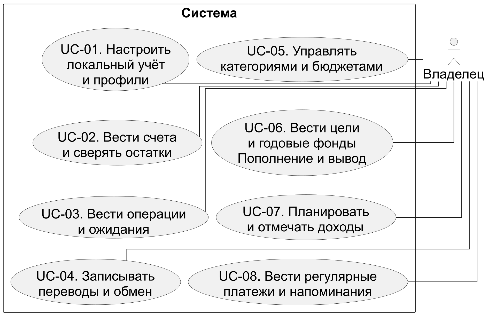

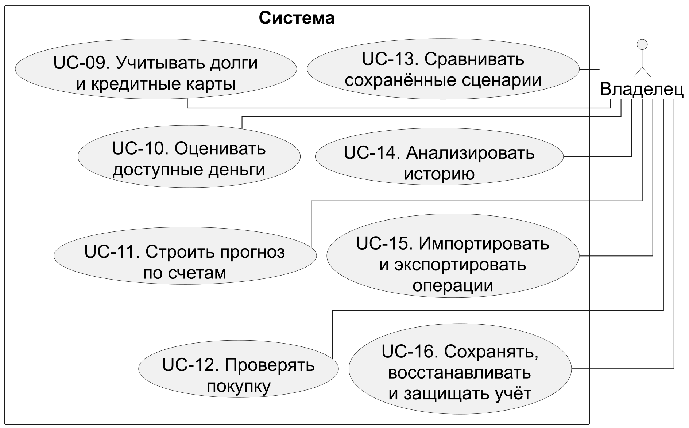

## 2.2 Логическая модель данных

Логическая модель описывает сущности независимо от хранения. В реализации ей соответствует агрегат финансового состояния профиля: массивы записей, вложенные значения и настройки, сериализуемые в JSON. Ссылки представлены идентификаторами; каталог профилей хранится отдельно. ER-диаграммы не предполагают реляционной СУБД.

Ядро учёта показано на рисунке 13. Операция имеет ровно один основной счёт: получатель для дохода, источник для расхода и перевода. Счёту соответствует 0..* операций. Второй счёт имеет общую кратность 0..1: он обязателен только для перевода и отличается от источника. При обмене списанная и полученная суммы сохраняются отдельно в соответствующих валютах.

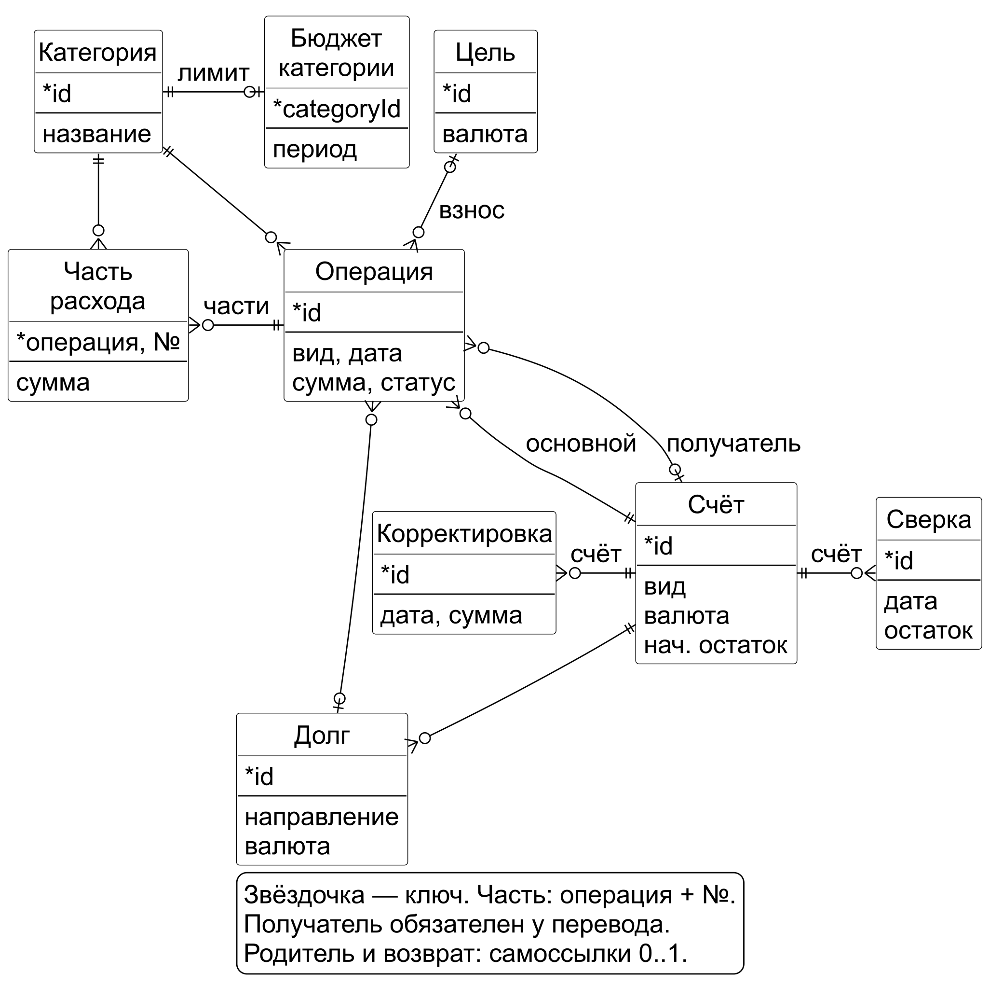

Каждая операция относится к одной основной категории и может содержать части расхода. Часть имеет одну категорию, принадлежит одной операции и распределяет её сумму без самостоятельного движения денег. Сумма частей совпадает с расходом. Обозначенный ключ «операция + номер» является модельным: собственного идентификатора у вложенной части нет. Легенда рисунка поясняет ключи и вынесенные самоссылки. Возврат ссылается на исходную покупку; покупка допускает несколько частичных возвратов, уменьшающих расходы в дату зачисления.

Категория имеет 0..1 родителя и 0..* дочерних категорий; разрешены только два уровня без циклов. Основной категории соответствует 0..1 бюджета, ключом которого служит categoryId, без отдельного id. Подкатегории разделяют родительский лимит. Условия периодов и переносов отделены от операций.

Счёт имеет 0..* корректировок, сверок и исходных записей долга; каждая такая запись относится к одному счёту. Корректировка изменяет остаток на заданную дату, сверка сохраняет подтверждённый остаток и отпечаток денежных записей. Остаток вычисляется из начальной суммы, проведённых операций и корректировок. Долг хранит направление, валюту и исходную сумму; с ним связаны 0..* операций. Счёт последующего движения может отличаться от исходного при сохранении валюты.

Операция взноса ссылается максимум на одну цель, у которой может быть множество взносов. Цель обеспечивается совокупностью накоплений своей валюты и не закрепляется за единственным накопительным счётом. Назначение счетов будущего взноса не меняет исторические переводы.

На рисунке 14 планы доходов, платежей и цели имеют по 0..* сохранённых версий условий. Ноль допустим для прежних данных, обрабатываемых совместимо. Версия принадлежит ровно одному объекту; её интервал включает начало и исключает окончание, интервалы не пересекаются. Условия дохода и платежа связаны с одним счётом, в валюте которого выражена сумма.

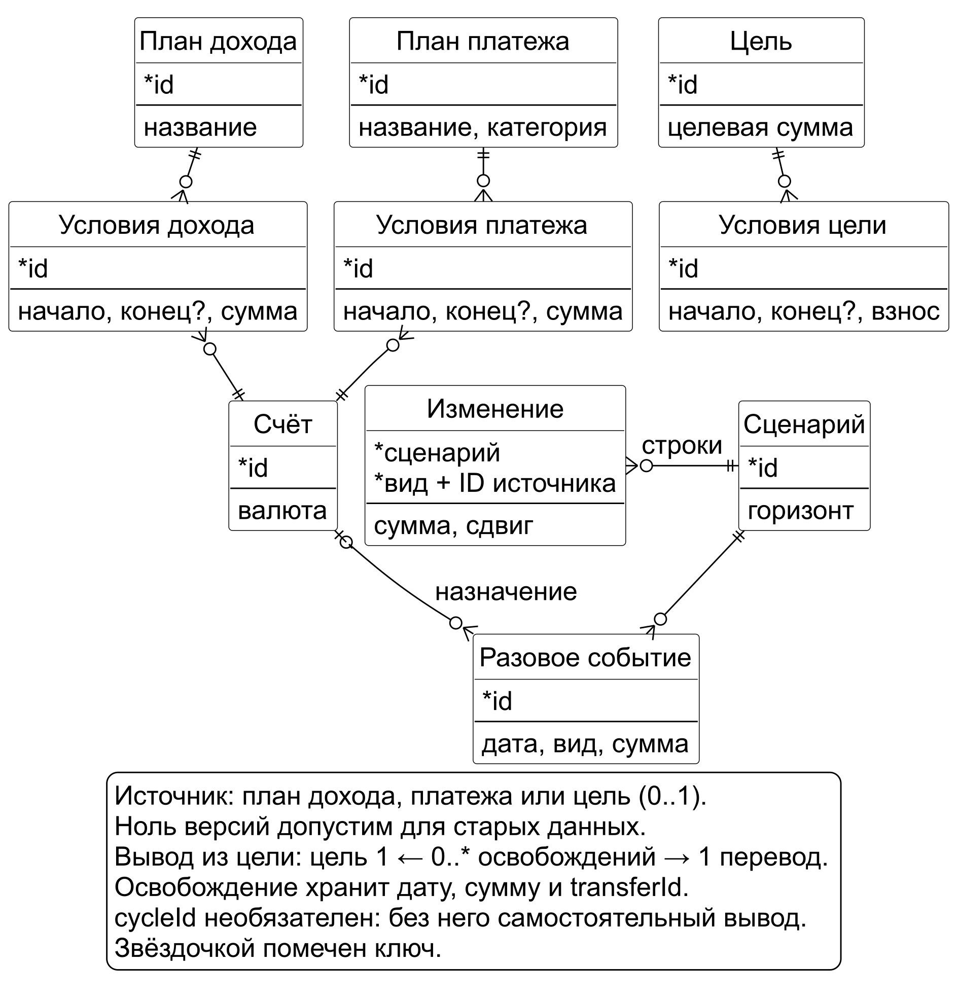

Обязательство определяется планом, версией условий и исходным ключом: месяцем для прежнего месячного плана, значением once для разового дохода или полной датой для интервального графика. Ожидаемая и фактическая даты отделены от идентичности события. Календарь обязательств вычисляется, а не хранится перечнем всех будущих дат.

Сценарий содержит 0..* изменений и разовых событий, каждое принадлежит одному сценарию. Изменение указывает вид и идентификатор источника; ключ на диаграмме описывает его положение в сценарии. Ссылка может утратить актуальность после удаления источника: строка сохраняется с пояснением, не восстанавливая объект. Разовое событие имеет 0..1 назначенного счёта. Результат пересчитывается от актуального учёта.

Настройки прогноза задают повседневный счёт ежедневных расходов, пару счетов взноса цели и счёт погашения долга или карты. Плановый перевод содержит дату, пару счетов и сумму списания; при обмене — также сумму зачисления. Он изменяет прогноз, но не историю. Эти записи формата 8 дополняют модель планирования. Автоматического сопоставления с проведённым переводом нет: после записи факта пользователь удаляет соответствующий план, исключая повторное влияние.

За пределами компактной диаграммы остаются вспомогательные записи годового фонда и освобождения накоплений. Цель допускает несколько исторических циклов и максимум один активный; оплаченный цикл связан с полным расходом. Каждое освобождение относится к одной цели и одному фактическому переводу. Ссылка на цикл обязательна при оплате фонда и отсутствует при самостоятельном выводе. Вывод уменьшает покрытие активного фонда, сохраняя связь с обязательством. Изменение прошлых денежных записей не должно делать уже записанный вывод необеспеченным.

Самостоятельный вывод можно исправить или удалить вместе с соответствующим освобождением после проверки ограничений. Удаление самой цели сохраняет фактический перевод и очищает связанные предметные ссылки. История взносов не переписывается освобождением накоплений. Чтение прежнего формата не создаёт неизвестных фактов и искусственной истории.

## 2.3 Структурное моделирование системы

Декомпозиция разделяет интерфейс, финансовые правила, состояние и платформенные средства. Семь разделов на рисунке 15 являются модулями одного приложения.

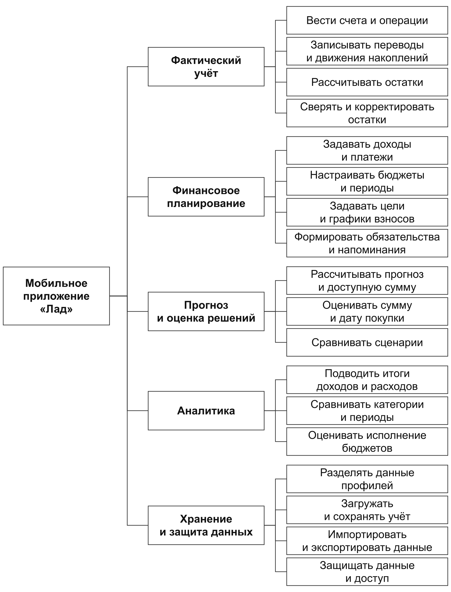

Application собирает провайдеры, навигацию и оболочку. Screens объединяет компоненты в четыре экрана: обзор, историю, планирование и аналитику. Features содержит предметные формы и карточки, сгруппированные по функциям; внешние потребители используют публичные интерфейсы модулей.

Полные списки используют существующую систему окон. Оболочка выбирает предметный компонент и передаёт ему режим полного показа и необходимый контекст, например месяц аналитики. Универсальный компонент RecordList ограничивает обзор пятью строками, а полный показ расширяет порциями по 50. Эти ограничения относятся к отображению: отдельное финансовое состояние для списков не создаётся.

Domain включает типы, проверки, расчёты и действия. Он зависит только от собственных модулей и shared/lib, исключая React, хранилище и платформенные API. Shared предоставляет универсальные компоненты и вспомогательные функции без зависимости от финансовой модели. State связывает React, предметные правила и хранение, предоставляя состояние, действия, денежное форматирование, текущую дату и статус сохранения. Infrastructure содержит адаптеры файлов, шифрования, защиты устройства, уведомлений и курсов, включая платформенные варианты реализации.

Допустимые зависимости закрепляют ответственность: state использует domain, infrastructure и shared; infrastructure — domain и shared. Features обращается к этим трём разделам, state и публичным интерфейсам других features без циклов. Screens использует собственные модули, публичные features, state, domain и shared, без прямого доступа к infrastructure. Для типов навигации действует ограниченное исключение, не разрешающее импорт исполняемой логики оболочки. Application выполняет композицию всех разделов.

Путь изменения состояния показан на рисунке 16. Форма собирает черновик, преобразует сумму в минимальные единицы валюты и вызывает useFinanceActions. Внутри обновления действие получает актуальное состояние, проверяет ссылки, суммы и финансовые ограничения, возвращая новый объект без изменения исходного. Ошибка отклоняет обновление и поясняется пользователю.

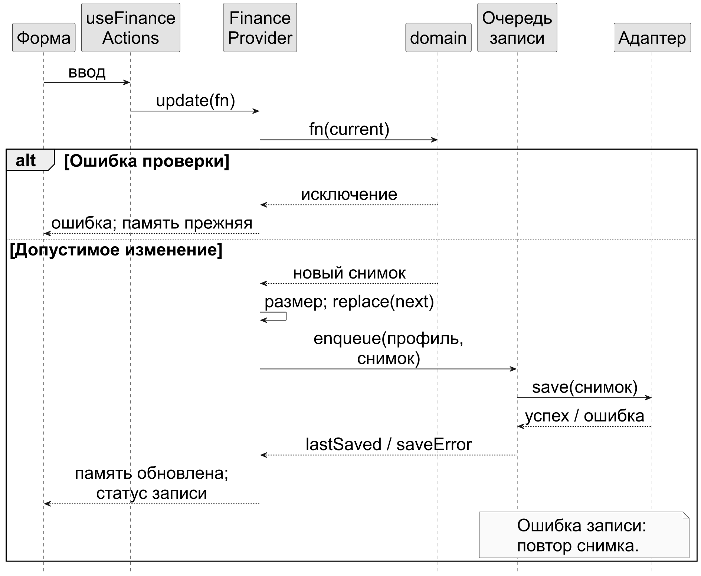

Принятое состояние обновляет интерфейс и сохраняется асинхронно. Очередь завершает текущую запись, оставляя для следующей наиболее новый ожидающий снимок. Изменение памяти поэтому отличается от подтверждённой записи. Ошибка сохранения доступна для повторной попытки; поддерживаемые черновики очищаются после проверки финансового снимка повторным чтением.

Порядок провайдеров: защита, финансовое состояние, напоминания, валютные курсы. Зависимые средства получают готовый контекст учёта. Управление системными уведомлениями отделено от расчёта напоминаний, а получение курсов — от вычисления валютной оценки. Сетевой ответ меняет настройки через проверяемое действие.

Перед удалением профиля завершаются ожидающие записи, а затем размонтируются зависимые провайдеры. Служебный журнал описывает подтверждённую очистку отдельно от финансового снимка. При следующем запуске приложение сначала завершает её и только затем открывает хранилище; ошибка переводит оболочку в состояние повторной попытки. Полный сброс дополнительно очищает настройки блокировки и обучения через платформенные адаптеры.

Стек включает React Native 0.88.0, React 19.3.0, TypeScript 6.0.3, Expo 58.0.19 (SDK 58); Node.js — 22.21.1. Компоненты React Native формируют общий мобильный интерфейс [18], React связывает отображение с состоянием [19]. Web служит предпросмотру и браузерным проверкам, которые не подтверждают системные функции телефона.

Строгая проверка TypeScript фиксирует варианты операций и контракты модулей [20], сохраняя необходимость проверки загружаемого JSON схемами и финансовыми инвариантами. Expo предоставляет средства сборки и доступа к возможностям устройства [15]; нативные зависимости должны соответствовать SDK 58.

Две самостоятельные нативные реализации потребовали бы согласовывать общий интерфейс и правила. Здесь выбран единый код и провайдер React со специализированной очередью сохранений. Альтернативой JSON была бы локальная реляционная база со схемой, миграциями и отображением агрегата на записи. Снимок согласуется с переносом полного учёта, но ограничивает объём данных и возлагает проверку целостности на приложение. Различия защиты нативного и Web-хранилища изолированы в адаптерах и не меняют финансовые формулы.

## 2.4 Модель классов предметной области

Концептуальные классы описывают предметные понятия и отношения средствами UML [17]. Данные представлены интерфейсами TypeScript и объектами, а обработка вынесена в отдельные функции. Диаграммы отражают атрибуты, связи и ограничения предметной модели.

На рисунке 17 показаны семь понятий: счёт, операция, категория, часть расхода, долг, корректировка и сверка. Тип счёта и вид операции являются признаками объектов. Две ролевые ассоциации различают основной счёт и получателя. Композиция связывает одну операцию с 0..* частями: каждая часть принадлежит только ей. Легенда дополняет модель самоссылками категории и возврата, правилом вычисления остатка и ограничениями значений.

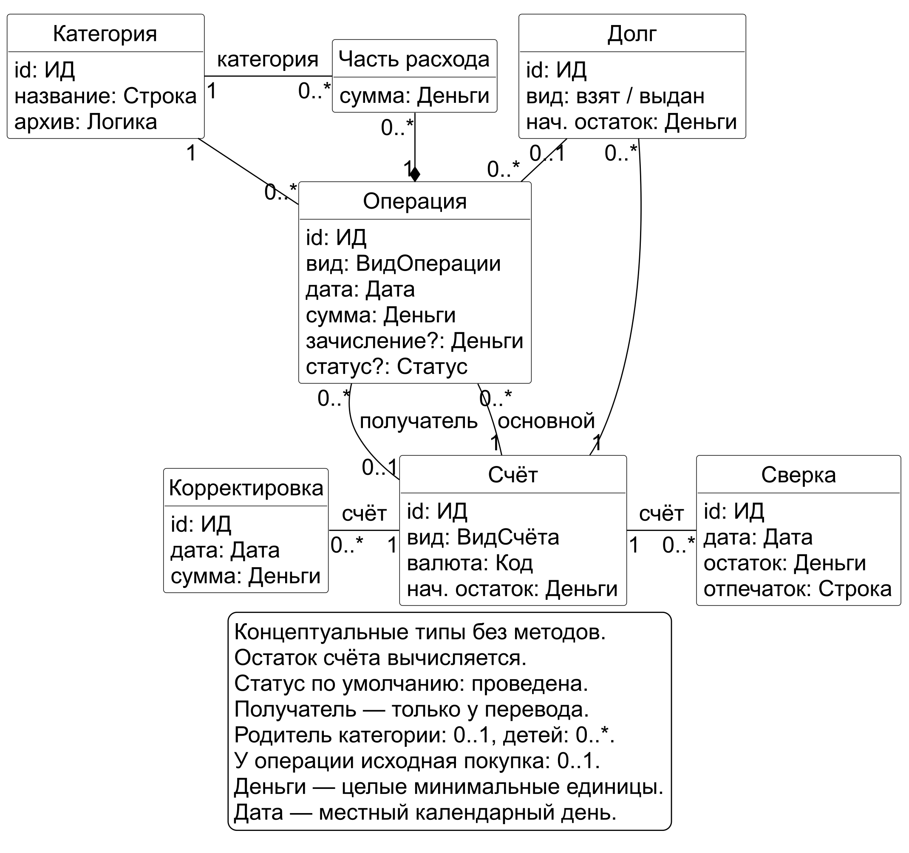

На рисунке 18 представлены восемь понятий: сценарий, планы дохода и платежа, цель, три вида условий и график. Композиция связывает каждый план или цель с собственными версиями. Версия содержит 0..1 графика; график — значение единицы повторения, интервала и опорной даты. Кратность владельца на каждой из трёх связей составляет 0..1, а ограничение {xor} в легенде требует ровно одного владельца среди соответствующих видов условий. Пунктир обозначает зависимость сценарного расчёта от планов, а не владение ими; устаревшая ссылка обрабатывается согласно логической модели.

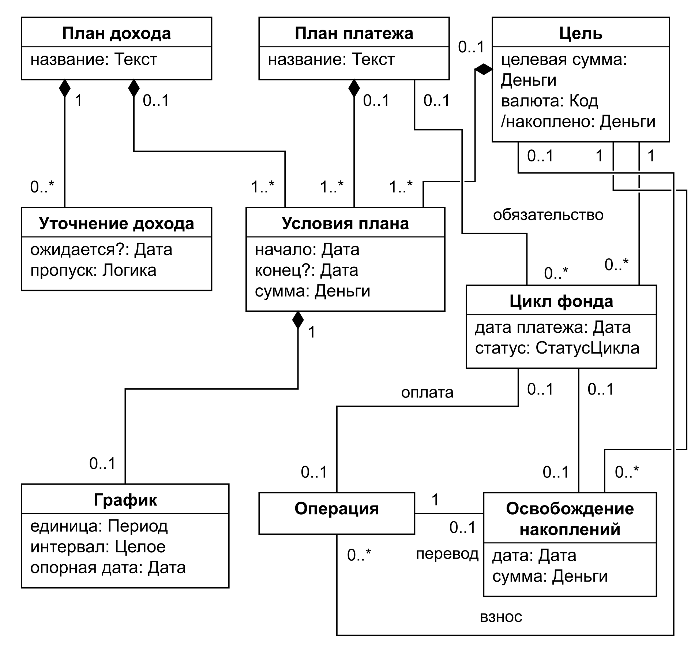

Таблица 6 сопоставляет понятия с типами реализации, включая вспомогательные типы, не показанные на компактных диаграммах.

Таблица 6 – Соответствие предметной модели типам реализации

| Концептуальный элемент      | Типы реализации                                        | Существенное различие                                        |
| --------------------------- | ------------------------------------------------------ | ------------------------------------------------------------ |
| Счёт и операция             | Account, Transaction                                   | Текущий остаток вычисляется; перевод хранит две стороны      |
| Категория и бюджет          | Category, BudgetPlan, BudgetVersion                    | Лимит принадлежит основной категории; условия версионируются |
| Цель и годовой фонд         | Goal, GoalTermsVersion, GoalFundCycle, GoalRelease     | Накоплено вычисляется по взносам и освобождениям             |
| Доход и платёж              | PlannedIncome, Recurring; соответствующие TermsVersion | План и факт разделены; обязательство имеет исходный ключ     |
| Долг, корректировка, сверка | Debt, BalanceAdjustment, AccountReconciliation         | Движение долга и корректировка не равны обычному расходу     |
| Сценарий и его строки       | SavedScenario, ScenarioChange, ScenarioEvent           | Хранятся предположения, а результат пересчитывается          |

Суммы интерпретируются вместе с валютой как целые минимальные единицы, даты — как местные календарные дни. Остатки, накопления, расходы бюджета и прогноз вычисляются согласованными функциями. Модели задают основу реализации: разделяют факты и предположения, сохраняют идентичность обязательств и направляют изменения через проверяемое общее состояние.

# Список использованных источников

1. Личный финансовый план. Как копить деньги и планировать свои траты [Электронный ресурс] / Финансовая культура. 2022. 25 с. URL: https://fincult.info/upload/iblock/5be/Lichny_finansovy_plan.pdf (дата обращения: 23.10.2026).

2. Manage your household budget in Excel [Электронный ресурс] / Microsoft Support. URL: https://support.microsoft.com/en-us/excel/manage-your-household-budget-in-excel (дата обращения: 29.10.2026).

3. Дзен-мани — приложение для контроля расходов [Электронный ресурс] / Дзен-мани. URL: https://zenmoney.ru/ (дата обращения: 29.10.2026).

4. CoinKeeper — answers to all your money questions [Электронный ресурс] / CoinKeeper. URL: https://coinkeeper.me/ (дата обращения: 29.10.2026).

5. The YNAB Method [Электронный ресурс] / YNAB. URL: https://www.ynab.com/ynab-method (дата обращения: 29.10.2026).

6. Features [Электронный ресурс] / YNAB. URL: https://www.ynab.com/features (дата обращения: 29.10.2026).

7. Pricing [Электронный ресурс] / YNAB. URL: https://www.ynab.com/pricing (дата обращения: 29.10.2026).

8. How Much Money to Keep in Your YNAB Checking Account [Электронный ресурс] / YNAB. URL: https://support.ynab.com/en_us/how-much-to-keep-in-your-checking-account-a-guide-ryZNWymAc (дата обращения: 29.10.2026).

9. Your Finances — made simple [Электронный ресурс] / Actual Budget. URL: https://actualbudget.org/ (дата обращения: 29.10.2026).

10. Multi-Currency [Электронный ресурс] / Actual Budget. URL: https://actualbudget.org/docs/budgeting/multi-currency/ (дата обращения: 29.10.2026).

11. Balance Forecast Report [Электронный ресурс] / Actual Budget. URL: https://actualbudget.org/docs/experimental/balance-forecast-report/ (дата обращения: 29.10.2026).

12. Creating a cash flow budget [Электронный ресурс] / Consumer Financial Protection Bureau. 3 p. URL: https://www.consumerfinance.gov/documents/10038/cfpb_creating-cash-flow-budget_tool_2021-08.pdf (дата обращения: 23.10.2026).

13. System Engineering Handbook: Appendix [Электронный ресурс] / NASA. Приложения C, D. URL: https://www.nasa.gov/reference/system-engineering-handbook-appendix/ (дата обращения: 23.10.2026).

14. How to Export Plan Data [Электронный ресурс] / YNAB. 18.08.2026. URL: https://support.ynab.com/en_us/how-to-export-plan-data-Sy_CouWA9 (дата обращения: 23.10.2026).

15. Expo SDK reference. SDK 58 [Электронный ресурс] / Expo. URL: https://docs.expo.dev/versions/v58.0.0/ (дата обращения: 26.10.2026).

16. Expo SecureStore. SDK 58 [Электронный ресурс] / Expo. URL: https://docs.expo.dev/versions/v58.0.0/sdk/securestore/ (дата обращения: 26.10.2026).

17. Unified Modeling Language. Version 2.5.1 [Электронный ресурс] / Object Management Group. 2017. Разделы 9.5.3, 11.4.3–11.4.4, 18.1. URL: https://www.omg.org/spec/UML/2.5.1/PDF (дата обращения: 23.10.2026).

18. Core Components and APIs [Электронный ресурс] / React Native. URL: https://reactnative.dev/docs/components-and-apis (дата обращения: 26.10.2026).

19. Thinking in React [Электронный ресурс] / React. URL: https://react.dev/learn/thinking-in-react (дата обращения: 23.10.2026).

20. The TypeScript Handbook [Электронный ресурс] / TypeScript. URL: https://www.typescriptlang.org/docs/handbook/intro.html (дата обращения: 23.10.2026).
