# Введение

Управление личными финансами требует согласования расходов, обязательных платежей и накоплений. Общий остаток нескольких счетов не всегда показывает доступную для покупки сумму: часть средств предназначена для целей, а платёж привязан к определённому счёту. Положительный итог месяца также не исключает нехватки денег между поступлениями. Поэтому актуальна разработка мобильного приложения, связывающего учёт операций с планированием денежных потоков.

Существующие приложения для личных финансов сочетают учёт с бюджетами и накопительными целями. Их средства прогнозирования решают разные задачи: оценивают расходы по категориям, срок достижения цели или будущий остаток счёта. Для оценки покупки важен прогноз остатков по счетам, учитывающий даты поступлений и обязательств, счёт оплаты и резерв. Такой прогноз предлагается связать с локальным учётом в приложении «Лад», чтобы объяснять пользователю причины ограничения расходов.

Объект исследования — процессы управления личными финансами. Предмет исследования — модели данных и алгоритмы мобильного приложения для учёта операций, распределения средств и прогнозирования остатков по счетам.

Цель выпускной квалификационной работы — разработать мобильное приложение для управления личными финансами, обеспечивающее учёт денежных операций, ведение бюджетов и накоплений, анализ финансового состояния и планирование расходов.

Для достижения цели необходимо решить следующие задачи:

- исследовать предметную область и существующие решения, сформулировать требования к приложению;

- спроектировать модель данных, архитектуру и пользовательский интерфейс;

- реализовать учёт счетов и операций, управление бюджетами, целями, доходами, платежами и долгами;

- разработать алгоритмы оценки доступных средств, прогноза по счетам, проверки покупки и сравнения сценариев;

- предусмотреть локальное хранение, импорт операций, резервное копирование и защиту данных;

- проверить корректность расчётов и описать работу основных пользовательских сценариев.

Исходными данными для расчётов должны служить остатки счетов, история операций, валютные курсы, условия бюджетов, цели, графики доходов и платежей, долги и размер резерва. Предусматриваются самостоятельный ввод сведений и импорт операций из файла. Для решения задач предполагается использовать сравнительный анализ, моделирование данных и сценариев использования, расчёт денежных потоков и тестирование.

Разработку планируется вести на React Native, Expo и TypeScript с общей кодовой базой для iOS и Android и независимыми от интерфейса финансовыми расчётами. Основной учёт должен работать локально; банковские подключения, облачная синхронизация и исполнение реальных платежей не входят в границы проекта.

Работа опирается на подходы журнального учёта, бюджетирования и календарного планирования. Предполагаемая прикладная новизна состоит в их согласовании в единой модели: прогноз каждого счёта в его валюте должен сочетаться с проверкой покупки при сохранении общего резерва на всём выбранном периоде. Альтернативные сценарии предусматривается рассчитывать без изменения фактического учёта. Практическая значимость разработки связана с возможностью заранее выявлять нехватку средств и объяснять пользователю причины ограничения расходов.

Первая глава посвящена анализу предметной области и требованиям, вторая — проектированию данных и архитектуры, третья — реализации приложения.

# 1 Требования к мобильному приложению «Лад»

## 1.1 Общее описание продукта

### 1.1.1 Назначение объекта автоматизации

Объект автоматизации — управление личными финансами: учёт поступлений и расходов, анализ истории, распределение средств, контроль обязательств и накоплений, планирование и оценка решений. Личный финансовый план связывает цели человека с его доходами, расходами и сроками, учитывая текущее положение и предстоящие изменения [1]. Разрабатываемое мобильное приложение «Лад» должно объединить эти процессы на устройстве пользователя.

Потенциальный пользователь имеет регулярный или нерегулярный доход, несколько счетов, обязательные платежи, цели, иногда разные валюты и долги. Общего остатка недостаточно для решения о покупке: часть средств закреплена за накоплениями, часть потребуется для обязательств; нужной суммы может не оказаться на выбранном счёте. Пропущенные операции и ошибочный учёт переводов искажают картину, а месячный итог скрывает нехватку денег между поступлениями. Это требует согласования фактов, ожиданий и будущих остатков.

В состав «Лада» предполагается включить журнал операций, бюджеты, цели, планы доходов и платежей, долги, прогноз и сценарии. Расчёт должен объяснять доступную сумму и последствия гипотетической покупки. Его результаты зависят от полноты введённых сведений и не гарантируют будущих поступлений. Целевые платформы — iOS и Android; Web предполагается использовать для предпросмотра и браузерных проверок. Банковские подключения, серверная авторизация, облачная синхронизация и исполнение платежей в объём проекта не входят. Для разделения данных на устройстве предусматриваются локальные профили без многопользовательского доступа.

### 1.1.2 Аналитический обзор

Приложения для личных финансов решают три связанные задачи: фиксируют движение денег, распределяют доступные средства и помогают оценивать будущие решения. Эти задачи требуют разных средств. Журнал операций объясняет фактический остаток, бюджет задаёт ограничения расходов, а календарный прогноз показывает, в какой момент может возникнуть нехватка денег. Поэтому сравнение только по наличию категорий и диаграмм недостаточно: необходимо учитывать способ получения операций, работу с планами, валютами и накоплениями, а также объект прогнозирования.

Косвенной альтернативой специализированному приложению является электронная таблица. Microsoft предлагает сопоставлять ожидаемые и фактические доходы и расходы в месячном бюджете [2]. Пользователь может дополнить такую таблицу своими формулами и сценариями, однако корректность переводов, валютных оценок и связей между записями будет зависеть от устройства файла. Бумажный журнал позволяет вести историю, но требует ручного пересчёта итогов. Эти способы подходят для простого учёта и не рассматриваются как готовые программные реализации всех перечисленных функций.

Для подробного сопоставления выбраны четыре приложения. Дзен-мани ориентируется на сбор операций из разных источников, анализ расходов и планирование бюджета. В описании продукта выделены регулярные платежи, свободные деньги на месяц и прогноз расходов по категориям на основе истории [3]. CoinKeeper сочетает учёт счетов, категорий и лимитов с накопительными целями, повторяющимися операциями и семейным доступом. Производитель также описывает прогноз роста капитала и даты достижения цели [4]. Оба продукта сокращают объём ручного ввода, однако фактическая доступность банковского подключения зависит от банка, платформы и условий сервиса.

YNAB строится вокруг распределения уже имеющихся денег по назначениям и подготовки к будущим, в том числе нерегулярным, расходам [5]. Приложение поддерживает цели, отчёты и синхронизацию устройств, включая работу без сети [6]. Для одного плана выбирается одна валюта; прямой банковский импорт доступен для поддерживаемых банков определённых регионов [7]. Наличие плановых операций позволяет в Web-интерфейсе просматривать будущий остаток счёта с помощью Running Balance [8]. Таким образом, распределение средств в YNAB дополняется оценкой будущего остатка счёта.

Actual Budget использует конвертное бюджетирование: деньги распределяются по категориям, а расходы уменьшают доступные суммы. Его существенное свойство — локальная работа с возможностью синхронизации через собственный сервер; предусмотрены файловый импорт, связанные переводы и настраиваемые отчёты [9]. Встроенная мультивалютность отсутствует, при этом документация описывает экспериментальный обходной способ через правила [10]. Другой экспериментальный инструмент, Balance Forecast, рассчитывает будущие остатки из истории и расписаний, позволяет выбирать счета и дневной либо месячный шаг [11]. Экспериментальный статус важен для сопоставления: опубликованная возможность ещё может измениться или быть исключена из продукта.

В таблице 1 возможности четырёх приложений сопоставлены с требованиями к «Ладу» по четырнадцати критериям. Сведения об аналогах отражают их официальные описания на 29 октября 2026 года; это не результаты испытаний приложений. Набор возможностей может зависеть от тарифа и платформы. Столбец «Лад» содержит планируемые возможности разрабатываемого приложения. Обозначение «Не уточнено» означает, что отобранные источники не дают достаточного основания для конкретного вывода, и не доказывает отсутствия возможности. В строке проверки покупки сравнивается именно оценка выбранного счёта и сохранения резерва на всём горизонте, а не любая рекомендация о расходах.

Таблица 1 – Сопоставление возможностей приложений для личных финансов

| Критерий                 | Дзен-мани                          | CoinKeeper             | YNAB                       | Actual Budget            | «Лад» (проект)                |
| ------------------------ | ---------------------------------- | ---------------------- | -------------------------- | ------------------------ | ----------------------------- |
| Основной подход          | Учёт и план расходов               | Учёт, лимиты, цели     | Назначение имеющихся денег | Конвертный бюджет        | Учёт, планы и прогноз         |
| Ручной ввод              | Есть                               | Есть                   | Есть                       | Есть                     | Ввод, шаблоны и правила       |
| Банковский ввод          | Подключения к банкам               | Банки и SMS            | Банки выбранных регионов   | Внешние провайдеры       | Только импорт CSV             |
| Бюджеты                  | Категории, план на месяц           | Лимиты категорий       | Суммы по категориям        | Категории-конверты       | Периоды, версии, переносы     |
| Регулярные платежи       | План и напоминания                 | Повторы и напоминания  | Плановые операции          | Расписания операций      | Версии условий, отметки факта |
| Накопления               | Отдельная модель целей не уточнена | Цели и прогноз срока   | Цели категорий             | Накопления в конвертах   | Цели, фонды, взнос и вывод    |
| Несколько валют          | Детали модели не уточнены          | Валютные счета         | Одна валюта в плане        | Нет встроенной поддержки | Валютные счета и обмен        |
| Контроль трат            | Свободная сумма на месяц           | Темп расходов и лимиты | Остаток по назначениям     | Остаток в конвертах      | Сумма до дохода с резервом    |
| Объект прогноза          | Расходы категорий                  | Капитал и срок цели    | Остаток по расписанию      | Остатки по расписанию¹   | Остатки счетов и сводка       |
| Будущие остатки счетов   | Не уточнено                        | Не уточнено            | Running Balance в Web      | Фильтр счетов, дни¹      | По дням, в валюте счёта       |
| Покупка с резервом       | Не уточнено                        | Не уточнено            | Аналог не установлен       | Аналог не установлен     | Сумма, дата, счёт; сценарии   |
| Аналитика                | Категории и тренды                 | Категории и капитал    | Расходы и капитал          | Поток денег и отчёты     | Месяцы, категории, возвраты   |
| Работа без сети          | Не уточнено                        | Основные функции       | Есть                       | Локальный учёт           | Локальный учёт                |
| Обмен между устройствами | В описании не уточнён              | Через облако           | Через сервис               | Через свой сервер        | Не планируется                |

¹ Для Actual Budget указан экспериментальный Balance Forecast в режиме расчёта по расписаниям. Режим Tracking Budget строит общий месячный прогноз и не использует фильтр отдельных счетов. Экспериментальная схема мультивалютности не равнозначна встроенной поддержке валют. Основания сравнения: описание Дзен-мани [3], CoinKeeper [4], метод и возможности YNAB [5], [6], [7], [8], описание и документация Actual Budget [9], [10], [11].

Сопоставление показывает, что история операций, категории, бюджеты и накопления уже относятся к распространённым возможностям. У рассмотренных продуктов имеются и прогнозные средства, однако они решают разные вопросы: предполагаемые расходы категории, срок достижения цели, изменение капитала или будущий остаток счёта. Сравнивать их одной отметкой «есть прогноз» некорректно. Для личного планирования существенна последовательность поступлений и списаний: положительный итог месяца ещё не исключает нехватки денег внутри него, что отражено и в методике календарного бюджета CFPB [12].

Для «Лада» предлагается объединить учёт и планирование на основе нескольких правил. Фактические деньги необходимо отделять от ожидаемых поступлений; прогноз — вести по каждому повседневному счёту в его валюте; гипотетическую покупку — проверять относительно выбранного счёта и общего резерва на всём горизонте. Сценарий должен хранить изменённые предположения и пересчитываться от актуального учёта, сохраняя реальные планы и историю. Такое сочетание требуется для объяснения ограничений покупки через конкретные остатки и обязательства. Предлагаемый расчёт определяется введёнными данными и не предназначен для статистического предсказания дохода.

Выбор локальной архитектуры ограничивает состав проекта. Банковское подключение, облачная синхронизация и совместный семейный доступ не планируются; ввод или импорт операций и создание копий предполагается поручить пользователю. CoinKeeper и YNAB предлагают совместное использование, а Actual Budget допускает синхронизацию через собственный сервер [4], [7], [9]. Расчёт доходности капитала и инфляции целей также выходит за границы «Лада». Поэтому разработка направлена на поддержку управления личными финансами средствами согласованного локального учёта, планирования и анализа. Такое назначение не предполагает превосходства над всеми аналогами.

### 1.1.3 Классы и характеристики пользователей

Основной актор — владелец локального учёта. Начинающему нужны простой ввод, обучение и объяснение показателей. При регулярном доходе важны повторяющиеся платежи и бюджетные периоды, при нерегулярном — перенос поступлений и осторожная оценка доступности. Несколько счетов и валют повышают требования к переводам и сверке; цели и долги требуют разделять собственные деньги, обязательства и закреплённые накопления. Эти характеристики сочетаются у одного человека и не образуют роли доступа: администратор сервера, банковский оператор и совместный семейный учёт в проекте не предусматриваются.

### 1.1.4 Ограничения дизайна и реализации

Исходные границы продукта — личное использование, русский интерфейс, локальный учёт и отсутствие исполнения платежей. Работа с сохранёнными данными должна оставаться доступной без сети; для обновления курсов потребуется внешний источник. Автоматическая облачная копия не предусматривается, поэтому перенос и восстановление необходимо выделить в самостоятельные сценарии.

В качестве технической основы предлагаются React Native, Expo, TypeScript, функциональные компоненты и единое состояние. Такой подход позволит использовать общую логику для iOS и Android и независимо проверять финансовые правила. Различия защиты и файлового обмена следует изолировать в платформенных адаптерах. При проектировании экранов необходимо учитывать прокрутку, безопасные области, перенос подписей и сохранение ошибочного ввода. Допустимый объём данных потребуется определить отдельно от измеряемой производительности.

## 1.2 Функциональные требования

Основные действия владельца учёта представлены девятью прецедентами UC-01–UC-09. Для каждого определены цель, предусловия, последовательность взаимодействия и ожидаемый результат. Запись перевода рассматривается как частный вид записи финансовой операции; взнос в цель и вывод из неё должны использовать запись перевода. Корректировка должна дополнять сверку только при подтверждённом решении пользователя. Оценка покупки и сравнение сценариев должны использовать общий расчёт прогноза. Эти отношения определяют модель подраздела 2.1. Высокий приоритет назначается сохранению фактов, согласованности остатков и прогнозу; средний — сравнению финансовых решений. Критерии результата должны позволять проверить выполнение требований при последующей приёмке [13].

Основные прецеденты должны раскрываться в модели подраздела 2.1 через вспомогательные варианты использования: разновидности денежных записей, обязательные финансовые проверки и условные дополнения. Идентификаторы UC-01–UC-09 закрепляются за основными целями владельца; повторяющиеся вспомогательные действия должны иметь одинаковый смысл на всех диаграммах.

Выполнение прецедентов требует подготовки локального учёта. Приложение должно позволять создавать, переключать и переименовывать профили, задавать основную валюту, резерв и параметры планирования. Необходимо предусмотреть ручные курсы с приоритетом над сетевым обновлением и согласованный пересчёт зависимых сумм при смене основной валюты. Профили не должны смешивать записи; обычный перезапуск должен сохранять учёт. Добровольное обучение следует проводить через основные экраны с возможностью пропуска. Для каждого профиля должны быть доступны повседневные, накопительные и кредитные счета с начальным остатком. Название счёта можно изменять с сохранением истории; тип и валюта после создания неизменны. Архивирование счёта допускается при нулевом остатке и отсутствии действующих зависимостей.

Для сохранности данных следует предусмотреть открытую JSON-копию и защищённую паролем .ladbackup. Восстановление должно требовать проверки файла и подтверждения замены данных; неверный пароль, повреждение копии и ошибка чтения не должны подменять действующий учёт. Для большого спасательного архива необходимо предусмотреть восстановление в новый профиль. Ошибка записи должна сопровождаться возможностью повтора. Нативная блокировка должна закрывать финансовый интерфейс при уходе в фон и сохранять черновик формы. Ключ устройства не должен попадать в переносимую копию; JSON и веб-хранилище нельзя обозначать как зашифрованные. Удаление профиля требует предупреждения и ввода слова «УДАЛИТЬ», сохраняя остальные профили и общую блокировку. Полный сброс должен отдельно предупреждать об удалении всех локальных профилей, настроек защиты и прогресса обучения. После удаления последнего профиля или полного сброса должно открываться приветствие; внешние копии сохраняются.

В дополнение к записи новой операции необходимы поиск и фильтрация истории, исправление и удаление записей, шаблоны и повтор ввода. Пользователь должен иметь возможность сохранить ожидающую операцию, позднее провести её отдельным действием либо отменить. Ожидание не должно менять фактический остаток; отмена должна освобождать удержание, проведение — учитывать движение один раз. При импорте CSV следует предусмотреть сопоставление колонок и значений, просмотр ошибок и повторов, выбор строк и подтверждение всего пакета. Ручной ввод и импорт должны подчиняться одинаковым финансовым правилам. Ошибка пакета должна исключать частичный импорт, повторный перенос — дублирование записей. Выгрузка должна учитывать выбранные период и счёт; большой результат следует разделять на файлы. CSV переносит историю операций и не заменяет полную копию профиля.

Для ограничения расходов необходимо предусмотреть категории, подкатегории, лимиты, бюджетные периоды и правила переноса. Подкатегория должна использовать общий лимит родителя; циклические и недопустимые связи необходимо отклонять. Архив категории должен сохранять историю и действующие платежи, а новые ручные операции и автоматическое сопоставление CSV — использовать активные категории. Бюджет должен показывать расход, остаток и перерасход без повторного учёта частей покупки и возвратов. Новые условия графика должны начинаться на ближайшей будущей границе прежнего периода после предпросмотра даты перехода. Закрытые периоды должны сохранять свои условия; положительный остаток и перерасход следует переносить по независимым правилам, действовавшим на соответствующей границе.

Управление целями должно позволять задавать название, целевую сумму, график взносов и необязательный срок, просматривать прогресс и оставшуюся сумму. Валюта существующей цели неизменна. Новые условия графика должны действовать с будущей даты и сохранять отмеченные взносы; график сам по себе не должен создавать денежных операций. Годовой фонд необходимо связывать с обязательством. При его оплате из накоплений требуется освободить используемую сумму и записать перевод на повседневный счёт; полный расход должен учитываться один раз независимо от доли использованных накоплений. Исправление и удаление самостоятельного вывода должны согласованно изменять связанный перевод и освобождение средств.

Для планирования следует предусмотреть разовые и повторяющиеся доходы, регулярные платежи, календарь и сводку неоплаченных и непропущенных платежей на 30 и 365 дней. Пользователь должен задавать сумму, счёт и дату либо график, для платежа — категорию; подписки следует учитывать среди регулярных платежей. Исполнение события должно допускать запись новой операции, проведение подходящего ожидания или привязку уже проведённой записи. Привязка не должна изменять баланс повторно. Доход можно перенести или отменить, платёж — пропустить. Перенос и досрочное исполнение должны сохранять идентичность события. Новые условия должны начинаться не раньше завтра и не изменять отмеченные будущие события. Пауза должна сохранять возникшие обязательства, возобновление — оставлять период паузы незаполненным; просрочка должна сохранять прежние условия. Создание плана и наступление срока не должны менять фактические деньги, удаление плана — удалять связанные факты. Напоминания должны включаться отдельно с просмотром очереди и учётом разрешения ОС; отказ в уведомлениях не должен блокировать учёт, а постановка в очередь — означать гарантированную доставку.

Для долгов необходимо предусмотреть запись направления, валюты, исходной суммы и необязательного срока, учёт погашений и показ непогашенного остатка. Ввод прежней задолженности не должен повторять состоявшуюся выдачу денег; исправление движения необходимо проверять с учётом последующих погашений. Для кредитной карты следует хранить лимит и оставшийся платёж по выписке, обозначать неактуальные условия и предлагать их уточнить. Последующие переводы на карту должны уменьшать платёж. Основная сумма долга не должна входить в обычные доходы и расходы, кредитный лимит — в собственные средства. Обязательства со сроком необходимо учитывать в прогнозе; выданный долг нельзя считать гарантированным будущим доходом.

Экранная аналитика должна позволять выбирать и сравнивать периоды, изучать категории, динамику доходов и расходов, фильтровать историю и открывать составляющие операции. Итоги следует выражать в основной валюте по сохранённым историческим оценкам. Переводы и основную сумму долга необходимо исключать из обычного оборота; возврат должен уменьшать расходы на дату зачисления, части покупки — учитываться без повторного суммирования. Пустую историю, неполноту данных и неизвестное основание прежней оценки следует обозначать явно. Переименование записи не должно переоценивать её по текущему курсу; выбор периода и фильтров не должен изменять историю.

Для текущих трат необходимо дополнительно предусмотреть показатель «Можно потратить», дневную сумму и объяснение расчёта. Доступная сумма должна учитывать фактические повседневные средства, удержания, обязательства, оставшиеся взносы и дальнейший прогноз при известном доходе. Неполученный доход не следует прибавлять к фактическим деньгам. При отсутствии подходящего дохода требуется явно объяснить запасную дату из профиля. В этом расчёте резерв должен вычитаться из доступных средств; в прогнозе он служит порогом сравнения. Повторное вычитание резерва и бюджетов недопустимо.

### 1.2.1 Записать финансовую операцию

UC-01. Цель — отразить новое денежное движение в истории учёта. Приоритет высокий. Предусловия: открыт профиль, доступны подходящие активные счета и необходимые валютные курсы.

Основной сценарий: пользователь выбирает вид операции, указывает сумму, дату не позднее сегодняшней, счёт и название; для дохода или расхода задаёт назначение. Приложение должно проверить ввод и ограничения выбранного вида, показать сведения для подтверждения и сохранить новую запись. Остатки и связанные представления должны пересчитываться по сохранённому факту. Для перевода следует использовать специализированный сценарий UC-02, сохраняющий общие правила записи операции.

Варианты и ошибки: для расхода необходимо предусмотреть распределение суммы по категориям, для возврата — связь с исходной покупкой и проверку возвращаемой суммы. Заметка необязательна. Неверные даты, суммы, счета и ссылки должны блокировать запись с объяснением исправления. Обычный расход повседневного счёта может оставить отрицательный остаток; для переводов, накоплений и кредита требуются отдельные ограничения.

Результат — новая денежная запись без частичного изменения связанных данных. Критерии: сумма частей равна сумме покупки, возврат уменьшает расход на дату зачисления. Денежные значения должны сохранять точность валюты, а фактическая дата — календарный смысл. Ошибка или отмена подтверждения не должны создавать запись.

### 1.2.2 Записать перевод между счетами

UC-02. Цель — отразить движение средств между собственными счетами. Приоритет высокий. Предусловия: открыт профиль, доступны два различных активных счёта и достаточная сумма источника с учётом удержаний.

Основной сценарий: пользователь выбирает счета списания и зачисления, дату и сумму, затем подтверждает перевод. Система должна выполнить общие проверки UC-01 и дополнительные проверки перевода. В одной валюте суммы списания и зачисления должны совпадать; для обмена пользователь должен указать обе фактические суммы в соответствующих валютах. После подтверждения требуется сохранить одну запись перевода и пересчитать оба остатка.

Варианты и ошибки: для нового проведённого обмена между счетами в разных валютах без связи с целью, долгом или планом следует предусмотреть отдельный расход комиссии. Пользователь должен указать её сумму, счёт и категорию; перевод и комиссия должны сохраняться одним подтверждением. Недостаточность средств, совпадающие или архивные счета, недопустимые суммы, ошибка комиссии и нарушение обеспеченности целей должны отклонять действие целиком.

Результат — согласованное изменение остатков с записью основного перевода и, при выбранной комиссии, отдельного расхода. Критерии: перевод и расход комиссии должны сохраняться совместно без частичного результата; одновалютный перевод сохраняет общую сумму денег, обмен учитывает фактическое зачисление. Перевод не должен входить в обычные доходы и расходы. Запись в приложении не должна выполнять банковский платёж.

### 1.2.3 Учесть взнос в цель

UC-03. Цель — закрепить фактически переведённые накопления за выбранной целью. Приоритет высокий. Предусловия: цель существует, доступны активные повседневный и накопительный счета; валюта накопительного счёта совпадает с валютой цели.

Основной сценарий: пользователь выбирает цель, счета и сумму взноса, при наличии графика — соответствующее событие. Приложение должно обязательно записать перевод по UC-02 текущей датой и связать его с целью. Прогресс необходимо увеличить по сумме зачисления, а оставшуюся сумму соответствующего взноса графика — уменьшить с учётом зачисления.

Варианты и ошибки: при разных валютах счетов пользователь должен указать фактическую сумму зачисления. Взнос сверх оставшейся суммы цели, недостаточность источника, неподходящий счёт и некорректная связь с событием должны блокировать сохранение. Отмена подтверждения не должна менять цель или счета.

Результат — записанный перевод и согласованное увеличение накопленной суммы цели. Критерии: одна запись перевода и связь с целью должны сохраняться одним подтверждением; включение UC-02 не должно требовать повторного ввода и создавать второе движение. Сумма распределённых средств должна оставаться обеспеченной накоплениями соответствующей валюты. Само наступление даты графика не должно считаться выполненным взносом.

### 1.2.4 Учесть вывод из цели

UC-04. Цель — вернуть часть или все закреплённые накопления в повседневное распоряжение. Приоритет высокий. Предусловия: цель существует и содержит накопленные средства; доступны активный накопительный счёт в валюте цели и повседневный счёт получателя.

Основной сценарий: пользователь выбирает цель, счета и сумму вывода. Система должна проверить накопленную сумму и доступность источника, освободить выбранную часть средств и обязательно записать обратный перевод по UC-02 текущей датой. Освобождение должно быть связано с этим переводом; история прежних взносов сохраняется.

Варианты и ошибки: при другой валюте получателя требуется указать сумму зачисления. Вывод сверх накопленного, недостаточность выбранного счёта, недопустимый получатель и нарушение обеспеченности остальных целей должны отклонять всё действие. Ошибка перевода не должна оставлять отдельное освобождение средств.

Результат — уменьшенная накопленная сумма цели и согласованное увеличение повседневного остатка. Критерии: освобождение и одна запись перевода должны сохраняться совместно одним подтверждением, без повторного движения при включении UC-02. Вывод не должен образовывать дохода или расхода. Частичный вывод не должен удалять цель; исправление и удаление записи должны согласованно изменять обе связанные части.

### 1.2.5 Сверить остаток счёта

UC-05. Цель — сопоставить расчётный остаток с известной пользователю суммой на конец выбранного дня. Приоритет высокий. Предусловия: счёт существует, пользователь располагает сопоставимым остатком в валюте счёта и выбрал дату не позднее сегодняшней.

Основной сценарий: пользователь вводит дату и известный остаток. Приложение должно вычислить остаток по начальной сумме, проведённым операциям и корректировкам, показать разницу и дать возможность просмотреть относящиеся к ней операции. При совпадении сумм пользователь подтверждает сверку; система должна сохранить дату, остаток и связь с проверенным составом денежных записей.

Варианты и ошибки: при расхождении пользователь может проверить и исправить историю, повторить сравнение или отказаться от подтверждения. Только при наличии расхождения и явном согласии владельца предусматривается необязательное продолжение UC-06. Неверная дата или сумма должны блокировать подтверждение; изменение денежных записей после открытия формы должно требовать повторной проверки разницы.

Результат — показанная разница, а при успешном подтверждении — сохранённая сверка. Критерии: сравнение само по себе не меняет деньги. При расхождении без корректировки отметка об успешной сверке не создаётся. Последующее изменение связанных денежных записей должно делать прежнюю сверку неактуальной.

### 1.2.6 Скорректировать остаток счёта

UC-06. Цель — отразить подтверждённую разницу, обнаруженную при сверке. Приоритет высокий. Предусловия: выполняется UC-05, расчётный и введённый остатки различаются, владелец явно подтвердил корректировку; счёт активен.

Основной сценарий: пользователь выбирает запись разницы корректировкой, вводит причину и подтверждает сверку. Приложение должно повторно проверить актуальность денежных записей, определить величину разницы и сохранить датированную корректировку вместе с результатом сверки. После изменения расчётный остаток на выбранную дату должен совпасть с подтверждённой суммой.

Варианты и ошибки: отказ от корректировки должен возвращать к сравнению без изменения остатка. Отсутствие пояснения, устаревшее подтверждение, превышение допустимой суммы, архивный счёт и нарушение ограничений накоплений или кредита должны блокировать сохранение обеих записей.

Результат — корректировка с причиной и согласованная отметка сверки. Критерии: начальный остаток и прежние операции не переписываются; корректировка не включается в обычные доходы и расходы. Без расхождения и отдельного согласия пользователя это продолжение сверки не должно выполняться.

### 1.2.7 Получить прогноз денежных остатков

UC-07. Цель — определить ожидаемые остатки и обнаружить будущую нехватку средств. Приоритет высокий. Предусловия: открыт профиль с фактическими остатками, резервом и известными планами; для валютных расчётов доступны необходимые курсы.

Основной сценарий: пользователь выбирает горизонт 30, 60 или 90 дней. Приложение должно рассчитать остатки на конец каждого дня отдельно по повседневным счетам в их валютах, затем сформировать сводку в основной валюте и предупреждения. В расчёте следует учитывать оставшиеся доходы, платежи, взносы, долги со сроком и плановые переводы. Пользователь должен иметь возможность назначить счета событий и просмотреть даты дефицита.

Варианты и ошибки: неизвестные курсы и неназначенные события необходимо обозначать явно; обмен нельзя предполагать автоматически. Плановый перевод после исполнения удаляется пользователем, иначе продолжает влиять на прогноз. Тот же расчёт должен использоваться внутри UC-08 и UC-09 для заданных ими условий.

Результат — последовательность будущих остатков и объяснение ограничений расчёта. Критерии: горизонт включает сегодня, повседневные расходы добавляются с завтра, исполненные события повторно не учитываются. Накопления и кредитный лимит не должны увеличивать повседневную доступность. Резерв служит порогом сравнения. Расчёт не должен создавать операций или изменять реальные планы.

### 1.2.8 Оценить возможность покупки

UC-08. Цель — определить, допустима ли покупка при заданном финансовом плане. Приоритет средний. Предусловия: открыт профиль, выбран горизонт, указан повседневный счёт покупки.

Основной сценарий: пользователь вводит стоимость и дату покупки. Приложение должно обязательно получить исходный прогноз по UC-07 и оценить влияние покупки на выбранный счёт и общую доступность. Достаточность средств и сохранение резерва требуется проверять на всех днях от покупки до конца горизонта. Следует показать ограничивающую дату, максимальную сумму и ближайшую допустимую дату в пределах выбранного периода.

Варианты и ошибки: дата вне горизонта и недопустимая сумма требуют исправления. Дефицит в исходном прогнозе, неназначенные события и предупреждения должны исключать положительный вывод о допустимости покупки. Пользователь может изменить сумму, дату, счёт или горизонт и повторить оценку. Если выбрана сегодняшняя дата, следует дополнительно показывать доступную и дневную суммы после предполагаемой покупки.

Результат — объяснение допустимости покупки либо причин ограничения. Критерии: учитываются обязательства после даты покупки; деньги на другом счёте не заменяют средства выбранного счёта без запланированного перевода. Изменение параметров не должно создавать расход или менять счета. Вывод относится к введённому плану и не гарантирует будущие доходы.

### 1.2.9 Сравнить финансовые сценарии

UC-09. Цель — сопоставить варианты будущего плана до принятия решения. Приоритет средний. Предусловия: открыт профиль, выбран горизонт и заданы условия сценария.

Основной сценарий: пользователь задаёт изменения сумм и сроков, добавляет разовые события и выбирает для сравнения текущий план либо другой сценарий. Приложение должно обязательно выполнить UC-07 для обоих вариантов от одинаковых актуальных остатков и на одинаковое число дней. Необходимо показать траектории, разницу к концу периода и предупреждения. Условия сценария должны сохраняться отдельно с возможностью копирования и последующего пересчёта.

Варианты и ошибки: выключенная строка должна сохраняться без влияния на расчёт. Удалённый источник или событие за пределами горизонта должны сопровождаться пояснением; недопустимые суммы, даты и назначения — блокировать сохранение условий. Изменение исходного учёта должно вызывать новый расчёт сохранённого варианта.

Результат — сопоставимые прогнозы и объяснение различий. Критерии: изменение сценария не переписывает фактические операции и реальные планы; новая цена не меняет просроченные обязательства. Счета разовых событий должны участвовать в оценке достаточности средств. Сохранение условий не должно фиксировать прежние остатки как неизменный прогноз.

## 1.3 Требования к данным

### 1.3.1 Словарь данных

Данные профиля должны образовывать согласованный набор с устойчивыми идентификаторами. Название не должно заменять ключ связи. Таблицы 2–4 задают требования к общим значениям, фактическому учёту и планированию.

Таблица 2 – Общие элементы финансовых данных

| Элемент            | Тип и обязательность                                         | Значение и ограничение                                                                                                                 |
| ------------------ | ------------------------------------------------------------ | -------------------------------------------------------------------------------------------------------------------------------------- |
| Идентификатор      | Непустая строка; обязателен для самостоятельной записи       | Уникален в коллекции; обязательные финансовые ссылки проверяются                                                                       |
| Денежная сумма     | Целое число; обязательна для денежной записи                 | Минимальные единицы валюты; положительная для операции, знаковая для корректировки; максимум отдельной записи — 100 000 000 000 единиц |
| Валюта             | Код из закрытого перечня                                     | RUB, USD, EUR, GBP, CNY, JPY, CHF, TRY, KZT, AED, BYN, GEL, KWD; у прежней записи отсутствие означает RUB                              |
| Календарная дата   | Строка YYYY-MM-DD                                            | Действительная локальная дата; без смещения UTC; обязательность зависит от события                                                     |
| Название и заметка | Строки; заметка необязательна                                | У операции название до 120, заметка до 500 символов                                                                                    |
| Курс и основание   | Положительное число в фиксированном масштабе, дата, источник | Курс хранится как рубли за единицу валюты с масштабом 10⁸; ручное значение имеет приоритет                                             |

Для JPY используются целые иены, для KWD — три дробных знака, для остальных валют — два. Ввод и конвертация сохраняют целые минимальные единицы. Отсутствующий курс вызывает ошибку. Валюты созданных счетов, целей и планов неизменяемы; другой счёт плана допустим только в той же валюте. Смена основной валюты согласованно пересчитывает бюджеты, исторические оценки и сценарии.

Таблица 3 – Составные элементы фактического учёта

| Элемент                | Обязательное содержание                                         | Условное содержание и правило                                                                                      |
| ---------------------- | --------------------------------------------------------------- | ------------------------------------------------------------------------------------------------------------------ |
| Счёт                   | Идентификатор, название, вид, начальный остаток                 | Вид: повседневный, накопительный, кредитный; признак архива; кредитные условия только у карты                      |
| Операция               | Идентификатор, тип, название, сумма, дата, счёт, категория      | Тип: расход, доход, перевод; статус: проведена, ожидается, отменена; старое отсутствие статуса означает проведение |
| Перевод                | Данные операции и счёт-получатель                               | Счета различны; для обмена используется сумма зачисления в валюте получателя                                       |
| Часть покупки          | Категория и сумма                                               | Вложена в расход; сумма частей точно равна покупке                                                                 |
| Возврат                | Поступление и ссылка на расход                                  | Уменьшает расходы на дату зачисления; ограничен возвращаемой частью покупки                                        |
| Корректировка и сверка | Счёт, дата; для корректировки — сумма и пояснение               | Сверка хранит проверенный баланс и отпечаток денежных записей; не создаёт дохода                                   |
| Долг                   | Идентификатор, направление, валюта, счёт, исходная сумма и дата | Направление: выдан или получен; срок необязателен; движения связаны с операциями                                   |

Текущий остаток вычисляется по начальной сумме, проведённым операциям и корректировкам. Исходящие ожидания удерживают доступность до проведения. Обычный расход повседневного счёта может оставить отрицательный остаток; переводы, накопления и кредит имеют специальные ограничения. Историческая оценка используется в аналитике, текущий курс — в сводках остатков. Неизвестное основание прежней оценки не дополняется вымышленной датой.

Таблица 4 – Составные элементы планирования

| Элемент                 | Обязательное содержание                                             | Существенное ограничение                                                                      |
| ----------------------- | ------------------------------------------------------------------- | --------------------------------------------------------------------------------------------- |
| Категория и бюджет      | Категория, лимит; у плана — период и правила переноса               | Один уровень подкатегорий; бюджет общий у родителя; один план на основную категорию           |
| Цель                    | Идентификатор, название, целевая сумма, исходное распределение      | Валюта неизменна; график и срок задают условия; обеспеченность проверяется по валюте          |
| План дохода или платежа | Идентификатор, сумма, счёт, дата либо график, связанные условия     | План не является фактом; версии действуют в непересекающихся интервалах                       |
| График                  | Единица, интервал, опорная дата                                     | День, неделя, месяц или год; интервал 1–365; короткий месяц ограничивает число последним днём |
| Цикл годового фонда     | Цель, дата события, состояние                                       | Активен, оплачен либо отменён; не более одного активного цикла цели                           |
| Освобождение накоплений | Идентификатор, цель, дата, сумма в валюте цели, фактический перевод | Ссылка на цикл нужна для оплаты фонда; самостоятельный вывод формата 9 не имеет цикла         |
| Плановый перевод        | Дата, источник, получатель, списание                                | Сумма зачисления учитывается при обмене; автоматической связи с фактом нет                    |
| Сценарий                | Название, горизонт, изменения и разовые события                     | Горизонт 30, 60 или 90 дней; выключенная строка не влияет на результат                        |

Идентичность события объединяет план, версию и исходный ключ: месяц прежнего месячного плана, единственное разовое поступление либо полную дату интервального графика. Перенос меняет ожидание, не идентичность. Ссылка сценария на удалённый источник допускается с предупреждением и не влияет на расчёт; это исключение из строгой ссылочной целостности фактов.

Для формата данных 9 необходимо предусмотреть самостоятельное освобождение накоплений цели без цикла годового фонда, связанное с фактическим переводом. При совместимости с форматом 8 следует учитывать назначения и переводы прогноза, основания оценок и активность строк сценария. Версии 1–4 должны нормализоваться до 4; чтение корректных копий 5–8 — сохранять прежние правила без добавления новой семантики. Повышать формат следует только действием, использующим новые возможности; последующие действия, включая сохранение и копирование сценария, не должны его понижать. Версии финансового JSON и шифрованного конверта необходимо вести независимо, а реестр профилей, ключи и черновики — хранить отдельно.

Для совместимости с прежними копиями поле вида регулярного платежа следует читать как необязательную метаинформацию. Для новых планов предлагается единая модель, в которой назначение расхода определяется категорией.

### 1.3.2 Отчёты

Экранная аналитика должна показывать доходы, расходы, категории, динамику и сравнение периодов по проведённым операциям, включая части и возвраты. Для объяснения итогов необходимо предусмотреть переходы к составляющим операциям. Регламентированный печатный бухгалтерский отчёт в объём проекта не входит.

CSV предполагается использовать для переноса выбранной истории, а JSON и .ladbackup — для копирования и восстановления полного профиля с планами, настройками и связями. Эти копии не предназначены для аналитической отчётности. Аналогичное различие отражено в экспорте YNAB, не включающем все элементы состояния [14]. При выборе формата важен состав данных, а не только читаемость файла.

## 1.4 Требования к внешним интерфейсам

### 1.4.1 Пользовательский интерфейс

Для навигации предлагаются четыре раздела: «Обзор», «Операции», «План» и «Аналитика». В обзоре необходимо показывать доступность и счета, в истории — предусмотреть поиск и фильтры, в плане — объединить бюджеты, цели, платежи и прогноз. Настройки и профили предполагается открывать из шапки, а формы — размещать в общей системе окон с возвратом к прежнему контексту.

Рисунки 1–10 представляют проектные макеты основных экранов, разделов «Плана» и ключевых окон. Они задают расположение элементов и предполагаемые переходы для последующей реализации интерфейса.

На макете экрана «Обзор» объединены доступная сумма, счета и ближайшие события. Экран «Операции» проектируется для поиска, фильтрации и просмотра истории по датам. На рисунке 1 показаны их основные области и предлагаемая нижняя навигация.

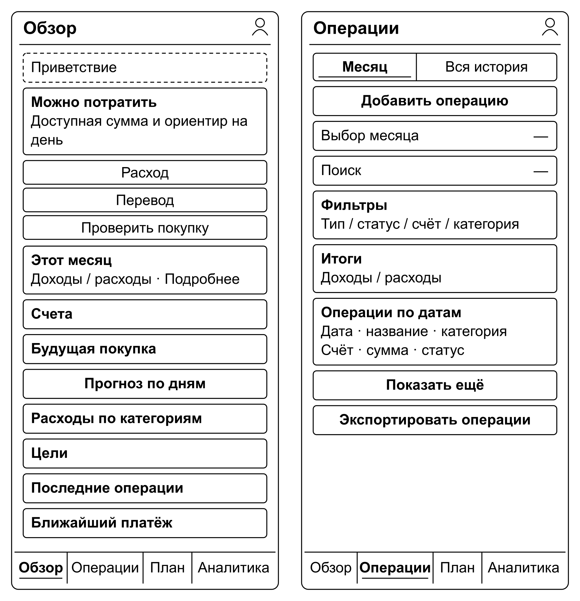

Раздел «Бюджеты» должен позволять сопоставлять расходы категорий с лимитами, а раздел «Цели» — просматривать накопления и переходить к пополнению или выводу средств. На рисунке 2 для обоих макетов предусмотрен общий переключатель разделов планирования.

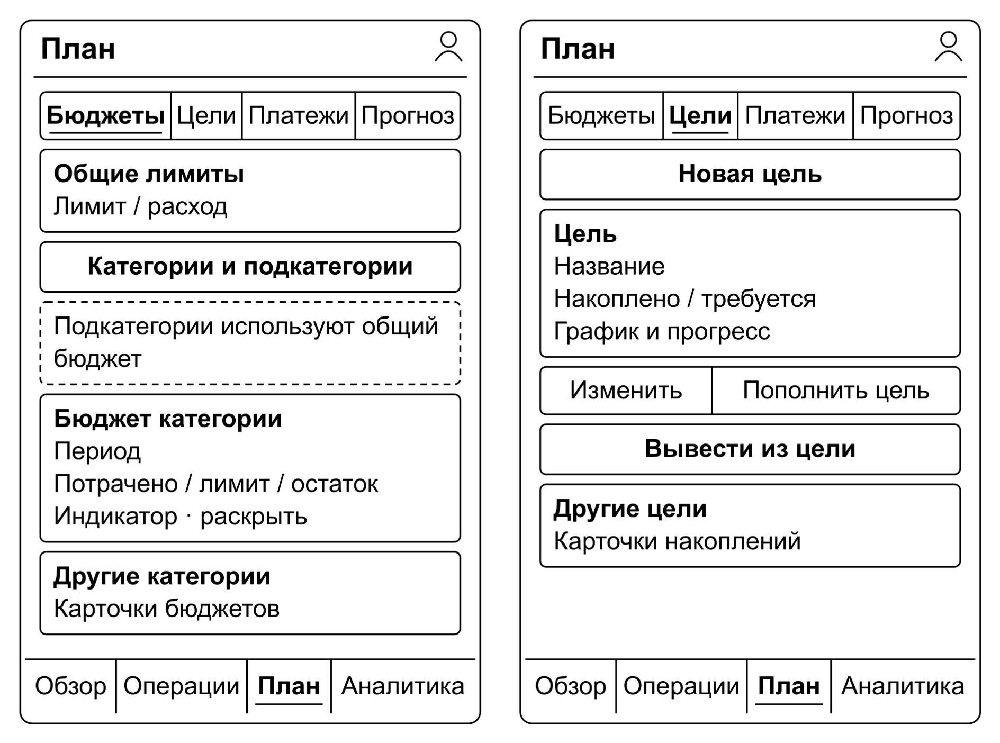

В разделе «Платежи» предлагается объединить календарь обязательств, единый список регулярных платежей и общую сводку на 30 и 365 дней. Для раздела «Прогноз» предусматривается показ ожидаемых остатков, счетов и событий выбранного горизонта. На макетах рисунка 3 плановые показатели визуально отделены от подтверждения фактической операции.

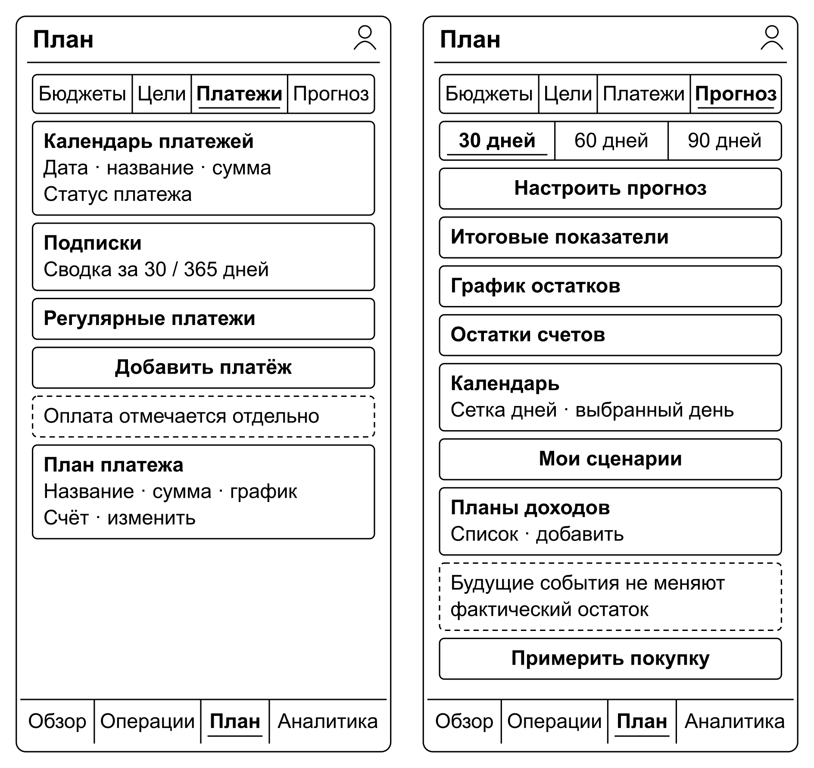

Экран «Аналитика» должен раскрывать результаты выбранного месяца, динамику и структуру расходов. В меню профиля предлагается объединить финансовые параметры, управление приложением и перенос данных. Рисунок 4 показывает макеты самостоятельного экрана аналитики и окна настроек, доступ к которому предполагается разместить в шапке.

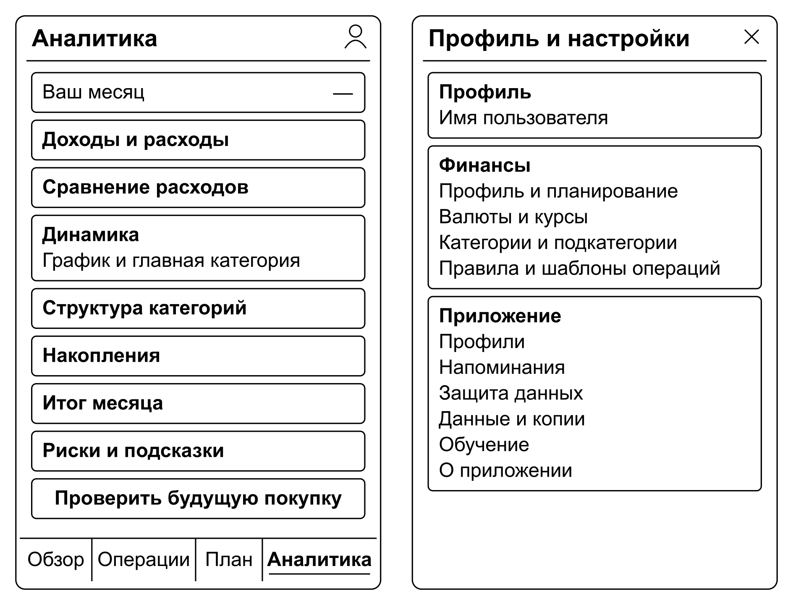

В финансовых настройках предусматриваются имя, опорный доход и резерв. Управление профилями должно позволять выбирать отдельный набор учёта, создавать, переименовывать и удалять его. На рисунке 5 показаны макеты этих окон; для удаления требуется отдельное подтверждение.

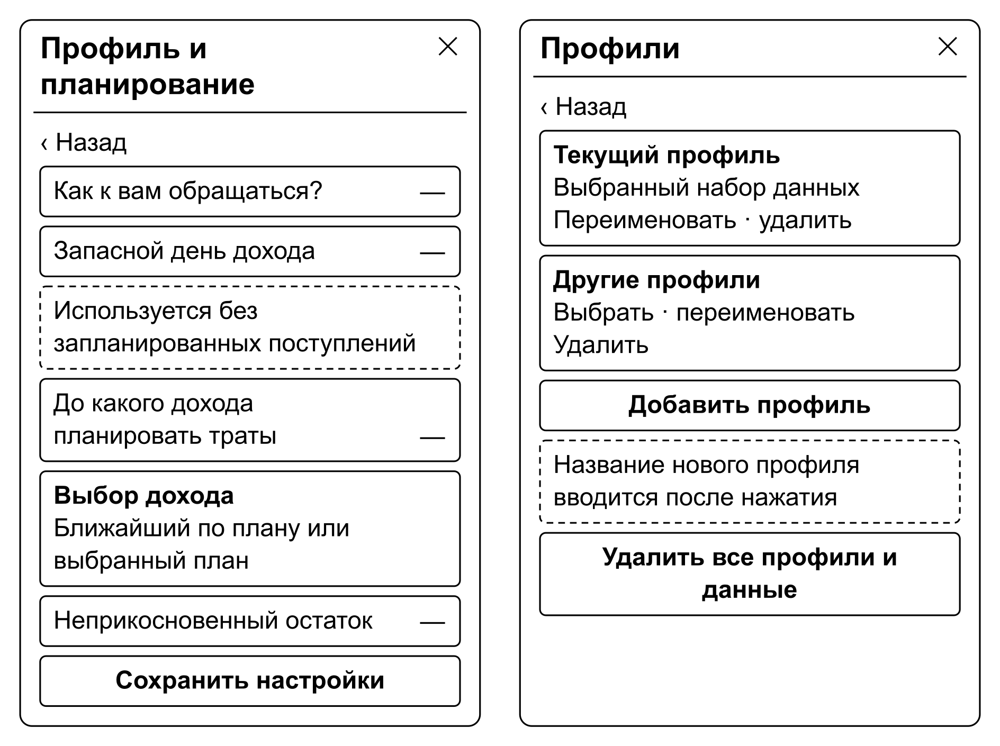

В макете окна данных разделены перенос истории, резервная копия и очистка. Для формы операции предусмотрены статус, вид движения, сумма, категория, счёт и дата. На рисунке 6 показаны предлагаемые действия и вариант ввода проведённого расхода.

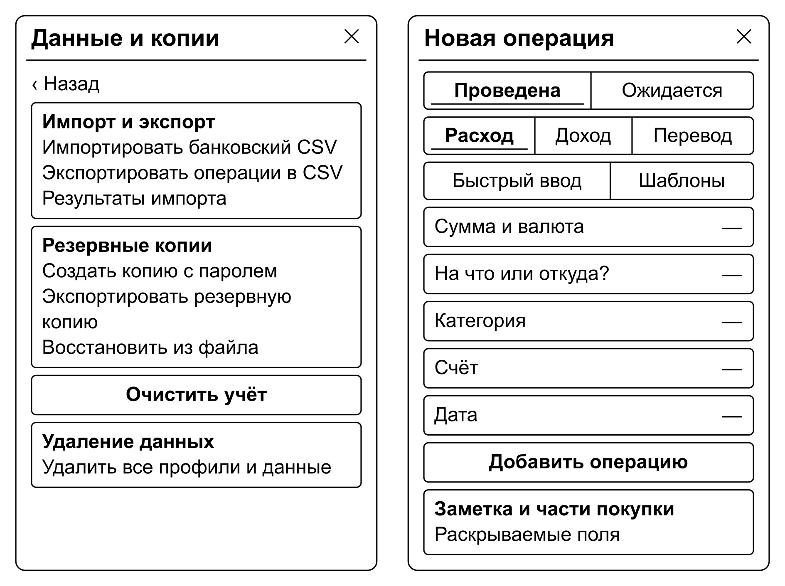

Форма создания счёта должна определять его тип, валюту и начальное денежное положение, а форма создания цели — требуемую сумму и условия накопления. Рисунок 7 показывает общие поля макетов; кредитные параметры и индивидуальный график предлагается раскрывать только при соответствующем выборе.

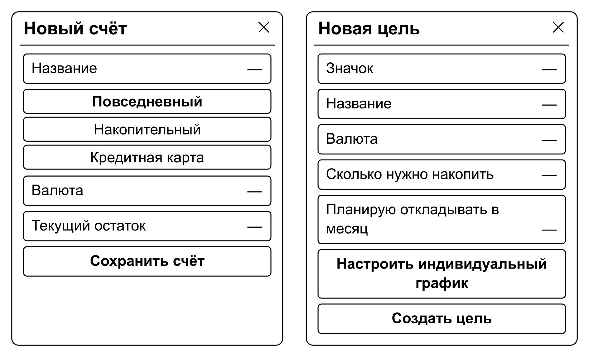

План дохода задаёт ожидаемое поступление, а план платежа — обязательство. Для обоих окон необходимо предусмотреть выбор суммы, графика и счёта. Рисунок 8 показывает макеты форм создания планов; сохранение условий само по себе не должно менять фактический остаток.

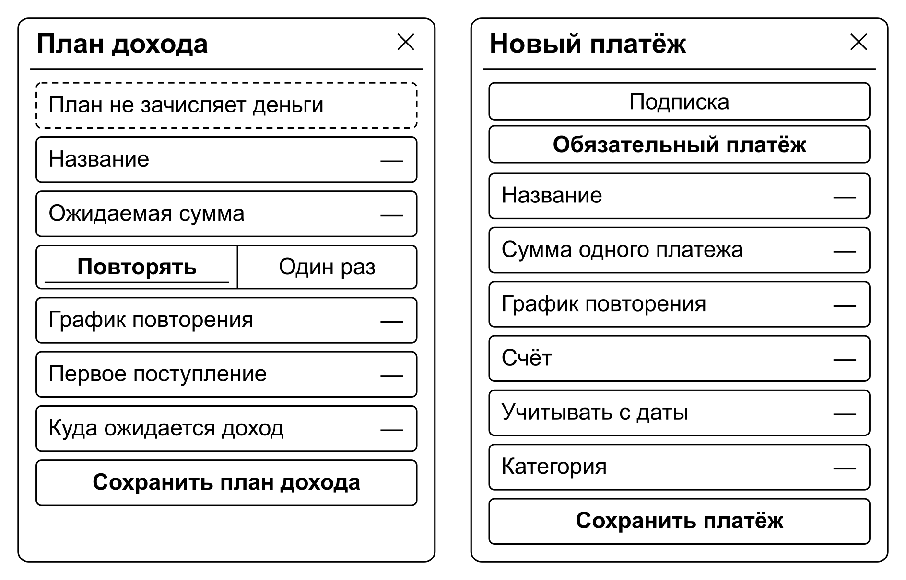

Проверка покупки связывает стоимость и дату с выбранным счётом и горизонтом. Сценарий объединяет несколько изменений для сравнения с базовым планом. Схемы на рисунке 9 отражают расчётный характер этих действий: изменение параметров не создаёт денежных операций.

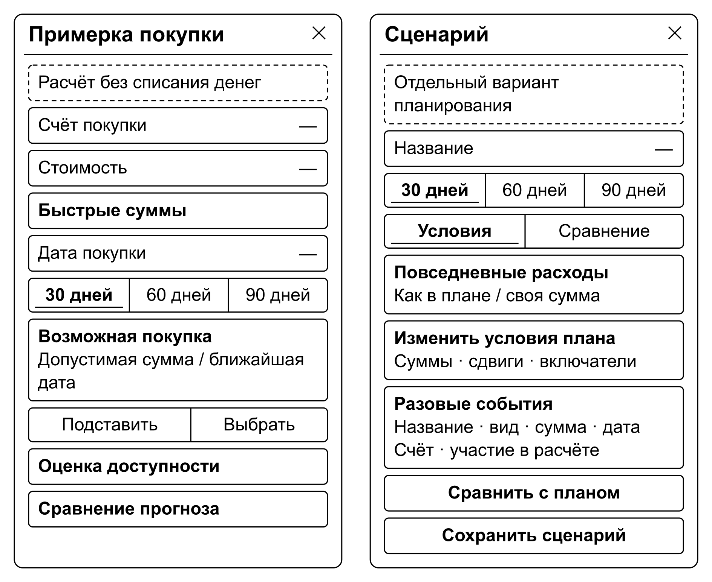

В обзорных блоках предлагается показывать первые пять записей. Для более длинных наборов необходима кнопка с общим числом, открывающая полный список порциями по 50 записей с действием «Показать ещё». Ограничение показа не должно сокращать данные финансовых итогов. После вложенной формы требуется возвращать пользователя к списку, сохраняя выбранный месяц аналитики. В форме вывода из цели следует показывать доступные накопления, счета списания и зачисления и сумму; запись должна выполняться текущей датой. Для обмена необходимо предусмотреть сумму в валюте получателя. Оба проектируемых состояния представлены на рисунке 10.

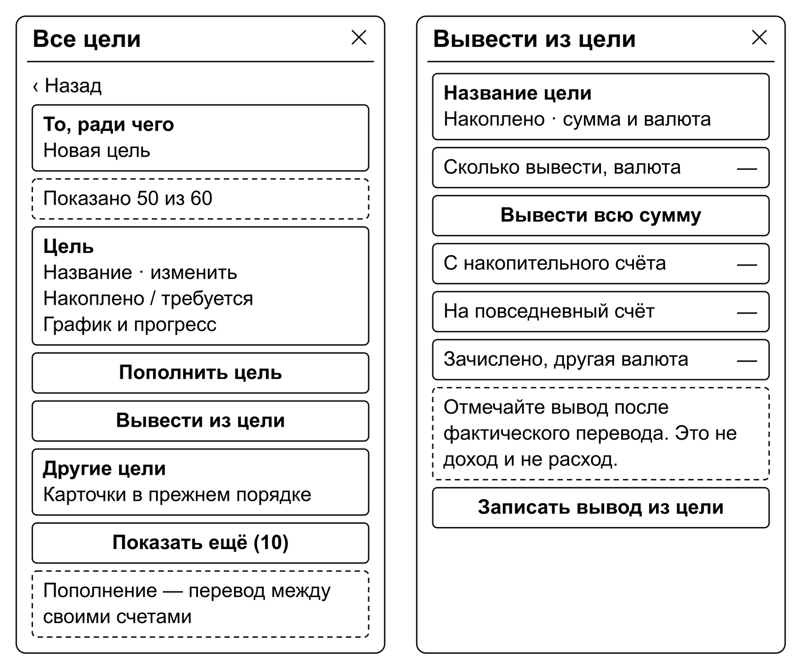

Поля должны явно разделять тип, сумму, счёт, категорию и дату; для обмена требуются две суммы и валюты. Сообщение об ошибке должно объяснять исправление с сохранением ввода. Для дат необходим локальный формат, для сумм — обозначение валюты, для доступности — пояснение. Неназначенное событие и неподтверждённая запись должны получать явный статус. Восстановление и сброс требуют отдельного подтверждения.

Для единообразия интерфейса предлагаются общие компоненты, цвета и шрифт Manrope. Действия должны иметь доступные подписи и роли; цвет не должен служить единственным сигналом ошибки. В формах необходимо учитывать прокрутку, безопасные области и клавиатуру. Проверку адаптации планируется проводить при ширине 320, 390 и 1440 пикселей; доступность и системные окна потребуется дополнительно проверить на мобильном устройстве.

Для закрытия изменённой формы, возврата, свайпа и перехода к списку требуется общая проверка несохранённых изменений. При отмене закрытия ввод должен сохраняться; после подтверждения следует последовательно очищать затронутые черновики, включая редактирование шаблона и правила категории.

### 1.4.2 Интерфейсы ПО

Платформенные обращения необходимо отделить от финансовых расчётов. В таблице 5 определены планируемые интерфейсы обмена через адаптеры и модули Expo SDK 58 [15].

Таблица 5 – Программные интерфейсы приложения

| Компонент                | Назначение и данные                                             | Ограничение                                                      |
| ------------------------ | --------------------------------------------------------------- | ---------------------------------------------------------------- |
| Локальное хранилище      | Снимок финансового состояния, реестр профилей, служебные записи | Native и Web имеют разные способы защиты                         |
| Файловые средства ОС     | Выбор CSV, JSON, .ladbackup; сохранение и передача файла        | Передача не подтверждает исправность копии без чтения            |
| SecureStore              | Отдельное хранение ключа профиля                                | Системные Keychain/Keystore; ключ не включается в экспорт [16]   |
| Системная аутентификация | Биометрия либо разрешённый код устройства                       | Только поддерживаемое нативное окружение                         |
| Локальные уведомления    | Разрешение, очередь событий, переход к плану                    | Web не предоставляет равнозначную очередь; доставки сервером нет |
| Frankfurter              | HTTPS-запрос кодов валют; JSON с курсом и датой                 | Финансовые записи не отправляются; ответ проверяется             |

Для импорта CSV требуется поддержка UTF-8/Windows-1251, точки с запятой, запятой и табуляции, настройка заголовка и колонок, разбор и предпросмотр. Полный перенос необходимо выполнять отдельной копией. При сетевой ошибке должны сохраняться прежние курсы и ручной ввод; обновление не должно отменять ручной приоритет.

Для напоминаний предлагается ограничение в 60 местных календарных дней, включая сегодня, и 60 записей. Очередь следует обновлять при открытии, возвращении и изменении планов; фоновое пополнение без запуска приложения не предусматривается. Собственные аппаратные протоколы не планируются; биометрическую аутентификацию предполагается выполнять через ОС без получения и хранения биометрических образцов.

## 1.5 Нефункциональные требования

### 1.5.1 Целостность финансовых данных

NFR-01. Изменение должно сохранять ссылки, целочисленные суммы и согласованность сущностей. Критерий: недопустимое действие не меняет исходное состояние; перевод обновляет обе стороны, импорт — весь проверенный пакет. При приёмке необходимо проверить возвраты, обеспечение целей по валютам, границы сумм и календаря.

NFR-02. Остатки и отчётность должны воспроизводиться на указанную дату. Критерий: корректировка не становится доходом, план не создаёт факт, переименование не меняет оценку. Одинаковые исходные данные и дата должны давать одинаковые суммы и состав денежных событий.

### 1.5.2 Надёжность и восстановление

NFR-03. Ошибка чтения должна открывать восстановление без подмены сохранённых данных; ошибку записи необходимо показывать с возможностью повтора. Критерий: различимы состояние в памяти, читаемый снимок и неподтверждённая запись; повтор не дублирует денежную операцию или импорт.

NFR-04. Формат, ссылки и пароль необходимо проверять до подтверждённой замены. Неудача должна сохранять исходные данные в предусмотренном маршруте. Для уменьшения риска перезаписи предлагаются новое поколение нативного файла и обратная проверка; физическая сохранность при любом отказе не гарантируется.

Подтверждённое удаление профиля или полный сброс необходимо фиксировать служебным журналом. После прерывания незавершённая очистка должна возобновляться до открытия учёта; при ошибке финансовый интерфейс должен оставаться закрытым до повторной попытки. Удаление одного профиля не должно затрагивать учёт остальных.

### 1.5.3 Безопасность информации

NFR-05. Нативный снимок необходимо шифровать AES-256-GCM, а ключ хранить отдельно в SecureStore. Для парольной копии требуется отдельный ключ с фиксированными проверяемыми параметрами PBKDF2-SHA256. Критерий: повреждение и неверный пароль обнаруживаются до применения, секреты не входят в журналы и экспорт. Оценку соответствия этим требованиям следует отделять от независимого аудита защиты.

NFR-06. Включённая блокировка должна закрывать интерфейс при уходе в фон, сохраняя черновик. При приёмке необходимо проверить возвращение, отмену аутентификации и список приложений. Шифрование Web, JSON/CSV и служебных названий профилей не предусматривается. Защита интерфейса не предназначена для противодействия скомпрометированной ОС или чтению памяти процесса.

### 1.5.4 Совместимость и переносимость

NFR-07. При чтении старых копий необходимо сохранять финансовый смысл: отсутствующая валюта означает RUB, неизвестное основание остаётся неизвестным, строка сценария без признака участия включена. Критерий: чтение корректной старой копии не повышает её автоматически до формата 9; версии 1–4 сохраняют нормализацию до 4. Освобождение без цикла допустимо начиная с формата 9; сохранение сценария после вывода должно сохранять версию и финансовые связи.

NFR-08. Общие действия должны давать одинаковые финансовые результаты на всех UI-платформах; системное поведение необходимо проверять отдельно. Экспорт JavaScript и ресурсов iOS/Android/Web не равнозначен APK/IPA или испытанию физического устройства.

### 1.5.5 Производительность и объём данных

NFR-09. Превышение допустимого объёма необходимо объяснять и отклонять до изменения учёта. Для обычной копии предлагается предел 5 МБ UTF-8, для CSV — 2 000 000 байт, 5000 строк и 50 колонок. Предупреждения следует показывать при 80% пределов учёта; эти границы потребуется учитывать при планировании нагрузочных испытаний. Спасательный архив не должен отменять обычные ограничения.

Предлагаемая приёмочная цель: на согласованном Android-устройстве с 5000 операциями пересчитывать прогноз на 90 дней за 2 секунды в 95% из 30 повторений после прогрева. Это будущий критерий, не замер. В протоколе фиксируются устройство, сборка и границы измерения; холодный запуск и парольный экспорт оцениваются отдельно.

### 1.5.6 Удобство и сопровождаемость

NFR-10. На узком экране необходимо обеспечить читаемость подписей, прокрутку окон и доступность подтверждения при открытой клавиатуре; ошибки должны объяснять исправление. Доступные роли и подписи потребуется проверить средствами платформы; свойства компонентов сами по себе не доказывают удобство для всех пользователей.

NFR-11. Финансовое ядро необходимо отделить от интерфейса и ввода-вывода; модули должны использовать публичные интерфейсы без циклов. Критерий: расчёт на переданных состоянии и дате не обращается к React, DOM, файлам и сети; замена адаптера не переписывает финансовую модель.

Для приёмки приложения предусматриваются модульные, браузерные и нативные испытания. Отдельно потребуется проверить доставку уведомлений, защищённый перенос данных и работу под нагрузкой. Расчёт доходности и инфляции целей, процентов и льготного периода карты, а также сохранение прошлых прогнозов для сравнения с фактом не входят в объём проекта.

Пользовательские цели, данные, интерфейсы и свойства качества определяют модели второй главы. Связь плана и факта, целостность изменений и объяснимые ограничения определяют дальнейшую проверку.

# 2 Проектирование мобильного приложения «Лад»

## 2.1 Модель сценариев использования предметной области

Модель вариантов использования должна раскрывать взаимодействие владельца с приложением: какие изменения он подтверждает, какие результаты получает и какие действия необходимы для их достижения. Основу составляют девять прецедентов UC-01–UC-09 из подраздела 1.2. Вспомогательные прецеденты уточняют разновидности денежных записей, обязательные части финансовых действий и дополнения, возникающие при определённых условиях. Такое представление позволяет связать общую цель пользователя с конкретным результатом учёта или расчёта.

Для проектирования используются нотация UML [17] и принципы выделения участников и отношений, рассмотренные в [21], [22]. Модель представлена на шести диаграммах: запись операции, переводы и обмен, движение накоплений, сверка, оценка покупки и сравнение сценариев. Повторяющееся название обозначает один прецедент с одинаковым смыслом. Например, финансовая проверка должна защищать как обычную запись расхода, так и перевод накоплений или корректировку остатка.

### 2.1.1 Участник системы и смысл отношений

Актор «Владелец учёта» соответствует пользователю, описанному в пункте 1.1.3. Он должен вводить финансовые сведения, подтверждать изменения и выбирать условия расчёта. Локальные профили разделяют наборы данных, сохраняя одинаковые возможности владельца. Поэтому для них не требуется вводить разные роли.

На каждой диаграмме прямоугольник задаёт границу мобильного приложения «Лад», внутри располагаются прецеденты, снаружи — владелец. Сплошная линия без стрелки обозначает его участие. Основные прецеденты имеют идентификаторы UC-01–UC-09; вспомогательные названы по результату действия. Связь владельца с общим прецедентом распространяется на его разновидности, поэтому отдельная линия к каждому частному случаю не требуется.

Обобщение обозначается сплошной линией с полым треугольником от частного прецедента к общему. Оно задаёт разновидность поведения: перевод должен сохранять общие свойства денежной операции. Пунктирная стрелка «include» направляется к обязательной части действия: взнос должен включать запись перевода. Стрелка «extend» направляется от условного дополнения к базовому прецеденту: корректировка должна дополнять сверку при расхождении и согласии владельца. Условие определяет, когда дополнение требуется, а точка расширения — к какой части взаимодействия оно относится [17]. Эти отношения не задают последовательность вычислений внутри программы.

### 2.1.2 Запись финансовой операции

UC-01 «Записать финансовую операцию» должен завершаться сохранением денежной записи с датой, суммой, названием и необходимыми ссылками. Прецеденты «Записать доход», «Записать расход» и «Учесть возврат покупки» являются его разновидностями: они должны использовать общие правила записи, уточняя экономический смысл движения. Для дохода предусматривается увеличение средств, для расхода — их уменьшение с указанием назначения. Возврат должен связываться с исходной покупкой и уменьшать расходы на дату зачисления; обычным доходом его считать не следует.

На рисунке 11 показаны разновидности операции, общая финансовая проверка и условное разделение расхода.

UC-01 обязательно включает прецедент «Проверить финансовую согласованность учёта». Его результатом должно быть решение о допустимости изменения с учётом счетов, валют, связанных записей и финансовых ограничений. Проверка должна предотвращать появление несогласованных сумм и ссылок, нарушение обеспеченности целей и недопустимое изменение кредитных обязательств. При ошибке новая запись не должна сохраняться. Частные виды операции наследуют эту обязательную проверку.

Прецедент «Разделить расход по категориям» расширяет «Записать расход» в точке «распределение расхода». Условие расширения — обычный расход без связи с долгом и выбор разделения владельцем. Пользователь должен иметь возможность указать несколько частей покупки, сумма которых точно равна её общей стоимости. Расход с одной категорией остаётся самостоятельным завершённым действием. Разделение должно уточнять распределение одной покупки, сохраняя одно списание со счёта.

### 2.1.3 Переводы и валютный обмен

UC-02 «Записать перевод между счетами» специализирует UC-01. Для него должны быть заданы разные счета списания и зачисления. В одной валюте обе суммы должны совпадать, сохраняя общую сумму собственных денег. Прецедент «Записать валютный обмен» является разновидностью перевода: он должен связывать счета в разных валютах и хранить две фактические суммы. Оба вида движения необходимо исключать из обычных доходов и расходов.

На рисунке 12 раскрываются обобщение перевода, его валютная разновидность и добавление комиссии.

Прецедент «Учесть комиссию обмена» расширяет валютный обмен в точке «учёт комиссии». Он должен выполняться, когда записывается новый проведённый обмен, владелец выбрал комиссию и перевод не связан с целью, долгом или планом. Без выбранной комиссии обмен должен завершаться сохранением основного перевода. Это условие отличает дополнительную плату от обязательной суммы зачисления в другой валюте.

Учёт комиссии обязательно включает прецедент «Записать расход»: пользователь должен указать сумму, счёт списания комиссии и категорию. Этот расход наследует общую запись операции и финансовую проверку. Таким образом, перевод объясняет перемещение денег, а расход — отдельную плату за обмен. Обе записи должны сохраняться совместно одним подтверждением; ошибка комиссии должна отменять всё изменение.

Обобщение не должно создавать дополнительную операцию наряду с переводом. Оно определяет общие правила его записи. Недостаточность источника с учётом удержаний, архивный счёт или нарушение обеспеченности накоплений должны блокировать недопустимое движение, независимо от того, выполняется обычный перевод или валютный обмен.

### 2.1.4 Взнос в цель и вывод накоплений

UC-03 «Учесть взнос в цель» должен включать два обязательных прецедента: UC-02 и «Закрепить переведённую сумму за целью». Запись перевода должна отражать движение с повседневного счёта на накопительный, а закрепление — назначение полученных средств. Без записи перевода результат взноса не достигается; без связи с целью перевод остаётся обычным перемещением денег. Валюта накопительного счёта должна совпадать с валютой цели. При обмене увеличение накопленной суммы определяется зачислением.

На рисунке 13 взнос и вывод связаны через общий перевод и финансовую проверку.

UC-04 «Учесть вывод из цели» должен включать UC-02 и прецедент «Освободить сумму из цели». Освобождение уменьшает сумму, закреплённую за выбранной целью, сохраняя историю взносов. Перевод должен отражать возврат этих средств с накопительного счёта в валюте цели на повседневный. Вывод необходимо ограничивать накопленной суммой и доступностью выбранного источника. Обеспеченность других целей должна сохраняться отдельно для каждой валюты.

Показанное включение прецедента «Проверить финансовую согласованность учёта» в UC-02 раскрывает проверку, которую перевод наследует от общей денежной операции. Она должна одинаково действовать при взносе и выводе. Взнос сверх оставшейся суммы цели, необеспеченный вывод и недопустимые счета должны отклоняться.

Владелец должен подтверждать взнос или вывод один раз. Включённый перевод должен использовать уже выбранные счета и суммы. Одна запись перевода и изменение закреплённой суммы должны образовывать согласованное действие: ошибка не должна оставлять отдельно движение денег или освобождение накоплений. Вывод не следует учитывать как доход либо расход, а наступление даты графика взносов не должно само создавать перевод.

### 2.1.5 Сверка и исправление расхождения

UC-05 «Сверить остаток счёта» должен обязательно включать прецедент «Определить фактический остаток на дату». Здесь требуется получить остаток по фактическому учёту: начальной сумме, проведённым операциям и датированным корректировкам. Владелец должен ввести известную ему сумму в валюте счёта на конец того же дня. Сопоставление этих значений должно показать совпадение или величину расхождения.

На рисунке 14 обязательное определение остатка отделено от условной корректировки.

При совпадении сумм UC-05 должен завершаться сохранением сверки без изменения денег. При расхождении владелец может проверить операции, исправить историю и повторить сравнение либо отказаться от подтверждения. UC-06 «Скорректировать остаток счёта» расширяет сверку в точке «разрешение расхождения» только тогда, когда остатки различаются и владелец подтвердил корректировку. Для неё необходимо пояснение причины. При расхождении без такого согласия отметка об успешной сверке создаваться не должна.

UC-06 обязательно включает общую финансовую проверку. Перед сохранением требуется повторно установить актуальность денежных записей, допустимость кредитного остатка и обеспеченность целей. Корректировка должна иметь собственную дату и изменять расчётный остаток, сохраняя начальную сумму счёта и прежние операции. В обычные доходы и расходы она не входит. Корректировку и результат сверки необходимо сохранять совместно; последующее изменение связанных денежных записей должно делать прежнюю сверку неактуальной.

### 2.1.6 Оценка покупки на основе прогноза

UC-08 «Оценить возможность покупки» должен включать UC-07 «Получить прогноз денежных остатков». Для вывода о допустимости решения необходимо сопоставить исходный план и вариант с покупкой на выбранном счёте и в заданную дату. UC-07 обязательно включает прецедент «Выявить дефицит и нарушение резерва». Прогноз должен предоставлять остатки по дням, минимальные значения, даты нехватки и предупреждения; отсутствие нарушений также является результатом этой проверки.

На рисунке 15 показаны обязательная оценка покупки и дополнение для текущего дня.

Второй обязательной частью UC-08 является прецедент «Определить допустимую сумму и дату покупки». Он должен учитывать средства выбранного счёта и общий резерв на всём горизонте, включая обязательства после покупки. Требуется показать максимальную сумму и ближайшую подходящую дату либо объяснить отсутствие допустимого варианта. Этот результат необходим при любой корректно заданной покупке, а не только при превышении желаемой стоимостью доступных средств.

Прецедент «Оценить дневную сумму после покупки» расширяет UC-08 в точке «оценка текущих трат», если дата покупки — сегодня. Он обязательно включает действие «Рассчитать доступную и дневную суммы». Владелец должен видеть текущий ориентир и его изменение после предполагаемой покупки до ближайшего подходящего дохода либо явно объяснённой запасной даты профиля. В этом расчёте резерв вычитается из доступных денег; в прогнозе он служит порогом сравнения.

Владелец также должен иметь возможность самостоятельно открыть UC-07. Накопления и кредитный лимит не должны увеличивать повседневную доступность. Исходный дефицит, неназначенные события и предупреждения должны исключать положительный вывод о покупке. Расчёт должен оставаться самостоятельной оценкой: изменение суммы и даты не создаёт расхода, а условия за пределами горизонта не дают основания обещать достаточность средств.

### 2.1.7 Сравнение и сохранение сценариев

UC-09 «Сравнить финансовые сценарии» должен включать UC-07 для обоих вариантов от одного актуального состояния и на одинаковом горизонте. В качестве второго варианта владелец может выбрать текущий план или другой сценарий. Общий прецедент выявления дефицита и нарушения резерва должен сохранять смысл, заданный при оценке покупки. Сравнение должно показывать различия остатков и дат нехватки, даже если конечные суммы совпадают.

На рисунке 16 общая проверка условий связывает сравнение с необязательным сохранением варианта.

UC-09 обязательно включает прецедент «Проверить допустимость условий сценария». Необходимо проверить название, горизонт, суммы, даты, валюты и допустимость назначений. Недопустимые значения должны препятствовать расчёту или сохранению до исправления. Прецедент «Пояснить ограничения сценария» расширяет сравнение в точке «пояснение результата», когда имеются неактуальные или неучтённые условия. Например, удалённый источник, остановленный платёж, прошедшая дата, архивный счёт или событие вне горизонта требуют пояснения. Такие предупреждения не следует автоматически считать запретом всего расчёта.

Прецедент «Сохранить условия сценария» расширяет UC-09 в точке «сохранение варианта», если владелец выбирает сохранение. Сравнение должно оставаться доступным без предварительной записи сценария. При сохранении требуется обязательно повторить проверку допустимости условий. Прямая ассоциация владельца с сохранением также должна позволять сохранить вариант из формы условий без предварительного просмотра сравнения.

Сохранять следует предположения сценария, а последующие результаты — пересчитывать от актуального учёта. Выключенная строка должна оставаться в условиях без влияния на результат. Изменения сценария не должны переписывать реальные счета, операции и планы или менять условия просроченных обязательств. Отдельный расход после совершённой покупки должен записываться самостоятельным выполнением UC-01.

### 2.1.8 Согласованность модели

Основные прецеденты сохраняют соответствие требованиям 1.2.1–1.2.9 и подразделам реализации 3.1–3.9. Вспомогательные действия раскрывают их поведение, а общие прецеденты задают одинаковые правила в разных взаимодействиях. Наличие исходных данных само по себе не означает включения: прогноз должен использовать историю, но не запускать заново запись операций или сверку. Связи данных и программных частей рассматриваются далее в подразделах 2.2 и 2.3. Профили, защита, файлы, категории, бюджеты, планы и аналитика должны обеспечивать эти взаимодействия в соответствии с требованиями первой главы.

## 2.2 Логическая модель данных

Для приложения предлагается единая логическая модель, объединяющая фактический учёт, планирование и вспомогательные настройки. Общая ER-диаграмма приведена в приложении А. Для сохранения читаемости она разделена на несколько фрагментов формата А4, которые при совмещении образуют одну схему. Верхний ряд составляют рисунки А.1 и А.2, нижний — А.3 и А.4. Фрагменты совмещаются по границам рисунков, без полей страницы. Одинаковые метки у границ обозначают продолжение одной связи на соседнем фрагменте. Модель описывает структуру данных независимо от способа хранения; использование реляционной СУБД для неё не требуется.

Основной единицей хранения предлагается сделать финансовое состояние отдельного профиля, сериализуемое в JSON. В него входят шестнадцать коллекций предметных записей и объект настроек. Каталог профилей следует хранить отдельно: профиль определяет пространство хранения своего учёта, поэтому добавлять его идентификатор в каждую операцию или цель не требуется. Идентификаторы записей действуют внутри профиля, а идентификаторы вложенных версий — внутри соответствующего плана. Для бюджета ключом служит идентификатор основной категории. Для части расхода составной ключ образуют операция и категория, для изменения сценария — сценарий, вид и идентификатор источника. Для разового события ключ образуют сценарий и его собственный идентификатор. Графики повторения, параметры напоминаний и сопоставления столбцов CSV предлагается описывать вложенными значениями.

На диаграмме кратность «1» означает обязательную связь с одним объектом, «0..1» — необязательную связь, «0..*» — произвольное количество связанных записей. Пунктир обозначает мягкую ссылку, для которой допускается отсутствие исходного объекта; пометка XOR — выбор одного из альтернативных видов источника. Пересечение линий само по себе не создаёт связи. Вложенные структуры отделены от самостоятельных сущностей. Такой способ представления позволяет отразить версии условий, части операций и строки сценариев без предположения, что для каждой из них нужна отдельная таблица. Вычисляемые остатки, будущие обязательства, результаты прогноза и расписание уведомлений не предусматриваются как самостоятельные сохраняемые сущности.

Центральную часть модели образуют счёт, операция и категория. Каждая операция связана ровно с одним основным счётом: получателем дохода либо источником расхода или перевода. Второй счёт обязателен для перевода и отсутствует у остальных операций. При валютном обмене необходимо сохранять обе фактические суммы. Операция имеет основную категорию и может содержать части расхода с собственными категориями; их суммы должны точно составлять исходный расход. Возврат связывается с первоначальной покупкой, для которой допускается несколько частичных возвратов. Возврат должен уменьшать расходы на дату зачисления.

Для категорий предусматривается двухуровневая иерархия без циклов: категория имеет не более одного родителя. Основной категории может соответствовать один бюджет с историей условий, изменениями лимита и отдельными значениями для периодов. Подкатегории должны использовать общий родительский лимит. Корректировки и сверки относятся к одному счёту, но имеют разное назначение: корректировка изменяет остаток на указанную дату, сверка фиксирует подтверждённую сумму и отпечаток денежных записей. Долг связан с исходным счётом и последующими операциями выдачи или погашения. Счёт такого движения может отличаться от исходного при сохранении валюты долга.

Планируемый доход, регулярный платёж и цель должны содержать историю версий условий. Каждая версия принадлежит одному объекту; её действующий интервал не пересекается с интервалами соседних версий. Для прежних записей допускается отсутствие сохранённых версий: исходные условия определяются по полям плана. Сохранённая операция может ссылаться на план, его версию и исходный ключ обязательства: месяц для прежнего месячного плана, значение once для разового дохода или дату для интервального графика. Перенос ожидаемого дохода следует описывать отдельным изменением события, сохраняя его первоначальную идентичность. График повторения предлагается задавать единицей периода, интервалом и опорной датой, а календарь обязательств рассчитывать по этим условиям.

Цель связана с переводами взносов и обеспечивается совокупностью накопительных счетов своей валюты. Для годового фонда предусматриваются циклы: у цели возможно несколько исторических циклов, но только один активный. Активный цикл связан с плановым платежом и его версией, оплаченный — с расходной операцией, которая не может одновременно оплачивать другой цикл. Освобождение накоплений относится к одной цели и одному фактическому переводу; связь с циклом нужна при оплате фонда и отсутствует при самостоятельном выводе. Один цикл и один перевод могут иметь не более одной связанной записи освобождения. Такая структура позволяет отличать уменьшение закреплённых накоплений от нового взноса и сохранять согласованность истории.

Настройки прогноза должны задавать счёт ежедневных расходов, пары счетов для взносов в цели и источники погашения долгов или кредитных счетов. Плановый перевод содержит дату, два счёта и суммы движения, однако не является фактической операцией. Автоматическая связь такого плана с проведённым переводом не предусматривается: после отражения факта соответствующий план необходимо удалить, чтобы исключить повторное влияние на прогноз.

Сценарий объединяет изменения существующих планов и разовые события. Изменение определяется видом и идентификатором источника, а разовое событие может иметь назначенный счёт. Ссылку изменения следует считать мягкой: после удаления исходного плана строка сценария сохраняется, но требует пояснения о недоступном источнике. Условия сценария хранятся отдельно от реальных планов, а результаты сравнения должны пересчитываться по актуальному учёту.

Вспомогательные сущности связывают автоматизацию с тем же финансовым ядром. Правило распознавания указывает категорию; шаблон операции — счета, категории и при необходимости части расхода. Профиль CSV задаёт счёт назначения, валюту и соответствие столбцов. Справочник валют определяет коды и точность денежных сумм, а настройки обмена — текущий курс используемой валюты с датой и источником его получения. Историческую оценку операции в основной валюте следует сохранять вместе с основанием оценки, не подменяя её текущим курсом. Денежные суммы во всех частях модели предполагается представлять целыми числами в минимальных единицах соответствующей валюты.

## 2.3 Структурное моделирование системы

Структурную модель предлагается построить нисходящим способом: приложение разделить на функциональные подсистемы, затем раскрыть составляющие их функции. На рисунке 17 показаны три уровня: мобильное приложение «Лад», пять подсистем и 18 функций. Линии дерева обозначают принадлежность функции подсистеме.

Подсистема фактического учёта должна обеспечивать ведение счетов и операций, запись переводов и движений накоплений, расчёт остатков, их сверку и корректировку. Её результатом должен быть согласованный набор финансовых фактов. Взнос в цель и вывод из неё необходимо отражать согласованным изменением денег на счетах и закреплённой суммы.

Подсистема финансового планирования должна позволять задавать доходы и платежи, настраивать бюджеты и периоды, определять цели и графики взносов, формировать обязательства и напоминания. Её результатом являются условия будущих действий. Условия цели следует отделять от фактического взноса, а наступление плановой даты не должно само создавать операцию.

Подсистема прогноза и оценки решений должна рассчитывать будущие остатки и доступную сумму, оценивать сумму и дату покупки, сравнивать сценарии. Для расчётов необходимо использовать текущий учёт, невыполненные планы и финансовые настройки. Результат должен показывать ограничения выбранного решения; изменение предположений не должно менять реальные операции.

Подсистема аналитики должна подводить итоги доходов и расходов, сравнивать категории и периоды, оценивать исполнение бюджетов. Исходными данными служат фактические операции и бюджетные условия. Сводки должны показывать распределение расходов и отклонения от лимитов. Переводы требуется исключать из доходов и расходов, возвраты — уменьшать расходы; исполнение бюджета следует оценивать по его собственным периодам.

Подсистема хранения и защиты должна разделять данные профилей, загружать и сохранять учёт, импортировать и экспортировать сведения, защищать данные и доступ к ним. При загрузке и импорте необходимо проверять формат и согласованность записей. Для мобильного хранилища предусматриваются шифрование и блокировка интерфейса; Web-хранилище и открытый JSON-экспорт остаются незашифрованными.

Взаимодействие подсистем должно опираться на единое состояние выбранного профиля. Учёт предоставляет сведения о выполнении планов; привязка уже записанной операции не должна повторно менять деньги. Прогноз получает текущие остатки из учёта и предстоящие события из планирования. Аналитика сопоставляет фактические операции с условиями бюджетов. Хранение должно предоставлять проверенные данные при открытии профиля и сохранять подтверждённые изменения. Эти связи позволяют использовать одни финансовые сведения для разных задач без дублирования учёта.

Для программного воплощения модели предлагается распределить предметные формы по модулям features, общие расчёты и проверки — по domain, управление состоянием — по state/finance. Адаптеры хранения, файлов, шифрования, уведомлений и курсов необходимо разместить в infrastructure. Application и Screens должны объединять модули в навигацию и экраны, Shared — предоставлять универсальные компоненты и функции. Интерфейс предполагается разработать на React Native и React [18], [19], контракты типизировать средствами TypeScript [20], возможности устройства подключать через Expo [15].

## 2.4 Модель классов предметной области

Концептуальные классы описывают предметные понятия и отношения средствами UML [17]. При реализации данные предполагается представить интерфейсами TypeScript и объектами, а обработку вынести в отдельные функции. Диаграммы задают атрибуты, связи и ограничения проектируемой предметной модели.

На рисунке 18 показаны семь понятий: счёт, операция, категория, часть расхода, долг, корректировка и сверка. Тип счёта и вид операции являются признаками объектов. Две ролевые ассоциации различают основной счёт и получателя. Композиция связывает одну операцию с 0..* частями: каждая часть принадлежит только ей. Легенда дополняет модель самоссылками категории и возврата, правилом вычисления остатка и ограничениями значений.

На рисунке 19 представлены восемь понятий: сценарий, планы дохода и платежа, цель, три вида условий и график. Композиция связывает каждый план или цель с собственными версиями. Версия содержит 0..1 графика; график — значение единицы повторения, интервала и опорной даты. Кратность владельца на каждой из трёх связей составляет 0..1, а ограничение {xor} в легенде требует ровно одного владельца среди соответствующих видов условий. Пунктир обозначает зависимость сценарного расчёта от планов, а не владение ими; устаревшая ссылка обрабатывается согласно логической модели.

Таблица 6 сопоставляет понятия с проектируемыми типами данных, включая вспомогательные типы, не показанные на компактных диаграммах.

Таблица 6 – Соответствие предметной модели проектируемым типам

| Концептуальный элемент      | Проектируемые типы                                     | Существенное различие                                        |
| --------------------------- | ------------------------------------------------------ | ------------------------------------------------------------ |
| Счёт и операция             | Account, Transaction                                   | Текущий остаток вычисляется; перевод хранит две стороны      |
| Категория и бюджет          | Category, BudgetPlan, BudgetVersion                    | Лимит принадлежит основной категории; условия версионируются |
| Цель и годовой фонд         | Goal, GoalTermsVersion, GoalFundCycle, GoalRelease     | Накоплено вычисляется по взносам и освобождениям             |
| Доход и платёж              | PlannedIncome, Recurring; соответствующие TermsVersion | План и факт разделены; обязательство имеет исходный ключ     |
| Долг, корректировка, сверка | Debt, BalanceAdjustment, AccountReconciliation         | Движение долга и корректировка не равны обычному расходу     |
| Сценарий и его строки       | SavedScenario, ScenarioChange, ScenarioEvent           | Хранятся предположения, а результат пересчитывается          |

Суммы необходимо интерпретировать вместе с валютой как целые минимальные единицы, даты — как местные календарные дни. Для остатков, накоплений, расходов бюджета и прогноза требуется разработать согласованные функции расчёта. Построенные модели задают основу дальнейшей реализации: разделяют факты и предположения, определяют идентичность обязательств и общий порядок проверяемых изменений состояния.

# 3 Реализация прецедентов мобильного приложения «Лад»

В третьей главе рассматривается реализация девяти прецедентов мобильного приложения «Лад», определённых в подразделе 1.2. Каждый раздел раскрывает результат конкретного взаимодействия: запись операции или перевода, взнос и вывод средств цели, сверку и корректировку остатка, получение прогноза, оценку покупки либо сравнение сценариев. Для них показаны преобразование входных данных, существенные проверки и используемые программные структуры. Числовые расчёты и примеры действий поясняют работу алгоритмов. Общие механизмы хранения, защиты, файлового обмена, бюджетов и аналитики описываются как обеспечение записи и обработки финансовых данных. Условия планов, долгов и напоминаний раскрываются как источники и средства поддержания исходных данных прогноза; их настройка не является обязательным шагом каждого расчёта.

Приложение реализовано функциональными компонентами React и модулями TypeScript. Поэтому описание реализации классов раскрывается через типы записей, их поля и функции, выполняющие соответствующие обязанности. Концептуальным сущностям главы 2 не приписываются отсутствующие конструкторы и методы экземпляров. Финансовый агрегат FinanceState передаётся в чистые функции предметной области, а интерфейс публикует результат через единое действие изменения состояния. Платформенные операции выполняются отдельными адаптерами.

Денежные значения хранятся в целых минимальных единицах валюты. В числовых иллюстрациях суммы приведены в рублях, если явно не указан иной код: 1 RUB соответствует 100 копейкам. Дата передаётся в расчёт явно; она обозначает местный календарный день. Для описания работы используются условные финансовые данные. Хранение, системная аутентификация и уведомления зависят от платформенных адаптеров и возможностей операционной системы.

## 3.1 Записать финансовую операцию

Прецедент UC-01 завершается сохранением новой согласованной денежной записи с её суммой, датой, счётом и назначением. Перевод UC-02 использует эту общую модель операции и уточняет её для двух счетов. Основной путь ввода и проведения раскрыт в начале раздела. Далее отдельно описаны обеспечивающие механизмы: перенос записей через файл, сохранность выбранного профиля, распределение расходов по бюджетам и аналитическая обработка истории. Их наличие не означает, что пользователь должен выполнять все эти действия при каждой записи операции.

### 3.1.1 Математическая модель денежной записи

Ручной ввод и файловый перенос операций используют общие правила денежных записей. Фактические операции отделяются от ожиданий. Для покупки с n частями должно выполняться условие

$$ Σ_{i=1}^{n} s_{i} = A \tag{3.1} $$

где s — положительная сумма части, A — общая сумма покупки. Части распределяют один расход по категориям и не создают самостоятельных списаний. Историческая оценка в основной валюте распределяется пропорционально методом наибольших остатков, поэтому округление не меняет общий итог.

Ожидающее исходящее движение уменьшает доступность, сохраняя фактический баланс:

$$ V_{a} = B_{a} − H_{a} \tag{3.2} $$

где V — доступность счёта, B — фактический остаток, H — сумма удержаний. Ожидаемый доход не увеличивает ни B, ни V. При проведении ожидания его удержание снимается одновременно с записью факта.

### 3.1.2 Ввод, изменение и проведение операций

Общая форма преобразует денежный ввод в целое число, проверяет дату и формирует TransactionInput. Внутри действия повторно проверяются счёт, допустимая категория, статус, сумма частей и предметные ссылки. Для нового ручного ввода выбирается активная категория; сохранённая архивная категория допускается в предусмотренных случаях редактирования, возврата и исполнения действующего плана. Для возврата дополнительно проверяются исходная покупка, её оставшаяся возвращаемая сумма и историческое распределение по категориям.

Алгоритм формирует новый массив операций и проверяет согласованность всего кандидата, включая обеспеченность целей и связи планов. Только после успеха единое состояние заменяется результатом. Ошибка не оставляет частично добавленную запись. Под атомарностью здесь понимается публикация финансового агрегата одним действием; это не утверждение о транзакции СУБД или поведении файловой системы. Схема приведена на рисунке 20.

При проведении ожидание временно исключается из кандидата, чтобы освободить собственное удержание. Затем проведённая запись с тем же идентификатором проходит общий путь проверки. Повторное проведение не создаёт вторую операцию. Отмена переводит ожидание в состояние cancelled и не изменяет фактические деньги.

### 3.1.3 Структуры операции и программные модули

Transaction содержит amount, date, accountId, status, expectedDate, splits и ссылки на связанные предметные записи. Поля baseAmount и valuation сохраняют историческую оценку и её основание. Изменение только заметки или названия не пересчитывает эту оценку по сегодняшнему курсу.

В модуле операций `saveTransaction` сохраняет ввод, а `appendTransaction` добавляет проверенную запись. Функции `postPendingTransaction` и `cancelPendingTransaction` проводят и отменяют ожидание. Общие проверки используются также импортом CSV. Функции `expenseContributions` и `transactionIncomeAmount` определяют финансовый смысл записи для аналитики. TransactionForm отвечает за ввод и обратную связь, а модель черновика сохраняет введённые поля при закрытии финансового интерфейса блокировкой.

Входом служат текст файла, сопоставление колонок и настройки назначения счетов и категорий. Промежуточная модель содержит разобранные строки, ошибки, признаки повторов и выбор пользователя. Функция `applyCsvImportWithSummary` повторно проверяет эти решения, а `appendTransactions` применяет согласованный пакет.

Результат включает sourceRows, added, invalid, duplicate и excluded, позволяя объяснить судьбу каждой логической строки. Функция `exportTransactionsCsvParts` возвращает подготовленные части и статистику экспорта. Записи операций и идентификаторы импорта сохраняются; таблица предпросмотра и промежуточные массивы разбора не становятся самостоятельными финансовыми фактами.

### 3.1.4 Распределение покупки, возврат и ожидание

При исходном остатке 10 000 RUB покупка 3 600 RUB от 8 сентября с частями 2 500, 800 и 300 RUB уменьшает остаток до 6 400 RUB. Возврат половины покупки от 10 сентября увеличивает его до 8 200 RUB и формирует отрицательные расходы −1 250, −400 и −150 RUB. На 9 сентября остаток по-прежнему равен 6 400 RUB, поскольку дата возврата ещё не наступает. Обычный доход от возврата равен нулю. Несовпадение суммы частей с покупкой и превышение возвращаемой суммы препятствуют сохранению записи.

Ожидающий расход 2 000 RUB при остатке 10 000 RUB даёт доступность 8 000 RUB. После проведения фактический остаток равен 8 000 RUB, удержание — нулю, доступность остаётся прежней. Повторная команда возвращает то же состояние. Ожидание ограничивает расходы заранее, а проведение заменяет удержание фактическим списанием.

### 3.1.5 Обеспечивающий механизм файлового переноса операций

Импорт CSV преобразует табличный файл в выбранный пакет операций. Предварительный просмотр отделяет некорректные строки, повторы и строки, исключённые пользователем. Наличие плохой строки не требует отвергать все подходящие записи файла. При применении весь выбранный пакет заново проверяется относительно актуального учёта и публикуется одним изменением. Этапы показаны на рисунке 21.

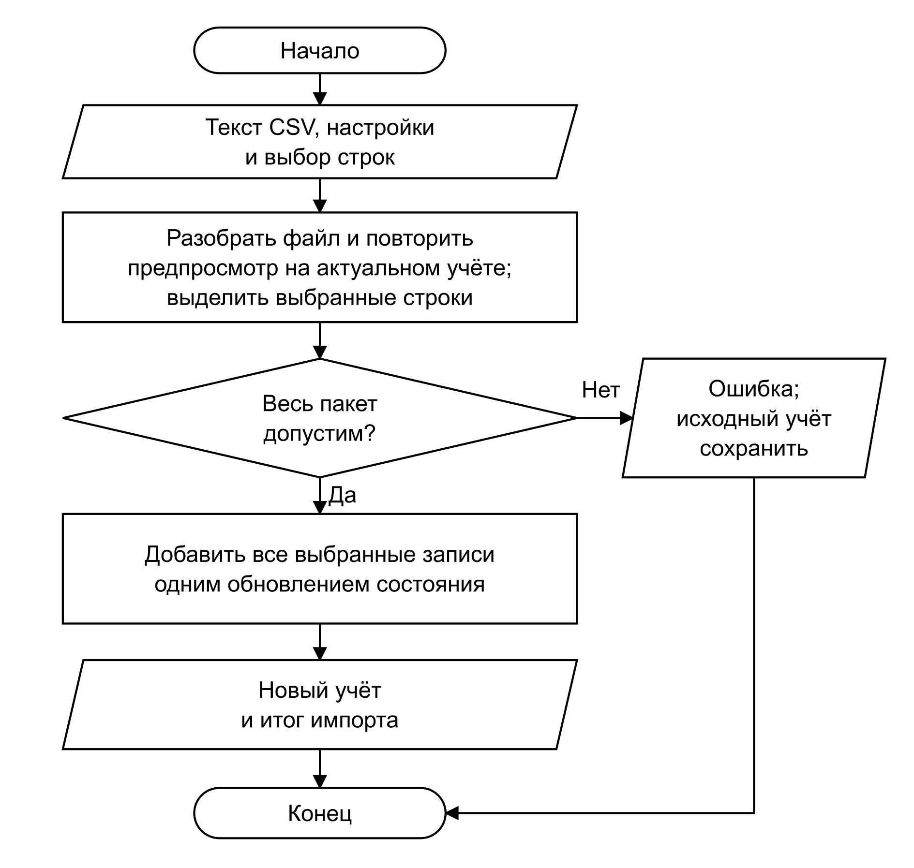

Даты, валюты и суммы преобразуются по тем же правилам, что ручной ввод. Повторы определяются с учётом идентификаторов импорта; новые категории автоматически выбираются только из активных. Общая проверка пакета учитывает лимиты записей и финансовые инварианты. Если она не проходит, исходное состояние сохраняется целиком.

Экспорт формирует UTF-8 с BOM, заголовками, запятой и разделителями строк CRLF. Крупный результат разделяется на части; связанные строки составной покупки и возврата не разрываются между файлами. Экспорт операций не заменяет полную резервную копию профиля.

На 15 октября 2026 года начальный остаток карты составляет 1 000 RUB; ранее импортированный расход 10 RUB уменьшает его до 990 RUB. Новый файл содержит пять строк: повтор прежнего расхода; доход с недопустимой будущей датой 16 октября; доход 100 RUB, исключённый пользователем; новый расход 20 RUB; новый доход 50 RUB.

Предварительный просмотр выделяет две операции для добавления, одну ошибку, один повтор и одну исключённую строку. После применения остаток равен 990 − 20 + 50 = 1 020 RUB; в истории находятся три операции. Экспорт формирует одну часть с тремя строками операций и BOM. Повторный импорт сохраняет историю, распознавая уже добавленные записи.

Ограничение общего объёма действует на пакет целиком. Если в учёте уже 19 999 операций, добавление ещё двух превышает предел 20 000. Действие отклоняет весь пакет и сохраняет прежние данные. Этот предел ограничивает допустимое состояние учёта и не задаёт скорость работы приложения.

### 3.1.6 Обеспечивающий механизм выбора профиля

Выбор профиля, сохранение и защита его данных обеспечивают среду выполнения финансовых действий. Создание и переключение профиля обеспечивают отдельное пространство учёта без смешивания финансовых записей. Имя профиля предназначено для отображения, а ключом хранения служит устойчивый идентификатор. Переименование поэтому не перемещает операции между хранилищами. Для имени проверяются длина от 1 до 40 символов, отсутствие управляющих знаков и регистронезависимая уникальность после удаления внешних пробелов и нормализации Unicode.

Перед созданием или переключением завершается очередь записи текущего профиля. Новый финансовый снимок сохраняется до публикации записи в реестре. При переключении целевой снимок сначала читается и проверяется; только затем изменяются активный профиль и отображаемый учёт. Отсутствие записи допускает начальное состояние, но ошибка разбора существующей записи открывает восстановление. Такая ошибка не должна запускать первоначальное обучение поверх повреждённых данных. Общий порядок показан на рисунке 22.

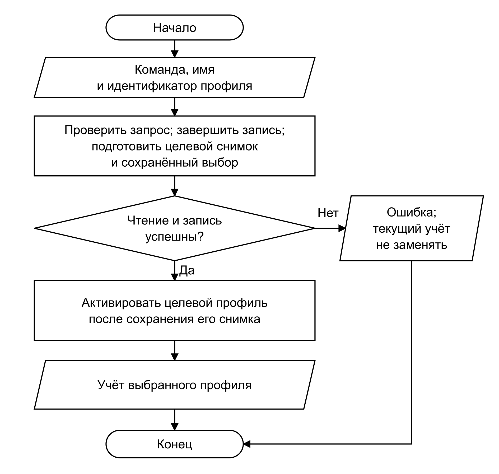

Удаление профиля является самостоятельным подтверждаемым действием. После ввода слова «УДАЛИТЬ» приложение завершает очереди, закрывает финансовые провайдеры и сохраняет журнал намерения. Затем удаляются ресурсы выбранного профиля, проверяется результат и обновляется реестр. Незавершённое подтверждённое удаление продолжается при следующем запуске. Удаление последнего пользовательского профиля возвращает приложение к приветствию; внешние экспортированные файлы этим действием не удаляются.

Пусть исходный реестр содержит профиль «Личный». Пользователь вводит для нового профиля имя « Семейный » с внешними пробелами. Нормализация удаляет их, поэтому в реестре сохраняется имя «Семейный». Переименование в «Общие расходы» меняет только отображаемое имя; идентификатор профиля и ключи его финансовых записей остаются прежними. Попытка добавить другой профиль с именем « ОБЩИЕ РАСХОДЫ » отклоняется как повтор после нормализации.

Действие возвращает новый массив реестра, не изменяя исходный. Кодирование сохраняет идентификаторы и имена для последующего чтения. Финансовые записи каждого профиля сохраняются под отдельными ключами, поэтому восстановление одного профиля не заменяет данные остальных.

### 3.1.7 Обеспечивающие механизмы локального сохранения и блокировки

Сохранность данных профиля обеспечивается локальной записью, переносимой копией, восстановлением и блокировкой интерфейса. На нативных платформах снимок шифруется AES-GCM, а отдельный ключ профиля хранится в SecureStore. В Web финансовый JSON в браузерном хранилище открыт. Обычный экспорт JSON также не зашифрован. Эти механизмы нельзя объединять в утверждение о шифровании всех данных на всех платформах.

Переносимая парольная копия использует независимый ключ: PBKDF2-SHA256 получает пароль, случайную соль 16 байт, 600 000 итераций и требуемую длину 32 байта. Затем AES-256-GCM использует новый nonce 12 байт и аутентифицируемые параметры конверта. Ключ устройства и пароль в копию не записываются. Рабочие массивы ключа и открытых байтов очищаются после завершения операции. Описанный алгоритм является использованием криптографических примитивов, а не самостоятельным доказательством их стойкости.

Блокировка закрывает финансовый интерфейс при уходе приложения в фон. Результат системной проверки не принимается, если во время неё приложение ушло в фон. Компоненты открытой формы сохраняются смонтированными под защитной оболочкой, позволяя удержать черновик. Черновики не являются частью финансовой резервной копии.

### 3.1.8 Обеспечивающие механизмы копирования и восстановления

Перед экспортом выбирается подтверждённый источник снимка и проверяются финансовая схема, ссылки и размер. Для обычной копии действует предел 5 000 000 байт. Подготовленные байты получают имя, размер и SHA-256; передача в системное меню не объявляется доказательством сохранения внешнего файла.

Восстановление сначала распознаёт содержимое, проверяет поддерживаемые параметры конверта, выполняет аутентифицированное расшифрование и проверяет финансовый снимок. До успешной проверки и предусмотренного подтверждения действующий учёт не заменяется. Неверный пароль допускает повторную попытку. Восстановление показано на рисунке 23.

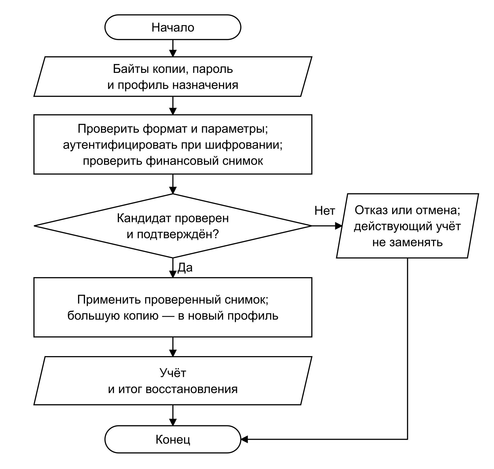

Финансовые форматы 1–4 читаются с прежней нормализацией в 4; чтение 5–8 само по себе не добавляет семантику 9. Версия финансового JSON независима от версии шифрованного конверта. Большой спасательный архив использует отдельный проверяемый допуск и восстанавливается в новый профиль; он не подменяет обычную копию произвольного размера.

Для финансового снимка с остатком 1 020 RUB парольная копия сохраняет все операции и параметры учёта. Такой снимок без новых полей имеет финансовую версию 4; обычный шифрованный конверт имеет версию 1. Расшифрование правильным паролем и последующее восстановление возвращают тот же финансовый снимок, включая его версию. Версия конверта описывает способ упаковки и не меняет смысл финансовых записей.

Неверный пароль вызывает отказ аутентификации до изменения действующего учёта. Подмена шифротекста, тега или соли также препятствует расшифрованию, а неизвестные параметры вывода ключа отклоняются до обработки содержимого. Данные профиля находятся в зашифрованной части; пароль в конверт не включается. Файловые диалоги и защищённое хранилище устройства обслуживаются платформенными адаптерами отдельно от преобразования снимка.

### 3.1.9 Структуры профилей защиты и резервных копий

Запись LedgerProfile содержит поля id и name. Реестр кодируется функциями `encodeProfileRegistry` и `decodeProfileRegistry`; его версия 2 допускает пустой список после удаления последнего профиля. Функции `addProfile` и `renameProfile` возвращают новый массив, сохраняя исходный. Функция `profileStorageKey` строит ключ из идентификатора профиля и назначения записи.

FinanceProvider координирует создание, переключение и очередь сохранения, а ProfilesSettings отображает список и формы. Промежуточными данными являются проверенный снимок целевого профиля и признак незавершённого переключения. В хранилище остаются снимок, реестр и предпочтение активного профиля. Сообщение об ошибке чтения выдаётся отдельно от результата успешного переключения.

PasswordEnvelope хранит формат, версию, алгоритмы, число итераций, соль и sealed. BackupCrypto предоставляет операции random, derive, seal и open через платформенные реализации. Функции `encryptBackup` и `decryptBackup` создают и читают парольную копию. `prepareRestoreCandidate` возвращает проверенный кандидат, а `restoreFinanceWithSummary` применяет допустимое восстановление.

PreparedBackup описывает точные передаваемые части, имя и отпечаток. BackupReceipt различает подготовку, подтверждённое сохранение и повторное чтение именно тех байтов, которые были экспортированы. Совпадение только имени файла недостаточно: проверяются размер и SHA-256. SecurityProvider отдельно управляет enabled, locked, busy и error, не изменяя финансовые суммы при блокировке.

### 3.1.10 Математическая модель бюджетной обработки операций

Подсистема бюджетов сопоставляет расходы выбранного периода с установленным лимитом. Для периода k неограниченный остаток равен

$$ R_{k} = L_{k} + C_{k} − E_{k} \tag{3.3} $$

где L — базовый лимит; C — входящий перенос; E — расходы периода с учётом частей покупок и возвратов в исторической оценке. Положительный R переносится, если разрешён перенос остатка; отрицательный — если отдельно разрешён перенос перерасхода. В остальных случаях входящий перенос следующего периода равен нулю.

Отображаемый бюджет активной категории не меньше нуля, но отрицательный перенос в истории не исчезает. Подкатегории используют бюджет основной категории; повторное сложение родительского итога с дочерними расходами недопустимо. Период содержит начальную дату и не содержит дату следующей границы.

### 3.1.11 Обеспечивающий механизм бюджетных периодов

При создании категории проверяются родитель, глубина дерева и отсутствие циклов. Расчёт определяет границы периода по графику и исходной опорной дате, затем распределяет вклады операций по основным категориям. От якоря плана до выбранного периода последовательно рассчитываются остатки и переносы по условиям соответствующих периодов.

Смена графика начинается на ближайшей будущей границе старого периода. Предпросмотр показывает эту дату, действие повторно проверяет её и сохраняет новую версию. Перенос на границе определяется прежними правилами один раз. Закрытые периоды не пересчитываются по новым условиям. Схема показана на рисунке 24.

Category содержит parentId и archived. BudgetPlan, BudgetTerms и BudgetVersion задают период, якорь, лимит, два независимых правила переносов и исключения. Функции `budgetPeriod` и `categoryBudget` возвращают границы и суммы; `scheduleBudgetTransition` сохраняет смену условий после проверки предпросмотра. Промежуточные накопители расходов не сохраняются. Карточка бюджета и расшифровка получают одни и те же значения base, carried, budget и spent.

### 3.1.12 Перенос остатка и границы периода

При лимите сентября 100 RUB, расходах 70 RUB и включённом переносе остатка октябрьский бюджет равен 100 + (100 − 70) = 130 RUB. Расходы октября 150 RUB образуют перерасход 20 RUB. Если перенос перерасхода выключен, ноябрьский бюджет составляет 100 RUB. В другом варианте разрешённый перенос сентябрьского перерасхода 40 RUB уменьшает октябрьский бюджет до 100 − 40 = 60 RUB.

Для месячного графика с опорной датой 31 января 2024 года дата 28 февраля относится к периоду от 31 января до 29 февраля, а дата 1 марта — к следующему периоду от 29 февраля до 31 марта. Ограничение короткого месяца сохраняет исходный якорь 31, поэтому мартовская граница возвращается к этому числу.

### 3.1.13 Математическая модель аналитической обработки операций

Подсистема аналитики вычисляет показатели по проведённым операциям выбранного периода. Доход суммируется через общий расчёт доходной части, расход — через подписанные вклады в категории. Переводы и основная сумма долга не становятся обычными доходами или расходами. Возврат уменьшает расходы на дату зачисления, поэтому итог отдельного месяца может быть отрицательным.

Для распределения исторической оценки покупки V по весам её частей сначала вычисляется

$$ q_{i} = ⌊V × s_{i} / Σ_{j=1}^{n} s_{j}⌋ \tag{3.4} $$

где q — целая доля оценки, s — суммы частей. Оставшиеся минимальные единицы распределяются по убыванию остатков деления; при равенстве сохраняется порядок частей. Сумма полученных значений точно равна V. Для последовательных возвратов используются оставшиеся исторические доли.

### 3.1.14 Обеспечивающий механизм аналитики

Расчёт ограничивает период сегодняшней датой и формирует сопоставимые границы текущего и предыдущего месяцев. Для каждой подкатегории определяется основной родитель. После фильтрации статусов операция преобразуется в положительные или отрицательные ExpenseContribution; её части, попавшие к одному родителю, объединяются до добавления объясняющей записи.

Функции `periodTotals`, `spendingComparison` и `monthlyOverview` используют единые правила `expenseContributions` и `transactionIncomeAmount`. SpendingChange хранит суммы двух периодов, разницу и списки исходных операций. AnalyticsScreen и CategoryBreakdown показывают агрегаты и открывают составляющие записи. Неполная и отсутствующая история отмечаются явно и не выдаются за доказанные нулевые расходы. Исходное финансовое состояние не изменяется.

### 3.1.15 Распределение возврата по категориям

Августовская покупка 100 RUB содержит три части: 60 RUB относятся к продуктам, 20 RUB — к их подкатегории, ещё 20 RUB — к другой категории. Возврат 40 RUB в сентябре формирует сентябрьский расход −40 RUB и обычный доход 0 RUB. Продукты с подкатегорией получают вклад −40 × (60 + 20) / 100 = −32 RUB, другая категория — −8 RUB.

При группировке основной категории продукты учитываются один раз вместе с подкатегорией. Отбор только по техническому типу income ошибочно относит возврат к обычным доходам. Общая функция финансового вклада учитывает его связь с первоначальной покупкой и уменьшает расходы соответствующих категорий на дату зачисления.

## 3.2 Записать перевод между счетами

Прецедент UC-02 записывает фактическое перемещение денег между двумя собственными счетами. Он специализирует UC-01: к общим реквизитам операции добавляются счёт-получатель и сумма зачисления, а обычный доход или расход не возникает. При валютном обмене сохраняются две фактические суммы. Запись отражает уже совершённое движение; банковское исполнение перевода в приложение не входит.

### 3.2.1 Математическая модель перевода

Перевод связывает две стороны движения между собственными счетами. Для источника и получателя используются отношения

$$ B_{1}' = B_{1} − A;   B_{2}' = B_{2} + C \tag{3.5} $$

где A — списание в валюте первого счёта, C — зачисление в валюте второго. Для одной валюты C равно A, поэтому сумма остатков сохраняется. При обмене складывать номиналы разных валют без пересчёта нельзя. Введённое фактическое зачисление не подменяется расчётом по текущему справочному курсу.

Комиссия является отдельным расходом. Сам перевод исключается из доходов и расходов; его влияние на накопления и обеспеченность целей проверяется независимо от этой классификации.

### 3.2.2 Алгоритм перевода и обмена

После выбора разных активных счетов проверяются сумма источника, точность валюты получателя, удержания и обеспеченность целей. Обычный перевод создаётся одной операцией с двумя ролевыми ссылками. Для нового проведённого обмена с комиссией формируется кандидат из двух записей: перевода и расхода комиссии.

Проверки второй записи выполняются до публикации всего кандидата по схеме рисунка 20. Ошибка категории или суммы комиссии отклоняет весь обмен. Идентификатор комиссии выводится из идентификатора команды, что позволяет распознать повторное применение. Это запись учётного факта; банковский перевод приложение не отправляет.

### 3.2.3 Структуры перевода и валютные преобразования

Поля accountId и toAccountId задают счета, amount и toAmount — суммы двух сторон. ExchangeWithFeeInput дополняет перевод суммой, счётом и категорией комиссии. Действие `exchangeWithFee` возвращает новый финансовый агрегат; функция `receivedAmount` выбирает сумму зачисления. Форматирование и преобразование денежных строк выполняют общие валютные функции, учитывающие JPY без дробной части и KWD с тремя знаками.

### 3.2.4 Обмен с комиссией

20 октября 2026 года исходные остатки равны 20 000 RUB и 0 USD. Пользователь указывает 9 000 RUB списания, 100 USD зачисления и 100 RUB комиссии с рублёвого счёта. Новый рублёвый остаток составляет 20 000 − 9 000 − 100 = 10 900 RUB, долларовый — 100 USD. Две записи отражают перевод и комиссию; обычный расход равен 100 RUB, доход — нулю. Действие возвращает новое состояние, сохраняя исходный объект. Некорректная комиссия или архивная категория отклоняют весь обмен до публикации обеих записей.

## 3.3 Учесть взнос в цель

Прецедент UC-03 фиксирует выполненный взнос и увеличивает накопления выбранной цели. Для завершения взноса обязательно записывается перевод UC-02 с повседневного на накопительный счёт. Дополнительно сохраняются связь с целью и, при наличии графика, идентичность события взноса. Прогресс определяется зачислением в валюте цели; одна запись не должна повторно превращать накопление в расход.

### 3.3.1 Математическая модель накоплений

Учёт целей отделяет закреплённые накопления от доступных повседневных денег. Прогресс цели g на дату d определяется выражением

$$ G_{g}(d) = G_{g}^{0} + Σ_{i∈P(d)} p_{i} − Σ_{j∈W(d)} w_{j} \tag{3.6} $$

где G с индексом 0 — начальное накопление; P(d) — проведённые взносы именно цели g не позднее d; p — сумма зачисления взноса; W(d) — освобождения накоплений той же цели не позднее d; w — освобождённая сумма. Для обменного взноса используется сумма в валюте цели. Вывод не может превышать накопленное на выбранную дату, а совокупные цели каждой валюты должны оставаться обеспечены накопительными счетами этой валюты с учётом удержаний.

### 3.3.2 Запись взноса и проверка его обеспеченности

Взнос создаёт перевод с повседневного на накопительный счёт и проверяется общим механизмом операций.

Форма FundGoalForm передаёт выбранную цель, счёт-источник, накопительный счёт-получатель и фактические суммы сторон. Действие fundGoal проверяет наличие цели и подходящего активного накопительного счёта её валюты, затем передаёт перевод общему действию сохранения операции. Для графика взносов вместе сохраняются версия условий и исходная дата события. Проверка итогового состояния ограничивает взнос оставшейся суммой цели и сохраняет обеспеченность других накоплений. Дата фактического взноса соответствует текущему календарному дню.

### 3.3.3 Общие структуры цели и её денежных движений

Goal хранит валюту, целевую сумму и условия накопления. GoalTermsVersion сохраняет изменения графика, GoalFundCycle — годовой цикл. GoalRelease содержит goalId, date, amount, transferId и необязательный cycleId. Функции `goalSaved` и `goalContributions` выводят накопленное из истории; `fundGoal` и `withdrawGoal` создают согласованные изменения. Для фонда используется `payFundedPayment`. Интерфейс разделён на GoalForm, FundGoalForm и WithdrawGoalForm; форму вывода показывает схема рисунка 10.

## 3.4 Учесть вывод из цели

Прецедент UC-04 освобождает выбранную часть накоплений цели и возвращает соответствующие деньги на повседневный счёт. Его выполнение обязательно включает запись перевода UC-02. Связь освобождения с переводом позволяет согласованно исправить или удалить результат, сохраняя историю прежних взносов. Вывод выполняется только в пределах накопленной суммы и доступности выбранного накопительного счёта.

### 3.4.1 Согласованная запись освобождения и перевода

Самостоятельный вывод выполняет обратное движение: проверяет цель и счета, создаёт датированное освобождение и связанный фактический перевод. Затем проверяются оставшиеся цели. Только согласованный результат публикуется, а финансовый формат повышается до 9. Алгоритм вывода приведён на рисунке 25.

Вывод не удаляет историю взносов. Исправление и удаление связанного перевода согласованно изменяют освобождение; удаление обеспечивающего взноса может быть запрещено. Годовой фонд использует другой контекст: освобождение связано с циклом фонда и оплатой конкретного обязательства. Возврат накоплений, полный расход и завершение цикла согласуются одним действием. Самостоятельному выводу цикл фонда не требуется.

### 3.4.2 Вывод части накоплений

На 26 октября 2026 года повседневный и накопительный счета содержат по 1 000 RUB. Цель «Поездка» обеспечена на 600 RUB, вторая цель — на 400 RUB. Вывод 250 RUB оставляет первой цели 350 RUB, второй — 400 RUB, накопительному счёту — 750 RUB и повседневному — 1 250 RUB.

Действие создаёт один перевод и связанное освобождение, повышая прежний финансовый формат до 9. На 25 октября накопление первой цели сохраняет значение 600 RUB: вывод относится к следующему дню. Последующий вывод оставшихся 350 RUB обнуляет её прогресс, сохраняя 400 RUB для второй цели и историю взносов. Превышение накопленного, недоступный счёт и устаревший повтор команды вызывают отказ без частичного перевода.

## 3.5 Сверить остаток счёта

Прецедент UC-05 сопоставляет расчётный остаток на выбранную дату с суммой, указанной владельцем. Его результатом служит выявленное расхождение либо подтверждение совпадения. Сравнение само не переписывает деньги. При расхождении владелец может исправить исходные записи или явно подтвердить расширяющий сценарий корректировки UC-06.

### 3.5.1 Математическая модель остатка

Сверка сопоставляет расчётный остаток с известной пользователю суммой. Для счёта a на дату d остаток определяется выражением

$$ B_{a}(d) = B_{a}^{0} + Σ_{t∈T(d)} Δ_{a}(t) + Σ_{c∈C(a,d)} δ_{c} \tag{3.7} $$

где B обозначает остаток в минимальных единицах валюты счёта; B с индексом 0 — начальный остаток; T(d) — проведённые операции не позднее d; Δ — подписанное влияние операции на счёт; C(a,d) — его датированные корректировки; δ — сумма корректировки. Ожидающие и отменённые операции не включаются в фактический остаток. Для входящей стороны обмена используется сумма зачисления, а не сумма списания.

### 3.5.2 Сопоставление и проверка актуальности данных

Форма передаёт счёт, дату, сумму, пояснение и подпись денежных записей, использованных при предпросмотре. Действие повторно проверяет эти данные на актуальном состоянии. Несовпадение подписи означает, что за время ввода изменился учёт; устаревшее подтверждение отклоняется.

Если остатки совпадают, подтверждение сверки сохраняется без корректировки. При ненулевой разности интерфейс показывает её и предлагает проверить операции. Отдельное согласие на корректировку требуется до изменения остатка. Тем самым успешное сравнение и изменение денежного состояния остаются различимыми результатами.

### 3.5.3 Структуры счёта и подтверждения сверки

Account хранит id, kind, currency и openingBalance; тип и валюта существующего счёта не меняются. BalanceAdjustment содержит accountId, date, amount и note. AccountReconciliation дополняет идентификаторы наблюдаемым balance и signature. Функции `accountBalance` и `accountBalances` вычисляют остатки, `reconcileAccount` создаёт результат сверки, `accountSignature` и `reconciliationCurrent` определяют её актуальность.

## 3.6 Скорректировать остаток счёта

Прецедент UC-06 расширяет сверку UC-05 при двух условиях: обнаружена ненулевая разность и владелец подтвердил её запись с пояснением. Результатом является датированная корректировка и подтверждение сверки. Начальный остаток и история доходов и расходов не переписываются; до выполнения общих финансовых проверок прежнее состояние сохраняется.

### 3.6.1 Математическая модель корректировки

При сверке вычисляется разность

$$ δ = B_{набл} − B_{a}(d) \tag{3.8} $$

где B с индексом «набл» — введённый наблюдаемый остаток. Нулевая разность позволяет сохранить только подтверждение сверки. Ненулевая разность требует причины и согласия на отдельную корректировку; начальный остаток и история операций остаются прежними.

### 3.6.2 Применение подтверждённого расхождения

После расчёта разности создаётся кандидат корректировки. Проверяются ограничения счёта и обеспеченность всех целей накопительными средствами соответствующей валюты. Только согласованный кандидат дополняется записью сверки и публикуется. Изменение денежных записей до даты сверки делает её неактуальной; простое переименование счёта не меняет финансовый результат. Этот порядок использует общую схему проверяемого изменения, показанную в пункте 3.1.2.

Вход формы преобразуется в команду, промежуточный результат представляет собой новый финансовый агрегат. Сохраняются корректировка и подтверждение; расчётная карта остатков заново выводится из фактов. Архивирование допускается только при нулевом остатке и отсутствии действующих зависимостей.

### 3.6.3 Расчёт датированной корректировки

На 10 сентября 2026 года начальный остаток равен 10 000,00 RUB, операций нет, наблюдаемая сумма — 9 876,55 RUB. Разность составляет 9 876,55 − 10 000,00 = −123,45 RUB. После согласия пользователя создаётся корректировка −12 345 копеек: на 9 сентября остаток равен 10 000,00 RUB, на 10 сентября — 9 876,55 RUB. Начальный остаток сохраняется, число операций, доход и расход месяца равны нулю.

Повторное подтверждение той же суммы создаёт ещё одну сверку без дополнительной корректировки, поскольку разность уже равна нулю. Если денежные записи после предпросмотра изменяются, прежняя подпись становится неактуальной и действие отклоняет устаревшее подтверждение.

## 3.7 Получить прогноз денежных остатков

Прецедент UC-07 получает актуальное состояние учёта, дату и горизонт и возвращает будущие остатки по дням и счетам, минимумы и предупреждения. Он используется непосредственно владельцем и включается в оценку покупки UC-08 и сравнение сценариев UC-09. Сначала рассматривается сам расчёт, затем — обеспечивающие модели планов и долгов, из которых он получает события. Их создание, исполнение и напоминания описаны отдельно от выполнения прогноза. Связанный показатель «Можно потратить» использует прогноз для ограничения текущих трат и не является обязательным результатом каждого обращения к UC-07.

### 3.7.1 Математическая модель прогноза

Прогноз по счетам рассчитывает остатки на конец каждого дня горизонта, включающего сегодня. Для счёта i движение определяется выражением

$$ b_{i}(d) = b_{i}(d − 1) + Σ_{e∈E(d)} δ_{ie} \tag{3.9} $$

где b — остаток в валюте счёта; E(d) — события дня; δ — подписанное собственновалютное движение события. Для первой точки b с аргументом d − 1 обозначает входной остаток на дату расчёта, уже включающий проведённые операции сегодняшнего дня; это не остаток вчерашнего дня. Далее используется предшествующая прогнозная точка. Ожидание при исполнении освобождает своё удержание; доступный остаток равен

$$ a_{i}(d) = b_{i}(d) − h_{i}(d) \tag{3.10} $$

где h — оставшиеся удержания. При финансовом формате 8 и выше сводная доступная сумма вычисляется как

$$ A(d) = Σ_{i∈W} V_{i}(a_{i}(d)) + U(d) \tag{3.11} $$

где W — повседневные счета; V — пересчёт остатка в основную валюту с текущим курсом и целочисленным округлением; U — накопленное подписанное влияние неназначенных событий. Накопительные и кредитные счета исключены из этой сводки. Резерв является порогом сравнения и не вычитается из каждой точки.

Сумма переоценённых остатков может отличаться от начальной оценки с отдельно округлёнными движениями; разница отражается явно. Расчёт моделирует конец дня, а не порядок платежей внутри суток. Повседневные расходы начинаются с завтрашнего дня.

### 3.7.2 Построение прогноза по счетам

Из условий планов формируются ещё не выполненные события доходов, платежей и взносов. Оплаченные, пропущенные и замещённые ожиданиями события исключаются. Затем добавляются ожидания, долговые обязательства, повседневные расходы, явные плановые переводы и сценарные события.

Каждому назначенному событию соответствуют движения в валютах счетов. Отсутствующее назначение сохраняется явно, без автоматического выбора источника. События группируются по датам; последовательный проход строит остатки и удержания. Проверяются достаточность источников плановых переводов и обеспеченность целей по валютам. Для каждого дня рассчитываются сводка, минимумы и признаки риска. Общий алгоритм показан на рисунке 26.

Плановый перевод после фактического выполнения не удаляется автоматически: пользователь должен убрать соответствующее предположение. Иначе оно продолжит влиять на прогноз. Неизвестный курс вызывает ошибку, просроченный плановый перевод — предупреждение, а валютный обмен требует двух явных сумм.

### 3.7.3 Структуры данных прогноза

Функция `forecast` собирает события и сводку, `forecastAccounts` строит собственновалютные траектории, `validateAccountForecast` проверяет назначения. ForecastEvent содержит тип, имя, исходную идентичность, сумму в основной валюте, необязательные legs и признак unallocated. ForecastLeg хранит accountId и amount в валюте соответствующего счёта.

ForecastResult объединяет массив дней, траектории счетов, минимумы, даты нехватки, предупреждения и неназначенные события. Временные карты группировки и результаты не сохраняются как фактические операции. Сохраняются только параметры прогноза и явно введённые плановые переводы.

### 3.7.4 Обеспечивающая модель событий доходов и платежей

Планы связывают ожидаемые доходы и платежи с фактами и напоминаниями. План дохода хранит ожидание поступления отдельно от факта. Возникновение определяется сочетанием плана, версии условий и исходного ключа. Для прежнего ежемесячного плана ключом служит месяц, для разового — once, для интервального графика — полная исходная дата. Ожидаемая дата переноса хранится отдельно.

Новая версия условий начинается не раньше завтра; интервалы не пересекаются. Получение нового дохода увеличивает остаток один раз. Привязка уже записанного дохода изменяет только ссылки и даёт нулевое дополнительное движение денег. Пауза сохраняет возникшие обязательства, а возобновление не заполняет пропущенный промежуток.

План регулярного платежа формирует обязательства по версиям условий и связывает их с оплатой. Уже возникшее неоплаченное событие сохраняет прежнюю цену при изменении будущего плана. Для дня 29–31 срок ограничивается последним днём короткого месяца; в следующем длинном месяце используется исходный день.

Фактическая оплата уменьшает деньги и одновременно закрывает конкретное обязательство. Поэтому повторное вычитание оплаченного события из прогноза недопустимо. Напоминание является отдельным системным действием: ни планирование, ни доставка уведомления не создают финансовой операции.

### 3.7.5 Согласование источников прогноза с полученным доходом

После проверки суммы, счёта и графика действие сохраняет план или новую версию его условий. При получении разрешается точное исходное событие. Уже полученное событие не записывается повторно. Связанное ожидание проводится общим действием; подходящий существующий доход привязывается; иначе создаётся новый факт с фактической датой. Ветви показаны на рисунке 27.

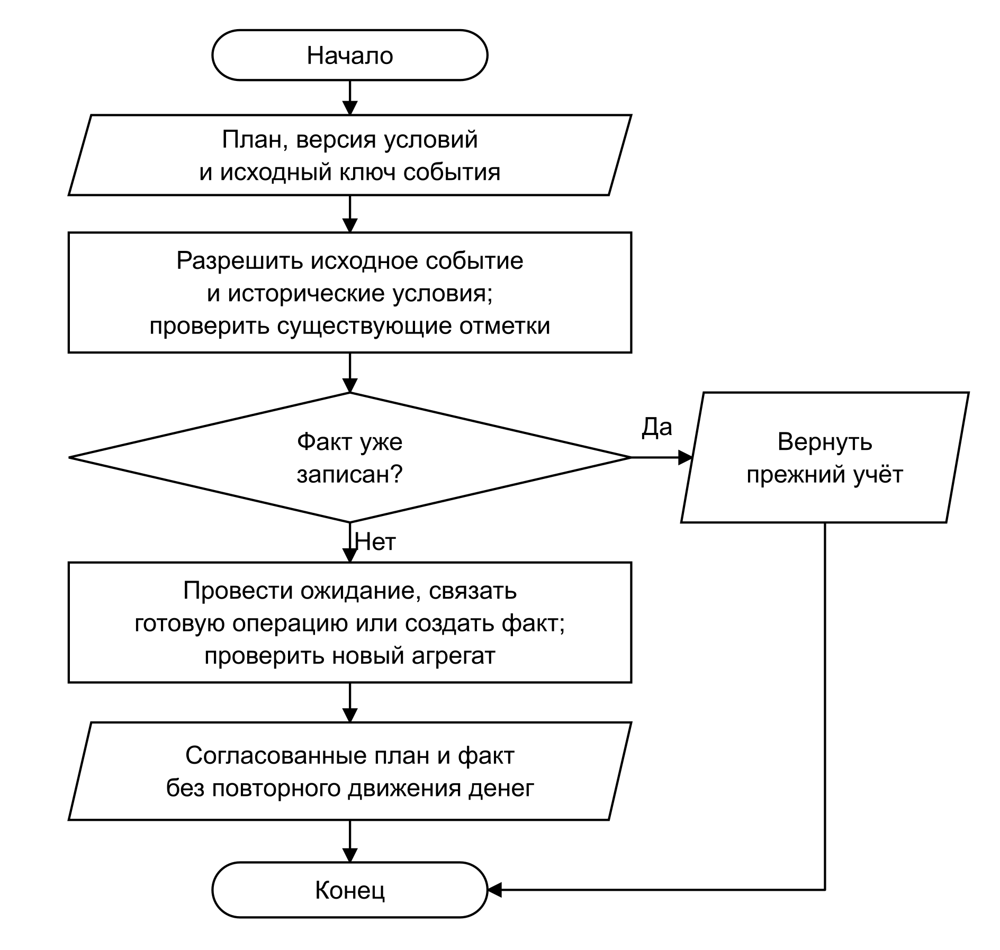

Перенос и отмена создают изменение отдельного события, сохраняя его исходный ключ. Удаление плана очищает связи, но оставляет полученные доходы и их суммы.

### 3.7.6 Обеспечивающие механизмы платежей и напоминаний

План сохраняет сумму, категорию, счёт и график. Календарь раскрывает ещё не оплаченные и не пропущенные события с исходными ключами и версиями. При оплате действует схема рисунка 27: распознаётся уже выполненное событие, проводится ожидание, привязывается подходящий расход либо создаётся один новый расход.

План напоминаний рассчитывает будущие местные даты и часы. Если предварительное время уже прошло, но время в день срока ещё впереди, используется последняя возможность напомнить. Синхронизатор сравнивает желаемую очередь с фактически прочитанными триггерами через платформенные порты. Отсутствие разрешения или ошибка очереди отражается в интерфейсе, сохраняя финансовый учёт. Подтверждение постановки в очередь не означает подтверждения доставки операционной системой.

### 3.7.7 Структуры планов и напоминаний

PlannedIncome содержит сумму, счёт, дату или график. IncomeTermsVersion задаёт интервал условий; IncomeOccurrenceOverride хранит изменение конкретного возникновения. Функция `resolveIncomeOccurrence` восстанавливает событие, `receivePlannedIncome` отмечает получение, `moveIncomeOccurrence` переносит ожидаемую дату. Реестр всех будущих событий не сохраняется: он вычисляется по версиям и отметкам. UI-компоненты IncomePlanForm и IncomeReceipt отделяют редактирование ожиданий от подтверждения факта.

Recurring и PaymentTermsVersion содержат график, сумму, категорию, счёт и интервалы действия. Новая форма использует единый регулярный платёж; прежнее поле kind читается для совместимости. Функции `upcoming` и `overduePayments` формируют календарные результаты, `payRecurring` сохраняет факт.

PlannedReminder задаёт исходное событие и время триггера. Функция `reminderPlan` ограничивает очередь 60 элементами и окном 60 дней. Системный доступ изолирован в нативном адаптере уведомлений; синхронизатор работает через переданные операции чтения, отмены и планирования. ReminderQueueStatus показывает результат сверки очереди отдельно от финансовых показателей.

### 3.7.8 Досрочное получение и привязка дохода

При исходном остатке 10 000 RUB создание плана поступления 500 RUB на 15 сентября 2026 года сохраняет фактические деньги. Отметка получения 10 сентября увеличивает остаток до 10 500 RUB, сохраняя идентичность исходного события 15 сентября. Повторная отметка возвращает прежнее состояние. При удалении плана фактический доход остаётся в истории, а ссылка на план очищается.

Если доход 500 RUB уже записан, его привязка к разовому плану меняет только предметные ссылки. Число операций остаётся равным единице, повторного зачисления на счёт нет. Несоответствие суммы препятствует привязке.

### 3.7.9 Оплата обязательства и календарь напоминаний

На 10 сентября 2026 года исходный счёт содержит 10 000 RUB, ежемесячный платёж 750 RUB действует с августа и назначен на 5-е число. Два неоплаченных события дают обязательства 1 500 RUB и доступную сумму 8 500 RUB. После оплаты августа остаток равен 9 250 RUB, остаётся одно обязательство 750 RUB. Доступная сумма составляет прежние 9 250 − 750 = 8 500 RUB: оплата уменьшает одновременно деньги и обязательства.

Для дня 31 и напоминания за сутки в 09:00 февральское событие 2026 года приходится на 28 февраля, а триггер — на 27 февраля в 09:00 местного времени. Отметка пропуска исключает событие из плана напоминаний. Расчёт задаёт время триггера; доставка зависит от разрешений и работы операционной системы.

### 3.7.10 Математическая модель долговых обязательств

Модель долга разделяет денежное движение и экономический смысл его основной суммы. Непогашенный остаток на дату d равен

$$ D(d) = D_{0} + Σ I(d) − Σ P(d) \tag{3.12} $$

где D с индексом 0 — исходный остаток долга; I — последующие выдачи; P — погашения не позднее d. До даты начала долг равен нулю. Направление определяет знак влияния на деньги: полученный заём увеличивает их при выдаче, выданный другому человеку — уменьшает. Основная сумма связанного долга исключается из обычных доходов и расходов.

Для кредитной карты долг равен модулю отрицательного остатка, если остаток отрицателен. Лимит карты не увеличивает собственные деньги. Оставшийся платёж по выписке уменьшается последующими входящими переводами, но не ниже нуля и не выше текущей задолженности. Уже учтённые в выписке переводы повторно его не уменьшают.

### 3.7.11 Обеспечивающий механизм учёта долгов и кредитных карт

Создание долга проверяет направление, сумму, валюту, счёт и даты. Прежний остаток сохраняется без новой выдачи; текущая выдача создаёт связанную операцию. Погашение ограничивается непогашенной суммой и проверяет достаточность исходящего счёта. Исправление раннего движения повторно проверяет хронологию последующих погашений.

Погашение карты является переводом с повседневного счёта. Оно уменьшает долг и оставшийся платёж по фактическому зачислению, не создавая второй расход исходной покупки. Обязательства со сроком поступают в прогноз; выданный долг не создаёт обещание надёжного будущего дохода. Проценты, доходность и льготный период модель не рассчитывает.

### 3.7.12 Структуры долгов и кредитных условий

Debt хранит direction, currency, accountId, openingAmount, startsOn и dueDate. Операции связаны с ним полями debtId и debtAction. Действия `saveDebt` и `repayDebt` изменяют факты; `debtBalance` вычисляет остаток. Кредитные поля Account включают лимит, дату и оставшуюся сумму платежа, а также набор уже учтённых переводов. Функции `creditPaymentRemaining` и `debtObligations` формируют остаток платежа и прогнозные обязательства.

### 3.7.13 Движение займа и погашение карты

При исходном остатке счёта 1 000 RUB получение займа 500 RUB увеличивает деньги до 1 500 RUB и создаёт долг 500 RUB. Погашение 200 RUB оставляет деньги 1 300 RUB и обязательство 300 RUB. Обычный доход от выдачи и обычный расход от погашения равны нулю, поскольку обе записи относятся к основной сумме долга.

Пусть кредитная карта имеет долг 200 RUB и оставшийся платёж 100 RUB. Покупка 50 RUB увеличивает долг до 250 RUB. Перевод 60 RUB с повседневного счёта с остатком 1 000 RUB оставляет на нём 940 RUB, уменьшает долг карты до 190 RUB, а платёж — до 40 RUB. Покупка входит в расходы один раз; погашение отражается переводом между счетами.

### 3.7.14 Связанный расчёт доступной суммы

Оценка доступной суммы использует прогноз как дополнительное ограничение текущих трат. Показатель «Можно потратить» даёт сводный ориентир до ближайшего неполученного дохода. Первичный предел определяется выражением

$$ C = L − H − P − D − G − R \tag{3.13} $$

где L — фактические повседневные остатки в основной валюте; H — удержания; P — не покрытые фондами платежи до выбранного дохода вместе с просрочкой; D — долговые обязательства до той же границы; G — оставшиеся резервируемые взносы текущего месяца; R — резерв. Накопительные и кредитные счета не входят в L. Будущий доход не прибавляется к фактическим деньгам, а бюджеты категорий не вычитаются как дополнительные движения.

Если подходящий доход найден в пределах 90 дней, выполняется защитный прогноз последующего периода:

$$ Q = min { A^{*}(d) − R : d ∈ D^{*} } \tag{3.14} $$

где A со звёздочкой — доступный остаток специального прогноза; D со звёздочкой — его календарные даты. Повседневные расходы этого прогноза начинаются с выбранной даты дохода, а при доходе сегодня — с завтрашнего дня. Это исключает двойное резервирование ежедневного ориентира до дохода. Горизонт защиты равен 30, 60 или 90 дням в зависимости от расстояния до поступления.

Доступная и дневная суммы рассчитываются как

$$ S = max(0, min(C, Q));   s = ⌊S / n⌋ \tag{3.15} $$

где n — число дней до выбранной даты, но не меньше единицы. При предупреждении защитного прогноза верхняя граница дополнительно ограничивается нулём. Если подходящего дохода нет, Q не ограничивает результат и используется объяснённый запасной день профиля. Отрицательный исходный результат сохраняется для расшифровки недостатка, хотя отображаемая доступная сумма равна нулю.

### 3.7.15 Расчёт и представление доступной суммы

Функция `spendable` принимает FinanceState и текущую дату. Она выбирает неполученное возникновение дохода, рассчитывает фактические остатки, удержания и обязательства, затем сравнивает первичный предел с результатом `spendableProtection`. Обязательства из защитного прогноза не вычитаются из C повторно.

Результат содержит liquid, held, payments, debts, goals, buffer, beforeProtection, raw, available, daily и параметры protection. Он не сохраняется в учёт. SpendableCard выводит сумму, FormulaContent раскрывает составляющие. Этот показатель является сводным ориентиром; проверка достаточности конкретного счёта выполняется прецедентом покупки.

### 3.7.16 Исходные данные для расчётов прогнозирования

Для прогноза UC-07, оценки покупки UC-08 и сравнения сценариев UC-09 используется один набор, приведённый в таблице 7. Фактические операции, удержания, цели и долги в нём отсутствуют. Все события назначены счёту A, если не указано иное.

Таблица 7 – Исходные данные примеров прогнозирования

| Параметр             | Значение                                            |
| -------------------- | --------------------------------------------------- |
| Дата и горизонт      | 20.10.2026; 30 дней, до 18.11 включительно          |
| Повседневные счета   | A — 30 000 RUB; B — 10 000 RUB                      |
| Накопительный счёт   | S — 50 000 RUB                                      |
| Неполученный доход   | 10 000 RUB на 25.10, разово, счёт A                 |
| Регулярный платёж    | 18 000 RUB на 28-е число, действует с 20.10, счёт A |
| Повседневные расходы | 500 RUB в день, счёт A                              |
| Резерв и формат      | 5 000 RUB; финансовый формат 9                      |

### 3.7.17 Расчёт доступной и дневной суммы

До 25 октября платежей нет: первичный предел равен 40 000 − 5 000 = 35 000 RUB. Но платёж 28 октября должен ограничивать решение уже сейчас. Защитный прогноз учитывает 25 ежедневных расходов с 25 октября до 18 ноября и получает минимум 40 000 + 10 000 − 18 000 − 25 × 500 = 19 500 RUB. После сравнения с резервом предел Q равен 14 500 RUB.

Доступная сумма равна min(35 000, 14 500) = 14 500 RUB, а дневной ориентир на пять дней — 14 500 / 5 = 2 900 RUB. Накопительные 50 000 RUB не входят в доступную сумму, доход учитывается как событие будущего прогноза. Крупный платёж после ближайшего поступления ограничивает текущие траты, поэтому расчёт использует и последующие даты.

### 3.7.18 Изменение остатков и нехватка средств на счёте

Прогноз позволяет определить, сколько денег останется на каждую дату и на каком счёте может не хватить средств для запланированного платежа. На рисунке 28 показан текущий план из таблицы 7: период с 20 октября по 18 ноября 2026 года, 30 календарных дней. В общую сумму входят два повседневных счёта: A с остатком 30 000 RUB и B с остатком 10 000 RUB. Накопительный счёт S с суммой 50 000 RUB в эту сводку не включается.

Каждая точка графика показывает остаток на конец дня. На 20 октября общая сумма равна 40 000 RUB. С 21 октября прогноз ежедневно учитывает расход 500 RUB со счёта A, поэтому к концу 24 октября остаётся 38 000 RUB. Доход 10 000 RUB, назначенный на 25 октября, увеличивает сумму до 38 000 + 10 000 − 500 = 47 500 RUB. Затем ежедневные расходы уменьшают её до 46 500 RUB на 27 октября. Платёж 18 000 RUB на следующий день вместе с повседневным расходом даёт 46 500 − 18 000 − 500 = 28 000 RUB. Этим событиям соответствуют подъём и резкое снижение линии.

После платежа 28 октября сумма постепенно уменьшается до 17 500 RUB на 18 ноября. Итог складывается из 7 500 RUB на счёте A и неизменных 10 000 RUB на счёте B. Общий расчёт за период имеет вид: 40 000 + 10 000 − 18 000 − 29 × 500 = 17 500 RUB. Расходов 29, поскольку первый день горизонта включён в прогноз, а повседневные траты начинаются со следующего дня.

Пунктирная линия обозначает резерв 5 000 RUB. Он служит нижним порогом для общей суммы и не вычитается из каждой точки графика. Минимум 17 500 RUB приходится на 18 ноября; запас над резервом составляет 12 500 RUB. Для оценки покупки дополнительно учитывается остаток выбранного счёта (подраздел 3.8).

Необходимость расчёта по каждому счёту поясняет отдельная ситуация. На 20 октября «Карта покупок» содержит 1 000 RUB, а «Основная карта» — 9 000 RUB. Резерв и повседневные расходы равны нулю. На «Карту покупок» назначен платёж 2 000 RUB: её прогнозный остаток равен −1 000 RUB, хотя общая сумма двух счетов остаётся положительной — 8 000 RUB. Для покрытия нехватки необходимо явно запланировать перевод с другого счёта или выбрать другой счёт для платежа.

На рисунке 29 показано предупреждение о нехватке на отдельном счёте при положительной общей сумме. Отрицательный прогнозный остаток указывает на недостаточность средств для платежа. Сам прогноз не выполняет операции и не создаёт реальную задолженность.

## 3.8 Оценить возможность покупки

Прецедент UC-08 оценивает заданные стоимость, дату и повседневный счёт покупки без создания реального расхода. Он обязательно включает получение прогноза UC-07: сначала рассчитывается исходная траектория, затем учитывается влияние покупки. Итог показывает допустимость выбранных условий, предельную сумму и возможную дату только в пределах рассматриваемого горизонта.

### 3.8.1 Математическая модель покупки

Для покупки проверяются заданные сумма, дата и счёт. Для каждой даты d от покупки до конца горизонта должны выполняться условия

$$ a_{k}(d) − q ≥ 0 \tag{3.16} $$

где k — выбранный повседневный счёт, a — его доступный остаток, q — стоимость в минимальных единицах его валюты, и

$$ A(d) − [V_{k}(a_{k}(d)) − V_{k}(a_{k}(d) − q)] ≥ R \tag{3.17} $$

где A — базовая сводка, V — пересчёт остатка выбранного счёта в основную валюту, R — общий резерв. Разность двух переоценённых остатков нельзя заменять отдельной конвертацией q: округление может дать различие в одну минимальную единицу.

Для каждого дня находится наибольшая допустимая целая стоимость q. Максимум на дату покупки равен минимуму таких дневных пределов на всём оставшемся горизонте. Исходный прогноз также должен сохранять резерв на всём горизонте, включая даты до покупки. Нехватка выбранного счёта, неназначенные события и предупреждения исключают положительный вывод.

### 3.8.2 Алгоритм проверки покупки

Функция `planPurchase` получает исходный ForecastResult, дату, стоимость и счёт. Сначала проверяются входные параметры и исходные препятствия. Затем проход справа налево определяет дневные пределы: двоичный поиск по целой сумме проверяет собственновалютный остаток и переоценку сводки. Накопленный минимум даёт допустимую стоимость каждой даты. Алгоритм показан на рисунке 30.

Результат содержит maximum, earliest, limitingDay, сведения об исходной нехватке и предупреждения. Временный массив пределов не сохраняется. Для графического сравнения Simulator строит второй прогноз с PurchaseScenario; реальная операция не создаётся. Ближайшая дата — первая допустимая дата внутри выбранного горизонта, а не обещание достаточности за его пределами.

Если дата покупки совпадает с сегодняшней, интерфейс дополнительно показывает влияние на текущие траты. Компонент PurchaseAllowance использует `simulatePurchase`: функция получает исходную доступную сумму через `spendable`, вычитает стоимость и определяет дневную сумму после покупки. Для положительного результата также учитывается допустимость покупки на выбранном счёте по `planPurchase`. Это дополнение соответствует условному расширению UC-08; оно не создаёт расхода и не меняет фактические остатки.

### 3.8.3 Предельная сумма покупки

По таблице 7 разность общего минимума и резерва составляет 12 500 RUB. Однако минимум счёта A равен только 7 500 RUB. Максимум покупки с A на 20 октября — 7 500 RUB; ближайшая дата для этой суммы — тот же день. В прогнозе с такой покупкой конечный остаток A равен нулю, сводка — 10 000 RUB.

При увеличении стоимости до 7 500,01 RUB на 18 ноября возникает нехватка A в размере 0,01 RUB; допустимой даты внутри горизонта нет. Если удалить назначение счёта ежедневных расходов, неопределённость источника исключает положительный максимум. Такое же ограничение возникает при отдельном увеличении резерва до 20 000 RUB, поскольку базовая сводка опускается ниже этого порога. В обоих случаях maximum равен нулю. Изменение параметров симуляции сохраняет исходный учёт.

## 3.9 Сравнить финансовые сценарии

Прецедент UC-09 сопоставляет исходный финансовый план с отдельным набором предположений либо два сохранённых варианта. Каждый сравниваемый вариант обязательно получает прогноз UC-07 от одного актуального состояния и на одинаковый период. Сохраняются условия сценария, а результаты пересчитываются при обращении. Сравнение не изменяет фактические операции и исходные планы.

### 3.9.1 Математическая модель сравнения сценариев

При сравнении сценариев строятся два прогноза от одного актуального состояния и одной даты. Базовый вариант использует текущие планы, альтернативный — отдельные предположения. Разница конечных остатков определяется выражением

$$ Δ = A_{1}(d_{кон}) − A_{0}(d_{кон}) \tag{3.18} $$

где A с индексами 0 и 1 — базовая и альтернативная траектории; d с индексом «кон» — последняя календарная дата горизонта: сегодня плюс N − 1 день, где N — число дней. Положительная разница не гарантирует лучшую обеспеченность на каждой промежуточной дате. Поэтому вместе с конечными значениями сопоставляются минимумы, сроки риска и траектории счетов.

### 3.9.2 Алгоритм работы со сценариями

Черновик сценария проходит проверку названия, горизонта, сумм, дат и валют источников. Включённые изменения сопоставляются с существующими планами; удалённый источник не восстанавливается. Затем дважды выполняется алгоритм рисунка 26 с одинаковым фактическим состоянием. Выключенные строки не участвуют; события за пределами горизонта поясняются предупреждениями.

Сдвиг дохода меняет ожидаемую дату, сохраняя исходную идентичность. Новая сумма платежа применяется к будущим событиям, не переписывая просрочку. Сохранение обновляет массив сценариев и при необходимости повышает версию формата, не меняя реальные планы и операции. Копирование создаёт новые идентификаторы сценария и разовых событий, оставляя ссылки на реальные источники. Уже достигнутый финансовый формат 9 не понижается.

### 3.9.3 Структуры данных сценария

SavedScenario содержит название, горизонт, изменения планов и разовые события. ScenarioChange хранит тип и идентификатор источника, сумму, delayDays и необязательный enabled. ScenarioEvent содержит дату, доход или расход в основной валюте, необязательный счёт и признак участия. Отсутствие enabled в старой записи означает включённую строку.

Функции `saveScenario`, `copyScenario` и `deleteScenario` изменяют условия варианта. ScenarioComparison вызывает прогноз для двух наборов предположений и показывает результат. Рассчитанные траектории не сохраняются: при следующем открытии они обновляются от текущего учёта.

### 3.9.4 Сопоставление итогового и промежуточного остатка

Для данных таблицы 7 сценарий сдвигает доход с 25 октября на 4 ноября, уменьшает платёж с 18 000 до 12 000 RUB и добавляет расход 4 000 RUB со счёта A на 23 октября. Дополнительный расход 9 000 RUB выключен и в расчёте не участвует. Конечный остаток равен 19 500 RUB, на 2 000 RUB больше базового.

Минимум альтернативной сводки составляет 17 000 RUB на 3 ноября. Он на 500 RUB ниже базового минимума 17 500 RUB: задержка дохода временно ухудшает положение при улучшении итоговой суммы. Перенесённый доход сохраняет исходную дату события 25 октября. Сохранение и последующее копирование создают два разных сценария. Финансовый формат остаётся 9, реальные счета, операции и планы сохраняются.

Реализация рассмотренных прецедентов объединяет средства управления личными финансами в мобильном приложении: фактический учёт, бюджеты, накопления, анализ и планирование. Общие проверки состояния связывают операции, условия планов и прогноз. Целочисленные суммы, календарные правила и согласованное обновление записей задают единый порядок обработки финансовых данных. Прогноз зависит от полноты исходных сведений и не гарантирует будущих доходов. Сохранение файлов и доставка напоминаний дополнительно зависят от возможностей операционной системы, доступных разрешений и действий пользователя.

# Заключение

В результате выпускной квалификационной работы на тему «Разработка мобильного приложения для управления личными финансами» создано мобильное приложение «Лад». Поставленная цель достигнута в части программной реализации, объединяющей локальный учёт денежных операций, управление бюджетами и накоплениями, анализ истории и планирование расходов. Готовность к широкому использованию на мобильных устройствах требует отдельного этапа испытаний.

Исследование процессов управления личными финансами и сопоставление аналогов позволили определить назначение и ограничения мобильного приложения. Сформулированы требования и описаны девять прецедентов записи денежных движений, сверки остатков и оценки финансовых решений. Они раскрыты на шести диаграммах через вспомогательные варианты использования и отношения обобщения, обязательного включения и условного расширения; обеспечивающие функции учёта описаны отдельно. Обоснована необходимость учитывать даты денежных событий, доступность средств на выбранном счёте и резерв на всём горизонте. Тем самым решены задачи анализа предметной области и формирования требований.

При проектировании определены модель финансовых данных и структура приложения с разделением интерфейса, предметных расчётов, состояния и платформенных адаптеров. Финансовые действия проверяют актуальный набор данных и согласованно обновляют связанные записи. Такое устройство позволяет проверять расчёты независимо от интерфейса и применять общие правила к ручному вводу и импорту.

Реализованы счета и датированные корректировки остатков, операции и переводы, категории и бюджетные периоды, цели и годовые фонды, планы доходов и платежей, долги и кредитные карты. Денежные величины представлены целыми минимальными единицами валюты. Переводы отделены от обычных доходов и расходов, а накопления целей проверяются на обеспеченность. История условий планов сохраняет смысл ранее возникших обязательств при последующем изменении графика.

Разработаны расчёт доступной для трат суммы, дневной прогноз по счетам, проверка покупки и сравнение сохранённых сценариев. Прогноз показывает как общую сводку, так и ограничения отдельного счёта. Положительная общая сумма не исключает нехватки денег на счёте платежа, поэтому приложение отдельно показывает такое ограничение. Максимальная сумма покупки определяется доступностью средств на выбранном счёте и сохранением общего резерва на всём горизонте.

Сохранённые сценарии позволяют изменять предположения о доходах, платежах и разовых событиях без изменения реальных планов и операций. Сравнение учитывает конечный остаток и минимальную сумму внутри горизонта: улучшение итога на последнюю дату может сопровождаться уменьшением средств в промежуточные дни. Прогноз остаётся результатом расчёта по введённым условиям, а не гарантией будущих поступлений.

Реализованы локальные профили, сохранение учёта, импорт и экспорт CSV, проверка резервных копий и восстановление. Импорт проверяет выбранный пакет до изменения состояния, что исключает частичное добавление ошибочного набора. Нативное хранение предусматривает шифрование данных и отдельное хранение ключа, а переносимая парольная копия использует собственный механизм защиты. Эти свойства не распространяются на незашифрованные Web-хранилище и JSON-экспорт.

Полученное мобильное приложение может использоваться для управления личными финансами: ведения истории операций, анализа расходов, распределения средств по бюджетам и целям, контроля обязательств и предварительной оценки покупок. Практическая ценность состоит в объединении этих действий с объяснимым расчётом финансовых ограничений. Для опытного использования необходимо завершить испытания на iOS и Android, проверить восстановление копий на целевых устройствах и организовать их регулярное создание. Пользователь должен поддерживать полноту учёта и актуальность планов; автоматического получения банковских операций и совместной работы между устройствами в приложении нет.

Дальнейшее развитие целесообразно начать с проверки нативных возможностей, доступности интерфейса и поведения при большом объёме истории. Затем возможны пользовательское исследование понятности прогноза и улучшение объяснений обнаруженных ограничений. Синхронизация между устройствами и банковский обмен могут рассматриваться как самостоятельные направления, требующие отдельного проектирования защиты, разрешения конфликтов и обработки внешних данных.

Технико-экономическая эффективность результата оценена качественно. Локальная архитектура не требует эксплуатации серверной части для основного учёта, а общая кодовая база позволяет совместно развивать финансовые правила для разных платформ. Автоматический пересчёт связанных показателей уменьшает объём ручных вычислений, однако ввод и проверка исходных данных, создание копий и сопровождение приложения остаются необходимыми. Затраты на разработку и эксплуатацию, изменение времени выполнения пользовательских задач и денежный эффект не измерялись, поэтому количественная экономия и срок окупаемости не установлены. Для такой оценки необходимы учёт трудозатрат и сравнительное исследование реального использования приложения.

# Список использованных источников

1. Личный финансовый план. Как копить деньги и планировать свои траты [Электронный ресурс] / Финансовая культура. 2022. 25 с. URL: https://fincult.info/upload/iblock/5be/Lichny_finansovy_plan.pdf (дата обращения: 23.10.2026).

2. Manage your household budget in Excel [Электронный ресурс] / Microsoft Support. URL: https://support.microsoft.com/en-us/excel/manage-your-household-budget-in-excel (дата обращения: 29.10.2026).

3. Дзен-мани — приложение для контроля расходов [Электронный ресурс] / Дзен-мани. URL: https://zenmoney.ru/ (дата обращения: 29.10.2026).

4. CoinKeeper — answers to all your money questions [Электронный ресурс] / CoinKeeper. URL: https://coinkeeper.me/ (дата обращения: 29.10.2026).

5. The YNAB Method [Электронный ресурс] / YNAB. URL: https://www.ynab.com/ynab-method (дата обращения: 29.10.2026).

6. Features [Электронный ресурс] / YNAB. URL: https://www.ynab.com/features (дата обращения: 29.10.2026).

7. Pricing [Электронный ресурс] / YNAB. URL: https://www.ynab.com/pricing (дата обращения: 29.10.2026).

8. How Much Money to Keep in Your YNAB Checking Account [Электронный ресурс] / YNAB. URL: https://support.ynab.com/en_us/how-much-to-keep-in-your-checking-account-a-guide-ryZNWymAc (дата обращения: 29.10.2026).

9. Your Finances — made simple [Электронный ресурс] / Actual Budget. URL: https://actualbudget.org/ (дата обращения: 29.10.2026).

10. Multi-Currency [Электронный ресурс] / Actual Budget. URL: https://actualbudget.org/docs/budgeting/multi-currency/ (дата обращения: 29.10.2026).

11. Balance Forecast Report [Электронный ресурс] / Actual Budget. URL: https://actualbudget.org/docs/experimental/balance-forecast-report/ (дата обращения: 29.10.2026).

12. Creating a cash flow budget [Электронный ресурс] / Consumer Financial Protection Bureau. 3 p. URL: https://www.consumerfinance.gov/documents/10038/cfpb_creating-cash-flow-budget_tool_2021-08.pdf (дата обращения: 23.10.2026).

13. System Engineering Handbook: Appendix [Электронный ресурс] / NASA. Приложения C, D. URL: https://www.nasa.gov/reference/system-engineering-handbook-appendix/ (дата обращения: 23.10.2026).

14. How to Export Plan Data [Электронный ресурс] / YNAB. 18.08.2026. URL: https://support.ynab.com/en_us/how-to-export-plan-data-Sy_CouWA9 (дата обращения: 23.10.2026).

15. Expo SDK reference. SDK 58 [Электронный ресурс] / Expo. URL: https://docs.expo.dev/versions/v58.0.0/ (дата обращения: 26.10.2026).

16. Expo SecureStore. SDK 58 [Электронный ресурс] / Expo. URL: https://docs.expo.dev/versions/v58.0.0/sdk/securestore/ (дата обращения: 26.10.2026).

17. Unified Modeling Language. Version 2.5.1 [Электронный ресурс] / Object Management Group. 2017. Разделы 9.5.3, 11.4.3–11.4.4, 18.1. URL: https://www.omg.org/spec/UML/2.5.1/PDF (дата обращения: 23.10.2026).

18. Core Components and APIs [Электронный ресурс] / React Native. URL: https://reactnative.dev/docs/components-and-apis (дата обращения: 26.10.2026).

19. Thinking in React [Электронный ресурс] / React. URL: https://react.dev/learn/thinking-in-react (дата обращения: 23.10.2026).

20. The TypeScript Handbook [Электронный ресурс] / TypeScript. URL: https://www.typescriptlang.org/docs/handbook/intro.html (дата обращения: 23.10.2026).

21. Сырцев В. Использование диаграммы вариантов использования UML при проектировании программного обеспечения [Электронный ресурс] / Хабр. 05.07.2021. URL: https://habr.com/ru/articles/566218/ (дата обращения: 01.11.2026).

22. Что такое диаграмма вариантов использования: компоненты, связи и примеры [Электронный ресурс] / Медиаблог ТГУ ДПО. 17.09.2026. URL: https://www.tgu-dpo.ru/news/2026/09/17/use-case-diagram-uml/ (дата обращения: 01.11.2026).

# Приложение А

## Общая ER-диаграмма предметных данных приложения

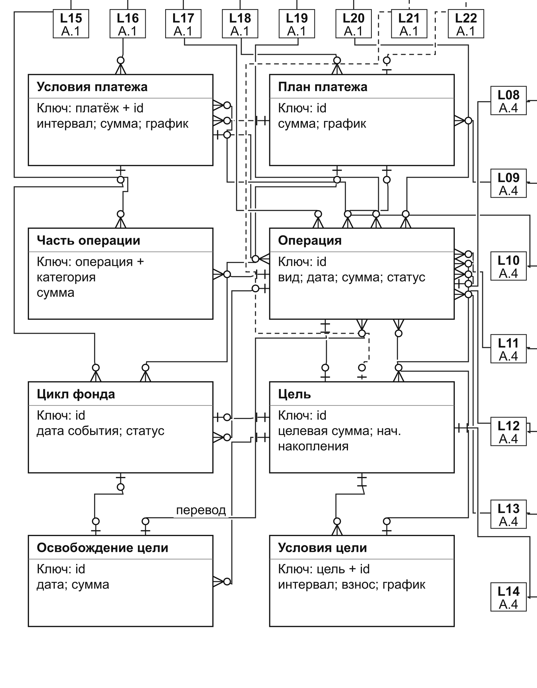

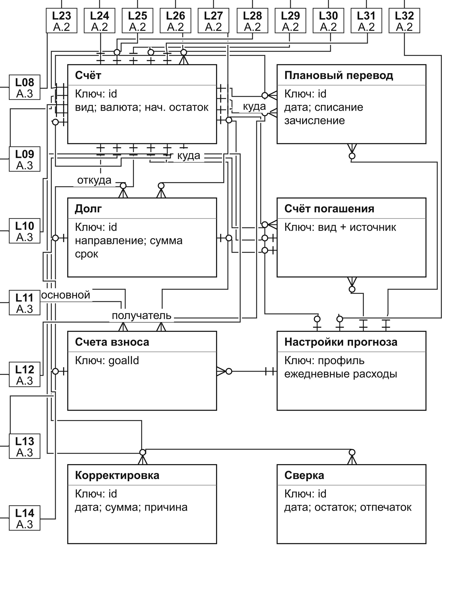
