# Введение

Управление личными финансами требует согласования расходов, обязательных платежей и накоплений. Общий остаток нескольких счетов не всегда показывает доступную для покупки сумму: часть средств предназначена для целей, а платёж привязан к определённому счёту. Положительный итог месяца также не исключает нехватки денег между поступлениями. Поэтому актуальна разработка мобильного приложения, связывающего учёт операций с планированием денежных потоков.

Существующие приложения для личных финансов сочетают учёт с бюджетами и накопительными целями. Их средства прогнозирования решают разные задачи: оценивают расходы по категориям, срок достижения цели или будущий остаток счёта. Для оценки покупки важен прогноз остатков по счетам, учитывающий даты поступлений и обязательств, счёт оплаты и резерв. Такой прогноз предлагается связать с локальным учётом в приложении «Лад», чтобы объяснять пользователю причины ограничения расходов.

Объект исследования — процессы управления личными финансами. Предмет исследования — модели данных и алгоритмы мобильного приложения для учёта операций, распределения средств и прогнозирования остатков по счетам.

Цель выпускной квалификационной работы — разработать мобильное приложение для управления личными финансами, обеспечивающее учёт денежных операций, ведение бюджетов и накоплений, анализ финансового состояния и планирование расходов.

Для достижения цели необходимо решить следующие задачи:

- исследовать предметную область и существующие решения, сформулировать требования к приложению;

- спроектировать модель данных, архитектуру и пользовательский интерфейс;

- реализовать учёт счетов и операций, управление бюджетами, целями, доходами, платежами и долгами;

- разработать алгоритмы оценки доступных средств, прогноза по счетам, проверки покупки и сравнения сценариев;

- предусмотреть локальное хранение, импорт операций, резервное копирование и защиту данных;

- проверить корректность расчётов и описать работу основных пользовательских сценариев.

Исходными данными для расчётов должны служить остатки счетов, история операций, валютные курсы, условия бюджетов, цели, графики доходов и платежей, долги и размер резерва. Предусматриваются самостоятельный ввод сведений и импорт операций из файла. Для решения задач предполагается использовать сравнительный анализ, моделирование данных и сценариев использования, расчёт денежных потоков и тестирование.

Разработку планируется вести на React Native, Expo и TypeScript с общей кодовой базой для iOS и Android и независимыми от интерфейса финансовыми расчётами. Основной учёт должен работать локально; банковские подключения, облачная синхронизация и исполнение реальных платежей не входят в границы проекта.

Работа опирается на подходы журнального учёта, бюджетирования и календарного планирования. Предполагаемая прикладная новизна состоит в их согласовании в единой модели: прогноз каждого счёта в его валюте должен сочетаться с проверкой покупки при сохранении общего резерва на всём выбранном периоде. Альтернативные сценарии предусматривается рассчитывать без изменения фактического учёта. Практическая значимость разработки связана с возможностью заранее выявлять нехватку средств и объяснять пользователю причины ограничения расходов.

Первая глава посвящена анализу предметной области и требованиям, вторая — проектированию данных и архитектуры, третья — реализации приложения.

# 1 Требования к мобильному приложению «Лад»

## 1.1 Общее описание продукта

### 1.1.1 Назначение объекта автоматизации

Объект автоматизации — управление личными финансами: учёт поступлений и расходов, анализ истории, распределение средств, контроль обязательств и накоплений, планирование и оценка решений. Личный финансовый план связывает цели с доходами, расходами и сроками, учитывая текущее положение и предстоящие изменения [1]. «Лад» должен объединить эти процессы на устройстве пользователя.

Потенциальный пользователь имеет регулярный или нерегулярный доход, несколько счетов, обязательные платежи, цели, иногда разные валюты и долги. Общего остатка недостаточно для решения о покупке: часть денег закреплена за накоплениями или потребуется для обязательств; нужной суммы может не оказаться на выбранном счёте. Пропущенные операции и ошибочный учёт переводов искажают картину, месячный итог скрывает нехватку денег между поступлениями. Поэтому факты, ожидания и будущие остатки необходимо согласовывать.

В «Лад» предполагается включить журнал операций, бюджеты, цели, планы доходов и платежей, долги, прогноз и сценарии. Расчёт должен объяснять доступную сумму и последствия гипотетической покупки; результат зависит от полноты ввода и не гарантирует будущих поступлений. Целевые платформы — iOS и Android; Web предполагается использовать для предпросмотра и браузерных проверок. Банковские подключения, серверная авторизация, облачная синхронизация и исполнение платежей не входят в проект. Локальные профили предусматриваются для разделения данных на устройстве без многопользовательского доступа.

### 1.1.2 Аналитический обзор

Приложения для личных финансов фиксируют движение денег, распределяют доступные средства и помогают оценивать будущие решения. Для этих задач нужны разные средства: журнал объясняет фактический остаток, бюджет ограничивает расходы, календарный прогноз показывает момент возможной нехватки денег. Поэтому сравнения по наличию категорий и диаграмм недостаточно: важны способ получения операций, работа с планами, валютами и накоплениями, объект прогнозирования.

Косвенная альтернатива специализированному приложению — электронная таблица. Microsoft предлагает сопоставлять ожидаемые и фактические доходы и расходы в месячном бюджете [2]. Пользователь может добавить формулы и сценарии, но корректность переводов, валютных оценок и связей записей зависит от устройства файла. Бумажный журнал сохраняет историю, требуя ручного пересчёта итогов. Оба способа подходят для простого учёта и не рассматриваются как готовые программные реализации всех перечисленных функций.

Для сопоставления выбраны четыре продукта. Дзен-мани сочетает учёт и бюджет с прогнозом расходов категорий [3]; CoinKeeper — учёт, лимиты и цели с прогнозом капитала и срока накопления [4]. YNAB распределяет имеющиеся деньги по назначениям [5], поддерживает цели и отчёты [6], использует одну валюту в плане и регионально ограниченный банковский импорт [7], показывает будущий остаток по плановым операциям в Web [8]. Actual Budget предлагает локальный конвертный бюджет [9], экспериментальный обходной способ валютного учёта [10] и экспериментальный Balance Forecast по истории и расписаниям [11]. Подробное сравнение приведено в таблице 1; экспериментальные возможности могут измениться или исчезнуть.

В таблице 1 четыре приложения сопоставлены с требованиями к «Ладу» по четырнадцати критериям. Сведения отражают официальные описания на 29 октября 2026 года, а не испытания; возможности могут зависеть от тарифа и платформы. Столбец «Лад» содержит планируемые возможности. «Не уточнено» означает недостаточность оснований в отобранных источниках, а не доказанное отсутствие функции. Для покупки сравнивается именно оценка выбранного счёта и сохранения резерва на всём горизонте, а не любая рекомендация о расходах.

Таблица 1 – Сопоставление возможностей приложений для личных финансов

| Критерий                 | Дзен-мани                          | CoinKeeper             | YNAB                       | Actual Budget            | «Лад» (проект)                |
| ------------------------ | ---------------------------------- | ---------------------- | -------------------------- | ------------------------ | ----------------------------- |
| Основной подход          | Учёт и план расходов               | Учёт, лимиты, цели     | Назначение имеющихся денег | Конвертный бюджет        | Учёт, планы и прогноз         |
| Ручной ввод              | Есть                               | Есть                   | Есть                       | Есть                     | Ввод, шаблоны и правила       |
| Банковский ввод          | Подключения к банкам               | Банки и SMS            | Банки выбранных регионов   | Внешние провайдеры       | Только импорт CSV             |
| Бюджет                   | Категории, план на месяц           | Лимиты категорий       | Суммы по категориям        | Категории-конверты       | Периоды, версии, переносы     |
| Регулярный платёж        | План и напоминания                 | Повторы и напоминания  | Плановые операции          | Расписания операций      | Версии условий, отметки факта |
| Накопление средств       | Отдельная модель целей не уточнена | Цели и прогноз срока   | Цели категорий             | Накопления в конвертах   | Цели, фонды, взнос и вывод    |
| Валютный учёт            | Детали модели не уточнены          | Валютные счета         | Одна валюта в плане        | Нет встроенной поддержки | Валютные счета и обмен        |
| Контроль трат            | Свободная сумма на месяц           | Темп расходов и лимиты | Остаток по назначениям     | Остаток в конвертах      | Сумма до дохода с резервом    |
| Объект прогноза          | Расходы категорий                  | Капитал и срок цели    | Остаток по расписанию      | Остатки по расписанию¹   | Остатки счетов и сводка       |
| Будущий остаток счёта    | Не уточнено                        | Не уточнено            | Running Balance в Web      | Фильтр счетов, дни¹      | По дням, в валюте счёта       |
| Покупка с резервом       | Не уточнено                        | Не уточнено            | Аналог не установлен       | Аналог не установлен     | Сумма, дата, счёт; сценарии   |
| Аналитика                | Категории и тренды                 | Категории и капитал    | Расходы и капитал          | Поток денег и отчёты     | Месяцы, категории, возвраты   |
| Работа без сети          | Не уточнено                        | Основные функции       | Есть                       | Локальный учёт           | Локальный учёт                |
| Обмен между устройствами | В описании не уточнён              | Через облако           | Через сервис               | Через свой сервер        | Не планируется                |

¹ Для Actual Budget указан экспериментальный Balance Forecast в режиме расчёта по расписаниям. Режим Tracking Budget строит общий месячный прогноз и не использует фильтр отдельных счетов. Экспериментальная схема мультивалютности не равнозначна встроенной поддержке валют. Основания сравнения: Дзен-мани [3]; CoinKeeper [4]; YNAB — метод [5], функции [6], условия [7], остаток счёта [8]; Actual Budget — возможности [9], валюты [10], прогноз [11].

Сопоставление показывает распространённость истории операций, категорий, бюджетов и накоплений. Прогнозные средства тоже имеются, но оценивают разные величины: расходы категории, срок достижения цели, изменение капитала или будущий остаток счёта. Одна отметка «есть прогноз» не отражает этих различий. Для личного планирования важна последовательность поступлений и списаний: положительный месячный итог не исключает нехватки денег внутри месяца, что отражено и в методике календарного бюджета CFPB [12].

Сравнение методов уточняет выбор расчётной модели. Учёт по фактам использует начальный остаток и проведённые операции: поступление увеличивает остаток, расход уменьшает его, перевод меняет два счёта. Он объясняет текущее состояние, но сам не определяет будущую доступность. Конвертное бюджетирование распределяет имеющиеся средства по назначениям: расход уменьшает доступную сумму категории, перераспределение меняет её лимит. Это помогает расставлять приоритеты и готовиться к нерегулярным тратам [5]. Распределение расходов по категориям и отдельным бюджетам также рассматривается Р. Талером как составляющая мысленного учёта личных финансов [13]. Однако назначение денег категории не определяет счёт и дату будущего списания.

Календарный прогноз использует текущий остаток и датированные будущие события: на каждом шаге к прежнему остатку прибавляются поступления дня и вычитаются списания. Полученная последовательность позволяет найти промежуточный дефицит. Actual Budget разворачивает расписания в ожидаемые операции для последовательного расчёта; другой вариант прогноза использует месячные суммы бюджетного плана [11]. Дневной шаг сохраняет различия дат внутри месяца, но требует заполненных графиков и назначения событий счетам. Перенос ожидаемого дохода должен менять будущую траекторию, сохраняя исходный фактический остаток.

Прогноз по истории оценивает ещё не заданные расходы по прошлому поведению. Результат зависит от периода наблюдения и предположения о повторяемости трат, которое может нарушить крупная разовая покупка или смена дохода. Поэтому для «Лада» предлагается детерминированный календарный расчёт с явными планами и заданной пользователем суммой повседневных расходов. Он должен показывать последствия введённых условий; альтернативные суммы и даты следует исследовать сценариями. Сценарный прогноз зависит от предположений и не обязательно описывает наиболее вероятный исход [14]. Описания возможностей аналогов не позволяют восстановить их внутренние статистические алгоритмы.

Реализация требует согласовать интерфейс, состояние и независимые финансовые расчёты. React предлагает делить интерфейс на компоненты и определять источник изменяемых данных [15]; React Native предоставляет базовые элементы мобильных экранов, ввода и списков [16]. Это позволяет предложить общую компонентную структуру для iOS и Android. Expo объединяет модули доступа к возможностям устройства [17]; TypeScript позволяет описывать и статически проверять типы данных [18]. Набор подходит для общей кодовой базы, но типизация не заменяет проверку импортируемых файлов, а общие компоненты — учёт различий системных разрешений, клавиатуры и хранения. Эти границы необходимо выделить в адаптеры и проверить на целевых устройствах.

Для «Лада» предлагается объединить учёт и планирование по следующим правилам: фактические деньги необходимо отделять от ожидаемых поступлений; прогноз — вести по каждому повседневному счёту в его валюте; гипотетическую покупку — проверять по выбранному счёту и общему резерву на всём горизонте. Сценарий должен хранить изменённые предположения и пересчитываться от актуального учёта, сохраняя реальные планы и историю. Это требуется для объяснения ограничений покупки конкретными остатками и обязательствами. Расчёт определяется введёнными данными и не предназначен для статистического предсказания дохода.

В работе о local-first программном обеспечении автономность и контроль пользователя над данными рассматриваются как самостоятельные архитектурные принципы [19]. Локальная архитектура ограничивает проект «Лад»: банковское подключение, облачная синхронизация и совместный семейный доступ не планируются; ввод или импорт операций и создание копий предполагается поручить пользователю. CoinKeeper [4] и YNAB [7] предлагают совместное использование, Actual Budget — синхронизацию через собственный сервер [9]. Доходность капитала и инфляция целей также выходят за границы «Лада». Поэтому разработка направлена на управление личными финансами через согласованный локальный учёт, планирование и анализ, не предполагая превосходства над всеми аналогами.

### 1.1.3 Классы и характеристики пользователей

Основной актор — владелец локального учёта. Начинающему нужны простой ввод, обучение и объяснение показателей. Регулярный доход повышает важность повторяющихся платежей и бюджетных периодов, нерегулярный — переноса поступлений и осторожной оценки доступности. Несколько счетов и валют требуют переводов и сверки; цели и долги — разделения собственных денег, обязательств и закреплённых накоплений. Эти характеристики могут сочетаться у одного человека и не образуют ролей доступа: администратор сервера, банковский оператор и совместный семейный учёт не предусматриваются.

### 1.1.4 Ограничения дизайна и реализации

Границы продукта — личное использование, русский интерфейс, локальный учёт без исполнения платежей. Работа с сохранёнными данными должна быть доступна без сети; для обновления курсов потребуется внешний источник. Автоматическая облачная копия не предусматривается, поэтому перенос и восстановление необходимо выделить в самостоятельные сценарии.

В качестве основы предлагаются React Native, Expo, TypeScript, функциональные компоненты и единое состояние для общей логики iOS/Android и независимой проверки финансовых правил. Различия защиты и файлового обмена следует изолировать в платформенных адаптерах. Экраны необходимо проектировать с учётом прокрутки, безопасных областей, переноса подписей и сохранения ошибочного ввода. Допустимый объём данных потребуется определить отдельно от измеряемой производительности.

## 1.2 Функциональные требования

Основные действия владельца представлены девятью прецедентами UC-01–UC-09; для каждого определены цель, предусловия, последовательность взаимодействия и ожидаемый результат. Запись перевода — частный вид записи финансовой операции; взнос в цель и вывод из неё должны использовать запись перевода, корректировка — дополнять сверку только по подтверждённому решению пользователя, оценка покупки и сравнение сценариев — использовать общий расчёт прогноза. Эти отношения определяют модель подраздела 2.1. Высокий приоритет назначается сохранению фактов, согласованности остатков и прогнозу, средний — сравнению финансовых решений. Критерии результата должны обеспечивать проверку требований при приёмке [20].

В модели подраздела 2.1 основные прецеденты должны раскрываться вспомогательными: разновидностями денежных записей, обязательными проверками и условными дополнениями. UC-01–UC-09 обозначают основные цели владельца; повторяющиеся вспомогательные действия должны сохранять одинаковый смысл на всех диаграммах.

Приложение должно разделять локальные профили и сохранять учёт при перезапуске. В профиле задаются основная валюта, резерв, параметры планирования и счета трёх видов; валюта и тип созданного счёта неизменны. Ручные курсы имеют приоритет; смена основной валюты требует согласованного пересчёта. Обучение должно быть добровольным.

Следует предусмотреть открытую JSON-копию и защищённую паролем .ladbackup. Восстановление требует проверки файла и подтверждения замены; ошибки не должны подменять учёт. Удаление профиля и полный сброс требуют предупреждения и отдельного подтверждения, не затрагивая внешние копии. Нативная блокировка должна закрывать интерфейс в фоне с сохранением черновика; ключ устройства не включается в переносимую копию.

История должна поддерживать поиск, фильтры, исправление и удаление операций. Ожидающая запись не меняет фактический остаток; проведение учитывает движение один раз, отмена освобождает удержание. CSV должен обеспечивать сопоставление полей, просмотр ошибок и повторов и подтверждение выбранного пакета. Ручной ввод и импорт используют общие финансовые правила; ошибка исключает частичный импорт, повтор — дублирование.

Необходимы категории, подкатегории и бюджеты с периодами и правилами переноса. Подкатегория использует лимит родителя; недопустимые связи отклоняются. Архив сохраняет историю; новый ручной ввод и автоматическое сопоставление CSV используют активные категории. Бюджет показывает расход, остаток и перерасход без двойного счёта. Новые условия действуют с будущей границы периода; закрытые периоды сохраняют условия, остаток и перерасход переносятся независимо.

Для цели задаются название, сумма, неизменяемая валюта, график взносов и необязательный срок; показываются прогресс и остаток. График и новые будущие условия не должны создавать операции или менять отмеченные взносы. Годовой фонд связывается с обязательством; его оплата должна согласованно освобождать накопления, переводить их на повседневный счёт и учитывать полный расход один раз.

Следует предусмотреть разовые и повторяющиеся доходы, регулярные платежи, календарь и сводки обязательств. Исполнение записывает новую операцию либо связывает проведённую запись без повторного изменения баланса. Переносы и досрочное исполнение сохраняют идентичность события; новые условия действуют в будущем, не переписывая возникшие обязательства. Создание и удаление плана не должны менять фактические деньги или удалять операции. Напоминания включаются отдельно с разрешения ОС и не гарантируют доставки.

Долги должны учитывать направление, валюту, сумму, необязательный срок и погашения без повторного отражения прежней выдачи денег. Кредитная карта хранит лимит и оставшийся платёж, уменьшаемый последующими переводами. Основная сумма долга исключается из обычных доходов и расходов, кредитный лимит — из собственных средств. Обязательства со сроком входят в прогноз; выданный долг не считается гарантированным доходом.

Аналитика должна сравнивать периоды, категории, доходы и расходы с переходом к операциям. Итоги показываются в основной валюте по сохранённым историческим оценкам; переводы и основная сумма долга исключаются, возвраты уменьшают расходы, части покупки учитываются один раз. Неполнота данных обозначается явно. Фильтры не должны менять историю, переименование — валютную оценку.

Для текущих трат необходимы показатель «Можно потратить», дневная сумма и объяснение расчёта. Доступная сумма должна учитывать фактические повседневные средства, удержания, обязательства, оставшиеся взносы и дальнейший прогноз при известном доходе. Неполученный доход не следует прибавлять к фактическим деньгам; без подходящего дохода требуется явно объяснить запасную дату из профиля. Здесь резерв должен вычитаться из доступных средств, а в прогнозе служит порогом. Повторное вычитание резерва и бюджетов недопустимо.

### 1.2.1 Записать финансовую операцию

UC-01. Цель — отразить новое денежное движение в истории учёта. Приоритет высокий. Предусловия: открыт профиль, доступны подходящие активные счета и необходимые валютные курсы.

Основной сценарий: пользователь выбирает вид операции, указывает сумму, дату не позднее сегодняшней, счёт и название; для дохода или расхода — задаёт назначение. Приложение должно проверить ввод и ограничения вида, показать сведения для подтверждения и сохранить запись. Остатки и связанные представления должны пересчитываться по сохранённому факту. Для перевода следует использовать UC-02 с общими правилами записи операции.

Варианты и ошибки: для расхода необходима возможность распределения суммы по категориям, для возврата — связь с исходной покупкой и проверка возвращаемой суммы. Заметка необязательна. Неверные даты, суммы, счета и ссылки должны блокировать запись с объяснением исправления. Обычный расход повседневного счёта может оставить отрицательный остаток; переводы, накопления и кредит требуют отдельных ограничений.

Результат — новая денежная запись без частичного изменения связанных данных. Критерии: сумма частей равна сумме покупки, возврат уменьшает расход на дату зачисления. Денежные значения должны сохранять точность валюты, а фактическая дата — календарный смысл. Ошибка или отмена подтверждения не должны создавать запись.

### 1.2.2 Записать перевод между счетами

UC-02. Цель — отразить движение средств между собственными счетами. Приоритет высокий. Предусловия: открыт профиль, доступны два различных активных счёта и достаточная сумма источника с учётом удержаний.

Основной сценарий: пользователь выбирает счета списания и зачисления, дату и сумму, затем подтверждает перевод. Требуются общие проверки UC-01 и дополнительные проверки перевода. В одной валюте суммы должны совпадать; при обмене пользователь должен указать обе фактические суммы в их валютах. После подтверждения требуется сохранить одну запись перевода и пересчитать оба остатка.

Варианты и ошибки: для нового проведённого обмена между счетами разных валют без связи с целью, долгом или планом следует предусмотреть отдельный расход комиссии. Пользователь должен указать её сумму, счёт и категорию; перевод и комиссия должны сохраняться одним подтверждением. Недостаточность средств, совпадающие или архивные счета, недопустимые суммы, ошибка комиссии и нарушение обеспеченности целей должны отклонять действие целиком.

Результат — согласованное изменение остатков, запись перевода и, при выбранной комиссии, отдельного расхода. Критерии: перевод и комиссия должны сохраняться совместно без частичного результата; одновалютный перевод сохраняет общую сумму денег, обмен учитывает фактическое зачисление. Перевод не должен входить в обычные доходы и расходы. Запись в приложении не должна выполнять банковский платёж.

### 1.2.3 Учесть взнос в цель

UC-03. Цель — закрепить фактически переведённые накопления за выбранной целью. Приоритет высокий. Предусловия: цель существует, доступны активные повседневный и накопительный счета; валюта накопительного счёта совпадает с валютой цели.

Основной сценарий: пользователь выбирает цель, счета, сумму взноса и, при наличии графика, соответствующее событие. Приложение должно обязательно записать перевод по UC-02 текущей датой и связать его с целью. Прогресс необходимо увеличить по сумме зачисления, оставшуюся сумму соответствующего взноса графика — уменьшить с учётом зачисления.

Варианты и ошибки: при разных валютах счетов пользователь должен указать фактическую сумму зачисления. Взнос сверх оставшейся суммы цели, недостаточность источника, неподходящий счёт и некорректная связь с событием должны блокировать сохранение. Отмена подтверждения не должна менять цель или счета.

Результат — записанный перевод и согласованное увеличение накоплений цели. Критерии: одна запись перевода и связь с целью должны сохраняться одним подтверждением; включение UC-02 не должно требовать повторного ввода или создавать второе движение. Распределённые средства должны обеспечиваться накоплениями соответствующей валюты. Наступление даты графика не должно считаться выполненным взносом.

### 1.2.4 Учесть вывод из цели

UC-04. Цель — вернуть часть или все закреплённые накопления в повседневное распоряжение. Приоритет высокий. Предусловия: цель существует и содержит накопленные средства; доступны активный накопительный счёт в валюте цели и повседневный счёт получателя.

Основной сценарий: пользователь выбирает цель, счета и сумму вывода. Система должна проверить накопленную сумму и доступность источника, освободить выбранные средства и обязательно записать обратный перевод по UC-02 текущей датой. Освобождение должно связываться с переводом; история прежних взносов сохраняется.

Варианты и ошибки: при другой валюте получателя требуется указать сумму зачисления. Вывод сверх накопленного, недостаточность выбранного счёта, недопустимый получатель и нарушение обеспеченности остальных целей должны отклонять всё действие. Ошибка перевода не должна оставлять отдельное освобождение средств.

Результат — уменьшение накоплений цели и согласованное увеличение повседневного остатка. Критерии: освобождение и одна запись перевода должны сохраняться совместно одним подтверждением, без повторного движения при включении UC-02. Вывод не должен создавать доход или расход; частичный вывод не должен удалять цель. Исправление и удаление записи должны согласованно менять обе части.

### 1.2.5 Сверить остаток счёта

UC-05. Цель — сопоставить расчётный остаток с известной пользователю суммой на конец выбранного дня. Приоритет высокий. Предусловия: счёт существует, пользователь располагает сопоставимым остатком в валюте счёта и выбрал дату не позднее сегодняшней.

Основной сценарий: пользователь вводит дату и известный остаток. Приложение должно вычислить остаток по начальной сумме, проведённым операциям и корректировкам, показать разницу и относящиеся к ней операции по запросу. При совпадении пользователь подтверждает сверку; система должна сохранить дату, остаток и связь с проверенным составом денежных записей.

Варианты и ошибки: при расхождении пользователь может проверить и исправить историю, повторить сравнение или отказаться от подтверждения. UC-06 предусматривается как необязательное продолжение только при расхождении и явном согласии владельца. Неверная дата или сумма должны блокировать подтверждение; изменение денежных записей после открытия формы — требовать повторной проверки разницы.

Результат — показанная разница и, при успешном подтверждении, сохранённая сверка. Критерии: сравнение не меняет деньги; расхождение без корректировки не создаёт отметку успешной сверки. Последующее изменение связанных денежных записей должно делать прежнюю сверку неактуальной.

### 1.2.6 Скорректировать остаток счёта

UC-06. Цель — отразить подтверждённую разницу, обнаруженную при сверке. Приоритет высокий. Предусловия: выполняется UC-05, расчётный и введённый остатки различаются, владелец явно подтвердил корректировку; счёт активен.

Основной сценарий: пользователь выбирает корректировку разницы, вводит причину и подтверждает сверку. Приложение должно повторно проверить актуальность денежных записей, вычислить разницу и сохранить датированную корректировку с результатом сверки. Расчётный остаток на выбранную дату должен совпасть с подтверждённой суммой.

Варианты и ошибки: отказ от корректировки должен возвращать к сравнению без изменения остатка. Отсутствие пояснения, устаревшее подтверждение, превышение допустимой суммы, архивный счёт и нарушение ограничений накоплений или кредита должны блокировать сохранение обеих записей.

Результат — корректировка с причиной и согласованная отметка сверки. Критерии: начальный остаток и прежние операции не переписываются; корректировка не входит в обычные доходы и расходы. Без расхождения и отдельного согласия пользователя продолжение не должно выполняться.

### 1.2.7 Получить прогноз денежных остатков

UC-07. Цель — определить ожидаемые остатки и обнаружить будущую нехватку средств. Приоритет высокий. Предусловия: открыт профиль с фактическими остатками, резервом и известными планами; для валютных расчётов доступны необходимые курсы.

Основной сценарий: пользователь выбирает горизонт 30, 60 или 90 дней. Приложение должно рассчитать остатки на конец каждого дня отдельно по повседневным счетам в их валютах, сформировать сводку в основной валюте и предупреждения. Следует учитывать оставшиеся доходы, платежи, взносы, долги со сроком и плановые переводы. Пользователь должен иметь возможность назначить счета событий и просмотреть даты дефицита.

Варианты и ошибки: неизвестные курсы и неназначенные события необходимо обозначать явно; автоматическое предположение обмена недопустимо. После исполнения плановый перевод удаляется пользователем, иначе продолжает влиять на прогноз. Тот же расчёт должен использоваться в UC-08 и UC-09 с заданными ими условиями.

Результат — последовательность будущих остатков и объяснение ограничений расчёта. Критерии: горизонт включает сегодня, повседневные расходы добавляются с завтра, исполненные события повторно не учитываются. Накопления и кредитный лимит не должны увеличивать повседневную доступность. Резерв служит порогом сравнения. Расчёт не должен создавать операций или изменять реальные планы.

### 1.2.8 Оценить возможность покупки

UC-08. Цель — определить, допустима ли покупка при заданном финансовом плане. Приоритет средний. Предусловия: открыт профиль, выбран горизонт, указан повседневный счёт покупки.

Основной сценарий: пользователь вводит стоимость и дату покупки. Приложение должно обязательно получить исходный прогноз по UC-07 и оценить влияние покупки на выбранный счёт и общую доступность. Достаточность денег и сохранение резерва требуется проверять на всех днях от покупки до конца горизонта. Следует показать ограничивающую дату, максимальную сумму и ближайшую допустимую дату выбранного периода.

Варианты и ошибки: дата вне горизонта и недопустимая сумма требуют исправления. Дефицит исходного прогноза, неназначенные события и предупреждения должны исключать положительный вывод. Пользователь может менять сумму, дату, счёт или горизонт и повторять оценку. Для сегодняшней покупки следует дополнительно показывать доступную и дневную суммы после неё.

Результат — объяснение допустимости покупки либо причин ограничения. Критерии: учитываются обязательства после даты покупки; деньги на другом счёте не заменяют средства выбранного счёта без запланированного перевода. Изменение параметров не должно создавать расход или менять счета. Вывод относится к введённому плану и не гарантирует будущие доходы.

### 1.2.9 Сравнить финансовые сценарии

UC-09. Цель — сопоставить варианты будущего плана до принятия решения. Приоритет средний. Предусловия: открыт профиль, выбран горизонт и заданы условия сценария.

Основной сценарий: пользователь задаёт изменения сумм и сроков, добавляет разовые события и выбирает для сравнения текущий план или другой сценарий. Приложение должно обязательно выполнить UC-07 для обоих вариантов от одинаковых актуальных остатков на одинаковое число дней. Необходимо показать траектории, разницу к концу периода и предупреждения. Условия должны сохраняться отдельно с возможностью копирования и последующего пересчёта.

Варианты и ошибки: выключенная строка должна сохраняться без влияния на расчёт. Удалённый источник или событие вне горизонта должны сопровождаться пояснением; недопустимые суммы, даты и назначения — блокировать сохранение условий. Изменение исходного учёта должно вызывать пересчёт сохранённого варианта.

Результат — сопоставимые прогнозы с объяснением различий. Критерии: изменение сценария не переписывает фактические операции и реальные планы; новая цена не меняет просроченные обязательства. Счета разовых событий должны учитываться при оценке достаточности средств. Сохранение условий не должно фиксировать прежние остатки как неизменный прогноз.

## 1.3 Требования к данным

### 1.3.1 Словарь данных

Данные профиля должны образовывать согласованный набор с устойчивыми идентификаторами. Название не должно заменять ключ связи. Словарь должен описывать простые элементы и их объединение в записи учёта и планирования. Ограничения задаются для предметных значений независимо от способа их хранения.

Точность сумм должна соответствовать минимальным единицам валют в перечне ISO 4217, который поддерживает SIX [21]: для JPY следует использовать целые иены, для KWD — три дробных знака, для остальных поддерживаемых валют — два. Суммы операции, целевая сумма, кредитный лимит и сумма освобождения накоплений должны быть положительными. Нулевые значения допустимы для бюджета, резерва, ежедневных расходов, исходного накопления и планового взноса в цель. Начальный остаток и подтверждённый при сверке баланс могут иметь знак; при создании повседневного или накопительного счёта начальный остаток должен быть неотрицательным. Корректировка — ненулевое изменение со знаком, а её пояснение — обязательная строка до 500 символов. Резерв, ежедневные расходы, бюджетные лимиты и разовые события сценария задаются в основной валюте. Суммы операций и долгов относятся к валюте счёта, накопления и взносы — к валюте цели; при обмене отдельно учитываются валюты списания и зачисления.

Курс не должен превышать 1 000 000 рублей за единицу валюты. Дата и источник обязательны для известного курса; ручное значение должно сохранять приоритет. У исторической оценки операции источник может обозначать ручное задание, расчёт при импорте или применение текущего курса. Неизвестное основание прежней оценки следует оставлять неизвестным. Ввод и конвертация должны сохранять целые минимальные единицы; отсутствие необходимого курса должно вызывать ошибку.

Простые элементы финансовых данных приведены в таблице 2.

Таблица 2 – Общие элементы финансовых данных

| Элемент            | Тип и обязательность                                                  | Значение и ограничение                                                                                    |
| ------------------ | --------------------------------------------------------------------- | --------------------------------------------------------------------------------------------------------- |
| Идентификатор      | Строка 1–100 символов; обязателен для самостоятельной записи          | Уникален в коллекции; ссылка должна указывать на допустимую запись                                        |
| Денежная сумма     | Целое число минимальных единиц валюты                                 | Модуль отдельной величины не более 100 000 000 000; знак и допустимость нуля зависят от назначения        |
| Валюта             | Код из трёх букв; для новых денежных записей должна определяться явно | RUB, USD, EUR, GBP, CNY, JPY, CHF, TRY, KZT, AED, BYN, GEL, KWD; отсутствие в прежней записи означает RUB |
| Календарная дата   | Строка из 10 символов YYYY-MM-DD                                      | Действительная локальная дата без смещения UTC; обязательна у датированной записи                         |
| Название и заметка | Строки; название обязательно, заметка необязательна                   | Название 1–120 символов, имя пользователя до 40; заметка до 500 символов                                  |
| Валютный курс      | Положительное целое число, дата и источник                            | Рубли за единицу валюты с масштабом 10⁸; источник — ручной ввод либо Frankfurter                          |

Кредитные условия должны включать положительный лимит; оставшийся платёж по выписке допускается не задавать либо указать неотрицательной суммой. При положительном платеже срок обязателен. Дата подтверждения выписки и дата следующего напоминания могут отсутствовать; подтверждение не должно относиться к будущему. Дата операции, начала долга, корректировки или сверки должна быть не позднее текущего дня; срок возврата долга, если задан, — не раньше его начала. Признак архива счёта или категории является логическим значением; отсутствие означает действующую запись. У прежней операции отсутствие статуса означает проведение.

Состав записей фактического учёта приведён в таблице 3.

Таблица 3 – Составные элементы фактического учёта

| Элемент                | Обязательное содержание                                                   | Условное содержание и правило                                                 |
| ---------------------- | ------------------------------------------------------------------------- | ----------------------------------------------------------------------------- |
| Счёт                   | Идентификатор, название, вид, валюта, начальный остаток                   | Вид: повседневный, накопительный, кредитный; кредитные условия только у карты |
| Операция               | Идентификатор, тип, название, сумма, дата, счёт, категория                | Тип: расход, доход, перевод; статус: проведена, ожидается, отменена           |
| Перевод                | Данные операции и счёт-получатель                                         | Счета различны; при обмене нужна сумма зачисления в валюте получателя         |
| Часть покупки          | Категория и положительная сумма                                           | Вложена в расход; сумма частей точно равна покупке                            |
| Возврат                | Поступление и ссылка на расход                                            | Уменьшает расходы на дату зачисления; ограничен возвращаемой частью покупки   |
| Корректировка и сверка | Идентификатор, счёт, дата, сумма; пояснение корректировки                 | Сверка хранит подтверждённый баланс и отпечаток денежных записей              |
| Долг                   | Идентификатор, название, направление, валюта, счёт, исходная сумма и дата | Направление: выдан или получен; срок и заметка необязательны                  |

Текущий остаток следует вычислять по начальной сумме, проведённым операциям и корректировкам; исходящие ожидания должны удерживать доступность до проведения. Обычный расход повседневного счёта может оставить отрицательный остаток; переводы, накопления и кредит требуют специальных ограничений. Сверка должна включать вычисляемый отпечаток состава денежных записей — строку из 64 шестнадцатеричных символов, позволяющую выявить последующее изменение истории. Она не создаёт дохода или расхода.

Состав записей планирования приведён в таблице 4.

Таблица 4 – Составные элементы планирования

| Элемент                 | Обязательное содержание                                             | Существенное ограничение                                                            |
| ----------------------- | ------------------------------------------------------------------- | ----------------------------------------------------------------------------------- |
| Категория и бюджет      | Категория, лимит; у плана — период и правила переноса               | Один уровень подкатегорий; один бюджет основной категории                           |
| Цель                    | Идентификатор, название, валюта, целевая сумма, исходное накопление | Обеспеченность должна проверяться отдельно для каждой валюты                        |
| План дохода или платежа | Название, сумма, счёт; дата или график                              | План не является фактом; интервалы условий не пересекаются                          |
| График                  | Единица, интервал, опорная дата                                     | День, неделя, месяц или год; целый интервал 1–365                                   |
| Цикл годового фонда     | Цель, дата события, состояние                                       | Активен, оплачен либо отменён; не более одного активного цикла цели                 |
| Освобождение накоплений | Идентификатор, цель, дата, сумма, фактический перевод               | Ссылка на цикл обязательна при оплате фонда, отсутствует при самостоятельном выводе |
| Плановый перевод        | Идентификатор, название, дата, источник, получатель, списание       | Сумма зачисления нужна при обмене; автоматической связи с фактом нет                |
| Сценарий                | Идентификатор, название, горизонт, изменения и разовые события      | Горизонт — целое число 30, 60 или 90 дней                                           |

Исходное накопление цели — неотрицательная сумма, закреплённая за ней до учёта последующих взносов и освобождений. Все назначения должны обеспечиваться накопительными счетами в той же валюте. Срок цели необязателен. Валюты созданных счетов, целей и планов должны оставаться неизменными; смена основной валюты должна согласованно пересчитывать бюджеты, исторические оценки и сценарии.

Условия дохода и платежа должны объединять начало действия, необязательный конец, сумму и назначение счёта; у платежа дополнительно требуется категория. У цели сумма условий означает взнос. Повторение следует задавать графиком либо месячным числом от 1 до 31; в коротком месяце число ограничивается последним днём. Опорные даты графиков и сроки целей должны находиться в пределах 2000–2100 годов. Для бюджета период принимает значения «неделя», «месяц», «год»; перенос положительного остатка и перерасхода задаётся двумя независимыми логическими признаками. Изменение лимита объединяет дату начала действия и неотрицательную сумму.

Изменение сценария должно содержать вид источника — доход, платёж или цель, его идентификатор, название, новую неотрицательную сумму и целый сдвиг от −90 до 90 дней. Ненулевой сдвиг допустим только для дохода. Разовое событие должно включать идентификатор, название, вид «доход» либо «расход», положительную сумму в основной валюте и дату в пределах 2000–2100 годов; назначение повседневного счёта необязательно. Признак включения строки — логическое значение, при отсутствии означающее участие в расчёте. Выключенная строка должна сохраняться без влияния на прогноз.

Идентичность планового события следует связывать с планом, версией условий и исходным ключом: месяцем прежнего месячного плана, единственным разовым поступлением либо полной датой интервального графика. Перенос должен менять ожидаемую дату, сохраняя эту идентичность. Ссылка сценария на удалённый источник допускается с предупреждением и без участия строки в расчёте; это исключение из строгой ссылочной целостности фактов.

Чтение финансовых копий должно сохранять смысл записей. Реестр профилей, ключи и черновики должны храниться отдельно.

### 1.3.2 Отчёты

Экранная аналитика должна показывать доходы, расходы, категории, динамику и сравнение периодов по проведённым операциям, включая части и возвраты. Для объяснения итогов необходимо предусмотреть переходы к составляющим операциям. Регламентированный печатный бухгалтерский отчёт в объём проекта не входит.

## 1.4 Требования к внешним интерфейсам

### 1.4.1 Пользовательский интерфейс

Для навигации предлагаются четыре раздела: «Обзор», «Операции», «План» и «Аналитика». В обзоре необходимо показывать доступность и счета, в истории — поиск и фильтры, в плане — бюджеты, цели, платежи и прогноз. Настройки и профили предполагается открывать из шапки, формы — в общей системе окон с возвратом к прежнему контексту.

Рисунки 1–5 — проектные макеты основных экранов, разделов «Плана» и ключевых окон. Они задают расположение элементов и предполагаемые переходы для последующей реализации.

Рисунок 1 показывает основные области «Обзора» и «Операций», предлагаемую нижнюю навигацию и ввод проведённого расхода.

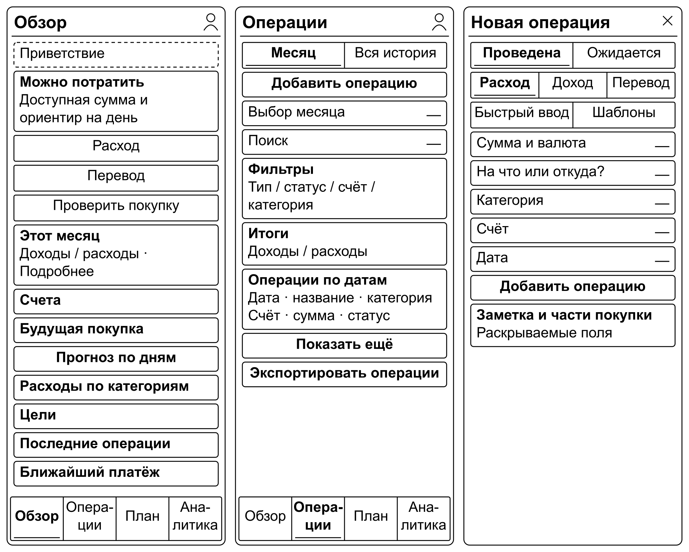

Макет «Обзора» объединяет доступную сумму, счета и ближайшие события. «Операции» проектируются для поиска, фильтрации и просмотра истории по датам. Форма операции предусматривает статус, вид движения, сумму, категорию, счёт и дату.

На рисунке 2 объединены макеты разделов «Бюджеты», «Цели» и формы вывода из цели.

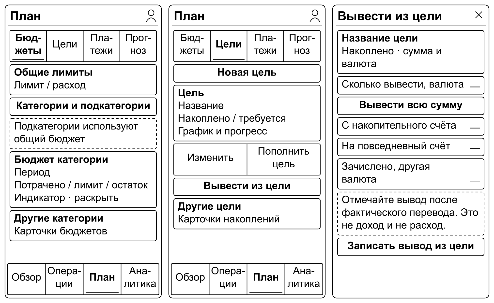

«Бюджеты» должны позволять сопоставлять расходы категорий с лимитами, «Цели» — просматривать накопления и переходить к пополнению или выводу. Макеты «Бюджетов» и «Целей» имеют общий переключатель разделов планирования.

В форме вывода из цели следует показывать доступные накопления, счета списания и зачисления и сумму; запись должна выполняться текущей датой. Для обмена необходима сумма в валюте получателя.

На рисунке 3 представлены макеты разделов «Платежи», «Прогноз» и проверки покупки.

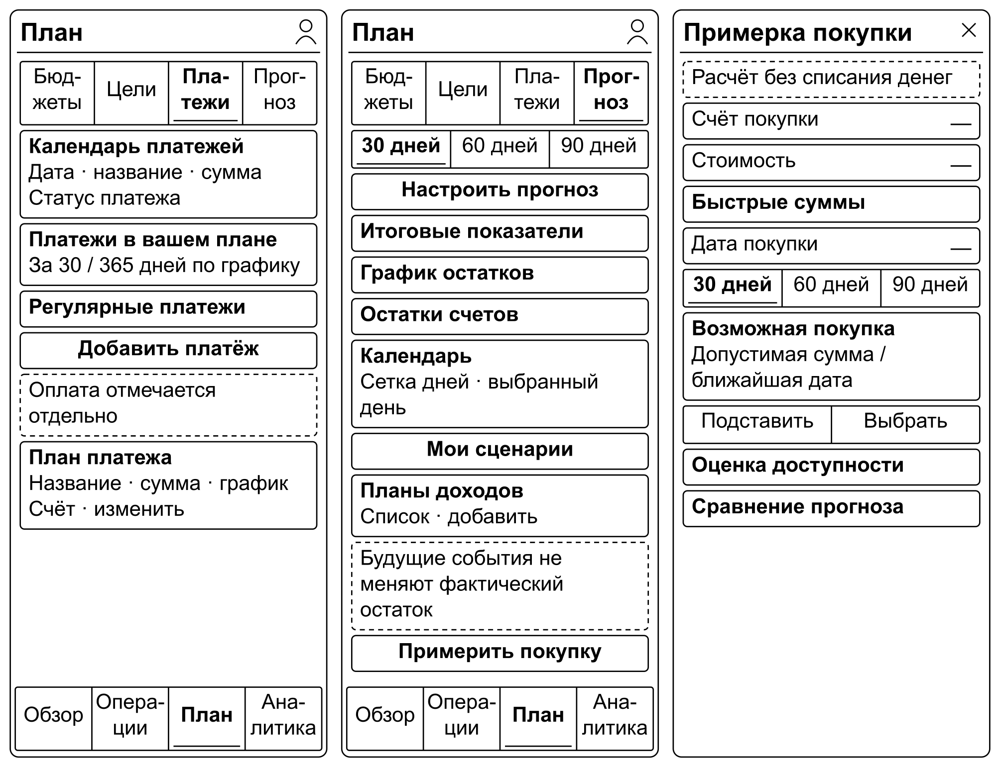

В «Платежах» предлагается объединить календарь обязательств, единый список регулярных платежей и общую сводку на 30 и 365 дней. «Прогноз» предусматривает ожидаемые остатки, счета и события выбранного горизонта. Плановые показатели визуально отделены от подтверждения фактической операции.

Проверка покупки связывает стоимость и дату с выбранным счётом и горизонтом.

На рисунке 4 показаны макеты аналитики, сценария и полного списка.

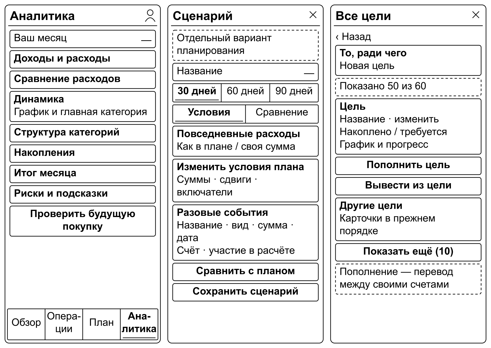

«Аналитика» должна раскрывать результаты выбранного месяца, динамику и структуру расходов. Сценарий объединяет несколько изменений для сравнения с базовым планом. Проверка покупки и сценарий имеют расчётный характер: изменение параметров не создаёт денежных операций.

В обзорных блоках предлагается показывать первые пять записей. Для длинных наборов необходима кнопка с общим числом, открывающая полный список порциями по 50 записей с действием «Показать ещё». Ограничение показа не должно сокращать данные финансовых итогов. Из вложенной формы требуется возвращать к списку, сохраняя выбранный месяц аналитики.

Рисунок 5 показывает меню настроек с предполагаемым входом из шапки и окно данных.

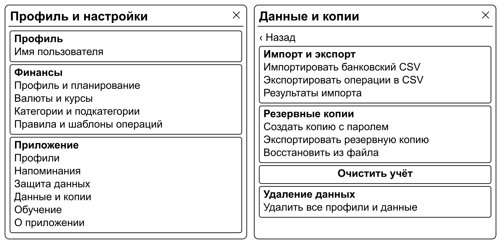

В меню профиля предлагается объединить финансовые параметры, управление приложением и перенос данных. Макет окна данных разделяет перенос истории, резервную копию и очистку.

Поля должны явно разделять тип, сумму, счёт, категорию и дату; обмен требует двух сумм и валют. Сообщение об ошибке должно объяснять исправление с сохранением ввода. Даты требуют локального формата, суммы — обозначения валюты, доступность — пояснения. Неназначенное событие и неподтверждённая запись должны иметь явный статус. Восстановление и сброс требуют отдельного подтверждения.

Для единообразия предлагаются общие компоненты, цвета и шрифт Manrope. Действия должны иметь доступные подписи и роли; цвет не должен быть единственным сигналом ошибки. Формы необходимо проектировать с учётом прокрутки, безопасных областей и клавиатуры. Адаптацию планируется проверять при ширине 320, 390 и 1440 пикселей; доступность и системные окна потребуется дополнительно проверить на мобильном устройстве.

Закрытие изменённой формы любым способом требует подтверждения; отказ должен сохранять ввод, подтверждение — очищать затронутые черновики.

### 1.4.2 Интерфейсы программного обеспечения

Платформенные обращения необходимо отделить от финансовых расчётов. Таблица 5 задаёт планируемые интерфейсы обмена через адаптеры и модули Expo SDK 58 [17].

Таблица 5 – Программные интерфейсы приложения

| Компонент                | Назначение и данные                                               | Ограничение                                                      |
| ------------------------ | ----------------------------------------------------------------- | ---------------------------------------------------------------- |
| Локальное хранилище      | Чтение и запись финансового снимка по идентификатору профиля      | Native и Web требуют разных способов защиты                      |
| Файловые средства ОС     | Получение содержимого CSV и копий; передача подготовленного файла | Передача файла не подтверждает его внешнее сохранение            |
| SecureStore              | Чтение и запись отдельного ключа профиля                          | Keychain/Keystore; ключ не включается в экспорт [22]             |
| Системная аутентификация | Запрос подтверждения личности и получение результата              | Только поддерживаемое нативное окружение                         |
| Локальные уведомления    | Разрешение, очередь событий, идентификатор выбранного плана       | Web не предоставляет равнозначную очередь; доставки сервером нет |
| Frankfurter              | HTTPS-запрос кодов валют; JSON с курсами и датами                 | Финансовые записи не передаются; ответ проверяется               |

Входной CSV должен содержать сопоставленные пользователем колонки даты, описания и суммы либо раздельных прихода и расхода. Валюта, статус, категория, тип и банковский идентификатор необязательны. Необходимо поддержать UTF-8/Windows-1251, разделители «точка с запятой», «запятая» и табуляция, выбор строки заголовков, кавычки и переносы внутри ячейки. Даты YYYY-MM-DD и DD.MM.YYYY следует приводить к локальной календарной строке; для «/» порядок дня и месяца выбирается явно. Дата операции допустима от 2000 года до текущего дня. Денежную строку необходимо преобразовывать в целые минимальные единицы валюты выбранного счёта; знак определяет направление по настройке сопоставления. Отсутствующая колонка валюты означает валюту счёта, несовпадающий код или неподтверждённый статус должны вызывать ошибку строки.

Результатом разбора должен быть предпросмотр операций с ошибками, повторами и предложенными категориями. Для перевода требуется выбрать второй счёт, а при обмене — фактическую сумму на нём. После подтверждения выбранный пакет необходимо повторно проверять по актуальному учёту и применять целиком либо отклонять без частичного добавления. Валютный доход или расход следует оценивать по сохранённому курсу с датой импорта и соответствующим основанием, не приписывая ему исторический курс.

При экспорте необходимо формировать CSV в UTF-8 с BOM, разделителем-запятой и окончаниями строк CRLF. Правила разделения записей и экранирования кавычек должны следовать RFC 4180 [23]. Универсальный формат должен передавать дату, тип, сумму и валюту, описание, категорию, счета, заметку и данные второй стороны перевода; формат YNAB — Date, Payee, Memo, Outflow, Inflow для одного счёта. Текст, похожий на формулу, следует сохранять как текст: OWASP описывает риск выполнения таких полей табличным редактором при открытии CSV [24]. CSV должен включать проведённые операции выбранного периода; полные внутренние связи учёта следует переносить отдельной копией.

Полная копия должна передавать финансовый набор одного профиля в текстовом формате обмена JSON [25]. При чтении JSON необходимо проверять типы, ограничения и ссылки до замены учёта. Открытые JSON и большой архив .ladrescue не должны объявляться зашифрованными. Для .ladbackup следует предусмотреть парольное шифрование AES-256-GCM [26] с получением ключа PBKDF2-SHA256 [27]: обычный снимок помещается в JSON-конверт, большой архив — в бинарный формат. Соль, параметры получения ключа и данные аутентификации должны проверяться до применения содержимого. Неверный пароль или повреждение файла должны оставлять текущий учёт неизменным; ключ устройства, пароль и черновики в копию включать нельзя.

Для курсов предлагается HTTPS-запрос API v2 Frankfurter с параметрами базовой валюты USD и перечня требуемых валют [28]. Ответ должен представлять массив записей «базовая валюта, котируемая валюта, положительный курс, дата». Курс к рублю следует получать делением котировки RUB на котировку нужной валюты, умножением на 10⁸ и целочисленным округлением; датой результата должна стать более ранняя из двух дат. Необходимо отклонять повторяющиеся валюты, неизвестные коды, неверную базовую валюту, будущие или некорректные даты, неположительные и нечисловые курсы, а также отсутствие RUB. При ошибке сети или ответа должны сохраняться прежние значения; автоматическое обновление не должно отменять ручной приоритет.

Запись финансового снимка необходимо подтверждать обратным чтением. Системная аутентификация должна возвращать подтверждение, отмену или ошибку без передачи биометрических образцов. Для напоминаний следует передавать идентификатор события, местную дату и время, заголовок, текст и данные перехода к плану; разрешение пользователя обязательно. Очередь ограничивается 60 календарными днями, включая сегодня, и 60 записями; обновление требуется при открытии, возвращении и изменении планов. Фоновое пополнение без запуска приложения и собственные аппаратные протоколы не предусматриваются.

## 1.5 Нефункциональные требования

### 1.5.1 Целостность финансовых данных

NFR-01. Изменение должно сохранять ссылки, целочисленные суммы и согласованность сущностей. Критерий: недопустимое действие не меняет исходное состояние; перевод обновляет обе стороны, импорт — весь проверенный пакет. При приёмке необходимо проверить возвраты, обеспечение целей по валютам, границы сумм и календаря.

NFR-02. Остатки и отчётность должны воспроизводиться на указанную дату. Критерий: корректировка не становится доходом, план не создаёт факт, переименование не меняет оценку. Одинаковые исходные данные и дата должны давать одинаковые суммы и состав денежных событий.

### 1.5.2 Надёжность и восстановление

NFR-03. Ошибка чтения должна открывать восстановление без подмены сохранённых данных; ошибку записи необходимо показывать с возможностью повтора. Критерий: различимы состояние в памяти, читаемый снимок и неподтверждённая запись; повтор не дублирует денежную операцию или импорт.

NFR-04. Формат, ссылки и пароль необходимо проверять до подтверждённой замены. Неудача должна сохранять исходные данные в предусмотренном маршруте. Для уменьшения риска перезаписи предлагаются новое поколение нативного файла и обратная проверка; физическая сохранность при любом отказе не гарантируется.

Подтверждённое удаление профиля или полный сброс необходимо фиксировать служебным журналом. После прерывания незавершённая очистка должна возобновляться до открытия учёта; при ошибке финансовый интерфейс должен оставаться закрытым до повторной попытки. Удаление одного профиля не должно затрагивать учёт остальных.

### 1.5.3 Безопасность информации

NFR-05. Нативный снимок необходимо шифровать AES-256-GCM, а ключ хранить отдельно в SecureStore. Для парольной копии требуется отдельный ключ с фиксированными проверяемыми параметрами PBKDF2-SHA256. Критерий: повреждение и неверный пароль обнаруживаются до применения, секреты не входят в журналы и экспорт. Оценку соответствия этим требованиям следует отделять от независимого аудита защиты.

NFR-06. Включённая блокировка должна закрывать интерфейс при уходе в фон, сохраняя черновик. При приёмке необходимо проверить возвращение, отмену аутентификации и список приложений. Шифрование Web, JSON/CSV и служебных названий профилей не предусматривается. Защита интерфейса не предназначена для противодействия скомпрометированной ОС или чтению памяти процесса.

### 1.5.4 Совместимость и переносимость

NFR-07. При чтении копий необходимо сохранять финансовый смысл: отсутствующая валюта означает RUB, неизвестное основание остаётся неизвестным, строка сценария без признака участия включена. Критерий: восстановление корректной копии сохраняет финансовые связи записей. Самостоятельный вывод допускает освобождение без цикла фонда; последующее сохранение сценария не должно нарушать связи вывода с целью и переводом.

NFR-08. Общие действия должны давать одинаковые финансовые результаты на всех UI-платформах; системное поведение необходимо проверять отдельно. Экспорт JavaScript и ресурсов iOS/Android/Web не равнозначен APK/IPA или испытанию физического устройства.

### 1.5.5 Производительность и объём данных

NFR-09. Превышение допустимого объёма необходимо объяснять и отклонять до изменения учёта. Для обычной копии предлагается предел 5 МБ UTF-8, для CSV — 2 000 000 байт, 5000 строк и 50 колонок. Предупреждения следует показывать при 80% пределов учёта; эти границы потребуется учитывать при планировании нагрузочных испытаний. Спасательный архив не должен отменять обычные ограничения.

Предлагаемая приёмочная цель: на согласованном Android-устройстве с 5000 операциями пересчитывать прогноз на 90 дней за 2 секунды в 95% из 30 повторений после прогрева. Это будущий критерий, не замер. В протоколе фиксируются устройство, сборка и границы измерения; холодный запуск и парольный экспорт оцениваются отдельно.

### 1.5.6 Удобство и сопровождаемость

NFR-10. На узком экране необходимо обеспечить читаемость подписей, прокрутку окон и доступность подтверждения при открытой клавиатуре; ошибки должны объяснять исправление. Роли и подписи элементов следует задавать средствами доступности React Native [29] и проверять на целевых платформах; свойства компонентов сами по себе не доказывают удобство для всех пользователей.

NFR-11. Финансовое ядро необходимо отделить от интерфейса и ввода-вывода; модули должны использовать публичные интерфейсы без циклов. Критерий: расчёт на переданных состоянии и дате не обращается к React, DOM, файлам и сети; замена адаптера не переписывает финансовую модель.

Для приёмки приложения предусматриваются модульные, браузерные и нативные испытания. Отдельно потребуется проверить доставку уведомлений, защищённый перенос данных и работу под нагрузкой. Расчёт доходности и инфляции целей, процентов и льготного периода карты, а также сохранение прошлых прогнозов для сравнения с фактом не входят в объём проекта.

Пользовательские цели, данные, интерфейсы и свойства качества определяют модели второй главы; связь плана и факта, целостность изменений и объяснимые ограничения — дальнейшую проверку.

# 2 Проектирование мобильного приложения «Лад»

## 2.1 Модель сценариев использования предметной области

Модель вариантов использования должна раскрывать взаимодействие владельца с приложением: подтверждаемые изменения, получаемые результаты и необходимые действия. Её основу составляют девять прецедентов UC-01–UC-09 из подраздела 1.2. Вспомогательные прецеденты уточняют разновидности денежных записей, обязательные части финансовых действий и условные дополнения, связывая общую цель пользователя с конкретным результатом учёта или расчёта.

Для проектирования используется нотация UML: участники, варианты использования и отношения определяются её спецификацией [30]. Шесть диаграмм раскрывают запись операции, переводы и обмен, движение накоплений, сверку, оценку покупки и сравнение сценариев. Повторяющееся название обозначает один прецедент с одинаковым смыслом. Например, финансовая проверка должна защищать обычный расход, перевод накоплений и корректировку остатка.

### 2.1.1 Участник системы и смысл отношений

Актор «Владелец учёта» соответствует пользователю пункта 1.1.3. Он должен вводить финансовые сведения, подтверждать изменения и выбирать условия расчёта. Локальные профили разделяют данные при одинаковых возможностях владельца, поэтому разные роли не требуются.

Прямоугольник каждой диаграммы задаёт границу мобильного приложения «Лад»: прецеденты располагаются внутри, владелец — снаружи. Сплошная линия без стрелки обозначает его участие. Основные прецеденты имеют идентификаторы UC-01–UC-09, вспомогательные названы по результату действия. Связь владельца с общим прецедентом распространяется на разновидности, не требуя отдельных линий к каждому частному случаю.

Обобщение обозначается сплошной линией с полым треугольником от частного прецедента к общему и задаёт разновидность поведения: перевод должен сохранять общие свойства денежной операции. Пунктирная стрелка «include» направляется к обязательной части: взнос должен включать запись перевода. Стрелка «extend» идёт от условного дополнения к базовому прецеденту: корректировка должна дополнять сверку при расхождении и согласии владельца. Условие определяет необходимость дополнения, точка расширения — соответствующую часть взаимодействия [30]. Эти отношения не задают последовательность вычислений программы.

### 2.1.2 Запись финансовой операции

UC-01 «Записать финансовую операцию» должен сохранять денежную запись с датой, суммой, названием и необходимыми ссылками. Его разновидности «Записать доход», «Записать расход» и «Учесть возврат покупки» должны использовать общие правила записи, уточняя экономический смысл движения. Доход предусматривает увеличение средств, расход — уменьшение с указанием назначения. Возврат должен связываться с исходной покупкой и уменьшать расходы на дату зачисления; считать его обычным доходом не следует.

На рисунке 6 показаны разновидности операции, общая финансовая проверка и условное разделение расхода.

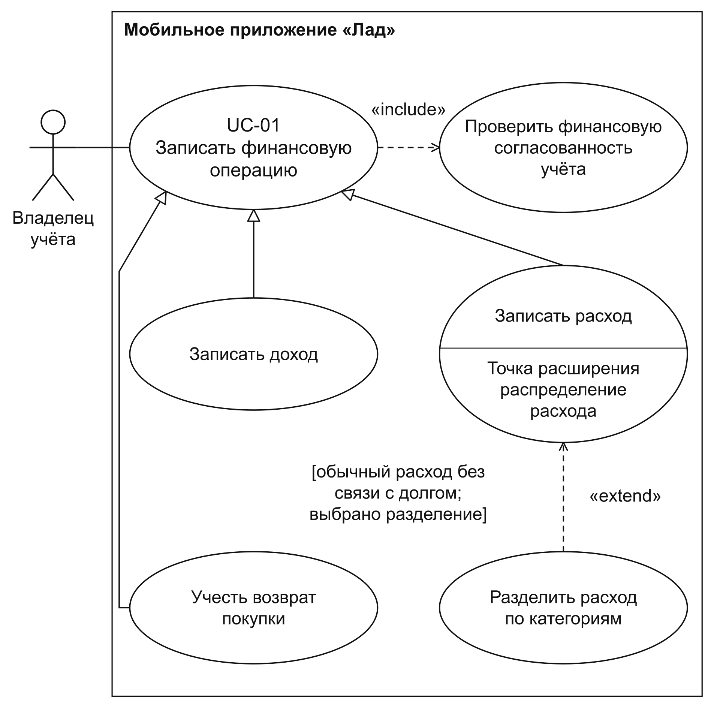

UC-01 обязательно включает прецедент «Проверить финансовую согласованность учёта»: определить допустимость изменения с учётом счетов, валют, связанных записей и финансовых ограничений. Проверка должна предотвращать несогласованные суммы и ссылки, нарушение обеспеченности целей и недопустимое изменение кредитных обязательств. При ошибке новая запись не должна сохраняться. Разновидности операции наследуют эту обязательную проверку.

Прецедент «Разделить расход по категориям» расширяет «Записать расход» в точке «распределение расхода», если расход обычный, не связан с долгом и владелец выбрал разделение. Пользователь должен иметь возможность задать несколько частей покупки с суммой, точно равной её стоимости. Расход с одной категорией остаётся самостоятельным завершённым действием. Разделение должно уточнять распределение одной покупки, сохраняя одно списание.

### 2.1.3 Переводы и валютный обмен

UC-02 «Записать перевод между счетами» специализирует UC-01 и требует разных счетов списания и зачисления. В одной валюте суммы должны совпадать, сохраняя общую сумму собственных денег. Разновидность перевода «Записать валютный обмен» должна связывать счета в разных валютах и хранить обе фактические суммы. Оба движения необходимо исключать из обычных доходов и расходов.

На рисунке 7 раскрываются обобщение перевода, его валютная разновидность и добавление комиссии.

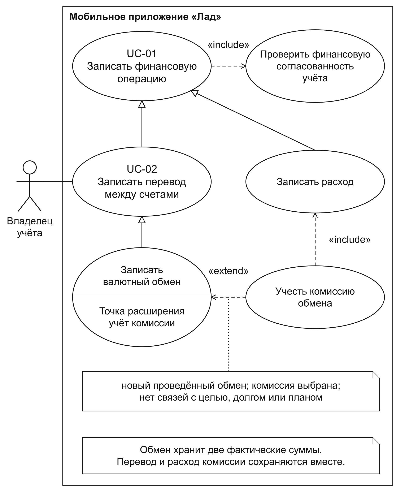

Прецедент «Учесть комиссию обмена» расширяет валютный обмен в точке «учёт комиссии». Он должен выполняться для нового проведённого обмена, если владелец выбрал комиссию и перевод не связан с целью, долгом или планом. Без выбранной комиссии обмен должен завершаться сохранением основного перевода. Условие отличает дополнительную плату от обязательной суммы зачисления в другой валюте.

Учёт комиссии обязательно включает прецедент «Записать расход»: пользователь должен указать сумму, счёт списания комиссии и категорию. Расход наследует общую запись операции и финансовую проверку. Перевод отражает перемещение денег, расход — отдельную плату за обмен. Обе записи должны сохраняться совместно одним подтверждением; ошибка комиссии должна отменять всё изменение.

Обобщение задаёт общие правила записи и не должно создавать дополнительную операцию наряду с переводом. Недостаточность источника с учётом удержаний, архивный счёт и нарушение обеспеченности накоплений должны блокировать как недопустимый обычный перевод, так и валютный обмен.

### 2.1.4 Взнос в цель и вывод накоплений

UC-03 «Учесть взнос в цель» должен обязательно включать UC-02 и «Закрепить переведённую сумму за целью». Перевод должен отражать движение с повседневного счёта на накопительный, закрепление — назначение полученных средств. Без перевода взнос не достигается; без связи с целью перевод остаётся обычным движением денег. Валюта накопительного счёта должна совпадать с валютой цели; при обмене накопленная сумма увеличивается по зачислению.

На рисунке 8 взнос и вывод связаны через общий перевод и финансовую проверку.

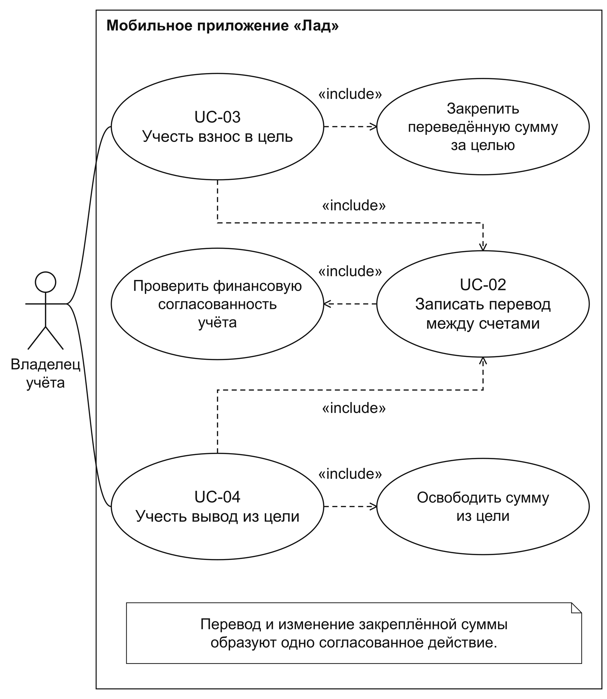

UC-04 «Учесть вывод из цели» должен включать UC-02 и «Освободить сумму из цели». Освобождение уменьшает закреплённую за выбранной целью сумму, сохраняя историю взносов. Перевод должен возвращать средства с накопительного счёта в валюте цели на повседневный. Вывод необходимо ограничивать накопленной суммой и доступностью выбранного источника, сохраняя обеспеченность других целей отдельно по каждой валюте.

Включение «Проверить финансовую согласованность учёта» в UC-02 раскрывает проверку, наследуемую от общей денежной операции. Она должна одинаково действовать при взносе и выводе, отклоняя взнос сверх оставшейся суммы цели, необеспеченный вывод и недопустимые счета.

Владелец должен подтверждать взнос или вывод один раз; включённый перевод должен использовать выбранные счета и суммы. Одна запись перевода и изменение закреплённой суммы должны сохраняться согласованно: ошибка не должна оставлять отдельно движение денег или освобождение накоплений. Вывод не следует учитывать как доход или расход; дата графика взносов не должна сама создавать перевод.

### 2.1.5 Сверка и исправление расхождения

UC-05 «Сверить остаток счёта» должен обязательно включать «Определить фактический остаток на дату»: рассчитать его по начальной сумме, проведённым операциям и датированным корректировкам. Владелец должен ввести известную сумму в валюте счёта на конец того же дня. Сравнение должно показать совпадение или величину расхождения.

На рисунке 9 обязательное определение остатка отделено от условной корректировки.

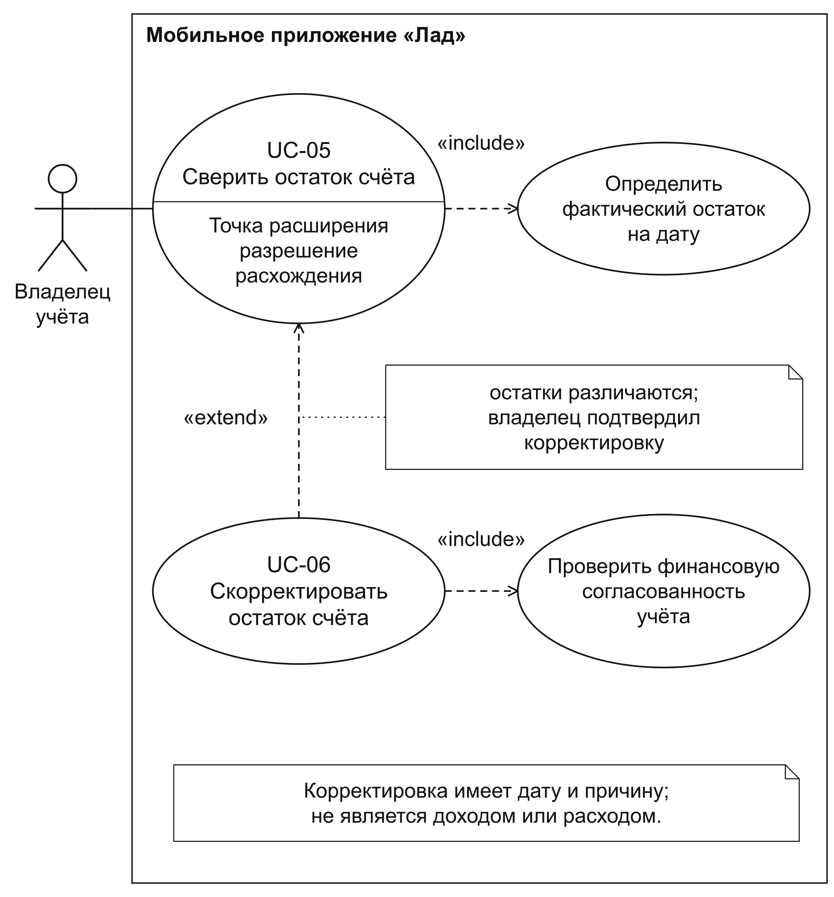

При совпадении сумм UC-05 должен сохранять сверку без изменения денег. При расхождении владелец может проверить операции, исправить историю и повторить сравнение либо отказаться от подтверждения. UC-06 «Скорректировать остаток счёта» расширяет сверку в точке «разрешение расхождения» только при разных остатках и подтверждении корректировки владельцем. Необходимо пояснить причину. Без согласия при расхождении отметка об успешной сверке создаваться не должна.

UC-06 обязательно включает общую финансовую проверку: перед сохранением требуется повторно установить актуальность денежных записей, допустимость кредитного остатка и обеспеченность целей. Корректировка должна иметь собственную дату и менять расчётный остаток, сохраняя начальную сумму и прежние операции счёта. В обычные доходы и расходы она не входит. Корректировку и сверку необходимо сохранять совместно; последующее изменение связанных денежных записей должно делать сверку неактуальной.

### 2.1.6 Оценка покупки на основе прогноза

UC-08 «Оценить возможность покупки» должен включать UC-07 «Получить прогноз денежных остатков». Для оценки допустимости необходимо сравнить исходный план с вариантом покупки на выбранном счёте в заданную дату. UC-07 обязательно включает «Выявить дефицит и нарушение резерва». Прогноз должен предоставлять дневные остатки, минимумы, даты нехватки и предупреждения; отсутствие нарушений также является результатом проверки.

На рисунке 10 показаны обязательная оценка покупки и дополнение для текущего дня.

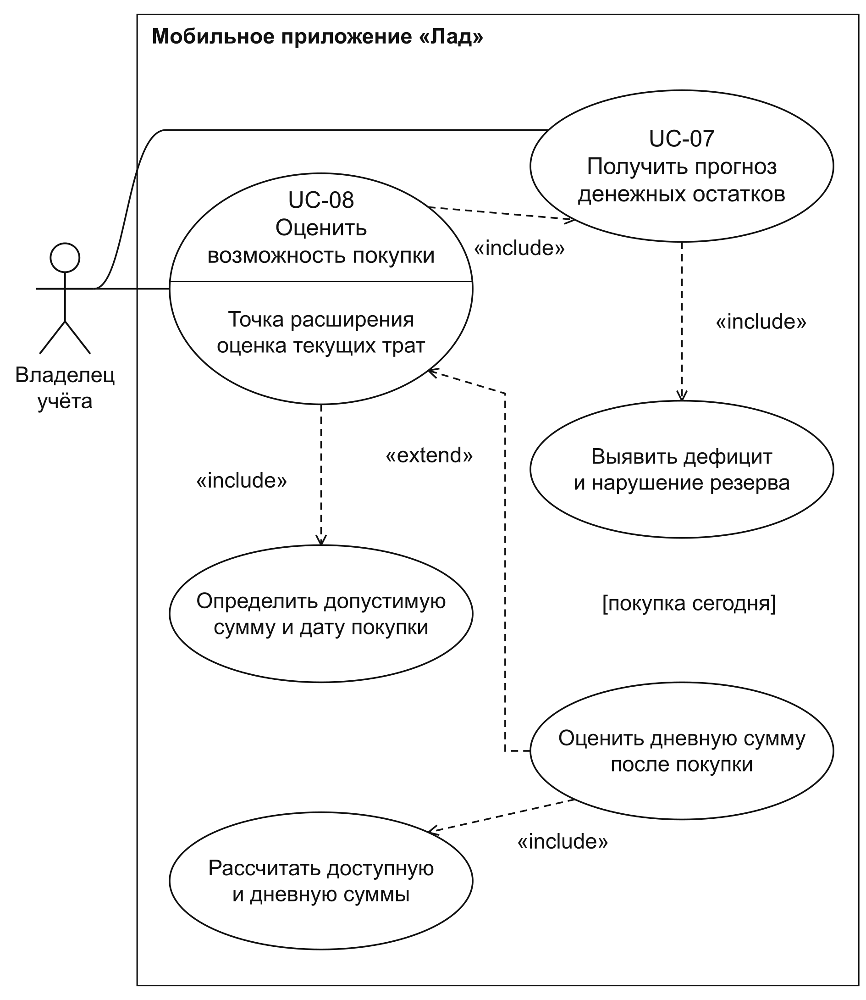

Вторая обязательная часть UC-08 — «Определить допустимую сумму и дату покупки». Она должна учитывать средства выбранного счёта и общий резерв на всём горизонте, включая обязательства после покупки. Требуется показать максимальную сумму и ближайшую подходящую дату либо объяснить отсутствие допустимого варианта. Результат необходим для любой корректно заданной покупки, а не только при превышении её стоимостью доступных средств.

Прецедент «Оценить дневную сумму после покупки» расширяет UC-08 в точке «оценка текущих трат» для покупки сегодня и обязательно включает «Рассчитать доступную и дневную суммы». Владелец должен видеть текущий ориентир и его изменение после предполагаемой покупки до ближайшего подходящего дохода либо явно объяснённой запасной даты профиля. Здесь резерв вычитается из доступных денег; в прогнозе он служит порогом сравнения.

Владелец также должен иметь возможность самостоятельно открыть UC-07. Накопления и кредитный лимит не должны увеличивать повседневную доступность. Исходный дефицит, неназначенные события и предупреждения должны исключать положительный вывод о покупке. Расчёт должен оставаться самостоятельной оценкой: смена суммы и даты не создаёт расхода, а условия вне горизонта не позволяют обещать достаточность средств.

### 2.1.7 Сравнение и сохранение сценариев

UC-09 «Сравнить финансовые сценарии» должен включать UC-07 для обоих вариантов от одного актуального состояния на одинаковом горизонте. Вторым вариантом владелец может выбрать текущий план или другой сценарий. Выявление дефицита и нарушения резерва должно сохранять смысл оценки покупки. Сравнение должно показывать различия остатков и дат нехватки даже при одинаковых конечных суммах.

На рисунке 11 общая проверка условий связывает сравнение с необязательным сохранением варианта.

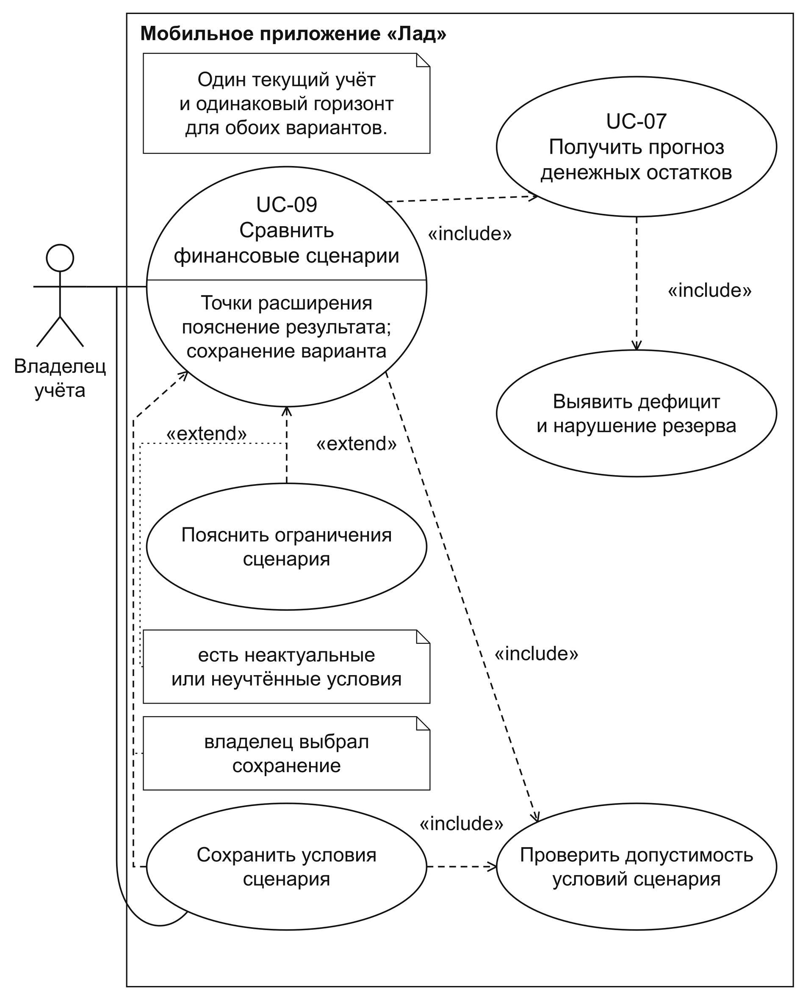

UC-09 обязательно включает «Проверить допустимость условий сценария»: название, горизонт, суммы, даты, валюты и назначения. Недопустимые значения должны препятствовать расчёту или сохранению до исправления. Прецедент «Пояснить ограничения сценария» расширяет сравнение в точке «пояснение результата» при неактуальных или неучтённых условиях: удалённом источнике, остановленном платеже, прошедшей дате, архивном счёте или событии вне горизонта. Такие предупреждения не следует автоматически считать запретом всего расчёта.

Прецедент «Сохранить условия сценария» расширяет UC-09 в точке «сохранение варианта» по выбору владельца. Сравнение должно оставаться доступным без предварительной записи сценария. Сохранение требует повторной проверки допустимости условий. Прямая ассоциация владельца с сохранением должна также позволять записать вариант из формы условий без предварительного просмотра сравнения.

Сохранять следует предположения сценария, результаты — пересчитывать от актуального учёта. Выключенная строка должна оставаться в условиях без влияния на результат. Изменения сценария не должны переписывать реальные счета, операции, планы и условия просроченных обязательств. Расход после совершённой покупки должен записываться отдельным выполнением UC-01.

### 2.1.8 Согласованность модели

Основные прецеденты соответствуют требованиям 1.2.1–1.2.9 и реализации 3.1–3.9. Вспомогательные раскрывают их поведение, общие задают одинаковые правила разных взаимодействий. Исходные данные сами по себе не означают включения: прогноз должен использовать историю, не запуская заново запись операций или сверку. Связи данных и программных частей раскрываются в подразделах 2.2 и 2.3. Профили, защита, файлы, категории, бюджеты, планы и аналитика должны обеспечивать взаимодействия по требованиям первой главы.

## 2.2 Логическая модель данных

Предлагается единая логическая модель фактического учёта, планирования и вспомогательных настроек на основе модели «сущность — связь», разделяющей предметные объекты, связи и физическое представление данных [31]. Общая ER-диаграмма в приложении 1 занимает два книжных листа А4: рисунок 1.1 — верхняя часть, 1.2 — нижняя. Фрагменты совмещаются по границам рисунков без полей страницы; одинаковые метки обозначают продолжение связи. Блоки содержат имена типов и ключевых полей TypeScript. Атрибуты имеют вид «имя: тип», вопросительный знак отмечает необязательное поле. Логическая модель не требует реляционной СУБД.

В Crow’s Foot две поперечные черты означают ровно один объект, кружок с чертой — не более одного, с разветвлением — любое количество, включая отсутствие записей [32]. Знак у блока задаёт число его экземпляров, связанных с одним экземпляром на другом конце. Пунктир обозначает мягкую ссылку: исходный объект может отсутствовать. Пересечение линий не создаёт связи. Подписи показывают соединяющие поля; у вложенных записей путь к полю заменяет имя типа. Вложенность описывает состав данных, не требуя отдельной таблицы. Остатки, будущие обязательства, прогноз и очередь уведомлений предполагается вычислять, не сохраняя отдельными сущностями.

Состояние `FinanceState` профиля должно объединять шестнадцать коллекций и настройки `settings`, сериализуемые в JSON. Запись каталога `LedgerProfile` определяет отдельное пространство хранения, поэтому идентификатор профиля не повторяется в операциях и целях. Профилю соответствует один объект настроек, который может включать параметры прогноза `ForecastPreferences`, несколько курсов `ExchangeRate` и один выбранный план дохода `PlannedIncome`. Связь `spendableIncomeId` задаёт опорный доход расчёта «Можно потратить»; без выбора действуют предусмотренные правила определения следующего поступления или дня из профиля. Идентификаторы самостоятельных записей уникальны внутри коллекции профиля, версий — внутри владельца. Ключ бюджета совпадает с ключом категории, части расхода — с сочетанием операции и категории. Изменение сценария определяется сценарием, видом и ключом источника, разовое событие — сценарием и собственным ключом.

Справочник `CURRENCIES[CurrencyCode]` задаёт код, точность и обозначение валюты. На запись могут ссылаться несколько счетов `Account`, целей `Goal` и долгов `Debt`, каждому из которых соответствует одна валюта. Настройки задают одну основную валюту и не более одного текущего курса для кода. Курс хранит значение, дату и источник; отсутствие необязательной записи не означает нулевой курс. Отсутствующую валюту прежних записей следует трактовать как RUB. Деньги необходимо представлять целыми минимальными единицами, историческую оценку операции с её основанием сохранять отдельно от текущих курсов.

Операция `Transaction` относится к одному основному счёту — получателю дохода либо источнику расхода или перевода; счёт может участвовать во многих операциях. Второй счёт нужен только переводу; обмен хранит обе фактические суммы. Категория `Category` может объединять много операций. Расход допускает вложенные части `Transaction.splits[]`, каждая принадлежит одной операции и одной категории; их сумма равна покупке. Возврат имеет не более одной ссылки `refundOf` на исходный расход, у которого возможны несколько возвратов; расходы уменьшаются на дату зачисления. Необязательная связь `debtId` объединяет операции одного долга. Долг имеет один исходный счёт; счёт последующего движения может отличаться при сохранении валюты долга.

Категория предусматривает не более одного родителя и несколько подкатегорий; циклы и третий уровень запрещены. Основной категории может соответствовать один `BudgetPlan`, подкатегории используют его лимит. Бюджет содержит исходные условия и любое число последующих `BudgetVersion`; каждая версия принадлежит одному бюджету. Изменения лимита и значения отдельных периодов остаются вложенными данными условий. Корректировка `BalanceAdjustment` и сверка `AccountReconciliation` относятся каждая к одному счёту; у счёта таких записей может быть несколько. Корректировка меняет остаток с указанной даты, сверка сохраняет подтверждённый остаток и отпечаток денежных записей.

План дохода `PlannedIncome`, платёж `Recurring` и цель `Goal` могут содержать несколько сохранённых версий `IncomeTermsVersion`, `PaymentTermsVersion` и `GoalTermsVersion` соответственно. Версия имеет одного владельца; интервалы действующих условий не пересекаются. Прежний план без массива версий должен использовать исходные условия: отсутствие отдельной версии не означает отсутствия условий. Доход и каждая его версия задают один счёт зачисления, платёж и каждая его версия — один счёт списания и одну категорию. Счёт или категория могут использоваться многими планами и версиями, сохраняя назначение события при изменении будущих условий. График повторения задаётся вложенными значениями единицы периода, интервала и опорной даты.

План дохода может владеть уточнениями поступлений `IncomeOccurrenceOverride`: переносом ожидаемой даты либо пропуском отдельного события. Каждое уточнение принадлежит только ему. Поле `versionId` указывает условия этого плана; отдельная сохранённая версия может отсутствовать при исходных условиях. Версия может участвовать в нескольких уточнениях. Исходная дата с версией сохраняет идентичность события при переносе. Аналогично операция может ссылаться на цель, платёж или доход и их версии парами `goalId` и `goalVersionId`, `recurringId` и `recurringVersionId`, `plannedIncomeId` и `incomeVersionId`. Каждая роль допускает не более одного плана и одной версии; каждому плану или версии соответствуют многие операции. Исходный ключ различает месяц прежнего месячного плана, once разового дохода и дату интервального графика. Удаление плана сохраняет факт операции и очищает связанные ссылки.

Цель может объединять несколько переводов-взносов; каждый относится не более чем к одной цели. Накопления обеспечиваются совокупностью накопительных счетов её валюты. Цикл годового фонда `GoalFundCycle` принадлежит одной цели; у неё возможны несколько циклов, но только один активный. Цикл имеет не более одной связи с платежом и его версией, платежу могут соответствовать несколько циклов. Активный цикл требует платежа; после удаления плана историческая ссылка может отсутствовать. Оплаченный цикл связан с одной расходной операцией, которая не может оплачивать другой цикл. Освобождение `GoalRelease` относится к одной цели и одному фактическому переводу; у цели их может быть несколько, у перевода — не более одного. Связь освобождения с циклом нужна для оплаты фонда и отсутствует при самостоятельном выводе; цикл допускает не более одного освобождения.

Параметры прогноза могут задавать один повседневный счёт ежедневных расходов, назначения взносов и погашений, плановые переводы. Назначение `goalAccounts[]` принадлежит одному набору параметров, связывая одну цель с повседневным счётом списания и накопительным счётом зачисления. Для цели допускается не более одного назначения, для счёта — несколько. Назначение `repaymentAccounts[]` задаёт один повседневный счёт оплаты; вид выбирает единственный объект погашения — кредитный счёт либо полученный долг. Обязательство допускает не более одного назначения. Плановый перевод `ForecastTransfer` принадлежит одному набору параметров и соединяет два разных счёта, каждый может участвовать во многих переводах в обеих ролях. План хранит дату и суммы, не создавая операцию. После отражения факта его следует удалить, исключая повторное влияние на прогноз.

Сценарий `SavedScenario` может содержать несколько изменений `ScenarioChange` и разовых событий `ScenarioEvent`; каждая строка принадлежит одному сценарию. Вид изменения выбирает один источник — доход, платёж или цель. Источник может участвовать в нескольких сценариях; мягкая ссылка сохраняет строку с предупреждением после его удаления. Необязательный код валюты изменения сохраняет денежный смысл суммы при недоступном источнике. Разовому событию можно назначить один повседневный счёт, счёту — несколько событий. Условия должны храниться отдельно от реальных планов, результаты — пересчитываться по актуальному учёту.

Правило распознавания `CategoryRule` указывает одну категорию, которую могут выбирать несколько правил. Шаблон `TransactionTemplate` задаёт один основной счёт, категорию и валюту; перевод добавляет счёт и валюту зачисления. Каждый из этих объектов может использоваться многими шаблонами. Части `TransactionTemplate.splits[]` принадлежат одному шаблону и каждая ссылается на одну категорию, сохраняя общую сумму расхода. Профиль импорта `CsvSourceProfile` задаёт один счёт назначения, одну валюту и вложенное соответствие столбцов CSV; счёту или валюте могут соответствовать несколько профилей. Эти записи подготавливают ввод, сами не создавая финансовых операций.

## 2.3 Структурное моделирование системы

Структурную модель предлагается строить нисходящим способом: разделить приложение на функциональные подсистемы и раскрыть их функции. Детализация подзадач соответствует пошаговому уточнению Н. Вирта [33]. Рисунок 12 показывает три уровня: мобильное приложение «Лад», пять подсистем и 18 функций. Линии дерева обозначают принадлежность функции подсистеме.

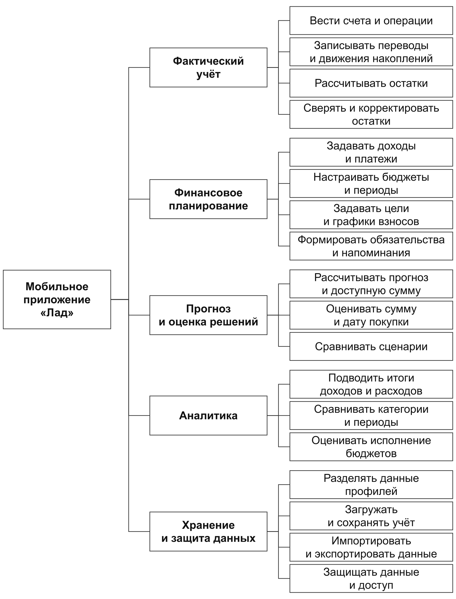

Подсистема фактического учёта должна обеспечивать ведение счетов и операций, запись переводов и движений накоплений, расчёт, сверку и корректировку остатков. Результатом должен быть согласованный набор финансовых фактов. Взнос в цель и вывод необходимо отражать согласованным изменением денег на счетах и закреплённой суммы.

Подсистема финансового планирования должна позволять задавать доходы и платежи, бюджеты и периоды, цели и графики взносов, формировать обязательства и напоминания. Её результат — условия будущих действий. Условия цели следует отделять от фактического взноса; плановая дата не должна сама создавать операцию.

Подсистема прогноза и оценки решений должна рассчитывать будущие остатки и доступную сумму, оценивать сумму и дату покупки, сравнивать сценарии. Расчёты должны использовать текущий учёт, невыполненные планы и финансовые настройки. Результат должен показывать ограничения решения; изменение предположений не должно менять реальные операции.

Подсистема аналитики должна подводить итоги доходов и расходов, сравнивать категории и периоды, оценивать исполнение бюджетов по фактическим операциям и бюджетным условиям. Сводки должны показывать распределение расходов и отклонения от лимитов. Переводы требуется исключать из доходов и расходов, возвраты — уменьшать расходы; бюджеты следует оценивать по собственным периодам.

Подсистема хранения и защиты должна разделять профили, загружать и сохранять учёт, импортировать и экспортировать сведения, защищать данные и доступ. Загрузка и импорт требуют проверки формата и согласованности записей. Мобильное хранилище предусматривает шифрование и блокировку интерфейса; Web-хранилище и открытый JSON-экспорт остаются незашифрованными.

Взаимодействие подсистем должно опираться на единое состояние выбранного профиля. Учёт предоставляет сведения о выполнении планов; привязка записанной операции не должна повторно менять деньги. Прогноз получает текущие остатки из учёта, предстоящие события — из планирования. Аналитика сопоставляет операции с условиями бюджетов. Хранение должно предоставлять проверенные данные при открытии профиля и сохранять подтверждённые изменения. Это позволяет использовать одни финансовые сведения для разных задач без дублирования учёта.

При переходе к программным модулям следует скрывать изменяемые решения за интерфейсами по принципу Д. Парнаса [34]. Предметные формы предлагается разместить в features, общие расчёты и проверки — в domain, управление состоянием — в state/finance. Адаптеры хранения, файлов, шифрования, уведомлений и курсов необходимо разместить в infrastructure. Отделение предметных расчётов от внешних средств опирается на «порты и адаптеры» А. Коберна [35]. Application и Screens должны объединять модули в навигацию и экраны, Shared — предоставлять универсальные компоненты и функции. Интерфейс предполагается разработать на React [15] и React Native [16], возможности устройства подключать через Expo [17], контракты типизировать средствами TypeScript [18].

## 2.4 Модель классов предметной области

Модель классов раскрывает понятия девяти прецедентов и бюджетирования, свойства, смысловые отношения и результаты расчётов средствами UML [30]. Предметная модель должна объединять данные и поведение значимых объектов [36]. Организация данных определена в подразделе 2.2; настройки оформления, импорта и хранения здесь не рассматриваются. Рисунки 13–15 представляют одну модель: повторённые классы сохраняют смысл и могут изображаться только заголовком.

Предметные классы предполагается описать типами TypeScript, например «Операцию» — типом Transaction, обработку вынести в функции. Общие «Условия плана» выражают смысл условий дохода, платежа и цели, не требуя общего программного класса. Реализация рассматривается в главе 3.

Сплошная линия обозначает ассоциацию, закрашенный ромб у владельца — композицию, пунктирная стрелка — зависимость расчёта. Кратности 1, 0..1, 0..* и 1..* означают один, не более одного, любое количество и хотя бы один объект. «?» отмечает необязательное свойство, «/» — вычисляемое. Типы значений заданы словарём 1.3.1.

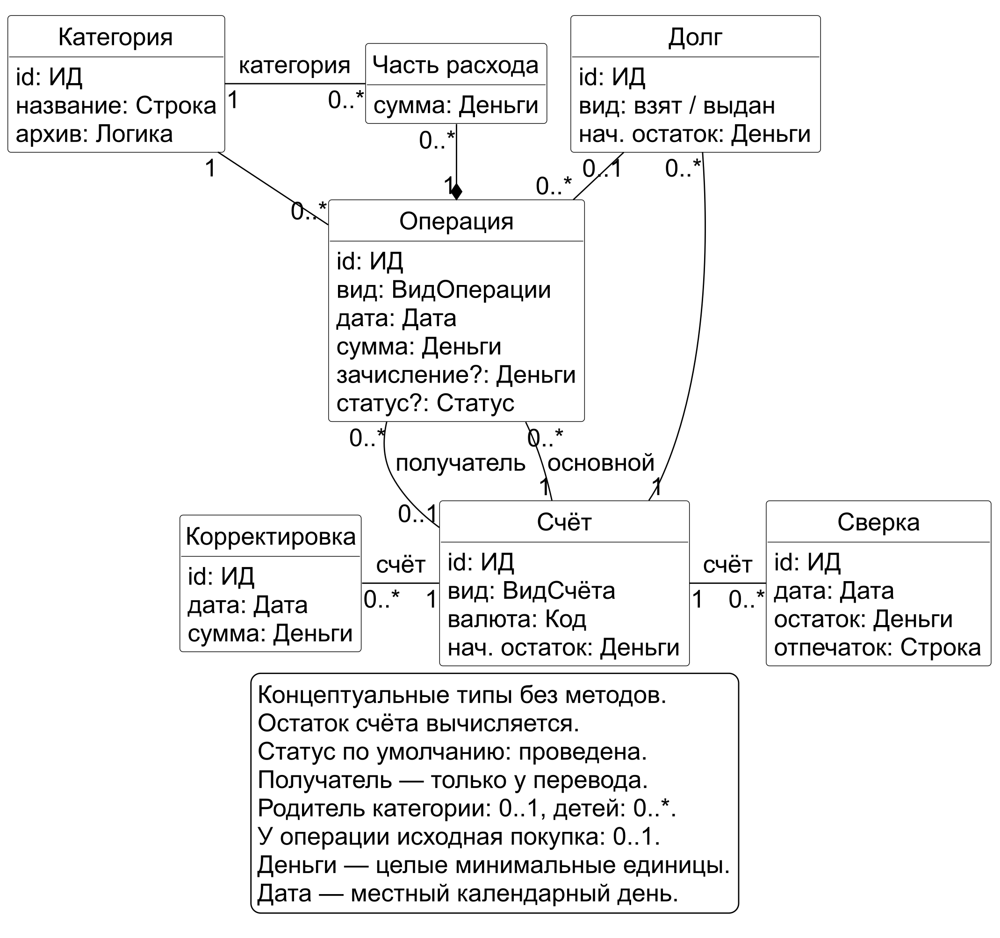

Счёт задаёт валюту и вид: повседневный, накопительный или кредитный. Остаток следует рассчитывать по начальному значению, операциям и корректировкам. Операция содержит вид — доход, расход или перевод, дату, сумму и статус: ожидающая, проведённая либо отменённая. Перевод предусматривает сумму зачисления. У операции одна категория и один основной счёт — получатель дохода либо источник расхода или перевода. Только перевод требует второго счёта; счета должны различаться. Счёт может участвовать во многих операциях в каждой роли.

Категория имеет название и признак архива; может иметь не более одного родителя и несколько подкатегорий. Иерархия должна оставаться двухуровневой, без циклов; архив сохраняет историю. Часть расхода принадлежит одной операции и одной категории. Расход без связи с долгом допускается разделить на 2–50 частей с разными категориями и общей суммой покупки; у остальных операций частей нет. Расход может иметь несколько возвратов, каждый относится не более чем к одной исходной покупке.

Долг бывает взятым или выданным; остаток следует вычислять по начальному обязательству и последующим движениям. У долга один исходный счёт и возможны несколько операций; операция связана не более чем с одним долгом. Корректировка задаёт дату и сумму изменения остатка без дохода или расхода, сверка — дату и подтверждённый остаток. Каждая запись относится к одному счёту; у счёта возможны несколько долгов, корректировок и сверок (рисунок 13).

План дохода описывает ожидаемое поступление, план платежа — обязательство; названия различают назначение. Цель задаёт требуемую сумму и валюту; накопленное следует рассчитывать по исходному значению, взносам и освобождениям. «Условия плана» объединяют начало, необязательный конец действия и сумму события, для цели — взноса. Набор принадлежит ровно одному доходу, платежу или цели: у каждого альтернативного владельца указано 0..1. История 1..* включает исходные условия даже без отдельной записи версии. Интервалы неотменённых условий одного владельца не должны пересекаться.

Условия могут содержать один график с единицей день, неделя, месяц или год. Интервал задаёт число единиц, опорная дата — начало отсчёта повторений. График принадлежит одному набору условий; без него допускаются месячные правила или разовый доход. План дохода может владеть несколькими уточнениями поступлений: ожидаемой датой либо признаком пропуска. Уточнение должно сохранять исходную идентичность события, не заменяя условия всего плана. Планирование и накопления показаны на рисунке 14.

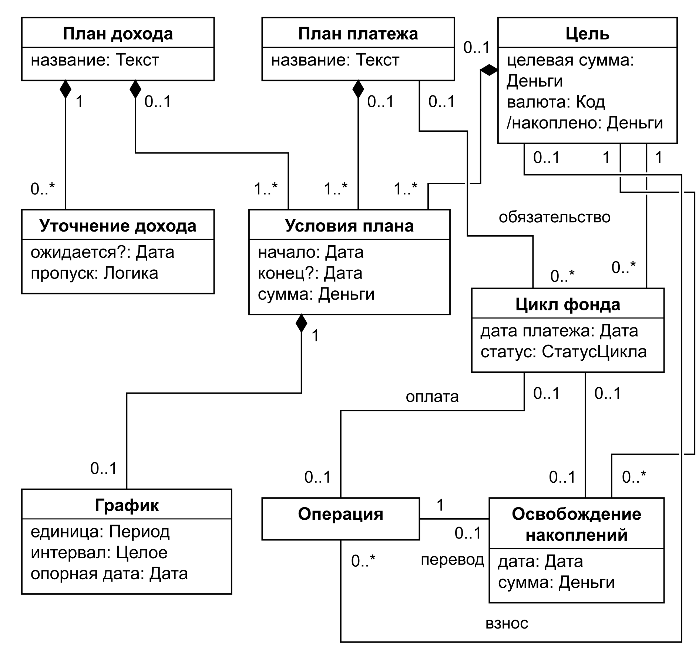

Цель может иметь несколько переводов-взносов, каждый относится не более чем к одной цели. Цикл фонда описывает подготовку цели к годовому платежу: дату обязательства и статус — активный, оплаченный либо отменённый. У цели возможны несколько циклов, но только один активный. Цикл связан не более чем с одним планом платежа, план — с несколькими циклами. Активному циклу план обязателен; после удаления плана историческая ссылка может отсутствовать. Оплаченный цикл имеет одну расходную операцию, не оплачивающую другой цикл. Освобождение накоплений задаёт дату и сумму, относится к одной цели и одному фактическому переводу. У цели таких записей может быть несколько, у перевода — не более одной. Освобождение может относиться к одному циклу; цикл имеет не более одного освобождения. Самостоятельный вывод цикла не требует.

Бюджет относится к одной основной категории; у неё допускается не более одного явно настроенного бюджета. Подкатегории используют общий лимит родителя. История бюджета композиционно объединяет исходные и последующие условия: недельный, месячный или годовой период, лимит и правило переноса. Перенос остатка и перерасхода необходимо определять отдельно, сохраняя условия завершённых периодов. Доступная сумма бюджета рассчитывается по лимиту, переносу и расходам периода и не является остатком счёта. Категория также задаёт назначение плана платежа: у плана одна категория, у категории возможны несколько планов.

Сценарий задаёт название и горизонт 30, 60 или 90 дней, композиционно объединяя любое количество изменений и разовых событий. Строка принадлежит одному сценарию. Изменение задаёт сумму, сдвиг в днях и признак включения. Источник — один доход, платёж или цель; сдвиг допустим только для дохода. Зависимость от условий плана означает использование актуальных условий источника, не ссылку на конкретную версию. После удаления источника строка остаётся с предупреждением. Разовое событие задаёт доход либо расход, дату, сумму и признак включения. Ему можно назначить один повседневный счёт; у счёта возможны несколько событий. Отключённые строки не влияют на расчёт.

Плановый перевод задаёт дату, списание, зачисление и два разных счёта — источник и получатель. В обеих ролях счёт может участвовать во многих переводах. План влияет на прогноз, не создавая операцию; после отражения факта его необходимо удалить, исключая повторное влияние.

Прогноз должен использовать текущие рассчитанные остатки счетов, долги, условия планов, плановые переводы и при необходимости сценарий. Горизонт задаёт длительность, резерв — порог общей доступной суммы, минимум — её наименьшее значение. Бюджеты повторно из денег не вычитаются. Оценка покупки зависит от прогноза и относится к одному повседневному счёту, у которого возможны разные оценки. Результаты — максимум на выбранную дату и ближайшая допустимая дата для заданной стоимости, если она существует. Требуются достаточность счёта и общий резерв на всём горизонте; неназначенные события и предупреждения исключают положительный вывод. Прогноз и оценка покупки — несохраняемые результаты расчётов (рисунок 15).

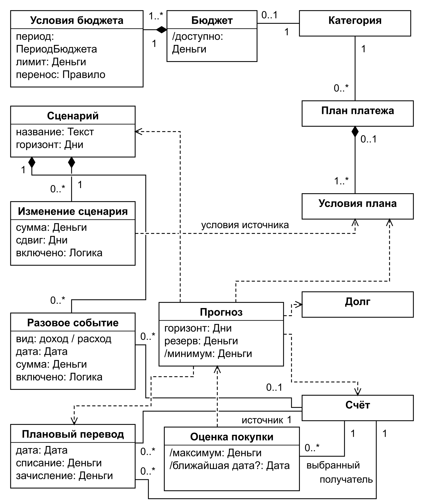

# 3 Реализация прецедентов мобильного приложения «Лад»

Глава раскрывает реализацию девяти прецедентов, сформулированных в подразделе 1.2 и связанных диаграммами подраздела 2.1. Для каждого рассмотрены расчётная модель, последовательность действий, используемые структуры и пример выполнения. Включения и расширения модели определяют совместное выполнение финансовых действий и условия дополнительных ветвей алгоритмов.

Сущности подразделов 2.2 и 2.4 реализованы типами TypeScript, поведение — функциями над `FinanceState`. Действия вызываются через `useFinanceActions`, проверяют актуальное состояние и возвращают новый объект по подходу React [37]; сохранение организовано в `FinanceProvider`. Прогноз и сравнение вариантов выполняются без записи фактических операций.

Денежные значения хранятся в целых минимальных единицах соответствующей валюты; в примерах рублёвые суммы приведены в RUB, где 1 RUB равен 100 копейкам. Даты обозначают местные календарные дни и передаются явно. Для условных финансовых данных приведены расчётные значения и результаты прямого выполнения функций предметного слоя над изолированными объектами в оперативной памяти.

Порядок установки, первоначальной настройки и работы с приложением приведён в приложении 2; ссылка на репозиторий исходного кода — в приложении 3.

## 3.1 Записать финансовую операцию

Прецедент UC-01 преобразует сведения о денежном движении в запись локального учёта.

### 3.1.1 Математическая постановка

Доход, расход и возврат покупки являются специализациями общей финансовой операции. Входными данными служат сумма, дата, счёт и признаки операции. Деньги выражаются целыми минимальными единицами валюты счёта; для типа Number точность целых значений ограничена безопасным диапазоном до 2 в степени 53 минус 1 по модулю [38]. Проведённый доход либо возврат увеличивает остаток на сумму операции, расход уменьшает его. Ожидающая запись ещё не меняет фактический остаток; при определении доступности средств отдельно учитывается её удержание. Отменённая запись денежного движения не образует.

Расширение «Разделить расход по категориям» применяется к обычной покупке без долговой связи. Сумма положительных частей по различным категориям должна точно совпадать со списанием:

$$ Σ_{i=1}^{n} s_{i} = A;   2 ≤ n ≤ 50 \tag{3.1} $$

где i — номер части; n — число частей и различных категорий; s с индексом i — положительная сумма части; A — общая сумма покупки.

Разделение меняет классификацию покупки, сохраняя её единственную денежную запись. Для возврата задаётся ссылка на исходный расход. Общая сумма возвратов в валюте покупки не может превышать первоначальное списание. Возврат увеличивает остаток счёта, однако в аналитике уменьшает расходы на дату зачисления и не считается обычным доходом. При иной валюте зачисления отдельно указывается возвращаемая часть исходной покупки. Историческая оценка в основной валюте хранится в записи, поэтому смена текущего курса не переоценивает прежний расход.

### 3.1.2 Реализация алгоритма

Форма вызывает действие через `useFinanceActions`. На актуальном `FinanceState` создаётся новая или находится редактируемая запись; устаревшая форма отклоняется. Проверяются сумма, дата не позднее текущей, счета, категории, валюты и связанные объекты.

Для составного расхода проверяются число частей, уникальность категорий и совпадение суммы со списанием. Для возврата находится проведённая покупка, проверяются даты, валюты и уже возвращённые суммы; связь с плановым доходом, платежом, целью или долгом недопустима. Общая финансовая проверка контролирует обеспечение целей, долги, кредитные счета и денежные пределы.

При редактировании прежняя запись заменяется, исключая второе списание. Только успешная проверка возвращает новое состояние для сохранения и пересчёта остатков и аналитики; ошибка оставляет исходный учёт. Алгоритм показан на рисунке 16.

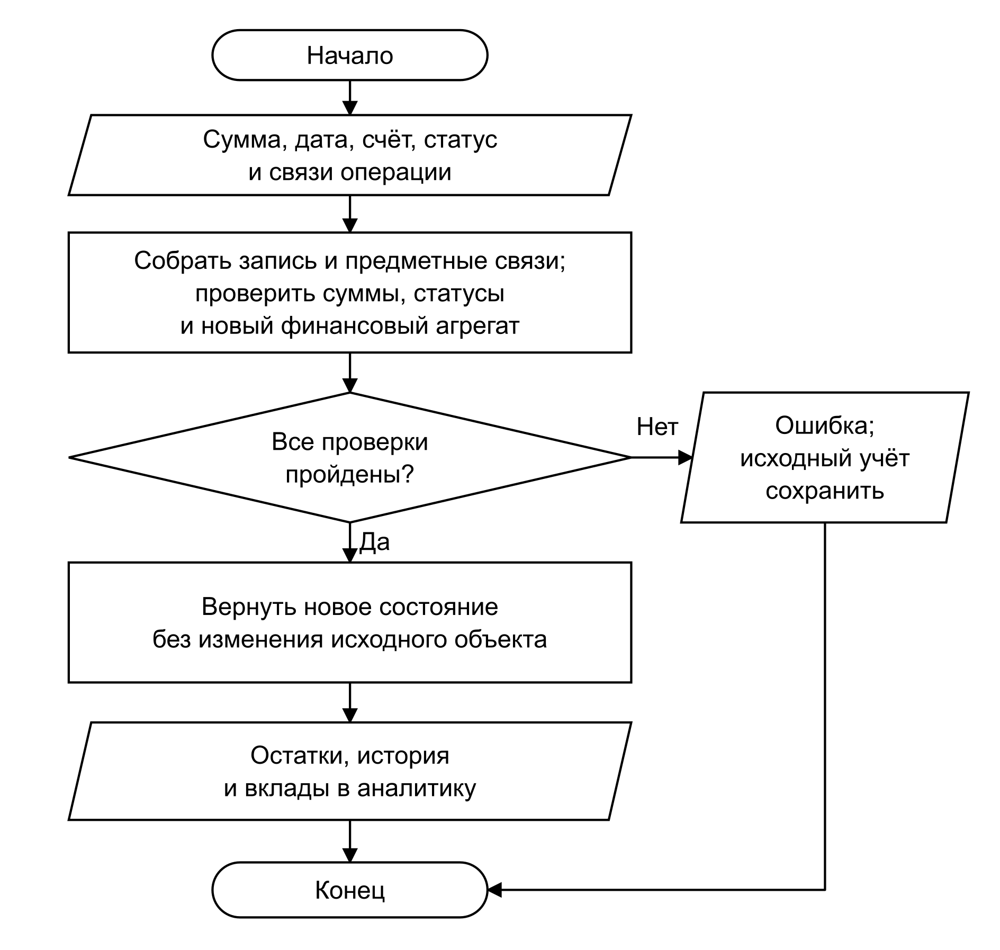

### 3.1.3 Структуры данных и функции

`Account` и `Transaction` описаны в подразделе 2.2, денежные поля — в пункте 1.3.1. Вход `TransactionInput` дополняет операцию идентификатором `createId` и ожидаемым содержимым `expectedOriginal`. `saveTransaction` подготавливает и проверяет запись, возвращая новый `FinanceState`. Остатки рассчитывает `accountBalances`, расходы и возвраты распределяет `expenseContributions`, обычный доход определяет `transactionIncomeAmount`.

### 3.1.4 Пример выполнения

Пусть на повседневном счёте находится 10 000 RUB. 20 октября 2026 года записывается покупка на 1 250 RUB: продукты — 1 000 RUB, товары для дома — 250 RUB. В минимальных единицах 100 000 + 25 000 = 125 000; ожидаемый остаток равен 8 750 RUB. Вызов `saveTransaction` возвращает состояние с одной операцией, а `accountBalance` — 875 000 копеек.

21 октября поступает возврат 250 RUB, связанный с этой покупкой. После его записи `accountBalance` возвращает 900 000 копеек. Функция `expenseContributions` распределяет возврат как уменьшение расходов на 200 RUB по продуктам и 50 RUB по товарам для дома. Суммирование частей покупки и возврата даёт расходы 800 и 200 RUB; `totals` возвращает расход 100 000 копеек и нулевой обычный доход. Денежное зачисление и его классификация отражают разные стороны одной записи.

## 3.2 Записать перевод между счетами

Прецедент UC-02 специализирует запись финансовой операции для движения между двумя собственными счетами.

### 3.2.1 Математическая постановка

Проведённый перевод изменяет остатки двух собственных счетов:

$$ B_{s}' = B_{s} − A;   B_{r}' = B_{r} + C \tag{3.2} $$

где B с индексом s обозначает остаток источника после перевода (со штрихом) и до него; A — фактическую сумму списания; B с индексом r — остаток получателя после перевода (со штрихом) и до него; C — фактическую сумму зачисления.

Для одной валюты C = A, поэтому суммарное количество денег в ней сохраняется. При обмене A и C относятся к разным валютам и вводятся как самостоятельные фактические суммы; складывать их номинальные значения нельзя. Текущий справочный курс может помочь заполнить форму, но не заменяет указанное зачисление. Сам перевод исключается из обычных доходов и расходов.

Доступность списания определяется остатком исходного счёта и удержаниями ожидающих операций. Для накопительного счёта дополнительно учитывается сумма, закреплённая за целями в соответствующей валюте. В расширении «Учесть комиссию обмена» комиссия F записывается отдельным расходом. Если она уплачена с исходного счёта в его валюте, из его исходного остатка вычитаются A и F. Комиссия не уменьшает сумму зачисления скрытым способом и сохраняет собственную категорию.

### 3.2.2 Реализация алгоритма

Вход содержит идентификаторы исходного и принимающего счетов, дату, название и обе суммы. Алгоритм проверяет существование и доступность счетов, различие их идентификаторов, положительность и целочисленность сумм. Для разных валют сумма зачисления обязательна; для одинаковой валюты она должна совпадать со списанием. Обычный перевод, как и иная фактическая операция, не записывается будущей датой.

Затем оценивается возможность списания. Проверка использует остаток на дату проведённой операции и удержания ожидающих движений, а при затрагивании накоплений — обеспечение целей. На основе этих данных создаётся один `Transaction` типа `transfer`. Он одновременно содержит списание и зачисление, поэтому для отражения сторон перевода не нужны две независимые операции. Общий алгоритм записи проверяет полученное состояние и возвращает его целиком. Последовательность и ветвь комиссии показаны на рисунке 17.

Обмен валют является специализацией перевода. Его условное расширение с комиссией допускается для нового проведённого обмена, не связанного с целью, долгом, плановым платежом или доходом. Пользователь отдельно выбирает сумму, счёт и категорию комиссии. Включённый прецедент «Записать расход» повторно использует общий механизм денежной записи и финансовых ограничений.

Функция `exchangeWithFee` сначала строит промежуточное состояние с переводом, затем добавляет в него расход комиссии. Только успешное выполнение обоих шагов возвращает результат вызывающему коду. Ошибка категории, суммы или связности комиссии прерывает всё действие, не оставляя отдельно записанного обмена. Для согласованного повтора пара использует связанный набор идентификаторов; наличие только одной прежней записи трактуется как несогласованность. Приложение отражает выполненное движение в локальном учёте и не отправляет банку распоряжение о переводе.

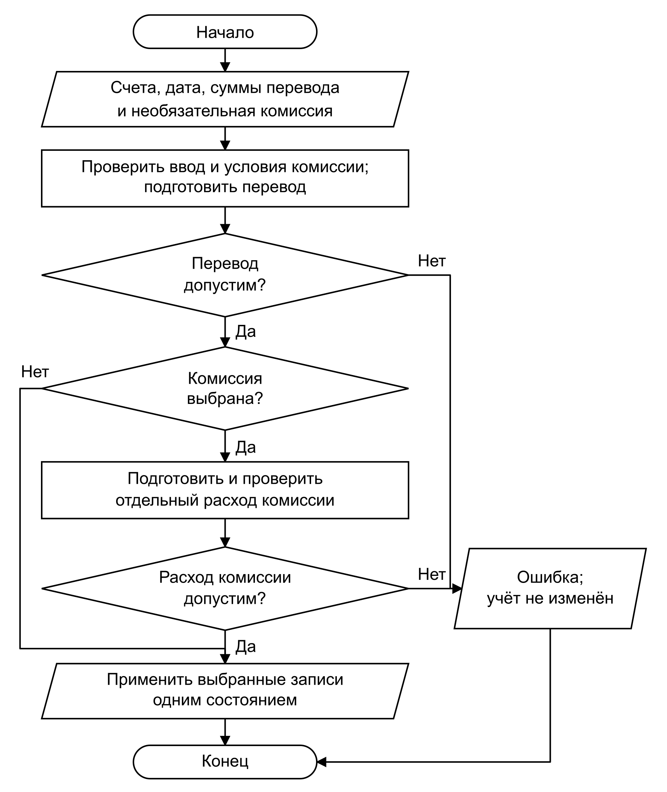

### 3.2.3 Структуры данных и функции

Структуры `Account`, `Transaction` и `FinanceState` описаны в подразделе 2.2. Перевод использует `accountId`, `toAccountId`, `amount` и `toAmount`; `receivedAmount` определяет зачисление. Вход `ExchangeWithFeeInput` добавляет сумму, счёт и категорию комиссии. `exchangeWithFee` выполняет две записи через `saveTransaction` и возвращает единое проверенное состояние; остатки обоих счетов определяет `accountBalances`.

### 3.2.4 Пример выполнения

На рублёвом счёте находится 20 000 RUB, на долларовом — 0 USD. Пользователь отражает обмен: списано 9 000 RUB, получено 100 USD. Отдельная комиссия составляет 100 RUB и оплачена с рублёвого счёта. Для оценок задан курс 90 RUB за 1 USD. Ожидаемый рублёвый остаток равен 20 000 − 9 000 − 100 = 10 900 RUB.

Вызов `exchangeWithFee` возвращает две операции: перевод и расход комиссии. Функция `accountBalances` даёт 1 090 000 копеек и 10 000 центов; `totals` возвращает расход 10 000 копеек и нулевой доход. Полученные остатки соответствуют 10 900 RUB и 100 USD. Рублёвая оценка собственных денег уменьшается только на комиссию.

## 3.3 Учесть взнос в цель

Прецедент UC-03 связывает фактическое перемещение денег с увеличением накоплений конкретной цели.

### 3.3.1 Математическая постановка

Согласно модели вариантов использования он включает перевод между счетами и закрепление переведённой суммы за целью. Источник является повседневным счётом, получатель — накопительным счётом в валюте цели. Если валюты различаются, величина взноса определяется зачислением получателю, а не списанием с источника.

Накопленная сумма цели рассчитывается по начальному значению и датированным движениям:

$$ G_{g}(d) = G_{g}^{0} + Σ_{i∈P(d)} p_{i} − Σ_{j∈W(d)} w_{j} \tag{3.3} $$

где G с индексом g — накопление цели g на дату d; G с верхним индексом 0 — её начальное накопление; i — индекс взноса; P(d) — множество проведённых взносов в эту цель не позднее d; p с индексом i — сумма зачисления по взносу; j — индекс освобождения; W(d) — множество освобождений средств из цели не позднее d; w с индексом j — освобождённая сумма.

Новый взнос C должен быть положительным и не превышать разность между требуемой суммой цели и её накоплением на дату d. Частичный взнос допустим, превышение оставшейся суммы — нет.

Закрепление за целью не создаёт дополнительного денежного списания. Для каждой валюты сумма накоплений всех целей должна оставаться обеспечена остатками накопительных счетов с учётом удержаний. Это ограничение относится к совокупности целей и не позволяет одной цели использовать уже распределённые деньги другой. Плановый график задаёт ожидаемые взносы; сама по себе очередная дата графика не увеличивает фактические накопления.

### 3.3.2 Реализация алгоритма

Форма передаёт цель, счета и суммы списания и зачисления. `fundGoal` заново находит цель в актуальном `FinanceState` и активный накопительный счёт в её валюте; отсутствие подходящего счёта вызывает ошибку.

Связь взноса с графиком определяется версией условий и исходной датой события, которые передаются вместе. Фактическая дата перевода остаётся текущей, в том числе для раннего или позднего взноса.

Общий алгоритм сохраняет перевод с `goalId` и при необходимости идентичностью события. Проверяются направление счетов, валюта получателя, средства источника, оставшаяся сумма цели, согласованность графика и обеспечение всех целей. Прогресс увеличивается на зачисление; оно уменьшает плановое обязательство, остаток которого ограничен недостающей суммой цели.

При успехе возвращаются согласованные счета, история и накопления, при ошибке учёт не меняется. Банковский перевод приложение не выполняет. Последовательность показана на рисунке 18.

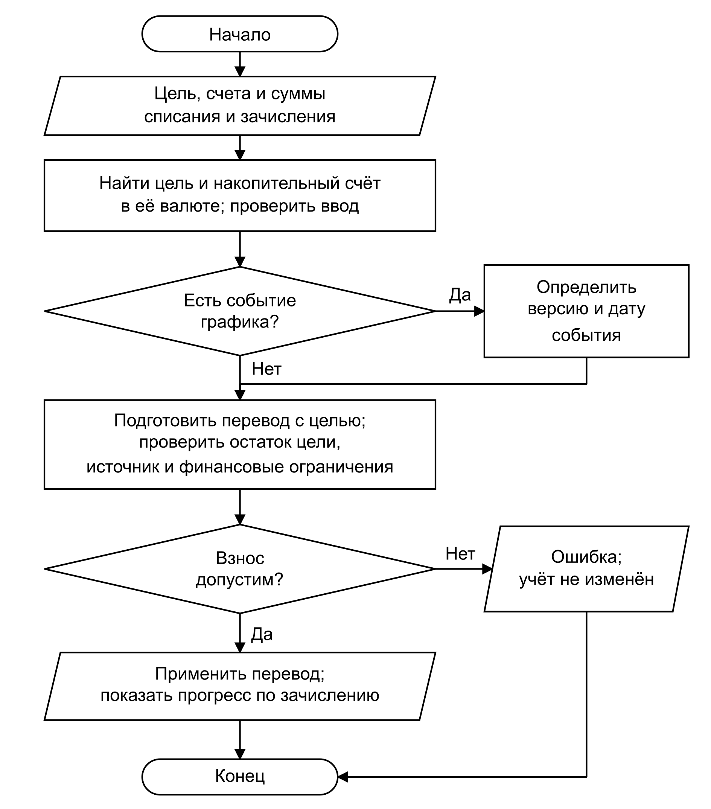

### 3.3.3 Структуры данных и функции

`Goal`, версии условий и записи переводов описаны в подразделе 2.2. `fundGoal` получает цель, счета, суммы списания и зачисления и при необходимости версию и исходную дату события. `goalSaved` рассчитывает прогресс по начальному накоплению, взносам и датированным освобождениям. `saveTransaction` записывает перевод; проверки графика и обеспечения целей предшествуют выдаче нового состояния форме `FundGoalForm`.

### 3.3.4 Пример выполнения

На повседневном счёте находится 10 000 RUB, на накопительном — 2 000 RUB. Цель «Поездка» имеет требуемую сумму 5 000 RUB и накопление 1 000 RUB. Ещё 500 RUB закреплены за другой целью; оставшиеся 500 RUB накопительного счёта свободны.

Для взноса 1 500 RUB от 20 октября 2026 года ожидаются остатки 8 500 и 3 500 RUB, накопление цели 2 500 RUB. Вызов `fundGoal` возвращает состояние с одним переводом. В нём `accountBalance` даёт 850 000 и 350 000 копеек, а `goalSaved` — 250 000 копеек для «Поездки» и 50 000 для другой цели. Доля накопления увеличивается с 20 до 50 %. Закреплённые 3 000 RUB обеспечены накопительным остатком 3 500 RUB; обычные расходы равны нулю.

## 3.4 Учесть вывод из цели

Прецедент UC-04 отражает возврат части закреплённых накоплений в средства повседневного использования.

### 3.4.1 Математическая постановка

Он включает освобождение суммы из цели и перевод с накопительного счёта на повседневный. Результат выражается соотношениями:

$$ G' = G − W;   B_{s}' = B_{s} − W;   B_{r}' = B_{r} + C \tag{3.4} $$

где G обозначает накопление выбранной цели после вывода (со штрихом) и до него; W — освобождаемую сумму в валюте цели; B с индексом s — остаток накопительного источника после перевода (со штрихом) и до него; B с индексом r — остаток повседневного получателя после перевода (со штрихом) и до него; C — фактическое зачисление получателю в его валюте.

Допустимая сумма удовлетворяет условиям 0 < W ≤ G и доступности списания с выбранного накопительного счёта. Его валюта совпадает с валютой цели. Для одновалютного перевода C = W; при обмене зачисление задаётся в валюте повседневного получателя. После действия остальные цели должны оставаться обеспечены накоплениями.

Освобождение и перемещение денег описывают разные изменения: первое уменьшает закреплённую сумму, второе меняет остатки счетов. История внесённых взносов сохраняется. Благодаря отдельной дате освобождения величина цели на предшествующий день остаётся прежней. Вывод не является ни обычным доходом, ни расходом: собственные деньги перемещаются между счетами и меняют назначение.

### 3.4.2 Реализация алгоритма

`withdrawGoal` получает цель, счета, сумму освобождения и при обмене зачисление. На актуальном состоянии проверяются накопление цели на текущую дату, положительная целая сумма, активный накопительный источник в валюте цели и активный повседневный получатель.

Сначала подготавливается освобождение `GoalRelease` текущей датой со ссылкой на будущий перевод: сумма перестаёт быть закреплённой и может перемещаться. Затем `saveTransaction` создаёт связанный перевод с проверкой доступности источника, удержаний, валют и обеспечения остальных целей. Перевод не считается новым взносом.

Единый `FinanceState` с обеими записями возвращается только при успехе всех проверок; ошибка сохраняет прежние данные. Редактирование или удаление перевода согласованно обновляет либо удаляет освобождение и повторно проверяет финансовые ограничения. Последовательность показана на рисунке 19.

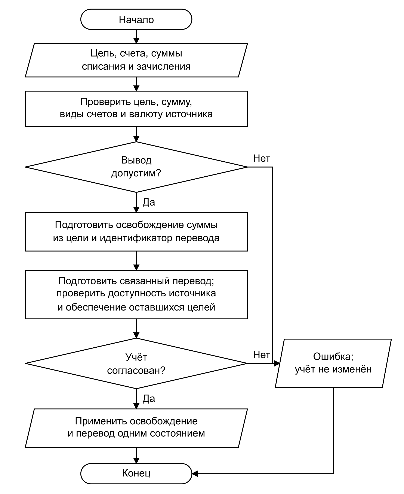

### 3.4.3 Структуры данных и функции

`GoalRelease`, `Transaction` и их связь описаны в подразделе 2.2; отсутствие `cycleId` отличает самостоятельный вывод. Вход `GoalWithdrawalInput` передаёт цель, оба счёта, сумму освобождения и при обмене зачисление. `withdrawGoal` объединяет освобождение и перевод, `goalSaved` вычисляет накопление на дату, `saveTransaction` проверяет движение. Действие возвращает единый `FinanceState`; ошибки передаются форме `WithdrawGoalForm` для исправления ввода.

### 3.4.4 Пример выполнения

Продолжим предыдущий пример. После взноса 20 октября повседневный счёт содержит 8 500 RUB, накопительный — 3 500 RUB. В цели «Поездка» учтено 2 500 RUB, в другой цели — 500 RUB. 21 октября из «Поездки» выводится 700 RUB на повседневный счёт. Ожидаются остатки 9 200 и 2 800 RUB и накопление цели 1 800 RUB.

Вызов `withdrawGoal` возвращает состояние с одним освобождением на 70 000 копеек и связанным переводом на ту же сумму. `accountBalance` даёт 920 000 и 280 000 копеек, `goalSaved` — 180 000 копеек. Общая сумма сохраняется: 9 200 + 2 800 = 12 000 RUB. За двумя целями закреплено 2 300 RUB при наличии 2 800 RUB накоплений. Для даты 20 октября `goalSaved` по-прежнему возвращает 250 000 копеек: последующий вывод не переписывает прошлое накопление.

## 3.5 Сверить остаток счёта

Прецедент UC-05 сопоставляет расчётный остаток с суммой, известной владельцу на конец выбранного дня. Обязательное определение остатка соответствует включению, показанному на рисунке 9. При совпадении сохраняется сверка; расхождение позволяет проверить историю либо перейти к корректировке UC-06 по отдельному согласию пользователя.

### 3.5.1 Математическая постановка

Остаток счёта на выбранную дату вычисляется по фактическим денежным записям:

$$ B_{a}(d) = B_{a}^{0} + Σ_{t∈T(d)} Δ_{a}(t) + Σ_{c∈C(a,d)} δ_{c} \tag{3.5} $$

где B с индексом a — остаток счёта a на дату d; B с верхним индексом 0 — его начальный остаток; t — операция; T(d) — множество проведённых операций не позднее d; Δ с индексом a — влияние операции t на данный счёт; c — корректировка; C(a,d) — множество корректировок счёта до той же даты включительно; δ с индексом c — сумма корректировки со знаком.

Доход и входящая сторона перевода увеличивают остаток, расход и исходящая сторона уменьшают его. Для входящего валютного перевода используется фактическое зачисление. Ожидающие и отменённые операции в сумму не входят.

Форма сопоставляет этот результат с наблюдаемым остатком в той же валюте. Удержания показывают доступность средств, поэтому их нельзя повторно вычитать из фактического остатка при сверке. Дата ограничивается сегодняшним днём: будущая сумма относится к прогнозу, а не к подтверждённому состоянию счёта.

### 3.5.2 Реализация алгоритма

Входными данными служат выбранный счёт, дата, введённый остаток и необязательная заметка. Форма рассчитывает разницу и формирует отпечаток денежных записей, по которым получен результат. Отпечаток позволяет обнаружить изменение истории за время заполнения формы. Алгоритм показан на рисунке 20.

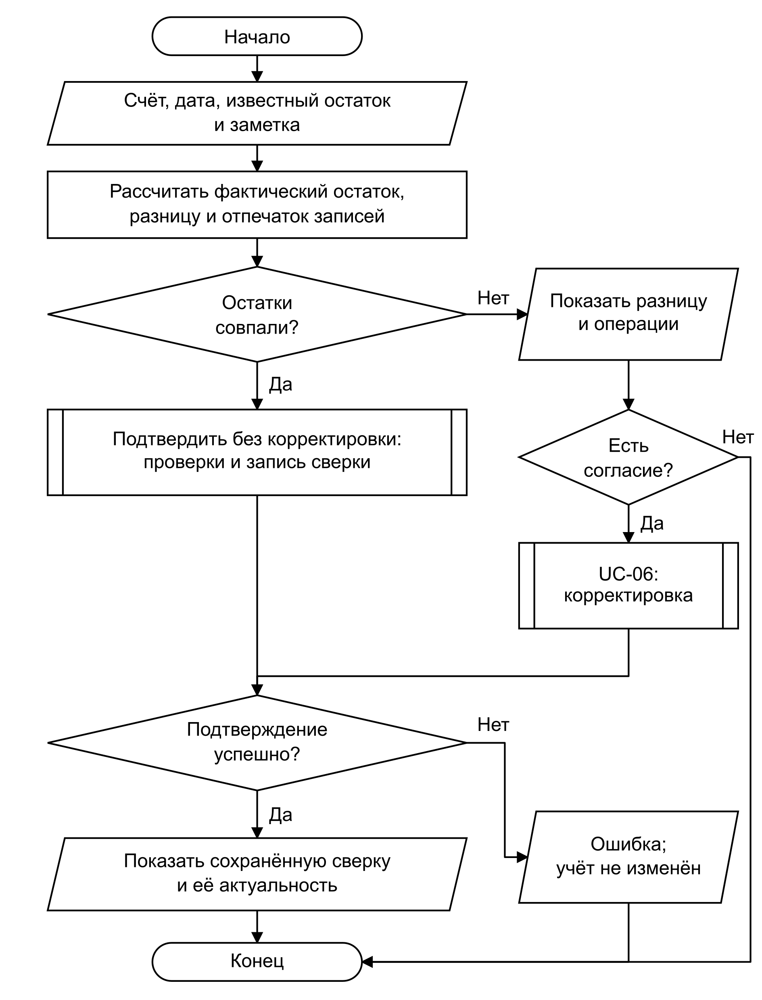

При подтверждении действие получает актуальное состояние, проверяет существование счёта, допустимость даты и суммы, затем заново вычисляет отпечаток. Несовпадение вызывает сообщение «Операции изменились. Проверьте разницу заново». Прежний предпросмотр при этом не используется для сохранения.

Если разница равна нулю, действие проверяет финансовую согласованность на текущую дату и добавляет запись сверки. Расчётный остаток и состав операций сохраняются. При ненулевой разнице без согласия на корректировку запись сверки не создаётся: пользователь возвращается к истории либо выбирает UC-06. Архивный счёт допускает подтверждение совпадающего остатка; для его корректировки требуется восстановление из архива.

Промежуточными результатами являются остаток, разница и отпечаток. В состоянии сохраняется только подтверждённая сверка. Интерфейс выводит дату подтверждения и признак его актуальности; последующее изменение относящихся к этой дате денежных записей делает прежнее подтверждение неактуальным.

### 3.5.3 Структуры данных и функции

`Account`, `Transaction`, `BalanceAdjustment` и `AccountReconciliation` описаны в подразделе 2.2. `accountBalance` возвращает остаток счёта на дату в минимальных единицах его валюты. Вход `ReconciliationInput` передаёт счёт, дату, известный остаток, заметку и ожидаемый отпечаток; для этой ветви `adjust` выключен. `reconcileAccount` возвращает новое состояние. Отпечаток формирует `accountSignature` (SHA-256 по FIPS 180-4 [39]), актуальность проверяет `reconciliationCurrent`. Отпечаток не является электронной подписью владельца.

### 3.5.4 Пример выполнения

На 10 сентября 2026 года начальный остаток счёта равен 10 000 RUB. До выбранной даты проведены доход 2 000 RUB, расход 3 000 RUB и входящий перевод 500 RUB. Расчёт даёт 10 000 + 2 000 − 3 000 + 500 = 9 500 RUB; `accountBalance` возвращает 950 000 копеек. При введённой владельцем сумме 9 500 RUB вызов `reconcileAccount` добавляет одну сверку без корректировки, а `reconciliationCurrent` возвращает истину.

## 3.6 Скорректировать остаток счёта

Прецедент UC-06 выполняется как расширение сверки при ненулевом расхождении и явном согласии владельца. Он записывает разницу отдельной датированной корректировкой и подтверждает новый остаток. Общая проверка финансовой согласованности соответствует включению на рисунке 9.

### 3.6.1 Математическая постановка

Корректировка устраняет расхождение между наблюдаемым и рассчитанным остатками:

$$ δ = B_{набл} − B_{a}(d);   B_{a}'(d) = B_{a}(d) + δ \tag{3.6} $$

где δ — сумма корректировки со знаком; B с индексом «набл» — остаток, введённый владельцем; B с индексом a — рассчитанный остаток счёта a на дату d до изменения; B со штрихом — остаток после добавления корректировки.

Положительная δ увеличивает остаток, отрицательная уменьшает его. Изменение действует с даты d; для более ранних дней результат расчёта остаётся прежним. Корректировка имеет самостоятельный финансовый смысл: она не записывается в доходы или расходы и не заменяет начальную сумму счёта.

### 3.6.2 Реализация алгоритма

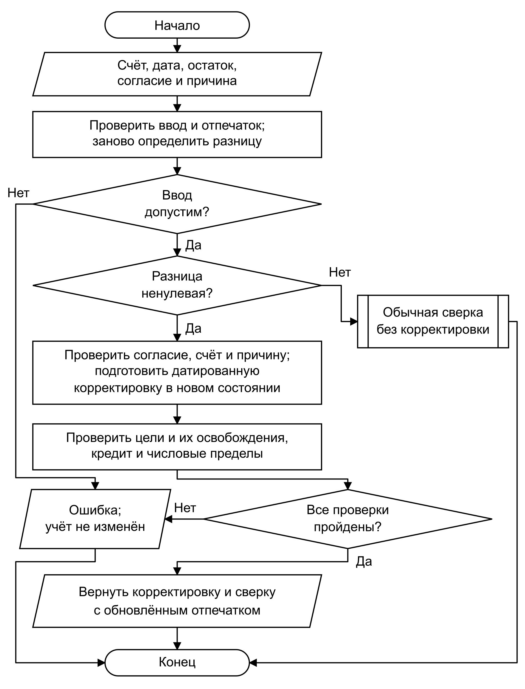

После предпросмотра пользователь подтверждает корректировку и указывает причину. `reconcileAccount` повторно проверяет счёт, дату, сумму и актуальность отпечатка. Если разница стала нулевой, выполняется обычная сверка UC-05 без изменения денег.

Для ненулевой разницы требуются активный счёт, непустая причина, допустимый диапазон суммы и допустимое число записей. Подготавливается датированная корректировка; на текущую дату проверяются обеспеченность целей накоплениями каждой валюты, кредитные остатки и денежные пределы. Связи освобождений и годовых фондов проверяются также с учётом дат записанных выводов; само расхождение определяется на выбранную дату сверки.

Допустимое состояние дополняется сверкой с новым отпечатком. Обе записи возвращаются совместно, исходные операции сохраняются. При ошибке ни корректировка, ни подтверждение не сохраняются; форма сообщает причину для исправления ввода или истории. Порядок показан на рисунке 21.

### 3.6.3 Структуры данных и функции

`BalanceAdjustment` и `AccountReconciliation` описаны в подразделе 2.2, вход сверки — в пункте 3.5.3. `reconcileAccount` с разрешением `adjust` создаёт датированную знаковую корректировку и сверку после проверок накоплений, связанных освобождений, кредитных счетов и денежных пределов. Результат — единый `FinanceState`; исходные операции не заменяются.

### 3.6.4 Пример выполнения

На 10 сентября 2026 года расчётный остаток равен 10 000,00 RUB, операций нет, а владелец указывает 9 876,55 RUB. Ожидаемая разница составляет −123,45 RUB. Вызов `reconcileAccount` с причиной и разрешением корректировки возвращает одну корректировку −12 345 копеек с датой 10 сентября и одну сверку.

Функция `accountBalance` возвращает 1 000 000 копеек на 9 сентября и 987 655 на 10 сентября. Начальная сумма и пустая история операций сохраняются; `totals` даёт нулевые доходы и расходы.

## 3.7 Получить прогноз денежных остатков

Прецедент UC-07 определяет будущие остатки и даты возможной нехватки средств. Пользователь выбирает горизонт 30, 60 или 90 дней; приложение получает актуальный финансовый учёт и формирует прогноз. Этот же расчёт включается в оценку покупки UC-08 и сравнение сценариев UC-09. Обязательный результат охватывает как денежную траекторию, так и выявленные ограничения.

### 3.7.1 Математическая постановка

Прогноз рассчитывается на конец каждого календарного дня, включая сегодняшний. Принцип последовательного учёта поступлений и списаний описан в методике бюджета денежных потоков CFPB [12]; здесь он применяется к дневным остаткам отдельных счетов. Остаток и доступная сумма отдельного счёта определяются выражениями

$$ b_{i}(d) = b_{i}^{0} + Σ_{e∈E(d)} δ_{ie}, a_{i}(d) = b_{i}(d) − h_{i}(d) \tag{3.7} $$

где b с индексом i — прогнозный остаток счёта i на конец дня d; b с верхним индексом 0 — фактический остаток на дату расчёта, включающий проведённые сегодня операции; e — событие; E(d) — множество прогнозных событий от начала горизонта до дня d включительно; δ с индексами i и e — движение события по счёту со знаком; a с индексом i — доступная сумма счёта; h с индексом i — оставшиеся удержания по его ожидающим операциям. Все суммы выражены в валюте счёта. При исполнении ожидания его удержание освобождается одновременно с отражением движения.

Общая доступная сумма равна

$$ A(d) = Σ_{i∈W} V_{i}(a_{i}(d)) + U(d) \tag{3.8} $$

где A(d) — общая доступная сумма на конец дня d; i — индекс счёта; W — множество повседневных счетов; V с индексом i — пересчёт суммы счёта в основную валюту по текущему курсу с целочисленным округлением; a с индексом i — доступная сумма счёта на конец дня d; U(d) — накопленное влияние событий без назначения счёта, выраженное со знаком в основной валюте.

Накопления и кредитный лимит не увеличивают эту сумму. Резерв R служит порогом сравнения: A(d) < R означает его нарушение, A(d) < 0 — общий дефицит. Отдельно выявляется отрицательная доступность каждого некредитного счёта. Повседневные расходы добавляются с завтрашнего дня; порядок платежей внутри суток не моделируется.

### 3.7.2 Реализация алгоритма

Функция `forecast` получает `FinanceState`, горизонт и текущую дату. После проверки даты и допустимого периода она создаёт отображение дат в массивы событий. Из версий доходов, платежей и целей выбираются оставшиеся обязательства. Исполненные, пропущенные и замещённые ожидающей операцией события повторно не добавляются. Для каждого сохраняются источник, версия условий и исходный ключ события. Просроченный платёж учитывается сегодня по прежней сумме, а просроченное поступление не превращается автоматически в надёжный доход.

Затем добавляются ожидающие операции с датами исполнения, долговые обязательства, взносы, повседневные расходы и явные плановые переводы. Для взноса и погашения используются назначения счетов из настроек. Перевод содержит движения списания и зачисления; обмен не подставляется автоматически. Возврат подготовленных средств годового фонда учитывается отдельно от полной суммы его платежа. Плановый перевод не связан автоматически с фактом: после исполнения его необходимо удалить из прогноза.

Последовательный проход по датам собирает дневные события. Функция `forecastAccounts` применяет их движения к каждому счёту, обновляет удержания и получает доступные остатки. Затем пересчитывается общая сводка, определяется минимум, первые даты нехватки и нарушения резерва. Отдельно проверяются обеспеченность целей накоплениями и достаточность источников переводов. Неуказанный счёт сохраняется как неопределённое назначение, а не заменяется произвольным счётом.

На рисунке 22 представлен порядок расчёта.

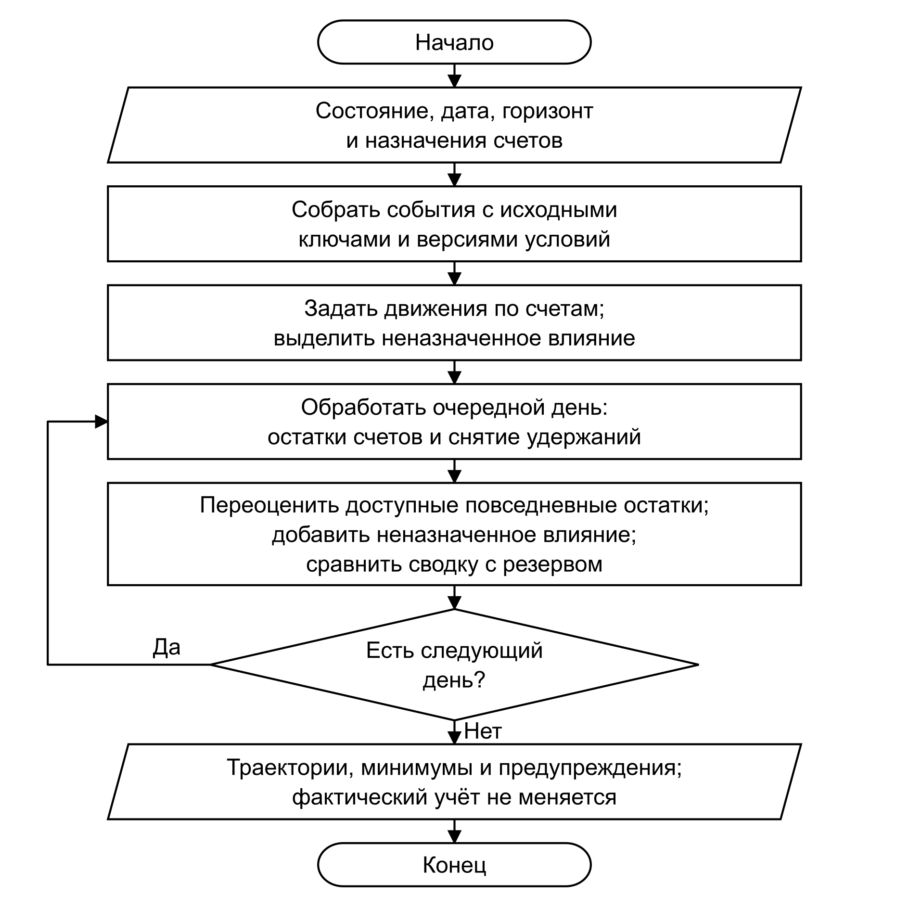

Некорректный горизонт, дата, отсутствие курса или выход остатка за безопасный целый диапазон приводят к сообщению об ошибке. Предупреждения и неназначенные события входят в результат и объясняют его ограничения. Расчёт возвращает новые структуры, не записывая операции и не изменяя планы.

### 3.7.3 Структуры данных и функции

Исходные счета, планы, цели и долги описаны в подразделе 2.2. Рабочие `ForecastEvent` и `ForecastLeg` задают события и движения по счетам; `ForecastDay` объединяет события и сводку дня. `AccountForecast` хранит ряд счёта, минимум и первую нехватку; `ForecastResult` — общий результат, резерв, предупреждения и неназначенные события. `ForecastPanel` запускает расчёт при изменении учёта, даты или горизонта; `ForecastResultView` показывает результат; при ошибке выводится её сообщение.

### 3.7.4 Пример выполнения

Для UC-07–UC-09 используется набор таблицы 6. Фактические операции, удержания, цели и долги отсутствуют. Все события назначены счёту A, если не указано иное.

Таблица 6 – Исходные данные примеров прогнозирования

| Параметр             | Значение                                            |
| -------------------- | --------------------------------------------------- |
| Дата и горизонт      | 20.10.2026; 30 дней, до 18.11 включительно          |
| Повседневные счета   | A — 30 000 RUB; B — 10 000 RUB                      |
| Накопительный счёт   | S — 50 000 RUB                                      |
| Неполученный доход   | 10 000 RUB на 25.10, разово, счёт A                 |
| Регулярный платёж    | 18 000 RUB на 28-е число, действует с 20.10, счёт A |
| Повседневные расходы | 500 RUB в день, счёт A                              |
| Резерв               | 5 000 RUB                                           |

Вызов `forecast` с этими данными возвращает 30 дневных точек. На 20 октября поле `available` равно 4 000 000 копеек; накопительные 50 000 RUB исключены. Расчёт ожидаемых остатков строится следующим образом. С 21 октября расходуется по 500 RUB в день, поэтому к концу 24 октября остаётся 38 000 RUB. Доход 25 октября увеличивает сумму до 38 000 + 10 000 − 500 = 47 500 RUB. К 27 октября она снижается до 46 500 RUB. Платёж следующего дня вместе с повседневным расходом даёт 46 500 − 18 000 − 500 = 28 000 RUB. Подъём и последующее резкое снижение показаны на рисунке 23.

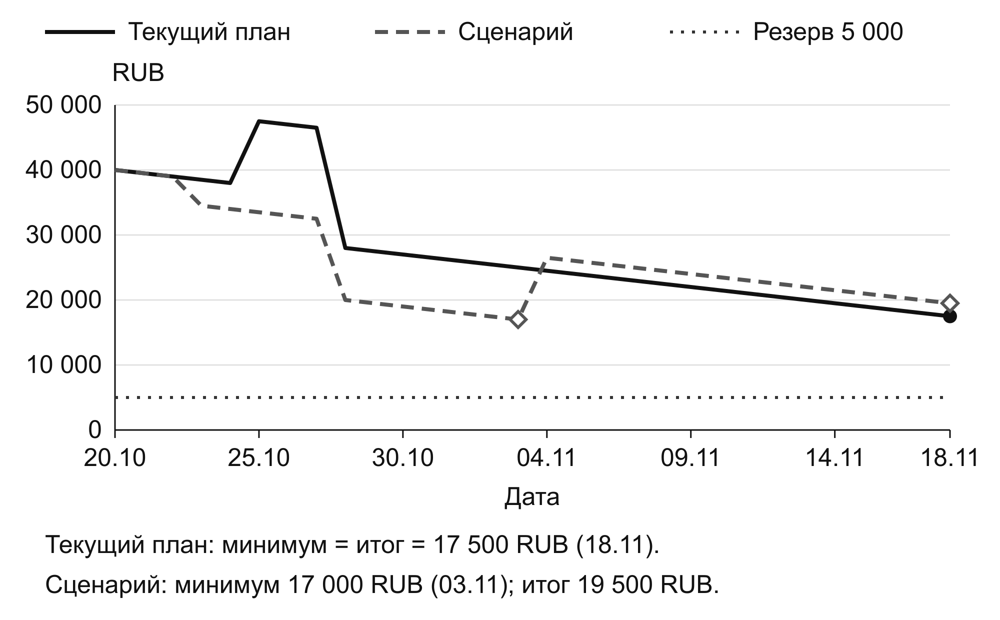

К 18 ноября остаток равен 40 000 + 10 000 − 18 000 − 29 × 500 = 17 500 RUB: 7 500 RUB на A и 10 000 RUB на B. Расходов 29, поскольку первый день уже представлен фактическим остатком. В результате `forecast` поля `closingAvailable` и `minimum.available` равны 1 750 000 копеек; последняя точка счёта A содержит 750 000, счёта B — 1 000 000 копеек. Над резервом остаётся 12 500 RUB. Пунктир обозначает резерв, который не вычитается из точек графика. Для покупки потребуется дополнительно учесть доступность выбранного счёта.

Отдельная ситуация показывает ограничение общей сводки. На рисунке 24 показано предупреждение о нехватке средств на отдельном счёте.

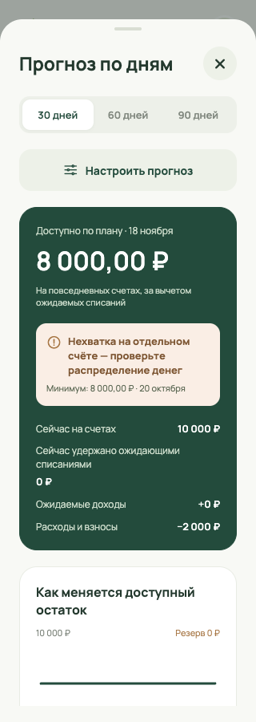

На 20 октября «Карта покупок» содержит 1 000 RUB, «Основная карта» — 9 000 RUB; резерв и повседневные расходы равны нулю. Платёж 2 000 RUB назначен «Карте покупок». Для этих условий `forecast` возвращает остаток выбранного счёта −100 000 копеек и признак `firstShortfall`, хотя общая доступная сумма равна 800 000 копеек. Устранить нехватку можно явным своевременным переводом либо изменением счёта платежа. Отрицательная прогнозная сумма обозначает недостаточность средств по условиям плана; сам расчёт не создаёт задолженность.

## 3.8 Оценить возможность покупки

Прецедент UC-08 получает стоимость, дату и повседневный счёт покупки. Он обязательно включает прогноз UC-07 и определение допустимой суммы и даты. Пользователь видит влияние решения на весь горизонт, сохраняя фактический учёт неизменным. Для сегодняшней покупки дополнительно рассчитывается изменение доступной и дневной сумм.

### 3.8.1 Математическая постановка

На всех днях от покупки до конца горизонта должны выполняться два условия. Первое сохраняет достаточность выбранного счёта:

$$ a_{k}(d) − q ≥ 0 \tag{3.9} $$

где a с индексом k — доступная сумма выбранного счёта k на конец дня d без учёта покупки; q — стоимость покупки в минимальных единицах той же валюты.

Второе условие сохраняет общий резерв:

$$ A(d) − [V_{k}(a_{k}(d)) − V_{k}(a_{k}(d) − q)] ≥ R \tag{3.10} $$

где A(d) — общая доступная сумма на конец дня d без учёта покупки; V с индексом k — пересчёт суммы выбранного счёта k в основную валюту с целочисленным округлением; a с индексом k — доступная сумма этого счёта без учёта покупки; q — стоимость в его валюте; R — резерв в основной валюте.

Разность переоценённых остатков учитывает округление; отдельная конвертация стоимости может отличаться на одну минимальную единицу основной валюты. Максимум покупки на выбранную дату равен минимуму допустимых дневных пределов до конца периода. Исходный прогноз также должен сохранять резерв на всех днях, включая дни до покупки. Нехватка выбранного счёта, неназначенные события и предупреждения исключают положительный вывод.

### 3.8.2 Реализация алгоритма

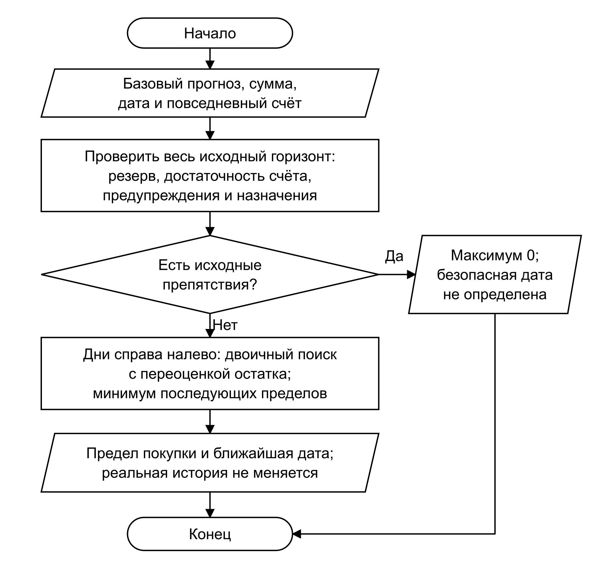

`Simulator` преобразует ввод в целую сумму валюты счёта и получает исходный `ForecastResult` через `forecast`. Функция `planPurchase` проверяет диапазон стоимости, наличие даты в горизонте и повседневный вид счёта. Для каждой даты она двоичным поиском определяет максимальную целую стоимость, сохраняющую оба ограничения. Поиск последовательно делит интервал вдвое [33]; он применим, поскольку увеличение стоимости при неизменном прогнозе не восстанавливает нарушенные ограничения. Проход от последнего дня к первому накапливает минимум, формируя массив допустимых сумм для каждой даты покупки.

При отсутствии исходных препятствий из массива выбираются максимум на заданную дату и первая дата, допускающая введённую стоимость. Если подходящей даты нет, возвращается отсутствие результата `earliest`. Нулевой максимум при исходной нехватке сопровождается объяснением причины. Ошибочная дата или сумма требует исправления ввода. Порядок показан на рисунке 25.

Для наглядного сравнения `PurchaseForecast` выполняет второй прогноз, добавляя гипотетическую покупку в выбранный день. Если покупка назначена на сегодня, `PurchaseAllowance` вызывает `simulatePurchase`. Эта функция получает доступную сумму через `spendable`, вычитает стоимость в основной валюте и делит остаток на число дней до опорного дохода с округлением вниз. Положительная оценка дополнительно требует достаточности выбранного счёта по `planPurchase`. Такое условное дополнение соответствует расширению UC-08 в модели вариантов использования.

### 3.8.3 Структуры данных и функции

Вход `PurchaseScenario` содержит стоимость в валюте выбранного счёта, дату и `accountId`. `planPurchase` возвращает допустимую сумму, ближайшую дату и ограничения: `limitingDay` — день общего минимума после выбранной даты, `accountMinimum` — минимум выбранного счёта. Рабочий массив `limits` существует только в расчёте. `PurchasePlanner` и `PurchaseForecast` показывают результат и сравнение; изменение ввода не сохраняет операцию. Оценка относится к концу дня и выбранному горизонту.

### 3.8.4 Пример выполнения

По таблице 6 общий минимум превышает резерв на 12 500 RUB, но минимум счёта A составляет лишь 7 500 RUB. Вызов `planPurchase` для A возвращает `maximum` = 750 000 копеек и `earliest` = 2026-10-20. Таким образом, допустимая сумма составляет 7 500 RUB, а ближайшая дата — тот же день. Вызов `forecast` с такой покупкой даёт на конец горизонта ноль на A и 1 000 000 копеек на B; нарушения резерва нет. Для стоимости 750 001 копейка `earliest` отсутствует, а прогноз покупки даёт −1 копейку на A к 18 ноября.

Для сегодняшней покупки на 7 500 RUB доступная сумма до дохода 25 октября уменьшается с 14 500 до 7 000 RUB, дневной ориентир — с 2 900 до 1 400 RUB. Повседневные расходы до дохода не резервируются повторно. Это результаты `spendable` и `simulatePurchase`; реальные счета сохраняются.

## 3.9 Сравнить финансовые сценарии

Прецедент UC-09 сопоставляет текущий план с предположениями либо два сохранённых варианта. Сравнение раскрывает последствия альтернативных условий в смысле сценарного прогнозирования [14]. Для каждого вызывается прогноз UC-07 от одного актуального состояния и на одинаковый горизонт. Обязательная проверка условий предшествует сравнению; пояснение ограничений и сохранение варианта выполняются при соответствующих условиях.

### 3.9.1 Математическая постановка

Разница между альтернативной и базовой траекториями на последнюю дату горизонта определяется выражением

$$ Δ = A_{1}(d_{кон}) − A_{0}(d_{кон}) \tag{3.11} $$

где Δ — разность доступных сумм в основной валюте; A с индексом 1 — доступная сумма альтернативного варианта; d с индексом «кон» — последняя дата горизонта, то есть текущая дата плюс N − 1 день при выбранной длительности N, равной 30, 60 или 90 дням; A с индексом 0 — доступная сумма базового варианта. Обе суммы учитывают удержания.

Положительное Δ не означает улучшения на каждой промежуточной дате, поэтому вместе с итогом рассматриваются минимумы, даты нарушения резерва и остатки отдельных счетов. Исходные деньги обоих вариантов одинаковы; различаются только предположения о будущих событиях.

### 3.9.2 Реализация алгоритма

`ScenarioForm` хранит строковый черновик. `parseScenarioDraft` преобразует денежные значения с учётом валюты источника и проверяет название, горизонт, суммы, даты, сдвиг дохода и уникальность строк. Отдельно проверяются назначения счетов и допустимость валютной оценки. При ошибке форма требует исправить ввод до расчёта и сохранения. Алгоритм представлен на рисунке 26.

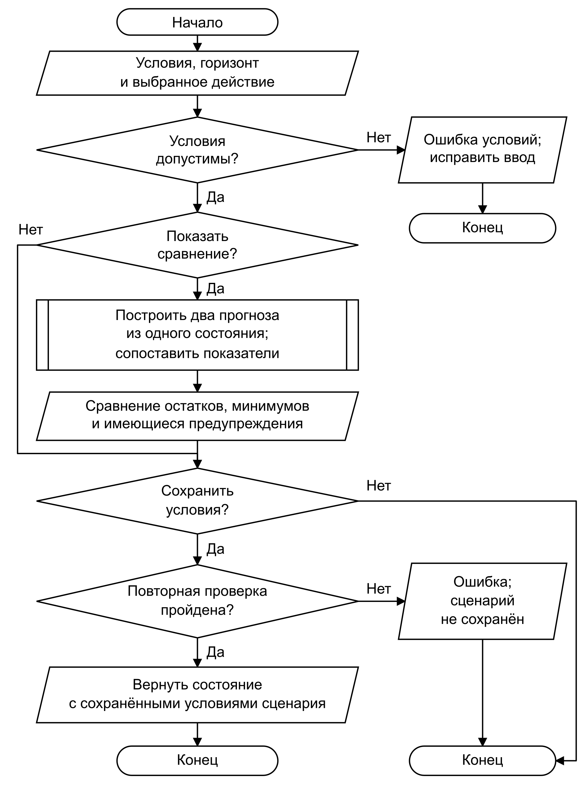

`ScenarioComparison` дважды вызывает `forecast`: для выбранного сценария и текущего плана либо другого варианта. Оба вызова получают одно состояние, дату и горизонт активного сценария. Включённые изменения сопоставляются с существующими источниками; строки с `enabled = false` не влияют на события. Сдвиг дохода меняет ожидаемую дату, сохраняя исходный ключ. Для дохода с активным ожиданием используются условия самой ожидающей операции. Изменённая цена платежа применяется к будущим событиям, не переписывая просроченные обязательства.

Функция `scenarioWarnings` поясняет удалённый источник, остановленный платёж, прошедшую дату и архивный счёт; интерфейс также сообщает о разовых событиях за горизонтом. Эти предупреждения не равнозначны ошибке формата: допустимые части сценария могут участвовать в сравнении. Неизвестный курс или недопустимая сумма расчёта выводятся как ошибка.

По выбору владельца `saveScenario` повторяет проверку на актуальном состоянии и добавляет либо заменяет условия варианта. Сохранение доступно и без предварительного просмотра сравнения. При превышении допустимого числа сценариев или исчезновении редактируемой записи действие отклоняется. Изменение публикуется только после успешной проверки; финансовые операции и реальные планы остаются прежними.

### 3.9.3 Структуры данных и функции

`SavedScenario`, `ScenarioChange` и `ScenarioEvent` описаны в подразделе 2.2; назначенные разовые события переводятся в валюту счёта при построении движений. `saveScenario`, `copyScenario` и `deleteScenario` меняют только условия. Копия получает новые идентификаторы сценария и событий, сохраняя реальные источники. `ForecastResult` не сохраняется: при следующем обращении прогноз рассчитывается по текущему учёту.

### 3.9.4 Пример выполнения

Для таблицы 6 сценарий переносит доход с 25 октября на 4 ноября, уменьшает платёж с 18 000 до 12 000 RUB и добавляет расход 4 000 RUB со счёта A на 23 октября. Строка дополнительного расхода 9 000 RUB выключена. Итог равен 40 000 + 10 000 − 12 000 − 4 000 − 29 × 500 = 19 500 RUB. Вызов `forecast` с условиями сценария возвращает `closingAvailable` = 1 950 000 копеек. Разница с базовыми 17 500 RUB составляет +2 000 RUB.

Однако к 3 ноября доход ещё не поступил, а платёж и разовый расход уже учтены. За четырнадцать дней повседневных расходов минимум равен 40 000 − 12 000 − 4 000 − 14 × 500 = 17 000 RUB. В возвращённом прогнозе `minimum` содержит дату 2026-11-03 и сумму 1 700 000 копеек — на 500 RUB ниже базового минимума. Точка 4 ноября после поступления содержит 2 650 000 копеек. Улучшение конечного результата сопровождается временным ухудшением доступности.

Сохранение и копирование сценария не меняют фактические операции и реальные планы; при следующем обращении прогноз пересчитывается по актуальному учёту.

# Заключение

В выпускной квалификационной работе «Разработка мобильного приложения для управления личными финансами» создано приложение «Лад». Цель достигнута в части программной реализации локального учёта операций, управления бюджетами и накоплениями, анализа истории и планирования расходов. Широкое использование на мобильных устройствах требует отдельного этапа испытаний.

Анализ личных финансов и аналогов определил назначение и ограничения приложения. Сформулированы требования и девять прецедентов записи движений, сверки остатков и оценки финансовых решений. Шесть диаграмм раскрывают их через вспомогательные варианты использования, обобщение, обязательное включение и условное расширение; обеспечивающие функции описаны отдельно. Обоснован учёт дат событий, доступности средств на выбранном счёте и резерва на всём горизонте. Задачи анализа предметной области и формирования требований решены.

Спроектированы модель данных и структура с разделением интерфейса, предметных расчётов, состояния и платформенных адаптеров. Действия проверяют актуальные данные и согласованно обновляют связанные записи, позволяя проверять расчёты независимо от интерфейса и применять общие правила к ручному вводу и импорту.

Реализованы счета и датированные корректировки, операции и переводы, категории и бюджетные периоды, цели и годовые фонды, планы доходов и платежей, долги и кредитные карты. Деньги представлены целыми минимальными единицами валюты. Переводы отделены от обычных доходов и расходов, накопления целей проверяются на обеспеченность. История условий планов сохраняет смысл возникших обязательств при изменении графика.

Разработаны расчёт доступных для трат средств, дневной прогноз по счетам, проверка покупки и сравнение сохранённых сценариев. Прогноз показывает общую сводку и ограничения счетов: положительная общая сумма не исключает нехватки на счёте платежа. Максимальная сумма покупки учитывает доступность средств на выбранном счёте и сохранение общего резерва на всём горизонте.

Сценарии изменяют предположения о доходах, платежах и разовых событиях без изменения реальных планов и операций. Сравниваются конечный остаток и минимум внутри горизонта: улучшение итога может сопровождаться уменьшением промежуточных остатков. Прогноз рассчитывается по введённым условиям и не гарантирует поступлений.

Реализованы локальные профили, сохранение учёта, импорт и экспорт CSV, проверка копий и восстановление. Проверка всего выбранного пакета перед импортом исключает частичное добавление ошибочных данных. Нативное хранение предусматривает шифрование данных и отдельное хранение ключа; переносимая парольная копия имеет собственную защиту. Web-хранилище и JSON-экспорт не зашифрованы.

Приложение может использоваться для ведения истории, анализа расходов, распределения средств по бюджетам и целям, контроля обязательств и предварительной оценки покупок. Его практическая ценность — объединение этих действий с объяснимым расчётом финансовых ограничений. Для опытного использования нужно завершить испытания на iOS и Android, проверить восстановление копий на целевых устройствах и регулярно создавать их. Пользователь должен поддерживать полноту учёта и актуальность планов; автоматического получения банковских операций и совместной работы между устройствами нет.

Развитие целесообразно начать с проверки нативных возможностей, доступности интерфейса и поведения при большой истории. Затем возможны пользовательское исследование понятности прогноза и улучшение объяснений ограничений. Синхронизация между устройствами и банковский обмен — возможные самостоятельные направления, требующие проектирования защиты, разрешения конфликтов и обработки внешних данных.

Технико-экономическая эффективность оценена качественно: основной локальный учёт не требует сервера, общая кодовая база объединяет развитие финансовых правил разных платформ, автоматический пересчёт сокращает ручные вычисления. Ввод и проверка данных, резервное копирование и сопровождение остаются необходимыми. Затраты на разработку и эксплуатацию, изменение времени выполнения пользовательских задач и денежный эффект не измерялись; количественная экономия и срок окупаемости не установлены. Для их оценки нужны учёт трудозатрат и сравнительное исследование реального использования приложения.

# Список использованных источников

1 Личный финансовый план. Как копить деньги и планировать свои траты [Электронный ресурс] / Финансовая культура. – 2022. – 25 с. – URL, режим доступа свободный: https://fincult.info/upload/iblock/5be/Lichny_finansovy_plan.pdf (дата обращения 23.10.2026).

2 Управляйте домашним бюджетом в Excel [Электронный ресурс] // Microsoft Support. – URL, режим доступа свободный: https://support.microsoft.com/ru-ru/excel/manage-your-household-budget-in-excel (дата обращения 06.11.2026).

3 Дзен-мани — приложение для контроля расходов [Электронный ресурс] // Дзен-мани. – URL, режим доступа свободный: https://zenmoney.ru/ (дата обращения 29.10.2026).

4 CoinKeeper: ответы на все вопросы о ваших деньгах [Электронный ресурс] // CoinKeeper. – URL, режим доступа свободный: https://coinkeeper.me/ (дата обращения 06.11.2026).

5 The YNAB Method [Электронный ресурс] // YNAB. – URL, режим доступа свободный: https://www.ynab.com/ynab-method (дата обращения 03.11.2026).

6 Features [Электронный ресурс] // YNAB. – URL, режим доступа свободный: https://www.ynab.com/features (дата обращения 29.10.2026).

7 Pricing [Электронный ресурс] // YNAB. – URL, режим доступа свободный: https://www.ynab.com/pricing (дата обращения 29.10.2026).

8 How Much Money to Keep in Your YNAB Checking Account [Электронный ресурс] // YNAB. – URL, режим доступа свободный: https://support.ynab.com/en_us/how-much-to-keep-in-your-checking-account-a-guide-ryZNWymAc (дата обращения 29.10.2026).

9 Your Finances — made simple [Электронный ресурс] // Actual Budget. – URL, режим доступа свободный: https://actualbudget.org/ (дата обращения 29.10.2026).

10 Multi-Currency [Электронный ресурс] // Actual Budget. – URL, режим доступа свободный: https://actualbudget.org/docs/budgeting/multi-currency/ (дата обращения 29.10.2026).

11 Balance Forecast Report [Электронный ресурс] // Actual Budget. – URL, режим доступа свободный: https://actualbudget.org/docs/experimental/balance-forecast-report/ (дата обращения 03.11.2026).

12 Creating a cash flow budget [Электронный ресурс] / Consumer Financial Protection Bureau. – 3 p. – URL, режим доступа свободный: https://www.consumerfinance.gov/documents/10038/cfpb_creating-cash-flow-budget_tool_2021-08.pdf (дата обращения 23.10.2026).

13 Thaler R. H. Mental Accounting Matters / R. H. Thaler // Journal of Behavioral Decision Making. – 1999. – Vol. 12, no. 3. – P. 183–206. – URL, режим доступа свободный: https://bear.warrington.ufl.edu/brenner/mar7588/Papers/thaler-jbdm1999.pdf (дата обращения 06.11.2026).

14 Хайндман Р. Прогнозирование: принципы и практика / Р. Хайндман, Дж. Атанасопулос ; пер. с англ. А. В. Логунова. – М. : ДМК Пресс, 2023. – 458 с. – ISBN 978-5-93700-151-1.

15 Философия React [Электронный ресурс] // React. – URL, режим доступа свободный: https://ru.react.dev/learn/thinking-in-react (дата обращения 06.11.2026).

16 Core Components and APIs [Электронный ресурс] // React Native. – URL, режим доступа свободный: https://reactnative.dev/docs/components-and-apis (дата обращения 03.11.2026).

17 Expo SDK reference. SDK 58 [Электронный ресурс] // Expo. – URL, режим доступа свободный: https://docs.expo.dev/versions/v58.0.0/ (дата обращения 03.11.2026).

18 Вогел П. Знакомимся с TypeScript [Электронный ресурс] / П. Вогел // MSDN Magazine. – 2015. – Январь. – URL, режим доступа свободный: https://learn.microsoft.com/ru-ru/archive/msdn-magazine/2015/january/typescript-understanding-typescript (дата обращения 06.11.2026).

19 Local-first software: you own your data, in spite of the cloud / M. Kleppmann, A. Wiggins, P. van Hardenberg, M. McGranaghan // Proceedings of Onward! 2019. – 2019. – P. 154–178. – DOI: 10.1145/3359591.3359737. – URL, режим доступа свободный: https://www.inkandswitch.com/essay/local-first/ (дата обращения 06.11.2026).

20 Вигерс К. Разработка требований к программному обеспечению / К. Вигерс, Дж. Битти ; пер. с англ. – 3-е изд., доп. – М. : Русская редакция ; СПб. : БХВ-Петербург, 2014. – 736 с. – ISBN 978-5-9775-3348-5.

21 Global Financial Data Standards. ISO 4217: Current Currency & Funds [Электронный ресурс] // SIX. – URL, режим доступа свободный: https://www.six-group.com/en/products-services/financial-information/market-reference-data/data-standards.html (дата обращения 06.11.2026).

22 Expo SecureStore. SDK 58 [Электронный ресурс] // Expo. – URL, режим доступа свободный: https://docs.expo.dev/versions/v58.0.0/sdk/securestore/ (дата обращения 26.10.2026).

23 Shafranovich Y. Common Format and MIME Type for Comma-Separated Values (CSV) Files [Электронный ресурс] : RFC 4180 / Y. Shafranovich. – 2005. – URL, режим доступа свободный: https://www.rfc-editor.org/rfc/rfc4180 (дата обращения 06.11.2026).

24 CSV Injection [Электронный ресурс] // OWASP Foundation. – URL, режим доступа свободный: https://community.owasp.org/attacks/CSV_Injection (дата обращения 06.11.2026).

25 Введение в JSON [Электронный ресурс] // JSON.org. – URL, режим доступа свободный: https://www.json.org/json-ru.html (дата обращения 06.11.2026).

26 Dworkin M. Recommendation for Block Cipher Modes of Operation: Galois/Counter Mode (GCM) and GMAC [Электронный ресурс] : NIST SP 800-38D / M. Dworkin. – 2007. – URL, режим доступа свободный: https://doi.org/10.6028/NIST.SP.800-38D (дата обращения 06.11.2026).

27 Moriarty K. PKCS #5: Password-Based Cryptography Specification Version 2.1 [Электронный ресурс] : RFC 8018 / K. Moriarty, B. Kaliski, A. Rusch. – 2017. – URL, режим доступа свободный: https://www.rfc-editor.org/rfc/rfc8018 (дата обращения 06.11.2026).

28 Frankfurter: Exchange rate and currency API [Электронный ресурс] : документация API v2. – URL, режим доступа свободный: https://frankfurter.dev/ (дата обращения 06.11.2026).

29 Accessibility [Электронный ресурс] // React Native. – URL, режим доступа свободный: https://reactnative.dev/docs/accessibility (дата обращения 06.11.2026).

30 Unified Modeling Language. Version 2.5.1 [Электронный ресурс] / Object Management Group. – 2017. – URL, режим доступа свободный: https://www.omg.org/spec/UML/2.5.1/PDF (дата обращения 23.10.2026).

31 Чен П. П.-Ш. Модель «сущность-связь» – шаг к единому представлению о данных [Электронный ресурс] / П. П.-Ш. Чен ; пер. М. Р. Когаловского ; новая ред. С. Кузнецова // CITForum. – 2009. – URL, режим доступа свободный: https://citforum.ru/database/classics/chen/ (дата обращения 06.11.2026).

32 Создание схемы с помощью нотации базы данных «воронья лапка» [Электронный ресурс] // Microsoft Support. – URL, режим доступа свободный: https://support.microsoft.com/ru-ru/visio/create-a-diagram-with-crow-s-foot-database-notation (дата обращения 06.11.2026).

33 Вирт Н. Алгоритмы и структуры данных. Новая версия для Оберона + CD / Н. Вирт ; пер. с англ. под ред. Ф. В. Ткачева. – М. : ДМК Пресс, 2010. – 272 с. – ISBN 978-5-94074-584-6.

34 Парнас Д. Л. О критериях для разбиения систем на модули [Электронный ресурс] / Д. Л. Парнас ; пер. с англ. dm_ptmkn // Хабр. – 2025. – 19 октября. – URL, режим доступа свободный: https://habr.com/ru/articles/957968/ (дата обращения 06.11.2026).

35 Коберн А. Гексагональная (порты и адаптеры) архитектура [Электронный ресурс] / А. Коберн ; пер. с англ. dm_ptmkn // Хабр. – 2025. – 11 сентября. – URL, режим доступа свободный: https://habr.com/ru/articles/946040/ (дата обращения 06.11.2026).

36 Фаулер М. Шаблоны корпоративных приложений / М. Фаулер ; пер. с англ. – М. : Вильямс, 2014. – 544 с. – ISBN 978-5-8459-1611-2.

37 Обновление объектов в состоянии [Электронный ресурс] // React. – URL, режим доступа свободный: https://ru.react.dev/learn/updating-objects-in-state (дата обращения 06.11.2026).

38 Number.MAX_SAFE_INTEGER [Электронный ресурс] // MDN Web Docs. – URL, режим доступа свободный: https://developer.mozilla.org/ru/docs/Web/JavaScript/Reference/Global_Objects/Number/MAX_SAFE_INTEGER (дата обращения 06.11.2026).

39 Secure Hash Standard (SHS) [Электронный ресурс] : FIPS PUB 180-4 / National Institute of Standards and Technology. – 2015. – URL, режим доступа свободный: https://doi.org/10.6028/NIST.FIPS.180-4 (дата обращения 06.11.2026).

40 Internal distribution [Электронный ресурс] // Expo. – URL, режим доступа свободный: https://docs.expo.dev/build/internal-distribution/ (дата обращения 03.11.2026).

# Приложение 1

## Общая диаграмма «сущность — связь» для данных приложения

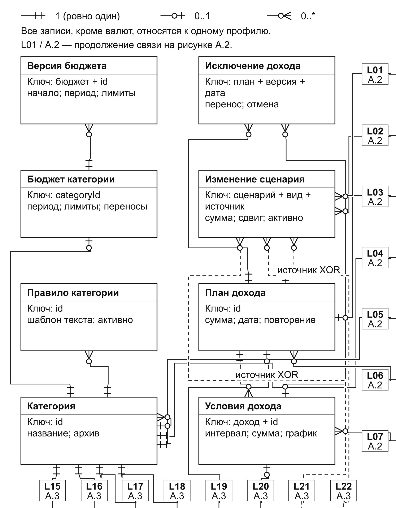

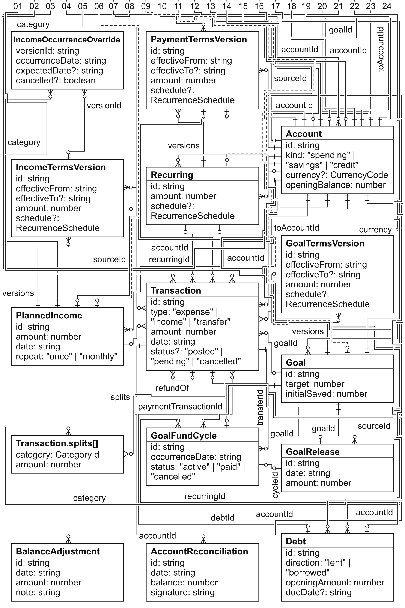

<!-- prettier-ignore-start -->

# Приложение 2

## Руководство пользователя мобильного приложения «Лад»

### Назначение системы

«Лад» предназначен для управления личными финансами: ведения счетов и истории операций, распределения расходов по категориям, задания бюджетов, планирования доходов и платежей, накопления на цели и оценки будущих покупок. Руководство — краткий справочник по установке, основным операциям и восстановлению данных.

Пользователь вводит данные, которые хранятся на устройстве. Приложение не подключается к банкам, не переводит деньги и не оплачивает покупки. Запись платежа, перевода или получения дохода отражает совершённое движение денег. Планируемые события служат расчётам и сами не меняют фактические остатки.

### Условия применения системы

Нужен смартфон с Android 7.0 или новее либо iOS 16.4 или новее — минимальными версиями ОС технической основы проекта [17]. Разработчик предоставляет совместимый установочный пакет. Необходимы свободное место для приложения и учёта, файловое хранилище копий. Внешнее оборудование не требуется. Обмен файлами выполняется через системное меню сохранения и передачи документов.

Основной учёт работает без Интернета. Сеть нужна для загрузки валютных курсов; без неё используются сохранённые значения. Для напоминаний разрешите уведомления в настройках устройства. Системная блокировка требует настроенной защиты устройства и доступного подтверждения личности. Доступность биометрии зависит от устройства.

Достаточно уметь открывать приложения, вводить текст, выбирать даты и сохранять файлы на смартфоне. Для учёта нужно знать фактические остатки и различать собственные деньги, кредитный лимит, ожидаемые и полученные доходы. Программирование и администрирование не требуются.

### Подготовка системы к работе

Для опытного использования передаётся APK-файл Android либо подписанная сборка iOS. Для iOS разработчик заранее включает устройство в список разрешённых [40]. Получите пакет или ссылку для своей платформы. Перед обновлением создайте резервную копию по инструкции ниже; удалять приложение для обычного обновления не требуется.

**Установка на Android**

1) Сохраните полученный APK-файл на смартфон и откройте через файловое приложение либо загрузки браузера.

2) При запросе разрешения установки откройте предложенную настройку. На Android 8 и новее разрешение выдаётся открывшему файл приложению; на Android 7 используется настройка установки из неизвестных источников. Разрешив установку, вернитесь к файлу. Системную проверку безопасности отключать не требуется.

3) Подтвердите установку «Лада» и дождитесь завершения. При несовместимости пакета с устройством или конфликте с установленной версией передайте разработчику текст сообщения; сохранённый учёт не удаляйте.

4) Откройте «Лад» с появившегося значка. После установки выданное источнику разрешение можно отключить.

**Установка на iOS**

1) Получите и выполните инструкцию разработчика по регистрации iPhone для опытной сборки до получения установочной ссылки. Разработчик должен разрешить это устройство в сборке.

2) Откройте установочную ссылку на зарегистрированном iPhone, подтвердите установку и дождитесь значка «Лад».

3) Для запуска подписанной опытной сборки включите «Режим разработчика»: «Настройки → Конфиденциальность и безопасность → Режим разработчика». Выполните предложенную перезагрузку и подтвердите включение. Если пункт недоступен, обратитесь к разработчику.

4) Откройте «Лад». При недоступной установке или сообщении о недействительной подписи запросите у разработчика новую совместимую сборку. Повторная загрузка того же файла не добавляет устройство в список разрешённых.

**Первоначальная настройка**

1) Откройте «Лад» и нажмите «Настроить свой учёт».

2) Укажите имя, название основного счёта и валюту. Введите текущий остаток в «Сейчас на основном счёте», отдельно — «Уже отложено на накопления». Эти суммы задают исходное состояние и не входят в доходы. Нажмите «Продолжить».

3) Укажите название, сумму и первую дату ближайшего ожидаемого дохода, затем аналогично заполните первый регулярный платёж. Мастер создаёт ежемесячные планы; другой график можно задать позднее в их настройках. Если плана нет, оставьте сумму пустой или нулевой. Дополнительные планы можно создать позднее.

4) Введите «Неприкосновенный остаток» — сумму для сохранения в повседневных деньгах. Проверьте сводку; предыдущие поля исправляются через «Назад». Нажмите «Начать учёт с этими данными» и дождитесь сохранения.

5) Выберите «Пройти обучение» или «Начать без обучения». Позднее обучение доступно через значок профиля, раздел «Обучение». После прерванной настройки используйте предложенную кнопку «Восстановить черновик настройки» и проверьте поля.

Внизу экрана находятся «Обзор», «Операции», «План» и «Аналитика». «План» содержит бюджеты, цели, платежи и прогноз. Значок профиля открывает настройки; далее «Профиль → …» означает переход через него. Для остальных записей обзорного списка откройте «Все…», в полном списке при необходимости нажмите «Показать ещё».

Вводите сумму в валюте у поля; для рублей допустимы два знака после запятой. Дату вводите как ДД.ММ.ГГГГ либо выбирайте в календаре. «Готово» на клавиатуре завершает ввод; данные записываются кнопкой сохранения формы.

### Описание операций

**Добавление счетов**

1) На «Обзоре» нажмите карточку «На всех счетах», затем «Добавить счёт».

2) Введите название, выберите тип «Повседневный» или «Накопительный», валюту и текущий остаток. Нажмите «Сохранить счёт». Для изменения счёта нажмите его в списке.

3) При работе с несколькими валютами откройте «Профиль → Валюты и курсы» и нажмите «Обновить курсы сейчас».

Тип и валюта созданного счёта неизменны. Изменение текущего остатка создаёт корректировку сегодняшней датой. Накопительные счета исключаются из доступных для трат денег; кредитный лимит не является собственными средствами.

**Запись расхода или дохода**

1) На вкладке «Операции» нажмите «+» для добавления, выберите «Расход» или «Доход».

2) Заполните «Сумма», «На что или откуда?», «Счёт» и «Дата». Для расхода выберите категорию. При необходимости раскройте дополнительные поля и добавьте заметку.

3) Нажмите «Добавить операцию». Проверьте запись в истории и изменение остатка выбранного счёта.

**Перевод между счетами и обмен валют**

1) На «Обзоре» нажмите «Перевод» либо выберите этот тип при добавлении операции.

2) Укажите сумму списания, название, счета «Откуда» и «Куда», дату. При разных валютах заполните «Зачислено» фактической суммой в валюте получателя.

3) Без отдельной комиссии нажмите «Записать перевод».

Внутренний перевод не является доходом или расходом; комиссия — отдельный расход. Записывайте движение в «Ладе» после банковского перевода или передачи наличных.

**Поиск и исправление операции**

1) На вкладке «Операции» выберите «Месяц» или «Вся история». Ищите по названию или заметке; в «Фильтрах» уточните статус, тип, счёт и категорию.

2) Откройте запись, исправьте поля и нажмите «Сохранить изменения». Для удаления нажмите «Удалить операцию», затем «Да, удалить». Остатки и связанные показатели пересчитаются.

**Сверка и исправление остатка счёта**

1) Через «На всех счетах» откройте список счетов и нажмите «Сверить» у нужного.

2) Укажите «Дата сверки» и «Остаток по банку». Сравните значения «В Ладе» и «Разница». При расхождении сначала проверьте пропущенные, повторные или ошибочные операции и исправьте их в истории.

3) Для отдельной корректировки разницы нажмите «Записать разницу корректировкой», укажите «Причина корректировки», нажмите «Подтвердить сверку». Совпадающие остатки подтверждаются без корректировки.

Корректировка не является доходом или расходом; ожидающие операции не входят в фактический остаток. При последующем изменении денежных записей проверенного периода повторите сверку.

**Бюджеты**

1) Откройте «План → Бюджеты» и нажмите карточку основной категории. Для нового бюджета задайте период и его начало, условия переноса остатка и перерасхода. Введите «Дата внутри периода» и «Лимит периода».

2) Выберите действие лимита «С этого периода» или «Только этот период», затем «Сохранить лимит». Для проверки состава расходов откройте «Расходы за период».

Подкатегории используют общий бюджет основной категории. Лимит помогает сравнивать план и расходы, не списывая деньги.

**Планирование и получение дохода**

1) Откройте «План → Прогноз», в блоке «План доходов» нажмите «Добавить».

2) Укажите название и ожидаемую сумму, выберите «Повторять» или «Один раз». Настройте график и первую дату, выберите «Куда ожидается доход». Нажмите «Сохранить план дохода».

3) После поступления откройте план и выберите нужную «Исходную дату поступления». Для записанного дохода используйте предложенную кнопку «Связать доход», иначе — «Доход получен — записать»: операция создаётся сегодняшним числом.

План не увеличивает фактический остаток.

**Регулярные платежи и отметка оплаты**

1) Откройте «План → Платежи» и нажмите «Добавить» в блоке «Регулярные платежи»; при пустом списке — «Добавить платёж».

2) Укажите название, сумму одного платежа, график, счёт, категорию и «Учитывать с даты». Нажмите «Сохранить платёж».

3) После фактической оплаты откройте событие в «Календаре платежей». Нажмите «Я оплатил — записать расход» либо «Связать» у подходящего записанного расхода. Связывание не списывает деньги повторно.

**Создание цели, пополнение и вывод накоплений**

1) Откройте «План → Цели → Новая цель»; при пустом списке — «Создать цель». Укажите название, валюту, нужную сумму и планируемый месячный взнос. При необходимости задайте даты и срок в «Настроить индивидуальный график». Создайте цель; если показан предварительный расчёт, подтвердите условия.

2) После перевода на накопления нажмите в карточке «Пополнить цель». Если показано «Взнос по графику цели», выберите событие. Заполните «Сколько вы отложили», выберите «Со счёта» и «На накопительный счёт». При обмене проверьте «Списано». Нажмите «Записать пополнение».

3) Для обратного движения нажмите «Вывести из цели». Укажите сумму либо «Вывести всю сумму», накопительный счёт списания и повседневный счёт получения. При обмене заполните «Зачислено». Нажмите «Записать вывод из цели».

Пополнение и вывод записываются сегодняшним числом как переводы, а не доходы или расходы. Не создавайте для них вторую ручную запись. Накопительный счёт должен иметь валюту цели. Нельзя внести больше недостающей суммы, вывести больше накопленного или нарушить обеспеченность других целей. Удаление цели сохраняет фактические деньги и историю переводов.

**Просмотр и настройка прогноза**

1) Откройте «План → Прогноз», выберите 30, 60 или 90 дней. Проверьте итоговую сумму, минимальный остаток и предупреждения. Нажмите дату календаря для просмотра событий дня.

2) Нажмите «Настроить прогноз». Укажите «Повседневные расходы в день» без регулярных платежей и взносов, уже внесённых в планы. Назначьте счёт повседневных расходов, счета взносов в цели и погашения долгов. Нажмите «Сохранить прогноз».

3) Для будущего перемещения денег снова откройте «Настроить прогноз», задайте плановый перевод: название, счета, сумму списания, дату, при обмене — сумму зачисления. Нажмите «Добавить плановый перевод», затем обязательно «Сохранить прогноз».

После реального перевода запишите фактическую операцию, удалите соответствующий плановый перевод и сохраните прогноз: автоматически план не исчезает. Прогноз показывает остатки на конец дня, не определяя порядок поступлений и списаний внутри дня. Проверяйте общую сумму и отдельные счета. Перед оценкой покупки исправьте неназначенные события и отсутствие курса. Прогноз зависит от полноты учёта и не гарантирует планируемых поступлений.

**Проверка будущей покупки**

1) Откройте «План → Прогноз → Примерить покупку».

2) Выберите «Счёт покупки», заполните «Сколько стоит покупка», «Дата покупки» и горизонт. Дата должна находиться внутри выбранного периода.

3) Прочитайте результат и ограничения. Для подходящего варианта можно нажать «Подставить доступную сумму» или «Выбрать ближайшую дату».

Оценка проверяет достаточность выбранного счёта и общий резерв до конца горизонта. При нехватке на счёте уточните расходы или запланируйте перевод; при нарушении резерва без покупки сначала исправьте основной план. Изменение полей не записывает расход и не меняет счета. Обязательства за горизонтом не учитываются.

**Сравнение сценариев**

1) Откройте «План → Прогноз → Мои сценарии → Создать сценарий». Введите название и выберите горизонт.

2) В «Условиях» оставьте расходы «Как в плане» либо задайте «Своя сумма в день». В блоке «Изменить условия плана» выберите доход, платёж или цель и измените сумму. Для дохода можно также задать сдвиг в днях.

3) Для отдельной покупки или поступления нажмите «Добавить событие в сценарий», задайте название, тип, сумму, дату и счёт. Сумма разового события — в основной валюте; изменение существующего плана — в его валюте.

4) Нажмите «Сравнить с планом», выберите текущий план или другой сохранённый сценарий. Оцените конечный результат, минимальный остаток, календарь и предупреждения. Нажмите «Сохранить сценарий».

Переключатели строк временно исключают условия из расчёта, сохраняя их. Сценарий пересчитывается по актуальному учёту без изменения реальных операций и планов. При удалении исходного плана удалите или выключите соответствующее изменение. События за горизонтом не влияют на результат.

**Просмотр аналитики**

1) Откройте «Аналитика» и выберите месяц рядом с заголовком «Ваш месяц».

2) Просмотрите доходы, расходы и распределение по категориям. В «Что изменилось» нажмите «Почему» у категории для просмотра операций, объясняющих разницу.

3) В «Истории по месяцам» выберите «3 месяца», «6 месяцев» или «Год».

Аналитика использует фактические записи. Переводы и основная сумма долгов исключаются из обычных доходов и расходов, возвраты уменьшают расходы. Текущий месяц показан по сегодняшний день; сравниваемые периоды равны по длительности.

**Защита данных**

1) Откройте «Профиль → Защита данных», нажмите «Включить блокировку», пройдите системное подтверждение. При возвращении нажмите «Разблокировать Лад» и подтвердите личность доступным способом. Для немедленного закрытия финансового интерфейса нажмите «Заблокировать сейчас».

Блокировка не защищает экспортированные открытые файлы. В браузерном предпросмотре нет системной блокировки; финансовые данные хранятся без шифрования приложения.

**Создание и проверка резервной копии**

1) Выберите нужный профиль через «Профиль → Профили». Откройте «Профиль → Данные и копии → Создать копию с паролем».

2) Заполните «Пароль копии» и «Повторите пароль»: используйте не менее 10 символов. Нажмите «Сохранить защищённую копию», выберите место файла в системном меню.

3) Проверьте появление файла .ladbackup в выбранном месте и только затем нажмите «Я сохранил файл». При неудачной передаче используйте «Повторить передачу этой копии».

4) Нажмите «Проверить копию», выберите сохранённый файл, введите пароль и нажмите «Открыть защищённую копию». Проверка читает файл и не заменяет текущий учёт.

Копия содержит один активный профиль; для остальных повторите процедуру. Храните копию вне устройства, пароль — отдельно от файла: приложение его не сохраняет и не восстанавливает. «Экспортировать резервную копию» создаёт открытый JSON или архив .ladrescue без парольной защиты.

**Восстановление и перенос данных**

1) Перед заменой учёта создайте копию нужных текущих данных. Откройте «Данные и копии → Восстановить из файла», выберите копию. Для .ladbackup введите пароль и нажмите «Открыть защищённую копию».

2) Проверьте профиль и количество записей. Для полной замены активного учёта нажмите «Заменить данные этой копией». Два набора не объединяются.

3) Для отдельного сохранения существующего учёта выберите «Восстановить в новый профиль», задайте название, нажмите «Подготовить восстановление в новый профиль», затем «Подтвердить создание профиля из копии». Большой архив восстанавливается только так.

4) Дождитесь сообщения «Импорт сохранён и проверен чтением». Проверьте счета, остатки и историю. На новом устройстве отдельно настройте блокировку и разрешения уведомлений.

Неверный пароль или ошибка проверки файла не заменяют данные. Черновики форм, системные разрешения и настройка блокировки не переносятся в финансовой копии.

**Импорт банковской выписки и экспорт операций**

1) Откройте «Профиль → Данные и копии → Импортировать банковский CSV → Выбрать CSV-файл». Исходный остаток счёта должен соответствовать моменту до импортируемой истории, не включая её движения.

2) При необходимости исправьте кодировку, разделитель и «Номер строки с заголовками». Нажмите «Распознать колонки». Выберите счёт и сопоставьте поля даты, описания и суммы; для раздельных приходов и расходов укажите соответствующие колонки.

3) Нажмите «Проверить операции». Просмотрите категории, типы, повторы и изменение остатка. Исключите ненужные строки. Для перевода между своими счетами укажите второй счёт, а при обмене — фактическую сумму зачисления.

4) Нажмите «Импортировать» с количеством операций и дождитесь подтверждения сохранения. Ошибочные и распознанные повторные строки не добавляются; одинаковые строки без банковского идентификатора проверьте вручную.

Принимаются CSV и TSV в UTF-8 или Windows-1251 до 2 МБ и 5000 строк. Для выгрузки откройте «Экспортировать операции в CSV», выберите «Универсальный» или «Для YNAB», счета и даты, затем «Сохранить CSV». Для YNAB нужен один счёт. Сохраните каждую часть разделённой выгрузки. CSV содержит проведённые операции, не заменяя полную копию: начальные остатки, бюджеты, цели и настройки целиком не переносятся.

### Аварийные ситуации

**Не сохраняются изменения.** Нажмите сообщение об ошибке для повторного сохранения и дождитесь результата. Не удаляйте приложение и его данные. При повторной ошибке создайте доступную резервную копию. Предлагаемый последний сохранённый снимок может не содержать последних изменений.

**Не подтверждена запись импорта.** Откройте результат через сообщение и нажмите «Повторить сохранение импорта». Заново импортировать файл не требуется. До подтверждения записи другие изменения и переключение профиля приостановлены. Перед «Открыть сохранённый снимок устройства» прочитайте предупреждение: снимок может отличаться от импортированных данных.

**Не открывается профиль.** Нажмите «Повторить загрузку». При повторной ошибке используйте «Выбрать копию для восстановления», проверьте содержимое и подтвердите. При сообщении о повреждённом списке профилей нажмите «Проверить сохранённые профили», выберите найденный профиль и «Подтвердить восстановление списка». Не обходите ошибку созданием пустого учёта поверх нужных записей.

**Не открывается защищённая копия.** Проверьте пароль именно этого файла, раскладку и регистр. Утраченный пароль не восстанавливается: выберите другую доступную копию. Повреждённый файл замените другой сохранённой копией; до подтверждения восстановления текущий учёт неизменен.

**Неверно распознана выписка.** Вернитесь к параметрам импорта, исправьте кодировку, разделитель и строку заголовков. Нажмите «Распознать колонки заново», проверьте сопоставление, затем повторите проверку операций. Не подтверждайте пакет с неверными датами, суммами или ожидаемым изменением остатка.

**Операция отклонена или прогноз содержит предупреждение.** Прочитайте сообщение рядом с формой. Проверьте положительную сумму, дату, валюту, выбранные счета и сумму частей покупки. При ограничении накоплений проверьте распределение средств по целям; при неопределённом прогнозе назначьте счета событий и уточните курсы. Исправьте указанные условия и повторите сохранение или расчёт.

Если сбой сохраняется, обратитесь к разработчику. Укажите версию из «О приложении», модель устройства, версию операционной системы, текст ошибки и последовательность действий. На передаваемом снимке скройте личные финансовые сведения; пароль копии не передавайте.

<!-- prettier-ignore-end -->

# Приложение 3

## Исходный код мобильного приложения «Лад»

Исходный код мобильного приложения «Лад» доступен в открытом репозитории:

Tiroras/lad-finance // GitHub. URL: [https://github.com/Tiroras/lad-finance](https://github.com/Tiroras/lad-finance) (дата обращения: 06.11.2026).
